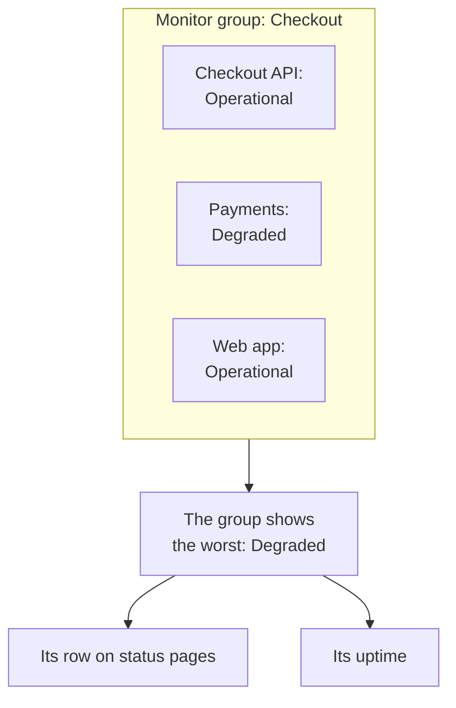

# Monitor Groups

A monitor group rolls several monitors up into one status. Group the monitors that together make up one service, such as Checkout: its API, its payment service and its web app. The group shows the worst status among them, keeps its own uptime, and a status page can show the whole group as one row. To choose between a monitor group, a service and a label, see [Which One Do I Use?](/docs/introduction/which-one#monitor-group-service-or-label).

:::cards
- [How a group's status is worked out](#how-a-groups-status-is-worked-out): The worst status among its monitors.
- [Turn on monitor groups](#turn-on-monitor-groups): One switch in Project Settings.
- [Create a monitor group](#create-a-monitor-group): Name it, then add its monitors.
- [Show a group on a status page](#show-a-group-on-a-status-page): One row for the whole group.
:::

## How a group's status is worked out

A group starts at your operational status and takes the worst status among its monitors: the one lowest in your project's list of monitor statuses. One monitor going **Degraded** makes the whole group **Degraded**; one going **Offline** makes it **Offline**.

- **Archived monitors do not count.** An archived monitor is not checked, so its status is frozen; the group leaves it out.
- **Monitors with monitoring off do not count.** Nothing checks a monitor whose monitoring is turned off, so its status is only what its last check saw. The group leaves it out of its status: a monitor left **Offline** when its monitoring was turned off does not make the group **Offline**. The group's uptime and **Uptime Graph** keep the monitor's history up to when its monitoring was turned off, and leave out the time after, on the Dashboard and on status pages alike. Turned back on, the monitor counts again from that moment.
- **An empty group is operational.** A group with no monitors, or with only archived ones, shows your operational status. Until you add a monitor, the Dashboard shows **No monitors yet** in place of its status.
- **Monitoring off shows Disabled.** When monitoring is turned off for every monitor in a group, nothing checks them, so the Dashboard shows **Disabled** in place of the group's status, and its **Uptime Graph** and uptime end where monitoring was turned off for the last of them. A status page shows the group as **Not monitored**.
- **The order is yours.** Which status is worst is the order of **Monitors → Settings → Monitor Status**. See [Monitor statuses](/docs/monitor/criteria-and-statuses#monitor-statuses).

A monitor group is not a status page group. A status page group is a heading on one status page that holds rows. A monitor group is one row that stands for several monitors, and any status page can show it.

## Before you begin

- **Your plan.** On OneUptime Cloud, monitor groups need the Scale plan.
- **The switch.** Monitor groups are hidden until **Monitor Groups** is turned on for the project (see below). Turning it on takes the Project Owner role, or a custom role with the Edit Project or Manage Billing permission.
- **Your role.** Creating, changing and deleting groups takes the Project Owner, Project Admin, Project Member, Monitor Admin or Monitor Member role, or a custom role with the matching monitor group permissions. A Viewer can see groups but not change them.

## Turn on monitor groups

:::steps
### Open Feature Flags

Go to **Project Settings → Advanced → Feature Flags**. **Advanced** starts collapsed in the side menu: expand it first.

### Flip the switch

Flip the **Monitor Groups** switch. It saves at once: **Monitor Groups** appears in the **Monitors** side menu, and each status page's **Monitors** item is renamed **Resources**, where you can add a group.
:::

Turning the switch off again hides **Monitor Groups** from the menu. It deletes no group.

## Create a monitor group

:::steps
### Open Monitor Groups

Go to **Monitors → Monitor Groups**. The **Monitor Groups** card lists each group with its **Current Status**, labels and owners.

### Create the group

Click **Create Monitor Group**, enter a **Name** and, if you like, a **Description**, and click **Create Monitor Group** at the bottom of the form. The group starts with no monitors.

### Add its monitors

Open the group: until it has a monitor, its **Overview** offers **Add Monitors**. Later, click **Monitors** in its side menu, then **Add Monitors**. Pick every monitor of the group under **Monitors** and click **Add Monitors**.

### Check its status

Click **Overview**. **Current Status** shows the group's status now, and **Uptime Graph** shows its last 90 days, one bar per day.
:::

To take a monitor out of the group, click **Remove** on its row in **Monitors in Group**. The monitor itself does not change. A monitor can belong to more than one group.

## A group's pages

Open a group to see its pages in the side menu:

| Page | What it shows |
| --- | --- |
| **Overview** | **Monitor Group Details**, **Current Status**, **Monitoring**, and **Uptime Graph** with the group's uptime percentage over the last 90 days. A group with no monitors offers **Add Monitors** in place of the graph. |
| **Monitors** | **Monitors in Group**, with **Add Monitors** and **Remove**. |
| **Incidents** | The incidents on any monitor in the group. |
| **Alerts** | The alerts on any monitor in the group. |
| **Owners** | The people and teams responsible for the group. It is under **Advanced**, which starts collapsed. |
| **Audit Logs** | Who changed the group, and when, also under **Advanced**. |
| **Delete Group** | Deletes the group, also under **Advanced**. |

The uptime on **Overview** counts every status but the operational one as downtime. A status page counts only the statuses in its own **Counts as downtime** list: see [Choosing what shows on the page](/docs/status-pages/index#choosing-what-shows-on-the-page).

Each bar of the uptime graph, here and on a status page, is how long the group itself spent in each status that day: at each moment it has the worst status among its monitors, so an hour two of them spend offline together is one hour of the group's, and a day never adds up to more than a day. The days are your own: the Dashboard draws them in the time zone of your user settings, and a status page in each visitor's.

The **Monitor Groups** list can filter groups by owner and label, set labels and owners on many groups at once, and export or import groups as JSON.

## Turn monitoring off for a whole group

The **Monitoring** card on a group's **Overview** turns monitoring off, or back on, for every monitor in the group at once.

- **Turn off monitoring** asks first. Nothing then checks the group's monitors until monitoring is turned back on, so they open no incidents or alerts, and the group shows **Disabled** in place of its status.
- **Turn monitoring on** saves at once. Each monitor's next check sets its status again.

Turning monitoring off also resolves the monitors' open incidents and alerts that are set to auto-resolve, as each monitor would have on recovery. Incidents and alerts declared by hand, or whose criteria do not auto-resolve, stay open. Turning off one monitor's monitoring, on its **Settings** page, does the same.

The card changes the monitors, not the group: each monitor's own **Monitoring** card shows the change, and a monitor added to the group later keeps its own setting. Archived monitors are left as they are. While only some of the monitors have monitoring off, the card says how many and offers both buttons.

## Show a group on a status page

:::steps
### Open the status page's resources

Go to **Status Pages**, open the page and click **Resources** in its side menu.

### Switch the dialog to a group

Click **Add Monitor**. Under the monitor dropdown, click **Add a Monitor Group instead.** The dropdown becomes **Monitor Group**.

### Pick the group and add it

Pick the group. **Display Name**, the name visitors read, fills in with the group's name until you type one of your own. Click **Add Monitor**: the row appears on the page with the group's status.
:::

On the status page, the row stands for every monitor in the group:

- **Its status.** It is the group's: the worst among its monitors whose monitoring is on. When monitoring is off for every one of them, the row shows **Not monitored** and counts toward neither the heading above it nor the page's overall status.
- **Its incidents.** An incident on any monitor in the group appears on the page, with the group named among the affected resources.
- **Its subscribers.** A subscriber who picks the group hears about every monitor in it. See [Letting subscribers choose resources and event types](/docs/status-pages/subscribers#letting-subscribers-choose-resources-and-event-types).

For the rest of the row's options, such as its uptime and history chart, see [Status Page Resources & Groups](/docs/status-pages/resources-and-groups).

> [!WARNING]
> Deleting a monitor group also deletes its row from every status page that shows it. The monitors in the group, and their incidents, are not deleted.

## API and Terraform

A group is `/api/monitor-group`, and each monitor in it is a row of `/api/monitor-group-resource` that pairs a `monitorGroupId` with a `monitorId`. In Terraform they are `oneuptime_monitor_group` and `oneuptime_monitor_group_resource`: see [Monitor group](/docs/terraform/examples#monitor-group).

## Troubleshooting

:::details Monitor Groups is not in the Monitors menu
The **Monitor Groups** switch is off. Turn it on under **Project Settings → Advanced → Feature Flags**. On OneUptime Cloud, groups also need the Scale plan.
:::

:::details The group shows Offline, but most of its monitors are up
That is the rule: the group shows its worst monitor. Open **Monitors** on the group to find the monitor that is down, or remove a monitor that does not belong in the group.
:::

:::details A status page cannot add the group
**Add a Monitor Group instead.** appears in the dialog only while the **Monitor Groups** switch is on for the project.
:::

## Next steps

:::cards
- [Criteria & Statuses](/docs/monitor/criteria-and-statuses): What sets each monitor's status.
- [Status Page Resources & Groups](/docs/status-pages/resources-and-groups): Lay out the rows of a status page.
- [Subscribers & Announcements](/docs/status-pages/subscribers): Tell customers about a group's incidents.
:::
