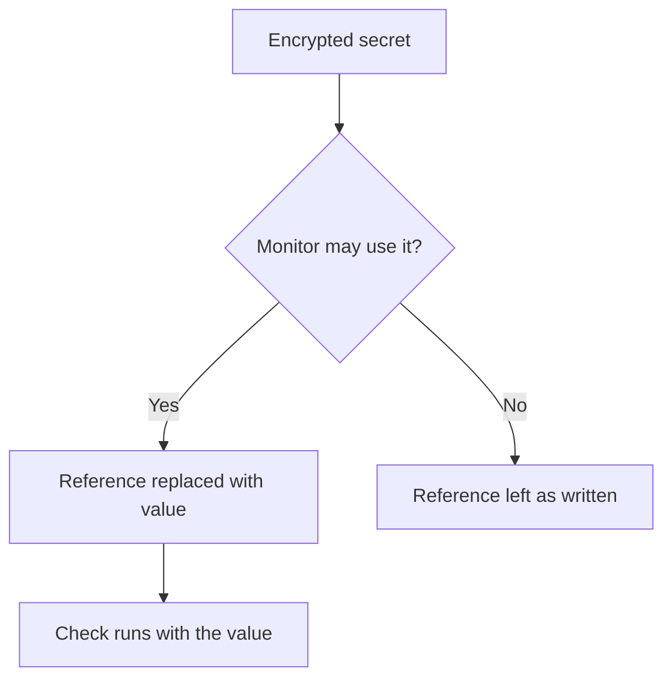

# Monitor Secrets

Monitor secrets keep the passwords, API keys and tokens your monitors need out of the monitor itself. You store a value once, encrypted, choose which monitors may use it, and reference it as `{{monitorSecrets.NAME}}` wherever the monitor needs it.

:::cards
- [Add a secret](#adding-a-secret): Store a value and choose who can use it.
- [Choose access](#choosing-which-monitors-can-use-a-secret): All monitors, specific monitors, or monitors with labels.
- [Use a secret](#using-a-secret): Where `{{monitorSecrets.NAME}}` works.
- [Sign in with a one-time code](#signing-in-with-a-one-time-code): Let a monitor pass a site's two-factor sign-in.
:::

## How secrets reach a monitor

A secret is stored encrypted and is never shown again after you save it. Before OneUptime hands a monitor to a probe, it replaces each reference the monitor may use with the decrypted value; a reference the monitor may not use is left as written. A one-time code secret is the exception: the probe makes its code when the check runs (see [Signing in with a one-time code](#signing-in-with-a-one-time-code)).



The probe that runs the check receives the value, so a monitor that uses a secret should run on probes you trust: OneUptime's own, or a [custom probe](/docs/probe/custom-probe) you run yourself.

## Before you begin

- **The Growth plan or above**, on OneUptime Cloud. Self-hosted installs have no plans.
- **A role that can manage secrets**: Project Owner, Project Admin, or a custom role with the Create Monitor Secret permission.

## Work with secrets

### Adding a secret

:::steps
1. Go to **Monitors → Settings → Secrets** and click **Create Monitor Secret**.
2. Enter a **Name** and the **Secret Value**. The name is what you reference, for example `ApiKey`. It can only contain letters, numbers, hyphens (`-`) and underscores (`_`), and no two secrets in a project share one. For a site's two-factor setup key, choose **One-time code (TOTP)** first (see [Signing in with a one-time code](#signing-in-with-a-one-time-code)).
3. On the **Access** step, choose which monitors can use it (see the next section), then click **Create Monitor Secret**.
:::

> [!IMPORTANT]
> Secrets are encrypted and stored securely. The secret value is never shown again after it is saved — not in the table, not in the edit form, and not over the API. If you lose the value you will need to get it from wherever it came from and set it again. To rotate a secret, use the **Update Secret Value** button on its row; you do not need to delete and recreate it. The same button changes what the secret holds, **Text** or **One-time code (TOTP)**, together with a new value, and monitors that use the secret take the new type at their next check.

### Choosing which monitors can use a secret

Each secret has one of three access options:

| Option | Which monitors can use the secret | Use it for |
| --- | --- | --- |
| **All monitors** | Every monitor in the project, including monitors you create later. | A credential that many monitors share. |
| **Specific monitors** | Only the monitors you pick. This is the default, and secrets created before these options existed work this way. | A credential for one or a few monitors. |
| **Monitors with labels** | Monitors that have at least one of the labels you pick. Adding one of those labels to a monitor gives it access, and removing the label takes access away the next time the monitor runs. | A credential for a group of monitors that changes over time. |

You can change the option at any time with **Edit** on the secret's row. Only the list for the chosen option is kept: switching to **All monitors** clears the secret's monitor and label lists, and switching between **Specific monitors** and **Monitors with labels** clears the list you switched away from.

A secret is never available to monitors in another project.

> [!WARNING]
> Anyone who can edit a monitor that can use a secret can send that secret anywhere the monitor connects to. With **All monitors**, that is anyone who can create or edit monitors in the project. With **Monitors with labels**, it also includes anyone who can add one of those labels to a monitor.

Over the API, the access option is the `monitorAccess` field: `All Monitors`, `Specific Monitors` or `Monitors With Labels`. The `monitors` and `labels` fields hold the lists. A secret created without `monitorAccess` gets `Specific Monitors`.

### Using a secret

To use a secret, write `{{monitorSecrets.SECRET_NAME}}` in a field that takes secrets. For example, a request header of `Authorization: Bearer {{monitorSecrets.ApiKey}}` sends the `ApiKey` secret's value.

These monitor types and fields take secrets:

| Monitor type | Fields |
| --- | --- |
| API | The URL, the request headers and body, and the client certificate, private key and passphrase (mTLS) |
| Website | The URL, and the client certificate, private key and passphrase (mTLS) |
| Ping, IP, Port, NTP, SSL Certificate | The host or URL to check |
| DNS | The domain name and the DNS server |
| DNSSEC, Domain | The domain name |
| SQL Query | The host, database name, username, password and query |
| Database Health | The host, database name, username and password |
| External Status Page | The status page URL |
| Synthetic Monitor, Custom JavaScript Code | The script |
| Network Device | The SNMP community string, and the SNMPv3 authentication and privacy keys |

Secrets are filled in before a Synthetic or Custom JavaScript Code monitor's script runs, so a reference such as `{{monitorSecrets.ApiKey}}` inside the script is the decrypted value when it executes.

If a monitor references a secret it cannot use, the reference is left as it is and is not replaced with the value.

When you test a monitor before saving it, only secrets available to **All monitors** are filled in, because a new monitor is not on any list and has no labels yet. After you save the monitor, tests use every secret the monitor can use.

## Signing in with a one-time code

Some sites ask for a code from an authenticator app when you sign in. A **One-time code (TOTP)** secret holds that site's setup key, so a monitor can sign in the way you do: wherever the monitor uses the secret, the probe makes the current code from its own clock, at the moment the check needs it. The setup key is stored encrypted and never shown again, like any secret value, and it is never written into the monitor.

1. Turn on two-factor sign-in for the account the monitor signs in with. Where the site shows a QR code, ask to enter the key by hand instead, and copy the setup key or the `otpauth://` link.
2. Go to **Monitors → Settings → Secrets**, click **Create Monitor Secret**, choose **One-time code (TOTP)**, and paste the key or the link into **Setup Key**.
3. Check that the **Current code** under it matches the code your authenticator app shows now, then choose which monitors can use the secret on the **Access** step, as for any secret.

| What you paste | The codes the monitor makes |
| --- | --- |
| A setup key, such as `JBSW Y3DP EHPK 3PXP` | SHA1, 6 digits, and a new code every 30 seconds: what every authenticator app assumes |
| An `otpauth://totp/` link | The link's `algorithm` (`SHA1`, `SHA256` or `SHA512`), `digits` (`6` or `8`) and `period` in seconds (`30` when the link has none) |

| Monitor type | Where the code goes, and when it is made |
| --- | --- |
| API | `{{monitorSecrets.NAME}}` in the URL, a request header or the request body, just before each attempt is sent |
| Synthetic Monitor, Custom JavaScript Code | `{{monitorSecrets.NAME}}` in the script, when the script starts, and `await oneuptime.getTotpCode("NAME")`, when the script asks |

Every other field keeps `{{monitorSecrets.NAME}}` as written. In a JSON request body, put the reference in quotes, as in `{"otp": "{{monitorSecrets.LoginCode}}"}`, because a code can start with a zero.

A sign-in usually reaches its code prompt a few pages after the script starts, so ask for the code there. This script signs in with a password and a one-time code:

```javascript
await page.goto("https://app.example.com/login");
await page.fill("#email", "monitoring@example.com");
await page.fill("#password", "{{monitorSecrets.AppPassword}}");
await page.click("button[type=submit]");

// The code is made now, when the sign-in asks for it.
await page.waitForSelector("#otp");
await page.fill("#otp", await oneuptime.getTotpCode("AppLoginCode"));
await page.click("button[type=submit]");

await page.waitForSelector(".dashboard", { timeout: 10000 });

return {
  data: { signedIn: true },
};
```

The probe never hands out a code with less than five seconds left, or a third of the period when the period is shorter: it waits for the next code instead, at most five seconds, and leaves that wait out of the check's execution time. Every code a check makes is shown as asterisks, such as `******`, in its log messages, its result, its error and the names of its screenshots. A screenshot is a picture of the page, so take it before the code is typed or after the page moves on.

> [!NOTE]
> The probe makes the codes, so a custom probe needs OneUptime 17.0.1 or later. On an older one, a check that needs a code does not run, and fails with a sentence saying to update the probe; the monitor's form and the probe's page name a probe that is too old, and [Update a probe](/docs/probe/custom-probe#update-a-probe) says how. The probe's clock must be right too, because a probe that is a minute off makes codes the site has already moved past.

## Troubleshooting

:::details The monitor sends `{{monitorSecrets.NAME}}` literally
The monitor cannot use the secret, or the name does not match. Check the secret's access option with **Edit** on its row, and that the name in the reference is exactly the secret's name.
:::

:::details Testing a new monitor does not fill in the secret
Before a monitor is saved, only secrets available to **All monitors** are filled in. Save the monitor, then test it again.
:::

:::details A field ignores the secret
Only the fields in the table above take secrets. In any other field, `{{monitorSecrets.NAME}}` is sent as written.
:::

:::details The site refuses the one-time code
Check that the **Current code** matched your authenticator app when you saved the secret, that the probe's clock is right, and that a reference in a JSON request body is in quotes. If the sign-in takes a while to reach its code prompt, ask for the code there with `oneuptime.getTotpCode`.
:::

:::details The check says the probe is too old to make one-time codes
The probe runs a release older than OneUptime 17.0.1, which cannot make one-time codes, so the check did not run on it. Update the probe (see [Update a probe](/docs/probe/custom-probe#update-a-probe)), or check the monitor from probes that run 17.0.1 or later.
:::

## Next steps

:::cards
- [API Monitor](/docs/monitor/api-monitor): Send a secret in a request header.
- [Synthetic Monitor](/docs/monitor/synthetic-monitor): Use a secret inside a browser script.
- [SQL Query Monitor](/docs/monitor/sql-monitor): Keep a database password encrypted.
:::
