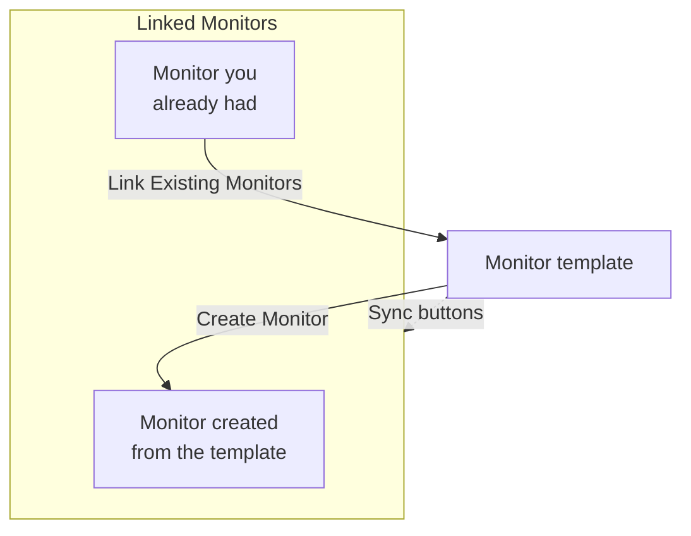

# Monitor Templates

A monitor template is a saved monitor configuration (a type, criteria, an interval, labels and custom field defaults) that you create monitors from in one click. Monitors created from it, or linked to it, stay connected: change the template, then sync the change to all of them. Use templates when many monitors should behave the same way, such as the same health check on every service, or the same API checks in production and staging.

:::cards
- [Create a template](#create-a-template): Four steps, like Create Monitor.
- [Create monitors from it](#create-monitors-from-a-template): One click, or link monitors you already have.
- [Sync changes](#sync-changes-to-linked-monitors): What each sync button copies.
- [Move monitors to another template](#move-monitors-to-another-template): A better template, and every monitor keeps its history.
- [Keep values specific to each monitor](#keep-values-specific-to-each-monitor): Protect a destination or headers from a sync.
:::

## How templates work

A template does not watch anything itself. Monitors are created from it, or linked to it, and the template's page lists them as **Linked Monitors**. When you change the template, nothing changes on those monitors until you sync: each sync button copies one part of the template onto every linked monitor, and fields you protect keep each monitor's own value.



## Before you begin

- **A role that can create templates**: Project Owner, Project Admin, Project Member, Monitor Admin or Monitor Member, or a custom role with the Create Monitor Template permission. Changing a template takes the same roles, or the Edit Monitor Template permission.
- **Permission to update the linked monitors.** A sync writes to each linked monitor as you, and skips the monitors your permissions do not cover.

## Create a template

:::steps
### Open Templates

Go to **Monitors → Settings → Templates** and click **Create Monitor Template**.

### Name the template

On **Template Info**, enter a **Template Name**, such as `Production API Health`. A **Template Description** is optional. Then click **Next**.

### Set the monitor defaults

On **Monitor Defaults**, pick the **Monitor Type**, with the same picker as Create Monitor. Optionally enter a **Default Monitor Name**; left blank, each monitor is named after the resource it watches. **Default Monitor Description** and **Labels** wait under **More fields**. Click **Next**.

### Set the criteria and the interval

On **Criteria**, fill in what to check and the criteria, as on [Create Monitor](/docs/monitor/create-monitor#criteria). The **Template sync settings** card at the top lets you protect fields from syncs (see [Keep values specific to each monitor](#keep-values-specific-to-each-monitor)). For a monitor type that probes check, the last step, **Interval**, asks for the **Monitoring Interval**. Click **Create Monitor Template** on the last step.
:::

The template is added to the list. Open it to see its page, with a card for each part: **Template Info**, **Monitor Defaults**, **Criteria**, **Monitoring Interval** (with **Minimum Probe Agreement**), **Labels**, **Custom Field Defaults** (when the project has monitor custom fields) and **Linked Monitors**. You change each part on its own card, for example with **Edit Criteria** or **Edit Interval**.

## Create monitors from a template

- **New monitor.** Click **Create Monitor** on the template's row in the list, or **Create Monitor from Template** on its page. **Create Monitor** opens with the template's type and settings filled in; change anything you need, then create it. The new monitor is linked to the template.
- **Monitors you already have.** In **Linked Monitors**, click **Link Existing Monitors** and pick them. With **Use the template's criteria and interval** on, they take the template's criteria, interval and probe agreement as they are linked; switched off, they keep their settings until you sync. A monitor linked to another template moves to this one.

Custom field values set under **Custom Field Defaults** are written onto every monitor created from the template, including monitors that auto-import rules and alert policies create from it.

## Sync changes to linked monitors

Editing a template changes only the template. To copy a change onto the linked monitors, use the sync button on the card you changed. Each button names how many monitors it reaches, such as **Sync Criteria to 3 Linked Monitors**, and is greyed out while nothing is linked. A sync cannot be undone.

| Button | Copies onto every linked monitor | Leaves alone |
| --- | --- | --- |
| **Sync Criteria to Linked Monitors** | The criteria and the step settings, such as destinations and request options, except protected fields | The monitoring interval, minimum probe agreement, name, description, labels and custom field values |
| **Sync Interval to Linked Monitors** | The monitoring interval and minimum probe agreement | The criteria, name, description, labels and custom field values |
| **Sync Labels to Linked Monitors** | The labels, and nothing else | Everything else |
| **Sync Custom Fields to Linked Monitors** | The custom fields the template has a default for, replacing what each monitor had | Custom fields the template leaves blank, and everything else |

To sync one monitor, click **Sync from Template** on its row in **Linked Monitors**. That copies the criteria and step settings (except protected fields), the monitoring interval, minimum probe agreement and labels, and leaves the monitor's name, description and custom field values alone. To disconnect a monitor, see [Unlink monitors from a template](#unlink-monitors-from-a-template).

After a sync, a summary says how many monitors were updated. **Partially synced** means some linked monitors still have the previous configuration, usually because your permissions do not cover them.

A sync that takes away the criteria behind an open incident or alert resolves it when it was set to resolve on its own, since nothing could resolve it once those criteria were gone: its timeline says why, and the summary says how many were resolved. An incident or alert whose criteria the template still has stays open, and one set to be resolved by hand is left to you. Editing a monitor's criteria yourself, in the Dashboard, through the API or with Terraform, does the same.

## Move monitors to another template

When a better template replaces one, move its monitors to it instead of deleting them. Each monitor keeps its name, status history, labels, owners and incidents, and takes the new template's criteria.

:::steps
### Select the monitors

Open the template they are linked to now. In **Linked Monitors**, select the monitors, or all of them. You can also select monitors on the Monitors list, filtered by any column.

### Move them

In **Bulk Actions**, click **Move to Another Template** (on the Monitors list, **Link to Template**). Pick the template.

### Keep the template's settings on

Leave **Use the template's criteria and interval** on, so each monitor takes the template's criteria, step settings, interval and probe agreement now. Switched off, each keeps its own until you sync. Then confirm.
:::

What the move does:

- The monitors' criteria, interval and probe agreement are replaced by the template's. An open incident or alert their old criteria were set to resolve on their own is resolved, and the new criteria open a new one if the problem is still there. Each Network Device monitor keeps watching its own device, and each address or URL monitor keeps checking its own device's address.
- Names, descriptions, status history, labels, owners, custom field values and incident links stay as they are.
- A monitor that an import, an auto import rule or a network alert policy made keeps the template it was created from. That rule never makes it again, and an alert policy lets it go: it no longer deletes or replaces it.
- A device has one monitor from each template. When a device already has a monitor made for it from the new template, its other monitor is left out, and the change names the one in the way: delete one of the two, then move again.
- A monitor of another type than the template's is left out.

The change runs on the server, up to 10,000 monitors at a time, and shows its progress: what was moved, what was left out and why, and the open incidents and alerts it resolved. Closing the dialog does not stop it: the template's page and the Monitors list show a change that is still running, with how far it got, and the Monitors list keeps one that finished with monitors left out or failed for an hour. Click its line to open it again, with **Show progress** while it runs and **Show what happened** once it is done. **Stop** stops it before the next monitor, and **Retry** tries again the monitors that failed or were not reached.

> [!TIP]
> Pointing an auto import rule at another template of the same kind offers to move its devices' monitors there first, and the rule uses the new template once they are moved, so no device gets a second monitor. **Save Without Moving** points the rule at it now: each device keeps its monitor and gets the new template's beside it.

## Unlink monitors from a template

Click **Unlink from Template** on a monitor's row in **Linked Monitors**, or select monitors there or on the Monitors list and use **Unlink from Template** in **Bulk Actions**. Pick what the monitors keep:

| Choice | What the monitors do afterwards |
| --- | --- |
| **Keep their settings** | They keep checking and alerting with the criteria they have now, as monitors of their own, and no longer get the template's updates. |
| **Clear the template's criteria from them** | They keep checking, but raise no incidents or alerts and set no status until you link them to a template again. An open incident or alert their criteria were set to resolve on their own is resolved. |

Either way they keep their names, status history, labels, owners and incidents, and a rule that made them never makes them again.

## Delete a template

A template that a network alert policy or an auto import rule provisions from cannot be deleted: point the policy or the rule at another template first. A policy's monitors move with it, and a rule's form offers to move its devices' monitors. When monitors are linked to the template, its delete asks what happens to them:

- **Keep their settings** (the default): the delete unlinks them, and they keep checking and alerting with the criteria they have.
- **Clear this template's criteria from them**: each is unlinked with its criteria cleared, as above, and then the template is deleted. When a monitor stays linked, such as one your permissions do not cover, the template is kept, and the dialog says how many.

To move the monitors to another template instead, use **Move to Another Template** before you delete it.

## Keep values specific to each monitor

A criteria sync also copies step settings such as destinations, request headers, and timeouts unless you protect those fields. Protect a field to keep each linked monitor's own value for it.

:::steps
### Open the template

Go to **Monitors → Settings → Templates** and open the template.

### Edit its criteria

On the **Criteria** card, click **Edit Criteria**.

### Protect the fields

In **Template sync settings**, check **Do not sync this field** beside each field you want to keep on the linked monitors.

### Save

Save your changes. The **Criteria** card, and the confirmation of both syncs below, list the protected fields.

### Sync

Use **Sync Criteria to Linked Monitors**, or **Sync from Template** on an individual linked monitor.
:::

For example, protect **Monitor destination** and **Request headers** on an API template. Production and staging monitors keep their own URLs and headers, while both receive the template's updated criteria and other unprotected settings.

The available options depend on the monitor type. These include destinations and ports, HTTP request options, database connections, DNS settings, infrastructure selectors, and telemetry queries. Related credentials, such as a client certificate and its private key, are kept together.

### How exclusions behave

- Checked fields keep each existing monitor's current value, including an empty or unset value. Request headers and other collections are preserved in full.
- Unchecked fields continue to sync from the template. Uncheck a protected field and save to copy its template value on the next sync.
- Exclusions apply to bulk and individual syncs. They are saved on the template, not selected separately for each sync.
- New monitors still start with the template's field values. Exclusions only affect syncing to existing monitors.
- Criteria always sync. Criteria-only sync leaves monitoring interval, labels, and other monitor-level settings alone.
- Existing templates have no field exclusions until you configure them. Network Device monitors continue to retain their own device binding automatically, and the Ping, IP, Port and NTP monitors a network discovery import made for devices keep checking each device's own address. Its Website, API and SSL Certificate monitors keep each device's address as their URL's host and take the template's scheme, port and path.

For templates with multiple steps, protected values are matched using the step IDs. Independently created single-step monitors can also receive a single-step template. If a protected step cannot be matched, the sync is rejected before any monitor updates, so a new or reordered step cannot accidentally copy another step's destination or credentials.

> [!IMPORTANT]
> Before changing a saved template's monitor type (with **Edit Monitor Defaults**), clear exclusions that do not apply to the new type in **Edit Criteria**. A template's exclusions must all exist for its monitor type.

## API configuration

Each template step accepts a `doNotSyncFields` array in its `MonitorStep.value` object. For an API monitor, protect its destination and entire header collection with:

```json title="monitorSteps (excerpt)"
{
  "_type": "MonitorSteps",
  "value": {
    "monitorStepsInstanceArray": [
      {
        "_type": "MonitorStep",
        "value": {
          "id": "<step id>",
          "doNotSyncFields": ["monitorDestination", "requestHeaders"]
        }
      }
    ]
  }
}
```

Omit the array or set it to `[]` to sync every supported step setting. Unsupported field names and fields that do not apply to the template's monitor type are rejected. The template's array controls sync; any such metadata on a linked monitor does not override it.

:::details Field names for doNotSyncFields, by monitor type
| Monitor type | Field names |
| --- | --- |
| Website, API, Ping, IP, Port, SSL Certificate, NTP | `monitorDestination`, `requestTimeoutInMs`, `retryCount` |
| API only | `requestHeaders`, `requestType`, `requestBody` |
| Website and API | `doNotFollowRedirects`, `allowSelfSignedCertificates`, `tlsClientAuthentication` (the client certificate, key and passphrase together) |
| Port, NTP | `monitorDestinationPort` |
| Synthetic Monitor, Custom JavaScript Code | `customCode` |
| Synthetic Monitor | `browserTypes`, `screenSizeTypes`, `retryCountOnError` |
| DNS | `dnsMonitor.queryName`, `dnsMonitor.recordType`, `dnsMonitor.resolver` (the DNS server and port together), `dnsMonitor.timeout`, `dnsMonitor.retries` |
| Domain | `domainMonitor.domainName`, `domainMonitor.lookupMethod`, `domainMonitor.timeout`, `domainMonitor.retries` |
| DNSSEC | `dnssecMonitor.domainName`, `dnssecMonitor.resolvers`, `dnssecMonitor.checkNameserverConsistency`, `dnssecMonitor.signatureExpiryWarningDays`, `dnssecMonitor.timeout`, `dnssecMonitor.retries` |
| SQL Query | `sqlMonitor.connection`, `sqlMonitor.connectionTimeoutInMs`, `sqlMonitor.statementTimeoutInMs`, `sqlMonitor.query`, `sqlMonitor.maxRows` |
| Database Health | `databaseMonitor.connection`, `databaseMonitor.connectionTimeoutInMs`, `databaseMonitor.statementTimeoutInMs`, `databaseMonitor.enabledMetricGroups` |
| External Status Page | `externalStatusPageMonitor.statusPageUrl`, `externalStatusPageMonitor.provider`, `externalStatusPageMonitor.components`, `externalStatusPageMonitor.timeout`, `externalStatusPageMonitor.retries` |
| Logs, Security Events, Traces, AI / LLM, Metrics, Exceptions, Profiles | `logMonitor`, `securityEventsMonitor`, `traceMonitor`, `llmMonitor`, `metricMonitor`, `exceptionMonitor`, `profileMonitor` (the monitor's whole configuration) |
| Probe Status | `probeStatusMonitor.probeIds` |

Infrastructure monitors (Kubernetes, Docker Container, Host, Podman Container, Proxmox, OpenStack, XCP-ng, Docker Swarm, Ceph, Storage Array, IoT Device) offer their resource selector, filters (every type but Host), metric queries and query time window. Their names are listed in **Template sync settings** on a template of that type.
:::

## Troubleshooting

:::details A sync says "Partially synced"
Some linked monitors were not updated, usually because your permissions do not cover them. Ask someone who can update every linked monitor to run the sync again.
:::

:::details A sync fails with "a template step cannot be matched to an existing monitor step"
A protected field could not be matched to a step on one of the monitors, so the sync stopped before changing any of them. Give the template's steps the same IDs as the monitors' steps, or use a single-step template with single-step monitors.
:::

:::details The sync buttons are greyed out
No monitor is linked to the template yet. Create a monitor from it, or click **Link Existing Monitors** in **Linked Monitors**.
:::

:::details A move leaves a monitor out: "The device this monitor was made for already has a monitor linked to this template"
The device has a monitor made for it from the template you are moving to, usually because an auto import rule was pointed at that template before the move. Delete the one you do not need, the newer one has the least history, then move again.
:::

:::details After an auto import rule moved to a new template, devices have two monitors
The rule was saved with **Save Without Moving**, or pointed at the template before its form offered to move them, and gave each device the new template's monitor beside the one it had. Delete the new monitors, then move the old ones to the new template: they keep their history, and the rule makes none again.
:::

:::details Saving fails with "Unsupported do not sync field"
A name in `doNotSyncFields` is not a field of the template's monitor type. Check it against the field names above.
:::

## Next steps

:::cards
- [Creating a Monitor](/docs/monitor/create-monitor): The form a template fills in.
- [API Monitor](/docs/monitor/api-monitor): The settings an API template carries.
- [Monitor Secrets](/docs/monitor/monitor-secrets): Share credentials across monitors without copying them.
- [Terraform Monitor Steps](/docs/terraform/monitor-steps): Manage monitors and their steps as code.
:::
