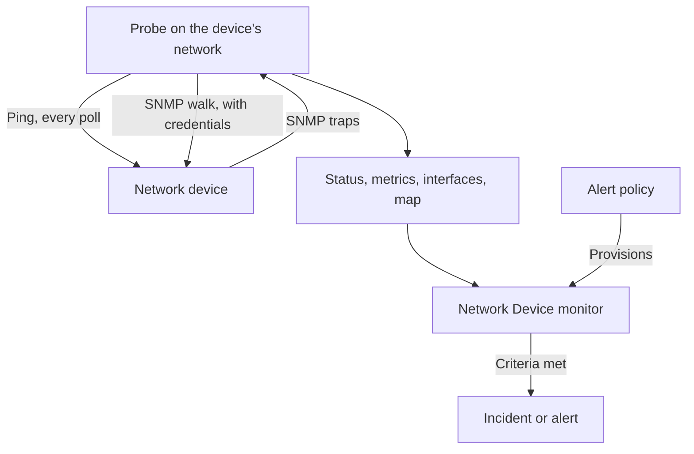
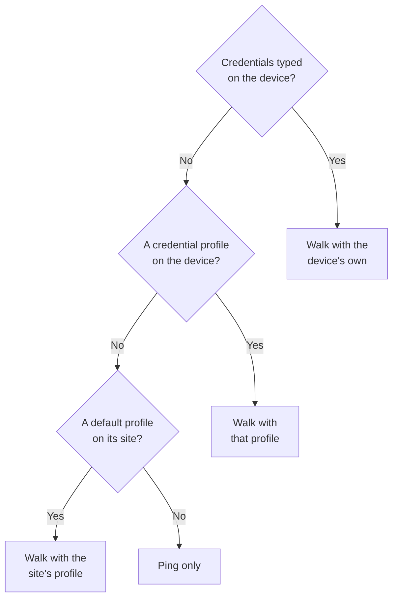
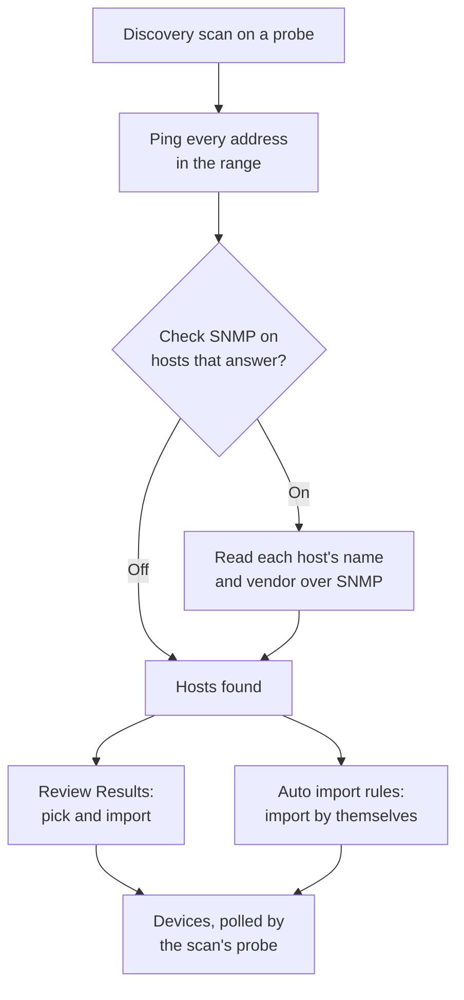
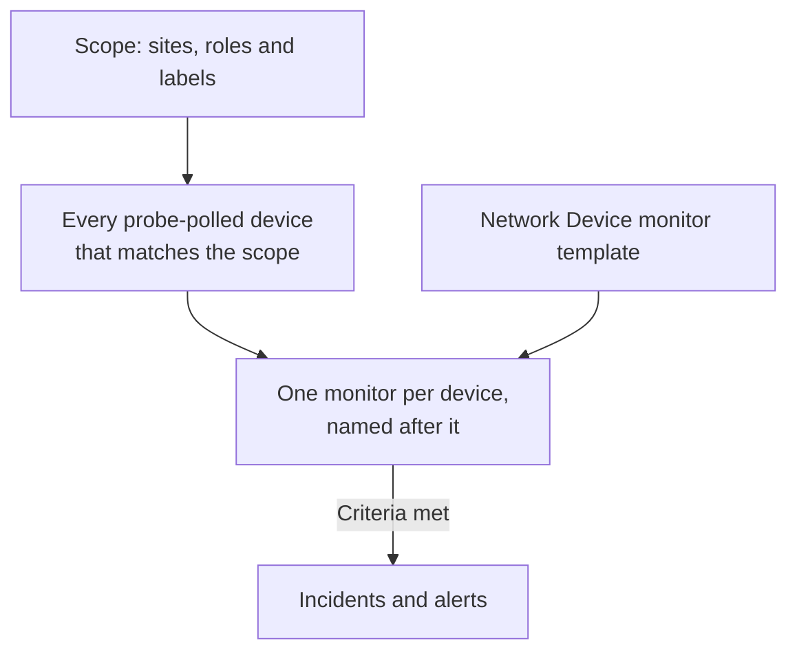
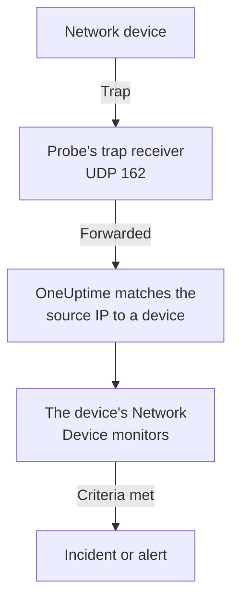

# Network Device Monitor

Monitor switches, routers, firewalls, access points, PDUs, cameras and printers: anything with an address on your network, whether or not it speaks SNMP.

Add a device with its address and a probe, and the probe pings it on a schedule: the device gets an up or down status, a place on the network map and a vote in its site's health. Give it SNMP credentials and the same probe also walks it: interfaces and the optics in them, hardware inventory, LLDP and CDP neighbours, and health OIDs. Add a monitor, or an alert policy for a whole fleet, and its polls and traps raise incidents and alerts.

:::cards
- [Add a device](#adding-a-network-device): Its address and a probe, on one page.
- [Discover a network](#discovering-devices-with-a-network-scan): Sweep an address range and import what answers.
- [Read devices over SNMP](#snmp-credentials-and-credential-profiles): Interfaces, optics, inventory and health.
- [Get alerted](#alerting): A monitor for one device, a policy for a fleet.
- [See the map](#network-topology): Neighbours drawn live, exported as a PDF.
- [Fix a problem](#troubleshooting): Pending devices, failing walks, missing traps.
:::

## How it works



The device and the monitor do different jobs:

| Part | What it does | When you need it |
| --- | --- | --- |
| The device | Its probe polls it on the device's own schedule. Every poll records reachability, ping round-trip time and packet loss; a poll with SNMP credentials also reads the device's identity, interfaces, neighbours and health OIDs. | Always: the device is what you add. |
| A monitor | Evaluates criteria against every poll result and every trap from the device, and opens incidents and alerts. | Only for incidents and alerts. Status, inventory, charts and the map need no monitor. |

## Before you begin

- **A probe that can reach the device.** The probe pings and walks the device from its own network, so a device at a private address needs a [custom probe](/docs/probe/custom-probe) inside that network: a probe on the public internet cannot reach it.
- **SNMP, for more than ping.** Optional. A v1 or v2c community string, or an SNMPv3 user, set on the device, with UDP 161 open from the probe. Without it the device is pinged only.
- **Traps, syslog and flows.** Optional. The probe takes SNMP traps on UDP 162, syslog on UDP 5140 once you turn it on, and flow records on UDP 2055, 4739 and 6343, so open those from your devices to the probe.

## The Network Overview

**Network → Overview** is where the Network area opens, and it starts with the answer: one sentence that says whether your network is healthy and, when it is not, what is wrong, worst news first.

| What it says | When |
| --- | --- |
| **3 devices are down** | A device's probe or monitor cannot reach it. |
| **2 sites need attention** | Every device answers, but a site's health is not operational. |
| **5 interfaces are down** | Every device answers, but ports are dark. |
| **2 devices are not reporting their details** | They answer ping, but their SNMP walk is failing, so their interfaces and health are not refreshed: usually credentials. |
| **Waiting for the first check** | Devices were added and their probe has not checked them yet. |
| **All 40 devices are up** | Every device answers. Devices still waiting for their first check are counted on a line of their own. |

Under it, one line says whether anything raises an incident when a device goes down: how many [alert policies](#alert-policies) are on, or a **Set up alerts** link when none is. The **Add Device** and **Discover Devices** buttons beside it open those forms, and the tiles and lists below carry the detail: devices and sites needing attention, the fleet by vendor, and recent scans.

Before anything is added, the Overview shows the two ways in instead: **Discover devices** scans an address range so you can pick what to add, best for a whole network or a new site, and **Add one device** adds one by its IP address or hostname.

The Network menu keeps what you open every day in view: **Overview**, **Devices**, **Sites**, **Map**, **Traffic** and **Discovery**. The rest is folded into sections, and a section opens by itself on any of its pages:

| Section | Pages |
| --- | --- |
| **Topology** | **Device Topology**, **Endpoints**, **Latency Matrix**, **Site Links**, **Device Links** |
| **Rules** | **Auto Import Rules**, **Site Assignment Rules**, **Owner Rules**, **Label Rules**, **Link Rules** |
| **Settings** | **Alert Policies**, **SNMP Credentials**, **Device Roles**, **Site Types**, **OID Collection Templates** |
| **Advanced** | **Archived Devices** |

## Adding a Network Device

:::steps
### Open the Devices list
Go to **Network → Devices** and click **Add Device**. **Add Device** on the Network **Overview** opens the same form.

### Type the device's address
In **Hostname**, type its IP address or hostname. Leave **Name** empty to name the device after its hostname.

### Check the site and the probe
Pick the **Site** the device is in, if you use sites. **Probe** fills itself in with the site's default probe, or with the project's only custom probe; make sure it is one that can reach the device.

### Add the device
Click **Add Device**. Within a couple of minutes the probe pings the device and its status turns **Up** or **Down**. With SNMP credentials, its Overview also fills in with the device's identity, interfaces and health after the first successful walk.
:::

The form is one page — the hostname, a name, the site and the probe — with **SNMP** and **More fields** folded underneath. It asks nothing about how the device is monitored: every device you add is polled by its probe, and the [bound-monitor override](#the-bound-monitor-override) is on the device's **Settings** page for the few devices that need it.

A device's details — its name, description, role, site, labels and addresses — are edited afterwards in one place: the **Device Settings** card on its **Settings** page. The **Device Details** card on its Overview shows them, with an **Edit in Settings** link.

### The device

| Field | Description | Required |
| --- | --- | --- |
| Hostname | The IP address or hostname the probe pings, and walks over SNMP once the device has credentials. | Yes |
| Name | A friendly name, such as core-switch-01. Leave it empty and the device is named after its hostname. The API does the same: a device created with no name is named after its hostname. | No |
| Site | The [Network Site](/docs/monitor/network-sites) the device is in. The site's health rolls up from its devices, and a site with a default probe fills in the probe below. | No |
| Probe | The probe that pings this device, walks it over SNMP when it has credentials, and receives its traps, syslog and [flow records](/docs/monitor/network-traffic). It must reach the device directly: a probe on the public internet cannot reach a private address. | Yes |

**Probe** fills itself in where it can: a project with exactly one custom probe starts on that one, and picking a site replaces it with the [site's default probe](/docs/monitor/network-sites#monitoring-defaults). It never overwrites a probe you picked yourself. Set a default probe on your sites and a device can be added by its address alone.

### More fields (folded)

| Field | Description | Required |
| --- | --- | --- |
| Description | Free text. | No |
| Device Role | Core switch, access switch, firewall and so on. It sets the device's tier on the map and scopes alert policies. | No |
| MAC Address | The device's own MAC. The map uses it to put a device that speaks neither LLDP nor CDP on the switch port that learned it; see [Ping-only devices and their switch port](#ping-only-devices-and-their-switch-port). Usually learned for you from a router's ARP table. | No |
| Also create a Ping monitor for incidents | The probe already pings the device and gives it a status; a Ping monitor is what turns failed pings into an incident. Tick it and one is created on the hostname and bound to the device when you save. It counts towards your plan, and its incidents stay off until you turn them on from the monitor's page. | No |

Ticking the Ping monitor box shows **Ping from probes**, the monitor's own probes. They have to reach the device's network; leave the field empty to use the project's default probes. To alert on many devices at once, use [alert policies](#alert-policies) instead.

### SNMP (folded, optional)

Leave it folded and the device is pinged only: the folded section says so in one sentence. The device still gets a status from its first poll and still sits in its site and on the map, but has no interfaces, inventory or health OIDs until it has credentials. Open the section to type a community string or a v3 user, or to pick a saved credential profile.

:::tabs
@tab SNMP v1 / v2c
| Field | Description | Required |
| --- | --- | --- |
| SNMP Version | V1, V2c or V3. | Yes, starts on V2c |
| SNMP Community String | The v1 or v2c community string, such as `public`. | No: empty means ping only |
| SNMP Port | The UDP port the agent listens on. | No, 161 by default |
| SNMP Credential Profile | A saved credential set to use instead of typing credentials here. | No |
@tab SNMPv3
| Field | Description | Required |
| --- | --- | --- |
| SNMP v3 Security Level | No Auth, No Priv; Auth, No Priv; or Auth, Priv. | Yes |
| SNMP v3 Username | The security name (user) configured on the device. | Yes: empty means ping only |
| SNMP v3 Authentication Protocol | MD5, SHA, SHA-256 or SHA-512. | With authentication |
| SNMP v3 Authentication Key | The authentication passphrase. | With authentication |
| SNMP v3 Privacy Protocol | DES, AES or AES-256. | With privacy |
| SNMP v3 Privacy Key | The privacy (encryption) passphrase. | With privacy |
:::

Credentials typed on the device win over a credential profile picked beside them, and the device's site can carry a default profile as well. Credentials on a profile are encrypted at rest. Credentials typed onto a device are guarded by the same read permissions but are not encrypted at rest: one more reason to keep shared credentials on a profile.

## Changing Many Devices at Once

A discovery scan of a customer's network brings in dozens of devices that belong in one site, share one role and come from one vendor. You do not open each of them: select them on the **Devices** list, by ticking rows or selecting every device the filters match, and open **Bulk Actions**.

| Action | What it does |
| --- | --- |
| **Set Site** / **Clear Site** | Moves every selected device into the site you pick, where it counts towards the site's health; a device without a probe of its own picks up the site's default probe. **Clear Site** takes them out of their sites. A device that a site assignment rule matches goes back to the rule's site on its next poll, so for devices discovery keeps finding, add a rule under **Network → Rules → Site Assignment Rules** instead; the **Set Site** dialog links to it. |
| **Set Device Role** / **Clear Device Role** | Gives every selected device one role, such as the twenty switches that are all "Access Switch". Roles are the project's own, under **Network → Settings → Device Roles**, which the dialog links to. **Clear Device Role** works each device's role out from its SNMP identity again. |
| **Apply Vendor Template** | Adds a [vendor template](#vendor-health-templates)'s health OIDs and SNMP tables to every selected device. **Match each device's vendor**, the dialog's first choice, picks each device's own template from what its SNMP walk reports, so a mixed selection gets the right one everywhere; or pick one template for all of them. |

Each action is one dialog and one save for the whole selection, and every device goes through the same checks as an edit on its own Settings page: permissions, the label and owner scope of your role, and the limits on what a device may collect.

**Apply Vendor Template** shows what it will do before it does anything: how many devices get which template, and how many it leaves alone and why. It adds to what each device already collects and removes nothing, and a device that already has everything in the template is not written again. It leaves alone a monitor-backed device (nothing polls it), a device linked to an [OID Collection Template](#oid-collection-templates) (the template decides what it collects, so add the vendor's OIDs there), and, when matching, a device not walked over SNMP yet or whose vendor has no template.

When an action finishes, it lists how many devices changed, which failed and why — a device your role may not edit, a list over its limit — and which it did not change and why: a device already in that site or role, or one the vendor template leaves alone.

The other bulk actions are covered where they belong: **Set OID Collection Template** under [OID Collection Templates](#oid-collection-templates), **Set SNMP Credential Profile**, **Switch to Probe Polling** and **Create Ping Monitors** under [In bulk](#in-bulk), and **Shorten Names to Hostname** under [How discovered devices are named](#how-discovered-devices-are-named).

## What a Poll Actually Does

Every poll of a probe-polled device is a ping. When the device has usable SNMP credentials, the probe also runs a full SNMP walk. The two run side by side and the walk never waits for the ping, so SNMP gear behind an ACL that drops ICMP still reports **Up**.

| Result | Ping-only device | Device with SNMP credentials |
| --- | --- | --- |
| Status (Up or Down) | From the ping | From the ping or the walk: either answering is enough |
| Ping round-trip time and packet loss | Recorded as device metrics | Recorded as device metrics |
| SNMP response time | — | The walk's time, never the ping's |
| Interfaces, neighbours, endpoints | — | From a successful walk |
| System identity, vendor, model, serial | — | From a successful walk |
| Health OIDs and SNMP tables | — | From a successful walk |

Usable credentials are a v1 or v2c set with a community string, or a v3 set with a username, found through the [credential chain](#snmp-credentials-and-credential-profiles). An empty set is skipped, so a device is never walked with a guessed default community.

Packet loss reuses the [Ping monitor](/docs/monitor/ping-monitor)'s series, so it reads the same across the product. Round-trip time has a series of its own, `oneuptime.monitor.ping.round.trip.time`, because on a network device the plain response time is the SNMP walk's. The device's **Metrics** page charts interface utilization and health OIDs; the round-trip time of the last hour is drawn in the device's drawer on the map.

### "SNMP failing" is not "Down"

A device that answers ping but whose walk fails is **Up**, tagged **SNMP failing**, and both halves matter:

- It is Up because something answers at that address. Painting it red would put a device that is running fine into your incident count.
- It is SNMP failing because its interfaces, inventory and health OIDs have stopped refreshing, almost always because of credentials, a disabled SNMP agent or an ACL. Nothing else on the page would tell you that the numbers are frozen.

A device whose ping and walk both fail is simply **Down**, so the tag only ever sits beside a green pill.

### Reading a device's status

Every place that shows a device — the Devices list, a site's Devices page, the Overview, the map — uses the same three verdicts and the same qualifiers beside them.

| Verdict | Means |
| --- | --- |
| **Up** | The last poll (ping or SNMP), or the bound monitor, reached the device. |
| **Down** | The last poll (ping or SNMP), or the bound monitor, could not reach the device. |
| **Pending** | No verdict yet: never polled, no probe assigned, or no monitor bound. |

| Qualifier | Shown when | What to do |
| --- | --- | --- |
| **Stale** | No poll has been attempted for well over the device's interval. | Check that the device's probe is online and keeping up with its fleet. |
| **No probe** | The device is probe-polled but has no probe, or its polling is off. | Assign a probe that can reach it; nothing polls it until then. |
| **No monitor** | The device uses the [bound-monitor override](#the-bound-monitor-override) and nothing is bound. | Bind a monitor, or switch it back to probe polling. |
| **SNMP failing** | Up on ping, but the last SNMP walk failed. | Check the credentials, the SNMP agent or an ACL. |

The **Devices** list has an **SNMP** filter with three values: **OK** (the last walk succeeded), **Failing** (the last walk failed) and **Not configured** (pinged only, no credentials, or never polled). "Which devices have credentials that stopped working" is one click. The list's **Interfaces (Up / Down)** column reads **No SNMP** rather than `0 / 0` for a device that is pinged and never walked: zero working ports would be a different claim, and a wrong one.

## SNMP Credentials and Credential Profiles

A device is walked with the first usable credential set found in this order, and the search stops at the first hit:



The site step reads the device's own site and no further: a device in a Unit does not pick up a profile set on the Region above it. A site's default probe does reach down the tree, because a probe is copied onto the device once while credentials are read again on every poll; [Network Sites](/docs/monitor/network-sites#monitoring-defaults) has the details.

### The SNMP Credentials page

**Network → Settings → SNMP Credentials** holds the project's credential profiles. A profile is one named set — a v1 or v2c community string, or a v3 user with its security level, protocols and keys — that any number of devices and sites point at. Nothing is copied onto the devices, so rotating a community string is one edit here, and every device that uses the profile picks up the new value on its next poll.

Secrets on a profile are encrypted at rest, and only roles that may read a device's own credentials may read them. A device or site that shows its profile shows the profile's name and version, never its secrets.

A profile that a device or site still points at cannot be deleted: the delete is refused with a count of what is in the way. Move those devices and sites to another profile, or clear the profile on them, then delete it.

### Turning a device back into a ping-only device

On the device's **Settings** page, **Edit Settings** has a **Ping only — clear this device's own SNMP credentials** checkbox on its **SNMP Credentials** step. It clears the device's own community string and v3 username when you save. It exists because emptying the right field is not obvious: a v3 device stays walkable while its username survives, whatever else you blank.

Clearing the device's own credentials does not clear a profile. If the device or its site still names one, the device keeps being walked with it; clear the profile too to have the device pinged only.

### In bulk

Select devices on the **Devices** list and use:

- **Set SNMP Credential Profile** / **Clear SNMP Credential Profile**: attach a profile to a selection, or take it off.
- **Switch to Probe Polling**: for devices on the bound-monitor override. Pick a probe, and each selected device is pinged on its schedule from then on, and walked once it has credentials. A monitor already bound stays bound; the device's status now comes from the probe.
- **Create Ping Monitors**: for devices on the bound-monitor override, creates a Ping monitor on each device's hostname and binds it, so the device reads Up or Down.

The **Devices** page shows a banner when the project holds devices on the bound-monitor override with nothing bound — devices that nothing polls and nothing reports on — and links to the selection that fixes them.

## Site Monitoring Defaults

A [Network Site](/docs/monitor/network-sites#monitoring-defaults) carries two defaults for the devices in it. Its **Default Probe** is copied onto a device created or moved into the site without a probe of its own. Its **Default SNMP Credential Profile** is read on every poll of a device in the site that has no credentials of its own. Set both on a site and a device there can be added by its address alone, then pinged and walked from its first poll. The site guide says how far each default reaches down the site tree.

## The Bound-Monitor Override

Some gear no probe can reach or usefully ping: a device behind a NAT, an appliance whose health is better judged by an HTTP check, a service whose real signal is a port check. For those, **Edit Settings** on the device's **Settings** page has a **Monitoring Method**:

| Method | What it means |
| --- | --- |
| **Probe** | The default. Pinged by the assigned probe on its schedule, and walked over SNMP when it has credentials. |
| **Bound monitor** | An existing monitor's status is this device's status. |

Switching a device to **Bound monitor** stops polling it. The probe, interval and polling switch leave the **Polling & Data Collection** card, the device's old poll results are cleared, and its status comes from the monitor you bind. Binding one is optional: until you do, the device reads **Pending**, tagged **No monitor**.

Switching back to **Probe** restores polling and asks for a probe. A monitor that was bound stays bound and goes on alerting; it just no longer decides the device's status.

Most devices do not want this. Every probe-polled device has a reachability status already, so there is no need to bind a Ping monitor to get one; bind a monitor when you want that monitor's incidents.

## Polling & Data Collection

Polling lives on the device's **Settings** page, on the **Polling & Data Collection** card (**Edit Polling**). The defaults suit a new device, so it needs no tuning:

| Setting | Description | Default |
| --- | --- | --- |
| Probe | The probe that polls the device. | Set when the device is added |
| Polling Enabled | The probe polls the device on the schedule below. Turn it off to pause polling without deleting the device. | On |
| Polling Interval (Minutes) | How often the probe polls the device. At least 1 minute. | 5 |
| Walk Interfaces | Walk the interface tables (IF-MIB) on each poll: status, bandwidth, utilization and errors for every port, plus LLDP and CDP neighbours for the map. | On |
| Collect Connected Endpoints | Also walk the ARP and bridge-forwarding tables to find what is plugged into the device: POS terminals, printers, phones, laptops. From an ARP table it also fills in the MAC address of devices registered at those addresses. Costs extra walks per poll. | Off |
| OID Collection Template | A shared, named OID list the device collects. Editing the template changes every linked device on its next poll. | None |
| Device-Specific Health OIDs | Extra OIDs only this device collects, on top of its template's. | None |
| Auto-Apply Vendor Health Template | When the device's vendor is recognised and its own OID list is empty, fill the list from the vendor's template on the next poll. | Off; on for devices discovery imports |
| Device-Specific SNMP Tables | Extra [SNMP tables](#snmp-tables) only this device walks, on top of its template's. A table with the same key as a template table replaces it on this device. | None |

Everything from **Walk Interfaces** down needs SNMP credentials: on a ping-only device those settings are kept and have no walk to apply to.

### Interface Walking

With **Walk Interfaces** on and credentials found, every poll tracks each interface's operational and administrative status, bits in and out, utilization and errors. The same walk collects the LLDP and CDP neighbours for the map.

Mute an interface on the device's **Interfaces** page, for a lab port or a link unplugged on purpose, and it stays in the inventory but leaves alerting and metrics. A failed walk never half-clears what was collected: the last interface snapshot stays, and the device is tagged **SNMP failing** so nobody mistakes it for a current one.

### Vendor Health Templates

In the **Health OIDs** editor, **Vendor Health Template** applies a prebuilt set of OIDs for the device's vendor. Many templates also ship [SNMP tables](#snmp-tables), added with **Add a Vendor's Tables** in the **SNMP Tables** editor.

| Vendor template | Health OIDs | SNMP tables |
| --- | --- | --- |
| Generic (Host Resources MIB) | CPU load, total and available RAM, load average | CPU cores (one row per core, however the platform numbers them) |
| Arista EOS | CPU load, load average, total and available RAM | — |
| Cambium Networks cnMatrix | CPU, RAM, flash, temperature, supply voltage | Fans, PoE ports, redundant power supply |
| Cambium Networks Enterprise Wi-Fi (cnPilot, XV, XE, XH) | CPU, free memory, Wi-Fi clients, cnMaestro connection | Wi-Fi radios (band, channel, width, TX power, clients, noise floor, airtime, state), SSIDs |
| Cisco IOS / IOS-XE | CPU, memory used and free, temperature, fan state, power supply state | — |
| Dell Force10 / OS9 | CPU, memory | — |
| Extreme Networks EXOS / Switch Engine | CPU, temperature, over-temperature alarm, power state | Power supplies, fans, memory per slot, stack members |
| Extreme Networks Fabric Engine / VOSS | vIST session, I-SID count | Fabric (IS-IS) adjacencies named by neighbour, CPU and memory per slot, temperature sensors, fans, power supplies |
| Extreme Networks IQ Engine (HiveOS) Access Points | CPU, memory, Wi-Fi clients, temperature | Wi-Fi radios (channel, TX power, noise floor), SSIDs |
| Extreme Networks Wireless Controller (XIQ-C, ExtremeWireless) | Access points, active access points, Wi-Fi clients | Access points (state, clients, address, software), Wi-Fi radios (band, channel, width, noise floor, busy airtime), WLANs (SSID, clients) |
| Fortinet FortiGate | CPU, memory, disk | — |
| HPE / Aruba ProCurve | CPU, total and free memory | — |
| HPE Aruba Instant (AOS 8) | Cluster name, firmware version, conductor | Access points (status, model, CPU, memory), Wi-Fi radios named by access point (channel, TX power, noise floor, utilization, clients, state), SSIDs (clients) |
| HPE Aruba Mobility Controller (AOS 8) | Access points, Wi-Fi clients, controller role | Access points (status, model, AP group), Wi-Fi radios named by access point (band, channel, TX power, utilization, clients, mode), SSIDs (clients, access points up and down), processors, memory |
| Huawei VRP | CPU, memory, temperature | — |
| Juniper Junos | CPU, memory buffer, temperature | — |
| MikroTik RouterOS | CPU load, temperature, voltage | — |
| Palo Alto PAN-OS | Management CPU, session utilization, active sessions | — |
| Sophos Firewall (SFOS / XGS) | Memory, disk, swap, HA state and peer state, IPsec service, CPU temperature (SFOS v22 and later) | IPsec tunnels (status needs SFOS v20 and later), CPU cores |
| TP-Link Omada Access Points (EAP) | Wi-Fi clients | — |
| Ubiquiti EdgeOS / EdgeSwitch / UniFi Switches | CPU load, total and available RAM | — |
| Ubiquiti UniFi Access Points | Isolated state, load average, total and available RAM | Wi-Fi radios (band, airtime), SSIDs (band, channel, clients, TX power, connection quality), CPU cores |

The template's OIDs are copied into the device's own list, where you can prune or extend them. After the first walk identifies the vendor, the device page suggests the matching template. Matching reads the device's `sysObjectID`, and its `sysDescr` where one enterprise number hosts two operating systems: Extreme Fabric Engine on universal hardware reports the same enterprise (1916) as EXOS, and only its description (`…-FabricEngine (9.0.4.0)`) tells them apart. UniFi access points are told from Ubiquiti's routers the same way (`U6-Pro 6.6.50.15098`), also when older firmware answers with Net-SNMP's arc, and IQ Engine access points from the Aerohive switches that share their arc (`AP230, HiveOS 8.2r1`).

Devices with **Auto-Apply Vendor Health Template** on get the template's OIDs and tables on their first poll: devices an auto import rule brings in, and devices imported from **Review Results** with its vendor template switch on, which it is unless you turn it off. To give many devices their template at once, such as a discovered fleet that predates the switch, select them on the **Devices** list and use **Apply Vendor Template** (see [Changing Many Devices at Once](#changing-many-devices-at-once)).

Applying a vendor template is a one-time copy, so nothing propagates when the template changes. For anything beyond a single device, use an **OID Collection Template** instead; the vendor templates are offered as a starting point when you create one.

### OID Collection Templates

An **OID Collection Template** (**Network → Settings → OID Collection Templates**) is a named OID list, usually named after a device type such as "Cisco Catalyst 9300", that any number of devices link to. The link is live, not a copy: a device's OID list is put together on every poll, so editing a template changes what every linked device collects on its next poll, with no sync step.

Before you build one, check that you need it. Per-port bits in and out, operational status, utilization and errors per second are collected for every port on every poll with no OIDs at all (see [Interface Walking](#interface-walking)), and they are alertable per port already. Templates are for what is not per port: CPU, memory, temperature, fans, power supplies, BGP peers.

Coming from Zabbix:

| Zabbix | OneUptime |
| --- | --- |
| Template | OID Collection Template |
| Item | An OID on that template |
| Discovery rule "Network interfaces by SNMP" with item prototypes | Built in and always on for the interface counters: nothing to write |
| Trigger | Monitor criteria |
| Trigger prototype, one per discovered interface | A criteria with **Interface** set to `*`, which fans out per port |
| Discovery rule over any other SNMP table (tunnels, radios, fans) with item prototypes | An [SNMP table](#snmp-tables) on the template |
| Trigger prototype on such a table | An SNMP Table Value or SNMP Table Row Is Unhealthy criteria with **Row** set to `*` |
| Host group | Labels |
| "Link template on host discovery" action | An auto import rule's **OID Collection Template** |
| Action on a host group ("alert on every switch") | An [alert policy](#alert-policies) |

An OID on a template is collected as written, so an OID that names one row of a table (`…ifSpeed.3`) collects that row only, whatever sits at index 3 the day it is polled. Anything that is a list — tunnels, radios, fans, neighbours — belongs in an [SNMP table](#snmp-tables), which walks every row and follows rows as they come and go. Per-port interface data needs neither: the interface walk records operational status, bits in and out per second, utilization and a combined errors-per-second rate as series. Per-direction errors, discards, admin status and link speed go into the device's interface inventory, but are not series and cannot be alerted on.

There are three ways to link devices, and on a fleet that discovery keeps finding, the third matters most:

- One device at a time, on the device's **Polling & Data Collection** card.
- In bulk, by selecting devices on the **Devices** list and using **Set OID Collection Template**. The list's **Template** column shows which devices are linked to what.
- Automatically, by setting an OID Collection Template on an auto import rule, so every device a scan imports is linked the moment it is created.

A device collects its template's OIDs first, then its own **Device-Specific Health OIDs**. When both name the same OID it is collected once, with the device's name and description winning, and template entries keep their place, so device-specific additions can never push them out.

| Limit | Value |
| --- | --- |
| Health OIDs a device polls | 200 |
| OIDs on a template | 150 |
| A linked device's own OIDs | 50 |
| An unlinked device's own OIDs | 200 |

The limits add up, so a linked device can never poll more than 200 OIDs. Going over is a validation error when you save, never a silent cut at poll time, and linking a device that already has more than 50 of its own is refused with a message saying how many to remove.

A template that devices are still linked to cannot be deleted. Unlink them first, for example with the **Clear OID Collection Template** bulk action, so a delete never quietly stops collection across a fleet.

### Custom OIDs

Add any OIDs you want collected on every poll, on a template or as device-specific additions:

| Field | Description | Required |
| --- | --- | --- |
| OID | The numeric OID, such as 1.3.6.1.2.1.1.1.0. | Yes |
| Name | A friendly name for the OID, such as sysDescr. | No |
| Description | What the OID represents. | No |

Collected values are charted on the device's **Metrics** page, and the **SNMP OID Value** and **SNMP OID Exists** criteria alert on them. The OID picker on those criteria lists the OIDs the selected device collects, its template's and its own, so there is nothing to type.

Long OID lists are split across several SNMP GET requests so each fits in one UDP datagram. If you kept your OID lists short because an older release reported a device answering `tooBig` as offline, you no longer need to.

### SNMP Tables

Some of what a device knows is a list: one row per IPsec tunnel, Wi-Fi radio, SSID, fabric neighbour, fan or power supply. An SNMP table is defined by its columns, and every row is walked on every poll, so a tunnel that is added, renamed or deleted is followed without anyone editing anything.

| Field | What it does |
| --- | --- |
| Name and key | What the table is called. The key (letters, digits and underscores, made from the name when left blank) is what criteria, metrics and template variables use, so renaming a table never breaks an alert. |
| Kind | What the rows are: VPN tunnels, Wi-Fi access points, Wi-Fi radios, Wi-Fi SSIDs, routing neighbours, hardware, or generic. The Wi-Fi kinds feed the device's [Wi-Fi page](#the-wi-fi-tab). |
| Columns | The column OIDs to collect (the table entry's OID plus the column number, such as `1.3.6.1.4.1.2604.5.1.6.1.1.1.1.9` for a Sophos tunnel's status), each with a name and, optionally, a unit, a role (status, band, channel, channel width, TX power, clients, noise floor, utilization, SSID), value labels and healthy values. |
| Row names | Optional columns whose values name each row, such as a tunnel's connection name. Without them rows are named by their index. A name can come from a sibling table that shares the index (Fabric Engine names IS-IS adjacencies from `rcIsisAdjHostName`), or from a parent table whose index starts this table's (Aruba Instant names each radio after its access point). A table indexed by a name (ArubaOS indexes its SSIDs by the SSID) is named by its decoded index. |
| Row limit | How many rows to keep: 100 by default, 250 at most. |

Numbers are read as numbers, and text that starts with a number is read as that number (`"36"`, `"-95 dBm"`, `"80MHz"`), because plenty of vendors put numbers in strings. Set a column's value type to **Text only** for values that only look numeric. **Value labels** turn codes into words (`0=inactive, 1=active`): the raw value is still what is charted and compared, the label is what is shown. **Healthy values** (`1`) say which values mean all is well: they colour the row on the device's **SNMP Tables** page and drive the **SNMP Table Row Is Unhealthy** criteria.

Some vendor template columns also **adjust** the number they read, for MIBs that keep a value in a unit of their own: ArubaOS reports transmit power doubled (read × 0.5), Aruba Instant the noise floor without its sign (× −1), Aerohive the noise floor plus 256 (− 256), and Extreme's controller the channel width in 20 MHz steps (× 20). The adjusted number is what is shown, charted and compared, so **Noise Floor Greater Than -80** means the same on every vendor, and the table editor shows the arithmetic under the column.

Tables come from an [OID Collection Template](#oid-collection-templates), shared by every linked device (up to 10 tables), or from the device itself under **Device-Specific SNMP Tables** (up to 10 more). They merge by key on every poll, template first, and a device table with the same key replaces the template's. Both editors offer **Add a Vendor's Tables**.

The probe walks each column as a subtree, within a 30-second budget shared by every table on the device. A table that cannot be walked says why and never fails the poll: the device's **SNMP Tables** page keeps its last good rows and says the latest walk failed, while criteria judge only what this walk produced, so a timeout is never read as an empty table. Every numeric cell is recorded as the metric `oneuptime.monitor.snmp.table.value`, with the attributes `snmpTableKey`, `snmpTableName`, `snmpTableColumn`, `snmpTableColumnOid`, `snmpTableRow` and `snmpTableRowIndex`, so a dashboard can chart every tunnel's status or every radio's transmit power, and a Metrics monitor can group by `snmpTableRow`.

### The Wi-Fi Tab

A device whose walk includes a Wi-Fi table — access points, radios or SSIDs, as the Wi-Fi vendor templates bring them — gets a **Wi-Fi** page. It opens on access points up (on a controller), radios on, clients and SSIDs, then lists every access point a controller manages with its state, radios and clients; every radio with its band, channel, frequency, channel width, transmit power, clients, noise floor and airtime; and every SSID with its band and clients. Columns are found by their role, so any vendor's tables that tag their columns show the same way.

Vendors split these facts differently, and the page puts them back together:

- Frequency is worked out from the band and the channel with the 802.11 channel plan (2.4, 5 and 6 GHz). A controller that reports the frequency where its MIB says channel (Extreme's) is read the other way round.
- A radio that reports no band is placed by its channel: 1 to 14 is 2.4 GHz, 32 to 177 is 5 GHz, and a number only 6 GHz uses (37, 53, 181…) is 6 GHz.
- UniFi reports channel, transmit power and clients per SSID: a radio takes them from the SSIDs on its band.
- Aruba counts clients per radio: an access point's clients are its radios'.
- An interface that broadcasts no network (IQ Engine lists every interface, with N/A for those) is not listed as an SSID.

A device that reports no Wi-Fi yet has the page name its vendor's template, matched from the last poll the way auto-apply matches it, and apply it with **Apply Template**; the radios appear after the next poll.

### Supported Wi-Fi Vendors

What each Wi-Fi vendor reports over SNMP, and what only its cloud has:

| Vendor | Access points and controllers | Vendor template | Read over SNMP | Needs the vendor's cloud API (not built) |
| --- | --- | --- | --- | --- |
| Cambium Networks | Enterprise Wi-Fi access points (cnPilot, XV, XE, XH) | Cambium Networks Enterprise Wi-Fi (cnPilot, XV, XE, XH) | Every radio's band, channel, width, TX power, clients, noise floor, airtime and state; SSIDs; CPU, memory | Fleet views in cnMaestro |
| Ubiquiti UniFi | UniFi access points (UAP, U6, U7, UK) | Ubiquiti UniFi Access Points | Every radio's band and airtime; every SSID's channel, clients and TX power; CPU per core, memory | Per-client data and site views in the UniFi Network application |
| HPE Aruba | Instant clusters (AOS 8), through their virtual controller | HPE Aruba Instant (AOS 8) | Every access point's status, CPU and memory; every radio's channel, TX power, noise floor, utilization, clients and state; SSIDs with clients | — |
| HPE Aruba | Mobility Controllers (AOS 8) | HPE Aruba Mobility Controller (AOS 8) | Every managed access point's status; every radio's band, channel, TX power, utilization and clients; SSIDs with clients; the controller's CPU and memory | — |
| HPE Aruba | Access points on AOS 10, managed by Aruba Central | — | Reachability (ping) | Radios, SSIDs and clients: the Aruba Central API |
| Extreme Networks | IQ Engine (HiveOS) access points | Extreme Networks IQ Engine (HiveOS) Access Points | Every radio's channel, TX power and noise floor; SSIDs; CPU, memory, clients, temperature | Client and fleet views in ExtremeCloud IQ |
| Extreme Networks | ExtremeCloud IQ Controller (formerly Extreme Campus Controller) and ExtremeWireless controllers | Extreme Networks Wireless Controller (XIQ-C, ExtremeWireless) | Every access point's state and clients; every radio's band, channel, width, noise floor and busy airtime; WLANs with clients | — |
| TP-Link | Omada access points (EAP) | TP-Link Omada Access Points (EAP) | The client count, on firmware with TP-Link's EAP client MIB | Radios, channels and SSIDs: the Omada Controller API |
| Juniper | Mist access points | — | Reachability (ping); access points going up and down through Mist's webhooks | Everything else: the Mist cloud API |

The templates are matched from each device's `sysObjectID` and `sysDescr`, so auto-apply, the **Apply Vendor Template** bulk action's **Match each device's vendor** and the Wi-Fi page pick them without being told, except TP-Link's, which you apply yourself. Turning SNMP on, by vendor:

- **Cambium**: in cnMaestro, SNMP is set per AP group (Configuration → Wi-Fi Profiles → AP Groups → Management → SNMP), with a v2c community or a v3 user. Add each access point.
- **Ubiquiti UniFi**: turn on SNMP in the UniFi Network application, which sets it on the devices it manages. Add each access point.
- **HPE Aruba Instant**: turn on SNMP for the cluster and add its virtual controller's address as one device; it answers for every access point.
- **HPE Aruba Mobility Controller**: add the controller; campus access points do not answer SNMP themselves.
- **Extreme IQ Engine**: turn on SNMP in the network policy that ExtremeCloud IQ pushes to the access points, and add each access point.
- **Extreme Wireless Controller**: turn on SNMP in the controller's administration settings and add the controller.
- **TP-Link Omada**: turn on SNMP for the site in the Omada Controller (Network Config → SNMP), add the access points, and apply the template from their Settings page or with **Apply Vendor Template**.
- **Juniper Mist**: Mist access points do not answer SNMP. Add them as ping-only devices for reachability, and send Mist's `device-updowns` webhook to an [Incoming Request monitor](/docs/monitor/incoming-request-monitor) to turn an access point going offline into an incident.

A controller's table keeps up to 250 rows: on a controller with more than 250 access points or radios, the rest are not listed, and the table says so. Its access point and client counts are health OIDs, so they count everything.

### Transceivers

The SFP, SFP+, SFP28 and QSFP optics in a device's ports are read on every poll that walks interfaces: there is nothing to switch on and no template to apply. For each optic OneUptime keeps:

- What it is: vendor, part number, serial number, revision, type and wavelength, as the optic reports them. Third-party optics (FS.com, FLEXOPTIX, Carritech and the rest) read the same as the switch vendor's own.
- Its readings: temperature, supply voltage, laser bias current, and transmit and received power, from its digital optical monitoring (DOM, also called DDM). A QSFP reports power and bias per lane.
- The device's own thresholds: the low and high warning and alarm limits the switch reports for each reading. An optic is judged against those and nothing else; OneUptime never invents limits of its own.
- A month of received power: the daily average of the weakest lane over the last 30 days. A dirty connector, a bent fibre or an optic wearing out shows here weeks before the link drops.

The device's **Interfaces** page opens with a **Transceivers** card: problems first, then one row per optic with its port, what it is, a status in words and its readings. A reading past a threshold is coloured and named (**Low alarm**, **High warning**), and a small chart of the month's received power sits beside the RX value; a QSFP's row shows its worst lane. Click a row for every lane against every threshold, the received power trend with its best day, and the optic's identity. A device that reports no optics, with copper ports only or an agent that does not expose them, shows no card at all.

| Status | Means |
| --- | --- |
| Healthy | Every reading the device has thresholds for is inside them. |
| Warning | A reading is at or past a warning threshold. |
| Alarm | A reading is at or past an alarm threshold, or the device flags a loss of signal or a transmitter fault. |
| Not detected | The port had an optic and no longer reports one, while the port is still enabled. The page still names what used to be there. |
| No thresholds | The optic reports readings, but the device reports no limits to judge them by. Alert on them with **SNMP Transceiver Reading**. |
| Detected | The optic reports no diagnostics at all: usual for copper SFPs and direct-attach cables. |
| Port disabled | The port is shut, so its laser is off by design: its readings are shown but never judged. |

The device's `sysObjectID` picks where the readings come from: the vendor's own table first, where it carries what the standard one does not, and ENTITY-SENSOR-MIB as the fallback.

| Devices | Read from | Thresholds |
| --- | --- | --- |
| Cisco | CISCO-ENTITY-SENSOR-MIB, matched to ports through ENTITY-MIB | Yes |
| Arista | ENTITY-SENSOR-MIB, with ARISTA-ENTITY-SENSOR-MIB thresholds | Yes |
| Juniper | JUNIPER-DOM-MIB, with per-lane readings for multi-lane optics | Yes |
| HPE Comware and H3C | HH3C-TRANSCEIVER-INFO-MIB | Yes |
| HPE Aruba ProCurve / ArubaOS-Switch | HP-ICF-TRANSCEIVER-MIB | Yes |
| MikroTik RouterOS | MIKROTIK-MIB (`mtxrOpticalTable`), with loss of signal and transmitter fault flags | No |
| Cambium Networks cnMatrix (4.5 and later) | CAMBIUM-NETWORKS-TRANSCEIVER-MIB | No |
| Every other device | ENTITY-SENSOR-MIB (RFC 3433), matched to ports through ENTITY-MIB | No |

The first poll reads everything. Later polls read only what changes — the readings, and the serial numbers that tell a swapped optic apart — and the rest (thresholds, identity, which optic sits in which port) is read again when an optic is inserted, removed or swapped, and at least once an hour. A device with none of these MIBs costs one request per MIB tried. The read has its own 20-second budget, and a read that times out or is cut short keeps the device's last good optics rather than reporting them gone.

An optic missing from an enabled port shows as **Not detected** on the page at once, and counts as missing for alerting after two polls in a row, so an agent that answers empty once pages nobody. An optic pulled from a port that is shut is simply forgotten, and a muted interface keeps its optic on the page but is never alerted on.

Every reading is also a device metric, one series per port and lane, in the units the page shows: `oneuptime.monitor.snmp.transceiver.temperature` (°C), `oneuptime.monitor.snmp.transceiver.voltage` (V), `oneuptime.monitor.snmp.transceiver.bias.current` (mA), `oneuptime.monitor.snmp.transceiver.tx.power` and `oneuptime.monitor.snmp.transceiver.rx.power` (dBm), with the attributes `interfaceName`, `interfaceIndex` and `lane`. A dashboard can chart a link's light over months, and a Metrics monitor can alert on it.

An investigation by OneUptime AI of an incident or alert from a Network Device monitor starts with the optics of the ports it is about: still detected or not, every reading against the device's thresholds, and the received power of recent weeks. The AI can also read any device's optics when you ask about them.

### Device Identity

After the first successful walk, OneUptime reads the SNMPv2 system group and, where the device supports it, ENTITY-MIB, and fills in the device record: system name, description, location, contact, uptime, vendor, model, serial number and firmware version. The vendor's enterprise OID (`sysObjectID`) is the device's fingerprint: it names the vendor and picks the matching vendor template. The same facts appear in [Inventory](/docs/inventory/cmdb-sync#network-device-asset-attributes) with every other asset.

A ping-only device keeps the name and address you, or a discovery scan, gave it: there is no SNMP agent to ask for anything better.

## Discovering Devices with a Network Scan

Instead of adding devices one at a time, sweep a range of addresses from a probe and import what answers.



:::steps
### Open Discovery
Go to **Network → Discovery** and click **Start Scan**. **Discover Devices** on the Network **Overview** opens the same form.

### Say what to scan
On the **Scan Target** step, type the range, check the **Probe**, and decide whether to **Check SNMP on hosts that answer**.

### Add credentials to try
With SNMP on, the **SNMP Credentials** step asks for the credential sets to try. With it off there is no second step: the scan is a [ping-only scan](#ping-only-scans), and **Start Scan** is on the first page.

### Start the scan
Click **Start Scan**. The probe sweeps the range and reports how many hosts it scanned and how many answered: how many answered SNMP, or, on a ping-only scan, how many answered ping.

### Import what it found
Click **Review Results** on the finished scan, select the devices you want, and click **Import Selected**.
:::

| Field | Description | Required |
| --- | --- | --- |
| Scan Target | The addresses to scan, in [CIDR or octet-range notation](#scan-target-notation). | Yes |
| Probe | The probe that runs the sweep. It must reach the range directly. A project with exactly one custom probe starts on that one. | Yes |
| Check SNMP on hosts that answer | A scan pings the range first; this decides whether the hosts that answer are then asked over SNMP for their name and vendor. Turn it off for a [ping-only scan](#ping-only-scans). Chosen when the scan is created and fixed after that. On by default. | No |
| SNMP Configs | The second step: the credential sets to try, in order. Each host is asked with each set until one answers, so add one set per group of devices that share a version and community or v3 user. | When Check SNMP is on |

Folded under **More fields** on the first step, for the scans that need them:

| Field | Description | Default |
| --- | --- | --- |
| Name | What the scan is for, so you can tell it apart from other scans. The list shows the scan target when this is empty. | Empty |
| Look up Windows names (NetBIOS) | Ask each host that has no SNMP system name for its NetBIOS name, its Windows computer name, over UDP 137. That name wins over the host's reverse-DNS name. Private addresses and custom probes only; see [How discovered devices are named](#how-discovered-devices-are-named). | On |
| Name devices by their short hostname | Name imported devices by the first part of a fully qualified hostname: `core-sw-01` instead of `core-sw-01.corp.example.com`. | Off |
| Repeat this scan | Run the scan again on an interval, the **Rescan Interval (Minutes)**, at least 15 minutes, to keep discovery going; see [auto import rules](#importing-automatically-with-auto-import-rules). Hosts a repeated scan finds wait for your review unless an auto import rule matches them. | Off |

### Scan Target Notation

The scan target takes two notations, both IPv4 only. CIDR is one contiguous subnet:

```text
192.168.1.0/24
10.0.5.0/28
```

The network and broadcast addresses are skipped, so a `/24` sweeps 254 hosts. `/31` and `/32` have no network or broadcast address to skip, so every address in them is scanned.

In an octet range, any of the four octets may be an inclusive `low-high` range instead of one number:

```text
10.16-22.0-255.51-66
10.48-50.0-255.51-66
192.168.1.10-40
10.0.0.5
```

Every address in the result is scanned, and none is treated as a network or broadcast address, because there is no prefix length to work one out from: `10.0.0.0-255` includes `10.0.0.0` and `10.0.0.255`.

- Each octet is a number from 0 to 255, or a range whose lower bound comes first. `10.22-16.0.1` is refused as a reversed range rather than quietly scanning nothing.
- A bare address (`10.0.0.5`) scans exactly that host.
- One scan covers at most 32,768 addresses. A larger target is refused when you save the scan: split it into several scans, or narrow the ranges.

Targets are checked when the scan is saved, so a typo shows on the form rather than minutes later as a failed scan.

Octet ranges exist for networks that are not shaped like CIDR blocks. `10.16-22.0-255.51-66` sweeps `.51` to `.66` in every `/24` from `10.16` to `10.22`: 28,672 addresses. Written in CIDR that takes 1,792 scans, and the smallest CIDR block that contains it (`10.16.0.0/13`) is 512k addresses, 98% of them not worth probing.

### What a scan imports

Every host a scan finds imports as a probe-polled device, with the scan's probe assigned and polling on, so it has a status from its first poll. What differs between hosts is what comes with them:

- Hosts that answered SNMP import with the address that answered as the hostname, the name chosen as below, and the credentials that answered, so a v3 scan imports devices ready to walk over v3 that start collecting interfaces and inventory at once.
- Hosts that answered ping but not SNMP — every host a [ping-only scan](#ping-only-scans) finds, and the hosts an SNMP scan could not identify — import with no credentials. The probe pings them on their schedule; add credentials later, on the device or as a profile on it or its site, and the same probe starts walking them too.

Devices already registered are flagged and skipped. Bind a [Ping](/docs/monitor/ping-monitor) or [IP](/docs/monitor/ip-monitor) monitor to an imported device only if you want that monitor's incidents; an [alert policy](#alert-policies) is usually the better answer for a fleet.

When a scan found SNMP hosts, **Review Results** offers **Apply each SNMP host's vendor template on its first poll (recommended)**, on by default: each imported SNMP device gets the [vendor template](#vendor-health-templates) for what its first walk reports, its health OIDs and SNMP tables, just as devices an auto import rule brings in do. A device whose vendor has no template is left as it is. Turn the switch off for a batch that should start without.

### How discovered devices are named

A discovered host is named by the first of these it has:

1. Its SNMP system name (`sysName`), the name the device reports for itself. A placeholder such as `localhost`, or an IP address, does not count.
2. Its NetBIOS name, the computer name a Windows or Samba host reports for itself, when the scan has **Look up Windows names (NetBIOS)** on. It keeps the case the host reports: `WB0024KDS03`.
3. Its reverse-DNS name, the PTR record the probe looks up after the sweep.
4. Its IP address.

The device's own names come first because they are the names its owners use: a Windows host called `WB0024KDS03` keeps that name even when its reverse zone calls it `wb-0024-kds03.wbhq.com`. The reverse-DNS name is kept too: **Review Results** shows it beside the address, and the device keeps it as its **DNS Name**. NetBIOS cuts a computer name to 15 characters, so a NetBIOS name that is the start of a longer reverse-DNS name (`WB-0024-KITCHEN` for `wb-0024-kitchen-display-03.wbhq.com`) gives way to the reverse-DNS name.

**Review Results** shows the name a device will get, and it gets the same name whether you import it there or an [auto import rule](#importing-automatically-with-auto-import-rules) does. The device's hostname is always its IP address. While a device's name is still the one discovery gave it, its Overview shows where the name came from as **Name Source**.

**Name devices by their short hostname** cuts a fully qualified name to its first label: `core-sw-01.corp.example.com` imports as `core-sw-01`. It applies to a reverse-DNS name and to a `sysName` that is a fully qualified hostname; anything else (`Core Switch`, `ubuntu-22.04`, an IP address) is left as it is. It only changes what devices are called, so no rescan is needed: **Review Results** and auto import rules use it the next time they name a host, and devices already imported keep their names.

A device imported from a host with a reverse-DNS name keeps the full name as its **DNS Name**, whether or not the scan uses short names. It is shown on the device's Overview, the **Devices** list search matches it, and site assignment rules match hostname patterns against it, so a `*.store-0660.corp.example.com` rule keeps placing a device whose name lost its domain. A NetBIOS name is never stored as a DNS Name: the host reports it about itself, and it is not a DNS record.

> [!WARNING]
> Label and owner rules match on the device's name. A pattern written against DNS names (`*.wbhq.com`) or full names (`*.corp.example.com`) does not match a device named by its own name or its short name. Site assignment rules also try the DNS Name, so they keep matching.

To shorten devices you already imported, select them on the **Devices** list and use **Shorten Names to Hostname**. The confirmation shows how many devices will be renamed, with examples. A device with no DNS Name keeps its full name as its DNS Name, unless that name is also its SNMP system name or is long enough to have been cut short at import. A device is skipped when another device already has its short name, when two selected devices would get the same short name, or when its name changed after you selected it. Site assignment rules run again for every renamed device; label and owner rules do not, so use [Run Now](/docs/configuration/run-rules-now) on a rule that matches device names. Existing Ping monitors keep their names, and metric series labelled with the device name start a new series under the new name.

:::details NetBIOS names: how the lookup works
Windows and Samba hosts often have no SNMP agent, so without this they are listed by a reverse-DNS name their owners may not use, or by address. With **Look up Windows names (NetBIOS)** on, the probe asks each host that has no SNMP system name for its NetBIOS name after the sweep, with an NBSTAT query to UDP 137, hosts with no reverse-DNS name first. The option is on for new scans and off for scans created before it existed; turning it on or off keeps the scan's results and takes effect the next time the scan runs. It is best-effort:

- Only hosts at private (`10.0.0.0/8`, `172.16.0.0/12`, `192.168.0.0/16`) and carrier-grade NAT (`100.64.0.0/10`) addresses are asked. Public addresses never are.
- Global probes never send the queries, whatever the scan says. Run the scan from a [custom probe](/docs/probe/custom-probe) inside the network, and allow UDP 137 from the probe and the replies back.
- The name keeps the case the host reports (`FILESRV01`), and is used only when it is 1 to 15 characters, a valid hostname label, and has a letter in it.
- The lookup asks at most 2,000 hosts per scan and adds up to about a minute to the end of the scan. A custom probe can raise the number of hosts with `PROBE_DISCOVERY_NETBIOS_MAX_HOSTS`. When the cap or the time limit stops it short, the scan's status message says how many hosts were not asked, and a host that does not answer keeps its reverse-DNS name, or its address, as its name.
- NBSTAT queries to many hosts can trip intrusion detection rules. Turn the option off on scans of networks where that matters, or tell your security team first.
:::

:::details When a host has no name
A host listed by its address in **Review Results** shows **No name found** and an (i) beside it. Hover over or focus the (i) to see what each way of naming it came back with:

- SNMP: the scan did not check SNMP, the host did not answer it, or it answered with no system name or one that cannot be a name, such as `localhost` or an IP address.
- NetBIOS: the option is off for the scan, the scan ran on a global probe, the address was not asked (a public address, or the host or time limit was reached), or the host did not answer on UDP 137.
- Reverse DNS: the probe's DNS server has no PTR record for the address, returned one that is not a valid hostname, did not answer in time, failed (SERVFAIL), refused the query or could not be reached; or the address was never looked up, because the scan ran out of time for name lookups or the DNS server was not answering at all.

The probe looks names up through its own DNS servers, the ones in `/etc/resolv.conf` where it runs: the host's for the bundled Docker Compose probes, the cluster's DNS for a probe in Kubernetes. They may not be the servers your workstation asks, so when a host you know has a PTR record shows no record, run `nslookup <address>` from inside the probe's container or pod to compare. A lookup that times out or fails is retried once while the scan's time for name lookups lasts, asking each configured nameserver in turn (up to three), and only the first nameserver's "no PTR record" is final. When lookups still fail, the scan's status message says for how many hosts, and a rescan tries again. Names in the probe's `/etc/hosts` are used before DNS is asked.
:::

:::details Better names found later
A scan does not always find a host's best name the first time. The partial results a running scan uploads carry no names, because reverse-DNS and NetBIOS names are looked up once, after the sweep, so a host imported from them — by an auto import rule, or from **Review Results** while the scan is still running — is named by its IP address at first. A NetBIOS reply can be lost, and a host can get an SNMP agent after it was imported.

So a device that discovery named remembers where its name came from. When a completed scan of its address finds a better name — its SNMP system name or NetBIOS name instead of its reverse-DNS name, any name instead of its IP address — the device is renamed to the name an import would give it now, and its DNS Name is filled in if it has none. If another device already has that name, the device is named with its address in brackets (`FILESRV01 (10.0.0.5)`), and if that is taken too, it keeps its name.

A name is only ever improved: a device keeps its name when its DNS record changes, or when a later scan gets no NetBIOS reply. A device with a DNS name is renamed only by a scan that finds that same DNS name at its address, so when the address now belongs to another machine (a DHCP lease that moved, say) the device does not take that machine's name. A device you renamed — on its Settings page, through the API, or with **Shorten Names to Hostname** — is never renamed by a scan. Devices imported before discovery recorded where names came from keep their names, except that one a still-running scan imported by its IP address is renamed when that scan completes.
:::

### Importing Automatically with Auto Import Rules

Reviewing every scan by hand does not scale past the first few subnets. **Network → Rules → Auto Import Rules** is where you write the import down once: a rule says which discovered hosts to claim (an IP range, and optional system name, description and `sysObjectID` patterns) and, optionally, which monitor template and [OID Collection Template](#oid-collection-templates) the devices it imports get. A rule marked as an exclusion claims nothing and vetoes the others: that is how printers and phones are carved out of a broad subnet rule.

Rules have no schedule of their own and need none. Enabled rules run by themselves against each scan's results as they arrive, including the partial results a long sweep uploads while it is still running, so hosts are imported within a minute of being found rather than at the end of the range. Turn on **Repeat this scan** on a discovery scan and the pair becomes a standing arrangement: the scan sweeps its range again on your interval, and every new host it finds is imported without anyone pressing anything.

Saving a rule also applies it to results the project already has: a rule you write or enable today reaches hosts discovered in the last 24 hours within about a minute, so a rule written after a one-off scan is not left waiting for a scan that will never run again. Older results are left alone, because importing an estate discovered last month is a decision, not a side effect of saving a rule. The two buttons on a rule are how you make that decision, and they reach every scan in the project, however old:

- **Dry Run** evaluates every completed scan and reports what the rule would import and monitor. Nothing is written, so it is the safe way to see what a rule would claim before you enable it on a live estate. A disabled rule can be dry-run; only a real run needs it enabled, which is why a rule created in the dashboard starts with **Enabled** off: dry-run it, then switch it on.
- **Run Rule** does the same evaluation and performs the import.

**Who may run a rule.** A run reaches every scan of the project, so pressing **Dry Run** or **Run Rule** takes permissions that reach the whole project: permission to edit the rule, to create network devices and - when the rule has a Monitor Template - to create monitors, each scoped to all resources in the project. A permission restricted to labels or to owned devices is not enough, and a team's block with labels on creating devices or monitors refuses the run. A site assignment or device label rule's **Run Now** takes permission to edit the rule and to edit network devices, reaching the whole project the same way (see [Run Rules on Existing Resources](/docs/configuration/run-rules-now#before-you-begin), which names each permission).

Large estates import in paced batches. Creating a device or a monitor runs the full pipeline — site assignment, owners, labels and, for monitors, the plan, status and status page work — so a run creates a few hundred of each at a time rather than tens of thousands at once. One press of **Run Rule** drives as many batches as the estate needs and reports the total, so a scan of 900 routers is one press. If a run stops with work left, the report says exactly how much ("Stopped at the run cap with 409 active Network Device monitors still to create"), and pressing the button again continues: hosts already imported and monitors already created are skipped, so running again never adds twice.

Devices and monitors are separate work with separate limits: a rule that gains a monitor template after its devices were imported creates no devices at all, only monitors, and its report says so.

### Ping-Only Scans

Turn **Check SNMP on hosts that answer** off and the scan is a plain ICMP sweep: it pings every address in the range, reports the ones that answered, and sends no SNMP packet at all. The SNMP Credentials step leaves the form, so it is one page with **Start Scan** on it, and no version, community string or v3 credential is asked for or stored on the scan.

The choice is made when the scan is created and cannot be changed: a scan created ping-only stays ping-only, including every run of a repeated scan. To scan the same range the other way, create a second scan.

Reach for one when:

- You have no SNMP credentials for the range: a lab, a tenant network, a subnet you inherited. A ping-only scan tells you what is alive there without your first guessing a community string.
- You want an inventory sweep rather than an identity check: what answers on this range, not what model it is. It is also the faster of the two, because it skips the SNMP probe and its per-host timeout on hosts that answer ping but will not talk SNMP to you.

Two things to know before running one:

- The probe needs a runtime that permits ICMP. The sweep runs the operating system's `ping`, so the probe container needs the `NET_RAW` capability and the binary. OneUptime's own deployments have both: `docker-compose.base.yml` and the Helm chart's `probeContainerSecurityContext` add `NET_RAW`, and the probe image installs `iputils-ping`. A failure here usually means a hardened Kubernetes `securityContext` dropped `NET_RAW`, or a custom probe image left `ping` out. A ping-only scan then has nothing left to try, so it fails with a message that says so, rather than reporting an empty range. If ping stops working partway through, the scan keeps the hosts it already confirmed and says the range was not fully checked.
- Everything it finds imports as a probe-polled device with no credentials, pinged by the scan's probe from its first poll. Add credentials, on the device or as a profile on it or its site, whenever you have them, and the probe starts walking the device too.

A ping-only scan finds only hosts that answer ICMP echo. Hosts that drop ping (Windows hosts by default, and often management VLANs) stay invisible to it even when they answer SNMP. An SNMP scan covers that case: when its ping pass finds no SNMP responder at all, it goes back and asks the silent addresses over SNMP as well. So if you expect managed devices in a range and a ping-only scan comes back empty, scan it again with **Check SNMP on hosts that answer** on.

## Alerting

Polling gives you status, inventory and charts. Incidents, alerts and pages need a monitor, and there are two ways to get one: an alert policy that keeps a monitor on every device of a set, or a monitor you create for one device.

### Alert Policies

**Network → Settings → Alert Policies** is where a fleet's alerting is written down once. A policy says which devices (a scope of sites, device roles and labels) and what they are alerted on (a Network Device monitor template), so "every warehouse switch raises an incident when it goes unreachable" is one row rather than two hundred monitors.



OneUptime then keeps one Network Device monitor per matching device, made from the template, as devices are added, moved between sites, re-labelled, archived and removed; the two-hundred-and-first switch is covered the moment it is discovered. A change to a few devices is applied at once, and a sweep every five minutes brings larger changes in, such as moving a thousand devices into a site.

- **Scope** is AND across kinds and OR within a kind: a device must match the sites and the roles and the labels, where "in site A or site B" is met by either. An empty kind matches everything, so a policy with every kind empty covers every device in the project, and the table says **All devices** against it.
- Only probe-polled devices that have a probe are covered. A device on the bound-monitor override has a monitor of its own already, and an archived device is left alone.
- Provisioned monitors are named after the device and kept in step with the template: edit the template's criteria and every monitor follows; edit a provisioned monitor by hand and the next sync overwrites it. Disabling a policy stands its monitors down without deleting them; deleting a policy deletes the monitors it provisioned.
- A template can back one policy only, and cannot at the same time be picked by an auto import rule, because a provisioned monitor belongs to one device and one template. The form refuses those choices with a sentence. A policy outlives its template: it keeps its name and scope, provisions nothing until another template is picked, and shows with no template in the table.

> [!IMPORTANT]
> Every monitor a policy provisions counts towards your plan. A policy over a large estate is a lot of monitors from one save, so the recommended policy's confirmation names the project's device count before it creates anything.

The table's **Covered Devices** column reads **Not counted yet** until the policy's first sync, and **Last Sync** says when that was, or why it failed.

With no policies yet, the page offers **Create the recommended policy**: a **Network device alert pack (recommended)** monitor template, carrying the [recommended alert pack](#recommended-alert-pack), and an **Alert on every device** policy that applies it to the whole project. The template is found again by a marker in its description, so the action never creates a second copy, and it is a monitor template you can also use for monitors you create yourself. Narrow the policy's scope afterwards if the whole project is too much.

### One device at a time

Open the device's page and click **Create Monitor** on the **Monitors alerting on this device** card. The monitor form opens with the Network Device type and the device picked, and the [recommended alert pack](#recommended-alert-pack) filled in: review it, set severities and on-call policies, and save.

To create one from **Monitors** instead:

1. Go to **Monitors** and click **Create Monitor**.
2. Select **Network Device** as the monitor type.
3. Pick the network device to alert on. Everything about collecting data — hostname, credentials, schedule, interface walks, health OIDs — comes from the device; the monitor only chooses what to alert on, through its criteria.

A Network Device monitor has no interval of its own: it is evaluated every time the device's poll results arrive, and every time a trap from the device arrives.

### Custom Field Defaults

If your project defines monitor custom fields — vendor, configuration item, owning service, whatever your CMDB needs — a monitor template can fill them in. Open the template from **Monitors → Settings → Templates** and set its **Custom Field Defaults**.

Every monitor made from that template afterwards carries those values: those you create with **Create Monitor from Template**, and those an auto import rule or an alert policy creates when a [discovery scan](#discovering-devices-with-a-network-scan) brings in a thousand devices at once.

- A field left blank on the template is not a default: each monitor keeps answering it for itself, so a template can default the vendor across a switch fleet while the configuration item stays per device.
- Defaults apply when a monitor is created, not to monitors that already exist. **Sync Custom Fields to Linked Monitors**, on the same card, pushes them onto the existing monitors. It overwrites the fields the template defaults, including values typed in by hand, and its confirmation names those fields first; fields the template leaves blank are never touched.

A plain **Sync from Template** leaves custom fields alone: pushing criteria or an interval never rewrites the values on your monitors.

## Monitoring Criteria

Criteria check each poll result and trap, and open incidents or alerts.

### Available Filter Types

| Filter type | What it checks | On a ping-only poll |
| --- | --- | --- |
| SNMP Device Is Online | Whether the device is reachable, by ping or SNMP: the same verdict as its status. | Evaluated |
| SNMP Walk Is Succeeding | Whether the last SNMP walk succeeded. False is the "SNMP failing" state: reachable, but interfaces and inventory have stopped refreshing. | Not evaluated |
| SNMP Response Time (in ms) | The walk's response time in milliseconds, never the ping's. | Not evaluated |
| SNMP OID Value | The value one OID returned. | Not evaluated |
| SNMP OID Exists | Whether an OID returns a value. | Not evaluated |
| SNMP Interface Is Down | True when an administratively enabled interface is operationally down. | Not evaluated |
| SNMP Interface Utilization (in %) | The busiest interface's link utilization. | Not evaluated |
| SNMP Interface Errors (per second) | The worst interface's error rate. | Not evaluated |
| SNMP Transceiver Not Detected | True when a port that had an optic has not reported one for two polls in a row, while the port is enabled. | Not evaluated |
| SNMP Transceiver Past Alarm Threshold | True when an optic's reading is at or past an alarm threshold the device reports, or the device flags a loss of signal or a transmitter fault. | Not evaluated |
| SNMP Transceiver Past Warning Threshold | The same at the warning thresholds; an optic past an alarm threshold counts too. | Not evaluated |
| SNMP Transceiver RX Power Drop (in dB) | How far an optic's received power is below its best daily average of the last 30 days. | Not evaluated |
| SNMP Transceiver Reading | One reading — RX or TX power (dBm), temperature (°C), supply voltage (V) or bias current (mA) — against a value of your own, for devices that report no thresholds. Met when any lane of any optic in scope matches. | Not evaluated |
| SNMP Table Value | One column of an [SNMP table](#snmp-tables), row by row. Met when any row in scope matches; Row `*` raises one alert per row. | Not evaluated |
| SNMP Table Row Is Unhealthy | True when a row in scope has a status outside its column's healthy values. Row `*` raises one alert per row. | Not evaluated |
| SNMP Table Row Count | How many rows a table, or the rows in scope, has. | Not evaluated |
| SNMP Trap Received (Trap OID) | Met when a trap with the given OID arrives from the device. | Trap-driven |
| SNMP Trap Varbind Value | The values a trap carries, or one varbind of it. | Trap-driven |

On a poll where no walk ran, the criteria marked "Not evaluated" return no verdict rather than a failing one. A criteria that opens an incident when the SNMP response time is too high cannot fire on a device that is only pinged, so a ping-only device watched by walk-based criteria never raises a false alarm.

The interface checks need **Walk Interfaces** on in the device's polling settings, which it is by default. The OID checks read the device's configured health OIDs. Administratively disabled interfaces are down on purpose and never count as failures.

SNMP table criteria pick a table, a column (for SNMP Table Value) and a row scope. Empty judges every row as one combined alert; `*` raises a separate alert for every row, each resolving on its own and named after its row; anything else names one row by its name or index. Numbers compare as numbers, and text compares against both the raw value and its label, so Not Equal To `active` and Not Equal To `1` both catch a Sophos tunnel that is down. A table whose walk failed on this poll is not evaluated rather than read as empty, and table criteria judge the current walk only, not a stretch of time.

Transceiver criteria are scoped like the interface checks: empty judges every optic as one combined alert, `*` raises a separate alert for every port with an optic (each resolving on its own and named after its port), and anything else names one port by its name or alias. They judge the device's [transceivers](#transceivers) as of this poll, which already carry their history — how many polls an optic has been missing, a month of received power — so they are not evaluated over a stretch of time either. A poll whose transceiver read failed leaves them judging the last good read, so an open alert does not resolve on a poll that could not look.

### Recommended Alert Pack

Click **Add Recommended Alerts** on the criteria form to add a prebuilt set of criteria: the alerts most network operators want, without building them by hand each time. The pack is filled in when you create a monitor from the device's page, and it is what the recommended alert policy's template carries.

| Criteria | Fires when | Creates |
| --- | --- | --- |
| Device unreachable | The device stops answering ping and SNMP. | Incident |
| SNMP walk failing | The device answers ping but its SNMP walk is failing. | Alert |
| Interface down | An administratively enabled interface goes operationally down. | Incident |
| Interface saturated | An interface runs above 80% utilization. | Alert |
| Interface errors | An interface logs more than 1 error per second. | Alert |
| Transceiver not detected | An optic is no longer detected in a port that is still enabled, for two polls in a row. | Alert |
| Transceiver past its alarm threshold | An optic's reading is past an alarm threshold the device reports, or the device flags a loss of signal or a transmitter fault. | Alert |
| Transceiver RX power dropping | An optic receives at least 2 dB less light than on its best day of the last 30. | Alert |

When the device walks [SNMP tables](#snmp-tables) that declare healthy values, the pack also adds one **SNMP Table Row Is Unhealthy** criteria per such table, with Row `*`: an incident per row for tunnels, routing neighbours and a controller's access points ("IPsec Tunnels: row unhealthy", or "Access Points: row unhealthy" for an access point gone from its controller), and an alert per row for hardware tables and radios.

SNMP walk failing is an alert rather than an incident on purpose: the device is not down, so waking somebody at 2am for it would be wrong, but its inventory has stopped refreshing and somebody should fix the credentials. It never fires on a ping-only device, because the criteria is not evaluated when no walk ran.

The three transceiver criteria raise one alert per port (`*`), and are alerts rather than incidents for the same reason: a dark optic already takes its interface down, and Interface down pages for that, while these say why, or warn before it happens. 2 dB is about a third of the light gone: well past the few tenths of a dB a healthy link wobbles by from day to day, and early enough to clean a connector before the link loses its margin. None of them can fire on a device that reports no optics.

After adding the pack, pick severities and on-call policies for each criteria as usual; the thresholds are editable like any criteria you build yourself.

## SNMP Traps

Polling catches a problem on the next poll; traps catch it in seconds. Every probe runs an SNMP trap receiver that takes v1 and v2c traps and informs and forwards them to OneUptime.



### Enabling the Trap Receiver

The receiver is on by default and listens on UDP 162. Configure it on the probe with environment variables:

| Environment variable | Description | Default |
| --- | --- | --- |
| `PROBE_SNMP_TRAP_RECEIVER_ENABLED` | Set to `false` to turn the trap receiver off. | `true` |
| `PROBE_SNMP_TRAP_RECEIVER_PORT` | The UDP port the receiver listens on. | `162` |
| `PROBE_SNMP_TRAP_RATE_LIMIT_PER_MINUTE` | How many traps it forwards per minute before dropping the rest. | `300` |

If the probe runs in Docker, publish the UDP port so traps can reach it:

```bash
docker run ... -p 162:162/udp oneuptime/probe
```

Outside Docker, a port below 1024 needs elevated privileges: run the probe with them, or set `PROBE_SNMP_TRAP_RECEIVER_PORT` to a port above 1024 and send your devices' traps there. A failed bind is logged and never affects polling.

Then point your devices' trap destination at the probe; on Cisco IOS, for example:

```text
snmp-server host <probe-ip> traps version 2c <community>
```

### How Traps Map to Monitors

Traps are matched through the device inventory:

1. A trap arrives at a probe's receiver and is forwarded to OneUptime.
2. OneUptime looks for the network devices assigned to that probe whose hostname, or one of whose **Other Addresses**, is the trap's source IP address.
3. The trap is logged in the device's trap history, and every Network Device monitor on a matching device evaluates it against its criteria, typically an **SNMP Trap Received (Trap OID)** filter.

Matching is by address, not by credentials, so a ping-only device can still receive traps: a device you hold no read credentials for can still send them. Register the device with the address it sends traps from, or add that address to its **Other Addresses** on its **Settings** page. SNMPv1 generic traps (coldStart, linkDown, linkUp and so on) are turned into their standard SNMPv2 notification OIDs, so linkDown matches trap OID `1.3.6.1.6.3.1.1.5.3` whatever the SNMP version.

#### Example: raise an incident on linkDown

- **Filter Type**: SNMP Trap Received (Trap OID)
- **Filter Condition**: Equal To
- **Value**: `1.3.6.1.6.3.1.1.5.3`

The filter also offers Contains, Starts With and Ends With, so one criteria can match a family of enterprise traps by OID prefix.

#### Example: tell apart events that share one trap OID

Some vendors send every event as the same trap and put the event in a text varbind: every Sophos Firewall notification is `sfosNotification` (`1.3.6.1.4.1.2604.5.1.8.1.1`) with the message in `sfosTrapMessage` (`1.3.6.1.4.1.2604.5.1.8.1.2`). Combine the two in one criteria:

- **SNMP Trap Received (Trap OID)**: Equal To `1.3.6.1.4.1.2604.5.1.8.1.1`
- **SNMP Trap Varbind Value**: varbind OID `1.3.6.1.4.1.2604.5.1.8.1.2`, Contains `IPSec`

A negative filter (Not Contains, Not Equal To, Is Empty) is met only when no varbind in scope matches its positive form. Leave the varbind OID empty to search every varbind the trap carries.

## Template Variables for Alerts

Incident and alert templates on a Network Device monitor can use these variables:

| Variable | Description |
| --- | --- |
| `{{isOnline}}` | Whether the device is reachable by ping or SNMP (true or false) |
| `{{responseTimeInMs}}` | The SNMP walk's time in milliseconds |
| `{{failureCause}}` | The error message when the SNMP walk failed |
| `{{oidResponses}}` | The OID responses, as an array |
| `{{OID_NAME}}` | One OID's value, by its name: `{{sysUpTime}}` |
| `{{sysName}}` | The device name from the SNMP system group |
| `{{sysDescr}}` | The device description from the SNMP system group |
| `{{sysObjectId}}` | The vendor's enterprise OID (the device's fingerprint) |
| `{{sysLocation}}` | The device location from the SNMP system group |
| `{{downInterfaces}}` | The interfaces that are administratively up but operationally down, each with `name`, `alias` and `interfaceIndex` |
| `{{interfacesTotal}}` | How many interfaces were walked |
| `{{interfacesUp}}` | Interfaces that are administratively and operationally up |
| `{{interfacesDown}}` | Interfaces that are administratively up but operationally down |
| `{{interfaceWalkFailure}}` | The error message when the interface walk failed |
| `{{trapOid}}` | The trap OID, on checks a trap triggered |
| `{{trapSourceIp}}` | The address the trap came from, on checks a trap triggered |
| `{{trapVarbinds}}` | The varbinds the trap carried, each with `oid` and `value` |
| `{{tables.<key>.rowCount}}` | The rows walked in an [SNMP table](#snmp-tables), by its key: `{{tables.ipsec_tunnels.rowCount}}` |
| `{{tables.<key>.unhealthyRowCount}}` / `{{tables.<key>.unhealthyRows}}` | The rows with a status outside their healthy values, each with `name`, `index` and `values.<column>` |
| `{{tables.<key>.rows}}` | Every row (up to 50), each with `name`, `index` and `values.<column>`, with column names in lower case and spaces as `_` |
| `{{snmpTable}}` / `{{snmpTableRow}}` | On a per-row alert (Row `*`), the table and the row it is about |

`{{isOnline}}` is filled in on every poll. Every other variable comes from the SNMP walk, so on a ping-only poll they are all empty: write templates that lead with `{{isOnline}}` and the device's name if a policy's scope might include devices without credentials. The interface and system variables also need interface walking on, and the trap variables are set only when a trap triggered the check. An incident title like this one:

```text
{{downInterfaces.0.name}} on {{sysName}} is down
```

reads "Gi0/1 on core-switch-01 is down". [Incident & Alert Templating](/docs/monitor/incident-alert-templating) explains templating in general.

## Network Topology

**Network → Topology → Device Topology** is a live map of your network, built from the LLDP neighbours that interface walks collect, with CDP added on Cisco estates. Managed devices are filled and unmanaged LLDP peers are hollow; a node's colour is its device's status, and clicking a managed device opens it.

For the map to fill in:

- Give the devices SNMP credentials. Neighbour tables come from the walk, so a ping-only device appears on the map but reports no neighbours of its own.
- Keep **Walk Interfaces** on in the devices' polling settings: the neighbour tables are walked with the interfaces.
- Turn on LLDP, or CDP on Cisco devices, on the devices themselves.

Click an unmanaged peer and **Add to Monitoring** registers it as a probe-polled device. It takes the probe its neighbours agree on, so it is pinged from its first poll, and you can add credentials later if it turns out to have SNMP.

### Export the map as a PDF

**Export PDF**, at the top of the map, downloads the map you are looking at as a PDF you can attach to an assessment, a change request or an incident review, or read offline. Every view of the device map has it: **Device Topology**, a site on the **Map**, and the **Network** tab of **Topology**.

The PDF holds:

- The whole map, not only the part on screen, drawn as vectors so it stays sharp at any zoom. Every device has its name, the shape for its type and the colour for its status (Up, Down or Unknown). Every link is drawn in its state, and devices with no links are grouped under **Not linked to anything**.
- Your view of it: the layout you chose, the devices you dragged, and your filters — hidden node types, the endpoint VLAN, a health filter, or a search, which fades the devices that do not match. The header says which filters were on.
- The legend, and a header with the project, the site and the time of the export.
- Two tables: every device (type, kind, status, vendor and model, address, interfaces and number of links), and every connection (the port at each end, its state, its utilization and how it was found).

A small site fits on one A4 page. A larger network gets a larger first page, so device names stay readable when you zoom in, and the tables follow on A4 pages. The PDF is always light, whichever theme you use, and is made in your browser from the map on screen. Its text is in English: names in scripts its built-in font cannot draw, such as Chinese, Japanese or Cyrillic, are replaced, and the PDF says so.

### Ping and traceroute from the map

Clicking a managed device on the map opens its drawer, and the drawer's **Connectivity** section answers the two questions that usually follow "is it up?": how has it been, and can I reach it right now.

- **Round-trip time, past hour** is a small chart of the device's ping round-trip time from its own polls, with the current, average and peak values under it and the hour's worst packet loss beside them. **Open metrics** opens the device's **Metrics** page. A device not pinged in the last hour shows **No ping data in the last hour.**
- **Ping** sends five ICMP echo requests to the device and reports whether it answered, the minimum, average and maximum round-trip time, the jitter and the packet loss. A device that answers some of them is reported as reachable, with packet loss.
- **Traceroute** reports the path from the probe to the device hop by hop — the hop number, the host that answered and its round-trip time — with timed-out hops marked `* * *` and, when the route did not reach the device, the hop it broke at.

Both run from the device's assigned probe, not from the OneUptime server, so the answer is the view from where the device is actually monitored. The probe picks the request up within about ten seconds and the result appears as soon as it reports back. If the probe has not answered within two minutes, the drawer says so and suggests checking that the probe is online and runs a version that supports diagnostics. A device with no probe shows a note pointing at its **Settings** page instead of the buttons. Running a diagnostic needs the **Create Network Device Diagnostic** permission, which project members have; without it the buttons are hidden, but the round-trip chart still shows.

Results are kept for two days and then deleted. The same tools are on the device's Overview, in the **Connectivity tools** card, for when you arrive at the device rather than at the map.

### Ping-only devices and their switch port

A register, a handset, a kiosk or a camera speaks neither LLDP nor CDP, so nothing it reports can place it on the map. Its switch knows, though: every walked switch reports its forwarding table, which MAC it learned on which port, and the map uses that to draw the device's cable, from the switch to the device's own node, with the port and VLAN it was learned on. The link is worked out from the latest walk each time the map loads, so when the device moves to another port or switch the map follows on the next poll.

For that, the map has to know which learned MAC is the device's. There are two ways, and you rarely need either by hand:

- From an ARP table: when a router at the site, or any walked device whose walk returns an ARP table, has **Collect Connected Endpoints** on, the table binds each address to a MAC, and a registered device whose hostname is that address gets its **MAC Address** filled in. A MAC learned this way is corrected when a later walk binds the address to another MAC; a MAC you typed is never touched. Devices registered by IP address, as discovery imports them, need nothing else.
- By typing it: set **MAC Address** on the device, on its **Settings** page or the Overview card, when its hostname is a DNS name or no router at the site is walked. Any of the usual spellings is accepted.

The switch the device hangs off needs **Collect Connected Endpoints** on as well: that is where the port comes from. Addresses are matched within the device's site, since every branch has a `10.0.0.5`; a MAC matches whatever the site.

The device's Overview has a **Connected to** card naming the switch, port and VLAN. On the map, the device's drawer shows the same under **Connected to**, and the link's drawer says it was learned from the switch's forwarding table. The Parent-Child view draws the device beneath its switch. A link you drew by hand under **Device Links** for the same pair merges with the learned one rather than doubling it: the learned port replaces a mistyped one, and a parent you set on the hand-drawn link is kept.


## Best Practices

- **Register everything, add credentials where you can.** A device with no SNMP credentials still has a status, a site and a place on the map, so leave nothing out while you look for a community string.
- **Set monitoring defaults on your sites.** A default probe and a default credential profile per site mean a new device can be added by its address alone, and a site-wide credential rotation is one edit.
- **Prefer credential profiles to per-device credentials, and SNMPv3 to v2c.** Rotating a community string then touches one profile instead of hundreds of devices, and v3 adds authentication and encryption.
- **Discover, then import.** A discovery scan is faster and less error-prone than adding devices by hand, and everything it finds is polled from the moment it is imported.
- **Write a fleet's alerting down as a policy.** A policy covers the devices you are about to discover as well as the ones you have; monitors built by hand cover only the ones you had.
- **Register devices by the address they send traps from**, or list that address under **Other Addresses**: traps are matched by source IP.
- **Keep interface walking on for switches and routers, and turn on Collect Connected Endpoints on each site's switches and router.** The interface walk powers interface alerts, utilization and the map; the endpoint walks put every ping-only device on the port it is plugged into.
- **Reserve the bound-monitor override for gear a probe cannot reach.** It turns polling off, and with it interfaces, inventory and the device's own metrics.

## Troubleshooting

:::details A device stays Pending
A device shows **Pending** while nothing has reported on it yet. Read the qualifier beside the pill:

- **No probe**: assign a probe, or turn **Polling Enabled** back on. Nothing polls the device until you do.
- **No monitor**: the device is on the [bound-monitor override](#the-bound-monitor-override) with nothing bound. Bind a monitor, or use **Switch to Probe Polling** to have its probe ping it.
- No qualifier at all: the device has a probe and is waiting for its first poll. On a large fleet a probe hands out a limited number of devices per cycle, so the first poll can take longer than the device's interval.

If a ping-only device stays Pending for hours while devices with credentials on the same probe are fine, check that probe's version. A probe from before ping-first polling cannot ping a device, and handing it a device without credentials would make it walk with a default community and report a healthy device Down. So the server withholds ping-only devices from an old probe and logs one warning per batch naming the probe and how many devices it withheld. Those devices stay Pending, visibly waiting and never wrongly Down, until the probe is upgraded; then they report on the next cycle with nothing else to do.
:::

:::details A device is Up but tagged "SNMP failing"
The device answers ping and its SNMP walk does not. In order of likelihood:

- The credentials are wrong or were rotated. Check the [credential chain](#snmp-credentials-and-credential-profiles): the device's own credentials win over its profile, which wins over its site's.
- SNMP is not enabled on the device, or the agent has stopped.
- An ACL or firewall blocks UDP 161 from the probe.
- For v3, the username, authentication protocol or key, privacy protocol or key, or security level does not match the device.

The device keeps its last interfaces and inventory meanwhile: they are frozen, not cleared, which is exactly what the tag tells you.
:::

:::details The Interfaces column reads "No SNMP"
The device was polled and no walk was attempted, because no usable credentials were found anywhere in its chain. Add credentials on the device, point it at a credential profile, or set a default profile on its site. It is a normal state for a phone, a camera or a PDU: not every device needs to be walked.
:::

:::details Interfaces do not show on a device with credentials
- Check that **Walk Interfaces** is on in the device's polling settings.
- Check the `{{interfaceWalkFailure}}` template variable and the monitor's logs: the device may restrict the IF-MIB subtree for your credentials.
:::

:::details A ping-only device is not attached to its switch
The map draws a ping-only device's cable from its switch's forwarding table, which needs three things to line up:

- The switch collects endpoints: **Collect Connected Endpoints** on in its polling settings, with credentials that let the walk succeed. The device's Overview shows a **Connected to** card once a switch has learned it.
- The device's MAC is known: its **MAC Address** is set, or a router at the site collects endpoints and the device's hostname is the address that router's ARP table binds. A device registered by DNS name with no MAC cannot be matched, so type the MAC in.
- The same site: an address is matched only to a device in the same site as the switch that learned it. A device with no site matches by address only when that switch has no site either; if the switch is in a site, put the device in the same one. A MAC matches whatever the site.

If the device is behind an unmanaged switch or a hub, the managed switch learns every MAC behind it on one port, and that is the port the map draws: the physical truth as the managed switch sees it.
:::

:::details Only some discovered devices were imported
The run report answers this, in the dialog that opens when a run finishes rather than in a log. A run that stopped at its batch limit says so and names what is left: press **Run Rule** again and it continues where it stopped. A run that finished but claimed fewer hosts than you expected says where the rest went: vetoed by an exclusion rule, already registered at that address, or not matched by the rule's criteria.

When the devices are all there but the monitors are not: devices and monitors are separate work, so a rule that got its monitor template after its devices were imported reports no devices imported and only monitors created. That is the rule doing exactly the work that was left, not a failed import; see [Importing Automatically with Auto Import Rules](#importing-automatically-with-auto-import-rules).
:::

:::details An SNMP table shows no rows
- The device returned nothing under those column OIDs. Walk one from the probe's network (`snmpwalk -v2c -c <community> <device> <column OID>`): a column the device does not implement has no rows.
- The SNMP view your credentials use may not include that subtree; a restricted v3 user often sees only the system group and IF-MIB.
- Sophos tunnel status needs SFOS v20 or later; Cambium client counts read 0 before firmware 6.5.3.
- A Wi-Fi table stays empty until SNMP is turned on where the vendor sets it (see [Supported Wi-Fi Vendors](#supported-wi-fi-vendors)); Juniper Mist access points and Aruba Central's AOS 10 access points do not answer SNMP at all.
- A table listed under **Waiting for the first walk** has not been walked yet; it appears after the device's next successful SNMP poll.
:::

:::details The Transceivers card does not appear
- The device reports no optics, or none it exposes over SNMP. Walk ENTITY-SENSOR-MIB from the probe's network (`snmpwalk -v2c -c <community> <device> 1.3.6.1.2.1.99.1.1.1.1`): no rows means the agent does not report sensors that way.
- **Walk Interfaces** is off in the device's polling settings: transceivers are read with the interface walk and matched to the ports it finds.
- The SNMP view your credentials use may not include ENTITY-MIB or the vendor's transceiver table; a restricted v3 user often sees only the system group and IF-MIB.
- A Cambium cnMatrix switch reports its transceivers from firmware 4.5 on.
:::

:::details Traps are not arriving
- Publish and allow UDP 162 through to the probe, or the port in `PROBE_SNMP_TRAP_RECEIVER_PORT`.
- Check that the device's hostname, or one of its **Other Addresses**, is the address it sends traps from: that is how traps are matched to devices.
- Check the probe's logs for bind errors: the port in use, or no privileges for a port below 1024.
:::

:::details Testing SNMP from the probe's network
Before adding credentials to a device, test them with the command-line tools from the probe's own network:

:::tabs
@tab SNMP v2c
```bash
snmpget -v2c -c public 192.168.1.1 1.3.6.1.2.1.1.1.0
```
@tab SNMPv3
```bash
snmpget -v3 -u username -l authPriv -a SHA -A authpassword -x AES -X privpassword 192.168.1.1 1.3.6.1.2.1.1.1.0
```
:::

An answer with the device's description means the probe can walk it with those credentials.
:::

## Next steps

:::cards
- [Network Sites](/docs/monitor/network-sites): Group devices into places and roll their health up the tree.
- [Network Traffic](/docs/monitor/network-traffic): See who talks to whom from your devices' flow records.
- [Network Vendor Guides](/docs/monitor/network-vendor-guides): Sophos, Extreme and Cambium, end to end.
- [Packet Capture](/docs/probe/packet-capture): Capture packets on a device's probe for Wireshark.
:::
