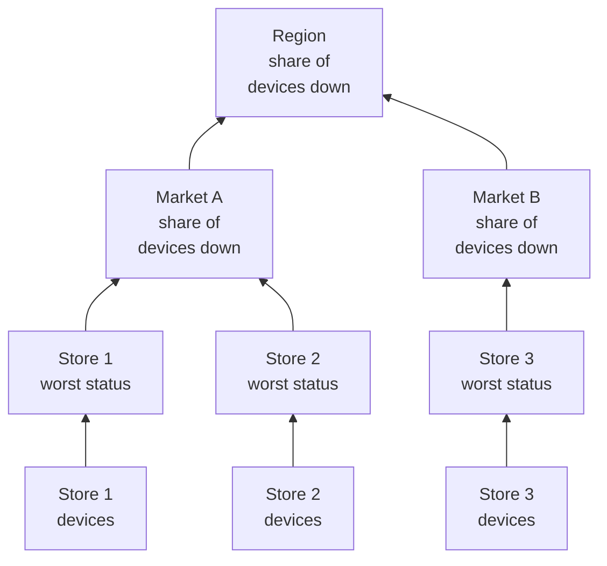

# Network Sites (Health Rollup & Uptime)

A Network Site is a place: a region, a market, a franchisee, a distribution centre, one store. Sites nest inside each other, network devices attach to them, and OneUptime rolls the devices' health up the tree, so one status on a Region answers "is anything wrong out there?".

Find them under **Network → Sites**, and on a map under **Network → Map**. This page pins down how a site's status is worked out from what is beneath it, what its uptime means, and how scheduled maintenance changes both.

:::cards
- [Add a site](#adding-a-site): Three steps, or a CSV file for a whole estate.
- [Set monitoring defaults](#monitoring-defaults): A probe and credentials for every device in a site.
- [Choose how health rolls up](#how-parent-health-is-calculated): Worst status for a store, a share for a region.
- [Read uptime](#uptime): What the percentages count, day by day.
:::

## How it works



Each site's status comes from every device in its subtree, judged by the site's own [rollup policy](#how-parent-health-is-calculated). A site's uptime comes from its own status timeline, and a [maintenance window](#scheduled-maintenance-for-network-sites) on a site takes its devices out of the vote above it.

## The Hierarchy

Sites form a tree. Each site has a **Site Type** and an optional parent site. Site types are the project's own list, under **Network → Settings → Site Types**, and a new project starts with Account Type, Region, Franchisee, Market and Unit, in that order from the top, plus Data Center and Other. Types form a hierarchy of their own (**Parent Site Type**), which decides which sites can be a site's parent. A type marked **Is Unit Level** is the leaf tier of your estate, the individual store or branch: its sites hold devices, not other sites.

A site's type, name, description, parent and location are edited in one place: the **Site Settings** card on the site's **Settings** page. The site's Overview shows them with an **Edit in Settings** link, and the **Sites** list adds sites but does not edit them.

Each device attaches to one site. A site's subtree is the site itself plus every site beneath it, and the subtree's devices are what its health rolls up from, so a Region with no devices of its own still has a status, because the units under it do.

> [!NOTE]
> A rollup is worked out again when a device's status changes, when a device moves to another site, when a site moves in the tree, and by a sweep every five minutes that catches the cases where only the passing of time changed the answer.

## Adding a Site

:::steps
### Start a new site
Go to **Network → Sites** and click **Add Site**.

### Say what the site is
On the **Site Details** step, pick the **Site Type** (what kind of place this is: a region, a store, a data center) and type a **Name**. The description, the street address, and the latitude and longitude that pin the site on the map are folded under **More fields**: fill them in now or later.

### Place it in the tree
On the **Hierarchy** step, pick the **Parent Site** if the site sits under another one. Leave it empty to keep the site at the top level.

### Set its defaults
On the **Monitoring Defaults** step, pick the [default probe and credential profile](#monitoring-defaults) for devices added to the site, and click **Add Site**.
:::

On a site's own **Child Sites** page, **Add Child Site** asks only the type and the name, on one page with the location folded, and places the new site under that one.

### Import sites from a CSV file

To bring in a whole estate at once, open the menu at the top of the **Sites** list and click **Import from CSV**. The file needs a header row; the columns can come in any order and their names are not case-sensitive:

```csv title="sites.csv"
name,siteType,parentName,address,latitude,longitude
North,Region,,,,
Leeds,Market,North,,,
Store 0660,Unit,Leeds,"1 High Street, Leeds",53.7997,-1.5492
```

- `name` and `siteType` are required. `siteType` must be one of the project's site types.
- `parentName` names the parent site, which can be in the same file: rows with no parent, or with a parent that already exists, go in first, then their children. Leave it empty for a top-level site.
- A row whose parent cannot be found is skipped, and the results list it. **Preview Import** shows what the file will create before anything is written.

## The Map

**Network → Map** shows your sites on a map, framed to wherever they are; click a site to drill in. A site with sites under it shows them, on the map and as a graph of the links between them. A site with no sites under it but devices of its own, or a site whose type is unit-level, opens those devices' live topology.

A project with no sites yet still has a map: the Map shows its devices' topology instead, and grouping devices into sites puts them on the map by location.

## Monitoring Defaults

A site is also where you say, once, how the devices in it are monitored. **Edit Settings** on the **Site Settings** card has a **Monitoring Defaults** step with two fields:

| Setting | Effect |
| --- | --- |
| **Default Probe** | The probe that pings devices in this site, and walks them over SNMP when they have credentials. A device created in the site with no probe of its own takes it, and so does a device moved in without one. |
| **Default SNMP Credential Profile** | The [credential profile](/docs/monitor/network-device-monitor#snmp-credentials-and-credential-profiles) devices in this site are walked with when neither the device nor its own profile has credentials. |

Set both on a site and a new device there can be added by its address alone: it is pinged from its first poll and walked from its first poll.

The two behave differently, on purpose:

- The probe is copied onto the device when the device is created in, or moved into, the site. Changing a site's default probe later does not move devices that already have one: which probe can reach a device is a fact about the network, not a preference to rewrite in bulk from a site form.
- The credential profile is read live, on every poll. Set one on a site and every device in it without credentials starts being walked on its next poll, with no per-device edit; clear it and they go back to being pinged only.

They also reach different distances down the tree:

- The probe reaches through the whole tree. A device landing in a site with no default probe takes the nearest ancestor's, so one probe set on a Region covers every Market and Unit beneath it, and a Market that names its own overrides it for its subtree.
- The credential profile is read from the device's own site only. A device in a Unit does not pick up a profile set on its Region, so set it on the sites the devices actually attach to.

## How Parent Health Is Calculated

Each site picks one of two rollup policies, on the **Health Rollup** card of its **Settings** page (**Rollup Policy**).

### Worst status of any device (default)

The worst status any device in the subtree reports becomes the site's status. How bad a status is comes from its priority as a monitor status: a new project's statuses are Operational (1), Degraded (2) and Offline (3), and higher is worse. One offline device makes the site offline, however many healthy devices sit beside it.

This is the right answer for a Unit. Four switches and a firewall in one building are not independent: one of them dark is a problem at that address, and averaging it away hides a real outage.

It is usually the wrong answer for a Region above four hundred stores. One dark switch in store 12,000 paints the whole region Offline: true in the narrowest sense, and useless in every practical one, because the region is then red whenever any store anywhere has a problem, and stops telling you anything.

### Percentage of devices down

The site's status is decided by the share of the subtree's reporting devices that are not in an operational status:

| Share of devices down | Site status |
| --- | --- |
| 0% | Operational |
| Above 0%, below the threshold | Degraded: the project's status that is neither operational nor offline, or Offline when the project has none |
| At or above the threshold | Offline |

The threshold is set per site, as **Offline Threshold (%)**, and is 50 by default.

Nothing down is Operational however low the threshold is set: a threshold of 0 means "any device down makes this offline", not "a healthy region is offline".

### Which devices get a vote

Both policies agree here, and it matters more than it sounds:

- Archived devices never vote. They are decommissioned: they keep their site but are left out.
- Devices that have never reported anything never vote. A device waiting for its first poll is no evidence of an outage, so it is left out of both sides of the share, and a region half-way through onboarding is scored on the half that has answered.
- A probe-polled device, the normal kind, votes with the outcome of its last poll: reachable by ping or SNMP, not how long ago it last succeeded. A device that answers ping while its SNMP walk fails is reachable and votes that way; the site says it is up, and the device's row says **SNMP failing** so somebody fixes the credentials.
- A monitor-backed device, one switched to the bound-monitor override on its Settings page, votes with the status of the monitor bound to it, because nothing polls it. With nothing bound it has never reported, so it does not vote at all.

A Network Device monitor on a probe-polled device does not change how the device votes. A monitor with an "interface down, so Offline" criteria would stamp Offline on a switch that answers every ping, and one dark port would turn a whole site red while every device row beneath it reads Up: the site would disagree with the list it sums up. For a polled device, the poll is the source of its health; the monitor is there to raise incidents.

### Choosing a policy

A reasonable start for a franchise estate:

| Tier | Policy | Why |
| --- | --- | --- |
| Unit or store | Worst status | One device down is one site in trouble. |
| Market | Percentage, threshold about 50% | A market with half its stores down is down. |
| Region | Percentage, threshold 25% to 50% | A single-store failure turns the region Degraded, not Offline, and it turns Offline when something systemic happens. |

The policy is set per site, so you can give the Region rows the percentage policy and leave everything beneath them on the default.

## Uptime

Every site has a status timeline: one row per change of its rolled-up status, opened when the status changes and closed when it changes again. Uptime is worked out from it:

- Time in a status not marked operational is downtime.
- Overlapping rows are merged, so no second counts twice.
- Time not covered by any row counts as up. The timeline gains rows only once a rollup has run, and no evidence is not an outage.
- A row still open runs to the end of the window measured.

Degraded is not operational, so it counts as down too. Under either policy, then, a site's uptime is the share of time when no reporting device beneath it was down: the policy changes the status a partial outage shows, Degraded or Offline, not whether it counts.

A site with no timeline rows at all shows `—` rather than 100%: a site nothing has ever rolled up is unmonitored, not perfect.

### Daily uptime

Beside the 30-day figure, every site's Overview shows **Uptime (24h)**, and its **Status Timeline** page shows the last 24 hours, 7, 30 and 90 days, and a bar per day for the last 30.

A 30-day average cannot show a bad day. A full day of outage in a 30-day window costs 3.3 points, so a site that was dark for a whole Tuesday still reports 96.7% for the month, a number that reads like rounding. The daily bars put the same data where one bad day is one bad bar.

Days are rolling 24-hour slices ending now, not calendar days: the devices, the viewer and the server can each be in a different time zone, and there is no one "day" they would agree on.

### Parent uptime is not an average of child uptime

A parent's uptime comes from the parent's own timeline, which its rollup policy produced, not from the average of its children's percentages.

An average over children weighs a store with two devices the same as a distribution centre with two hundred. A parent's own timeline instead gives a reading you can state in one sentence: the share of time nothing at all in the region was down. It is strict on purpose, so on a large region read it with the daily bars, and with the status, which says whether a partial outage was Degraded or Offline.

## Scheduled Maintenance for Network Sites

Attach sites to a scheduled maintenance event under **Other Affected Resources**, on the event's **Resources Affected** step, as you would a host. A site's own **Scheduled Maintenance** page lists the events attached to it, and its **Create Scheduled Maintenance Event** opens the form with the site already picked.

A window on a parent covers everything beneath it: a window on a Region covers every Market and Unit in it, including sites created after the window was scheduled, so a regional carrier cutover does not have to list four hundred stores.

Coverage reaches down only. A window on one Unit does not put its Region under maintenance: the region is still expected to be up, and a real failure in another unit during the same hours still counts against it.

### What a maintenance window changes

| During the window | What happens |
| --- | --- |
| The site's live status | Unchanged. A unit that is off for planned work still reads Offline on the map and in the tree, with an "In maintenance" badge beside it: whoever looks at it needs to know it is off. |
| The site's uptime | The window is taken out of both the downtime and the period measured. Two hours of maintenance make the day 22 hours long, and nothing inside those two hours counts either way. |
| Its ancestors' health rollup | The maintained subtree's devices stop voting, so the region does not turn red for a cutover that was on the calendar. |
| Its ancestors' uptime | Unaffected, with nothing to correct, because the planned outage never reached their timelines. |

That last row is why ancestors are handled by holding back votes rather than by taking the window out of their uptime: taking it out of the region's period would also erase a real failure elsewhere in the region during the same hours.

Uptime is corrected with the event's declared start and end time, not with when a worker moved it between states, so the number can be checked by hand against the calendar. A day that falls entirely inside a window is drawn as maintenance in the daily bars rather than as a perfect day, and adds nothing to the average.

### Interaction with monitors

Attaching a monitor to the same event still does what it always does: active monitoring of that monitor pauses for the window. The two are independent: attach the site to keep it out of the rollup and its uptime, and attach the monitors to stop them alerting.

## Alerting on a Site

The **Alerting** card on a site's **Settings** page has **Alert When Unhealthy**: an alert opens when the site's rollup moves to a status that is not operational, and resolves itself when the site recovers. **Alert Severity** sets its severity; left empty, it is the project's most severe.

It alerts on the change only: turning it on for a site that is already unhealthy arms the next change rather than alerting about the past. Degraded is not operational, so a site on the percentage policy alerts as soon as one of its reporting devices is down, as a site on the worst-status policy does; the alert stays open, with no second one, while the site moves between Degraded and Offline, and its title names the status the site reached first.

## Troubleshooting

:::details A region is always red
The site is on the worst-status policy, so one offline device anywhere beneath it makes it offline. Switch the region to **Percentage of devices down** on its **Health Rollup** card, with a threshold that matches how much of the region has to be down before you call it down.
:::

:::details A site shows — instead of an uptime
No rollup has ever run for the site, so it has no timeline rows: it is unmonitored, not perfect. Add devices to the site, or to the sites beneath it, and the next rollup starts its timeline.
:::

:::details A device does not count towards its site
Archived devices, and devices that have not reported yet, never vote. A monitor-backed device with no monitor bound has never reported either. Check the device's status: a **Pending** device starts voting after its first poll.
:::

:::details A site's alert did not fire
**Alert When Unhealthy** fires on a change from an operational status to any other, so a site that was already unhealthy when you turned it on alerts on its next change, after it recovers. Check too that its devices vote: archived devices and devices waiting for their first poll never do, and the devices of a site under maintenance do not vote in the rollups above it.
:::

## Next steps

:::cards
- [Network Device Monitor](/docs/monitor/network-device-monitor): Add, poll and alert on the devices that attach to these sites.
- [Network Traffic](/docs/monitor/network-traffic): See a site's traffic from its devices' flow records.
- [Inventory](/docs/inventory/overview): Network devices beside every other asset you have.
:::
