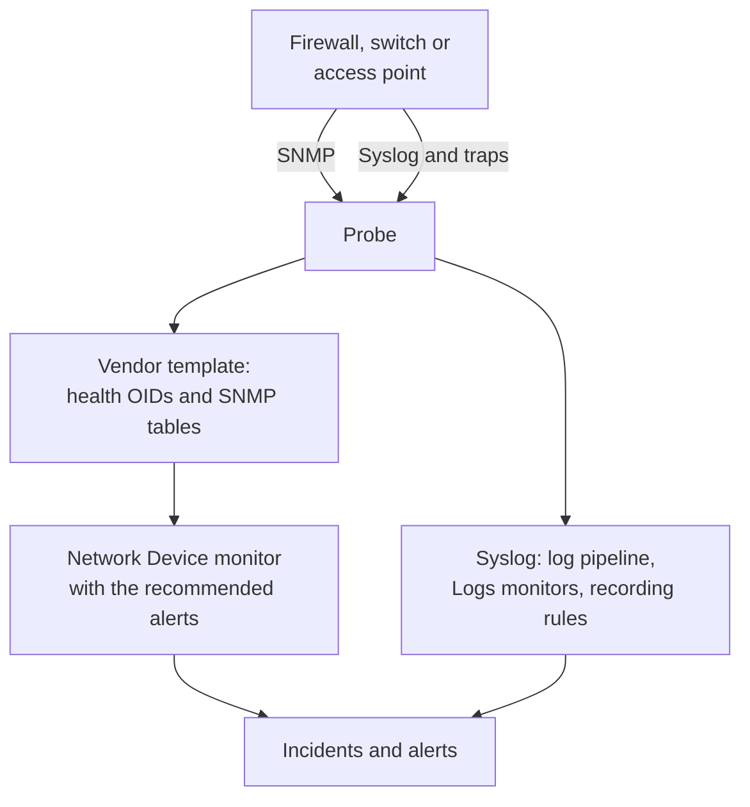

# Network Vendor Guides (Sophos, Extreme, Cambium)

How to monitor three common estates end to end with OneUptime: a Sophos Firewall (XGS, SFOS) with its IPsec tunnels, WAN links and SD-WAN; Extreme Networks switches (EXOS / Switch Engine and Fabric Engine / VOSS) with their fabric; and Cambium Networks cnMatrix switches and Enterprise Wi-Fi access points, down to each radio's channel and transmit power.

:::cards
- [Sophos Firewall](#sophos-firewall-xgs-sfos): Tunnels, WAN links, gateways and SD-WAN.
- [Extreme Networks](#extreme-networks-exos-switch-engine-and-fabric-engine-voss): Switches, the fabric and its hardware.
- [Cambium Networks](#cambium-networks-enterprise-wi-fi-and-cnmatrix): Access points down to each radio, and cnMatrix switches.
:::

## How it works

Every guide uses the same pieces:

- A [network device](/docs/monitor/network-device-monitor) per box, polled by a probe that can reach it, with a vendor template that brings the right health OIDs and [SNMP tables](/docs/monitor/network-device-monitor#snmp-tables).
- A Network Device monitor per device for alerting. Create it from the device's page so the [recommended alerts](/docs/monitor/network-device-monitor#recommended-alert-pack), including one per-row alert for each table that knows what healthy looks like, are filled in for you. For a fleet, an [alert policy](/docs/monitor/network-device-monitor#alert-policies) keeps one on every device.
- For what a vendor reports only in its logs: syslog to the probe, a [log pipeline](/docs/telemetry/log-pipelines) to turn each line into attributes, [Logs monitors with Group By](/docs/monitor/logs-monitor#per-group-alerting-group-by) to alert once per tunnel or gateway, and [log recording rules](/docs/telemetry/log-recording-rules) to chart the numbers in those logs.

## Sophos Firewall (XGS / SFOS)

| What you want to see | Where it comes from |
| --- | --- |
| Firewall health: memory, disk, swap, HA state, IPsec service, CPU per core | SNMP, with the **Sophos Firewall (SFOS / XGS)** vendor template |
| Every IPsec tunnel's status, by name | The SNMP table `ipsec_tunnels` (SFOS v20 and later) |
| Each WAN link's status, throughput, utilization and errors | The interface walk of the WAN ports |
| Each WAN link's latency, packet loss and jitter | Ping monitors and device polls from OneUptime probes |
| Gateway up and down, SD-WAN SLA met or not met, SD-WAN route changes | The firewall's syslog |
| SD-WAN latency, jitter and packet loss per gateway, as charts | Log recording rules over the SD-WAN SLA logs |

Sophos does not report gateway or SD-WAN health over SNMP, in any SFOS version: that exists only in the firewall's logs, and in Sophos Central's alerts, which is why the last three rows go through syslog.

### Register the firewall

:::steps
1. On the firewall, turn on SNMP under **Administration → SNMP**: add an SNMPv3 user, or a v2c community, and allow the probe's address to query it.
2. In OneUptime, go to **Network → Devices** and click **Add Device**. Type the firewall's management address, pick a probe that can reach it, and add the SNMP credentials under **SNMP**.
3. On the device's **Settings** page, under **Polling & Data Collection**, apply the **Sophos Firewall (SFOS / XGS)** template from **Vendor Health Template** and add its tables from **Add a Vendor's Tables**. Or turn on **Auto-Apply Vendor Health Template**, and the first poll does both.
:::

After the next poll, the device's **SNMP Tables** page lists every IPsec connection with its status (active, inactive, partially active), and the CPU cores. SFOS numbers its cores from 196608, which is why CPU comes from a table rather than from a single `hrProcessorLoad.1`.

### Alert on every IPsec tunnel

On the device's page, click **Create Monitor**. The recommended alerts include **IPsec Tunnels: row unhealthy**, an **SNMP Table Row Is Unhealthy** criteria on the `ipsec_tunnels` table with Row `*`: it opens one incident per tunnel that is not active, named after the tunnel, and resolves each one when its tunnel comes back.

A tunnel Sophos reports as active only has its security associations up. To prove traffic crosses it, add a [Ping monitor](/docs/monitor/ping-monitor) from a probe at one site to a host on the far side of each tunnel, and draw the tunnel as a site link under **Network → Topology → Site Links** between the two [sites](/docs/monitor/network-sites), bound to that monitor: the link on the map then takes the monitor's colour.

### WAN links

- **Port health.** The interface walk already measures every WAN port's status, bits in and out, utilization and errors. On the firewall's monitor, an **SNMP Interface Is Down** or **SNMP Interface Utilization (in %)** criteria with **Interface** set to the WAN port's name, or `*` for every port, alerts per link.
- **Path quality.** Each link's latency, packet loss and jitter are measured from outside the firewall: a Ping monitor from the OneUptime cloud probes to each WAN link's public address, and a Ping monitor from a probe at the site to each ISP's gateway. Packet loss and jitter criteria on those monitors alert per link, and **Network → Topology → Latency Matrix** shows every probe against every monitor at a glance.
- **Traffic.** SFOS exports NetFlow v5. Send it to the probe on UDP 2055, where the probe's flow collector listens by default, and the device's **Traffic** page shows who talks to whom over each WAN link; [Network Traffic](/docs/monitor/network-traffic) has the details.

### Gateways and SD-WAN from syslog

:::steps
1. Turn on the probe's syslog receiver: set `PROBE_SYSLOG_RECEIVER_ENABLED=true` on the probe. It listens on UDP 5140 by default (`PROBE_SYSLOG_RECEIVER_PORT` changes it); publish the port if the probe runs in Docker. Messages are matched to the network device whose hostname, or one of whose **Other Addresses**, is the sender's address, and appear on the device's **Logs** page.
2. On the firewall, under **System services → Log settings**, add a syslog server pointing at the probe and that port, and tick the **Event** log types for IPsec and gateways and the **SD-WAN** log type: the SLA logs stay off until it is ticked.
3. Under **Logs → Settings → Pipelines**, create a pipeline whose filter matches the firewall's logs, such as `attributes.networkDevice.name = 'hq-firewall'`, and add a **Key=Value Parser** with **Target Prefix** `sophos`. Paste a line from the firewall into its tester to see the exact attribute names your SFOS version produces; [the Sophos example](/docs/telemetry/log-pipelines#example-sophos-xgs-firewall) walks through it.
4. Create [Logs monitors](/docs/monitor/logs-monitor) on the firewall's logs, each with **Group by Attributes** so every tunnel or gateway alerts on its own, and the criteria **Log Count** **Greater Than** `0` over a few minutes. The rows below are the three to start with.
5. Chart SD-WAN quality: with SD-WAN logging on, the firewall writes an SLA summary per profile and gateway (`latency`, `jitter`, `packet_loss`). Under **Logs → Settings → Recording Rules**, create one rule per number, such as the average of `sophos.latency` grouped by `sophos.gw_name` and `sophos.profile_name`, then chart the results, or alert on them with a [Metrics monitor](/docs/monitor/metrics-monitor) that groups by gateway. [Log Recording Rules](/docs/telemetry/log-recording-rules) walks through this example.
:::

| Alert | Logs to count | Group by |
| --- | --- | --- |
| IPsec tunnel terminated | Attribute `sophos.log_component` = `IPSec`, body contains `terminated` | `sophos.con_name` |
| Gateway down | Attribute `sophos.log_component` = `Gateway`, body contains `is Down` | `sophos.gatewayname` |
| SD-WAN SLA not met | Attribute `sophos.log_type` = `SD-WAN`, body contains `SLA not met` | `sophos.gw_name` |

The syslog events complement the SNMP table: they arrive the moment a tunnel drops, while the table also catches a tunnel that never came up.

### Traps

Every Sophos notification is the same trap, `sfosNotification` (`1.3.6.1.4.1.2604.5.1.8.1.1`), with the event as text in `sfosTrapMessage` (`1.3.6.1.4.1.2604.5.1.8.1.2`). To alert on one kind of event, combine **SNMP Trap Received (Trap OID)** Equal To `1.3.6.1.4.1.2604.5.1.8.1.1` with **SNMP Trap Varbind Value** on that varbind, Contains `IPSec` for example. Set the firewall's trap destination to SNMP v2c: the probe's trap receiver takes v1 and v2c traps.

## Extreme Networks (EXOS / Switch Engine and Fabric Engine / VOSS)

| What you want to see | Where it comes from |
| --- | --- |
| EXOS: CPU, temperature and its alarm, power state, power supplies, fans, memory per slot, stack members | The **Extreme Networks EXOS / Switch Engine** template |
| Fabric Engine: CPU and memory per slot, temperature sensors, fans, power supplies, vIST session, I-SID count | The **Extreme Networks Fabric Engine / VOSS** template |
| Every Fabric Connect (IS-IS) adjacency, named by its neighbour | The Fabric Engine template's table `isis_adjacencies` |
| Ports, LLDP neighbours, the network map | The interface walk, on both |

### Which template

Fabric Engine on Extreme's universal hardware (the 5000 and 7000 series) reports the same enterprise number as EXOS: only its system description (`7520-48Y-8C-FabricEngine (9.0.4.0)`) says which operating system is running. OneUptime reads both, so auto-apply and the device page's suggestion pick the right template, and older VSP switches report the Avaya/Nortel arc and are recognised as Fabric Engine directly.

### Fabric and hardware alerts

The recommended alerts on a Fabric Engine switch include **Fabric Adjacencies (IS-IS): row unhealthy**, an incident per neighbour whose adjacency is not up. Fabric Engine also sends a trap when an adjacency changes, `rcnIsisPlsbAdjStateTrap` (`1.3.6.1.4.1.2272.1.21.0.281`), and an **SNMP Trap Received (Trap OID)** criteria on it alerts within seconds, before the next poll.

Power supplies, fans, temperature sensors and stack members are tables that declare their healthy values, so each gets a per-row alert in the recommended alerts.

### Flows and Wi-Fi

EXOS and Fabric Engine export flows as sFlow and IPFIX. Send sFlow to the probe on UDP 6343, or IPFIX on UDP 4739, and the device's **Traffic** page shows its traffic; see [Network Traffic](/docs/monitor/network-traffic).

IQ Engine (HiveOS) access points and ExtremeCloud IQ Controller have vendor templates of their own, which fill the device's **Wi-Fi** page. [Supported Wi-Fi Vendors](/docs/monitor/network-device-monitor#supported-wi-fi-vendors) covers them, with Ubiquiti UniFi, HPE Aruba, TP-Link Omada and Juniper Mist.

## Cambium Networks (Enterprise Wi-Fi and cnMatrix)

### Access points

:::steps
1. Turn on SNMP on the access points. In cnMaestro, SNMP is set per AP group: **Configuration → Wi-Fi Profiles → AP Groups → Management → SNMP**. Turn it on with a v2c read community or an SNMPv3 user.
2. Add each access point with its management address and those credentials, and apply the **Cambium Networks Enterprise Wi-Fi (cnPilot, XV, XE, XH)** template, or turn on auto-apply.
3. Open the device's **Wi-Fi** page. It shows how many radios are on, the clients and SSIDs, then every radio's band, channel, frequency, channel width, transmit power, clients, noise floor and airtime, and every SSID with its clients. The frequency is worked out from the band and channel; the access point does not report it.
:::

Useful alerts, all on the `wifi_radios` table with Row `*`, so each radio alerts on its own:

| Alert | Criteria |
| --- | --- |
| A radio switched off | **SNMP Table Row Is Unhealthy**, part of the recommended alerts |
| Transmit power changed | **SNMP Table Value**, column TX Power, Not Equal To your planned power |
| A crowded radio | **SNMP Table Value**, column Clients, Greater Than your limit |
| A noisy channel | **SNMP Table Value**, column Noise Floor, Greater Than `-80` |

Every numeric radio value is also a metric (`oneuptime.monitor.snmp.table.value`, one series per radio and column), so channel, power and clients can be charted over time on a dashboard; a channel that keeps changing is DFS at work.

Cambium reports the total client count only from firmware 6.5.3; earlier firmware returns 0.

### cnMatrix switches

The **Cambium Networks cnMatrix** template collects CPU, RAM, flash, temperature and supply voltage, and fans, the redundant power supply and each port's PoE draw as tables. Ports and LLDP neighbours come from the interface walk, as on any switch.

### cnMaestro alarms

cnMaestro can send its alarms, such as an access point going offline, to an HTTPS webhook. Point it at an [Incoming Request monitor](/docs/monitor/incoming-request-monitor) to turn those alarms into OneUptime incidents beside the SNMP data.

## Troubleshooting

:::details The IPsec Tunnels table has no status
Tunnel status needs SFOS v20 or later. Check too that the SNMP view of your credentials includes the Sophos enterprise tree (`1.3.6.1.4.1.2604`): a restricted v3 user often sees only the system group and IF-MIB.
:::

:::details No syslog arrives from the firewall
The probe's syslog receiver is off by default: set `PROBE_SYSLOG_RECEIVER_ENABLED=true` and publish UDP 5140, or your `PROBE_SYSLOG_RECEIVER_PORT`, to the probe. Messages are matched to a device by the sender's address, so the firewall's hostname in OneUptime, or one of its **Other Addresses**, must be the address it sends syslog from.
:::

:::details A Fabric Engine switch got the EXOS template
The template is picked from the switch's system description. Check that the device's Overview shows a description naming Fabric Engine (such as `7520-48Y-8C-FabricEngine (9.0.4.0)`); if it does, remove the EXOS OIDs and tables and apply **Extreme Networks Fabric Engine / VOSS** from **Vendor Health Template**.
:::

:::details Cambium access points report 0 clients
The total client count needs firmware 6.5.3 or later. On older firmware the radios still report their channel, power and noise floor.
:::

## Next steps

:::cards
- [Network Device Monitor](/docs/monitor/network-device-monitor): Everything a device collects, and every criteria it can alert on.
- [Log Pipelines](/docs/telemetry/log-pipelines): Parse firewall logs into attributes.
- [Logs Monitor](/docs/monitor/logs-monitor): Alert once per tunnel or gateway.
:::
