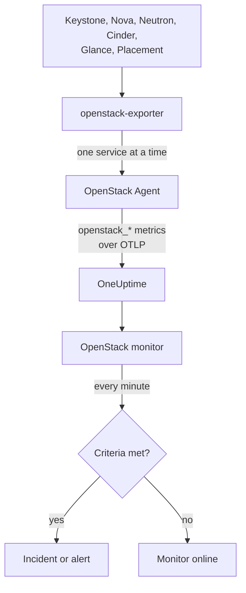

# OpenStack Monitor

An OpenStack monitor watches one cloud - its APIs, the workers behind them, hypervisors, instances, networks, storage pools and project quotas - and tells you when an API stops answering, a worker goes down, a hypervisor has no room to give or a pool fills up. It reads the `openstack_*` series the OneUptime OpenStack Agent collects from openstack-exporter.

:::cards
- [Create the monitor](#create-an-openstack-monitor): Six steps in the dashboard.
- [Templates](#pre-built-alert-templates): Ready-made alerts, one incident per worker, instance, network or region.
- [Identity attributes](#identity-attributes): How to target one region, host or project.
- [Metrics](#collected-metrics): Every series the monitor can alert on.
:::

## How it works

The agent is an OpenTelemetry Collector and an openstack-exporter that you run on a machine that can reach the cloud's APIs. It reads each OpenStack service in its own collection, so a failing Nova costs only Nova's series, and it reads gently: compute, network, volume and placement every 2 minutes, identity and image every 5.

Each series is stamped with the cloud's name, `openstack.cloud.name`, and each datapoint with `openstack.region.name` and `openstack_service`. A cloud is one Keystone, and an OpenStack monitor is tied to one cloud. Every minute it runs its query over that cloud's metrics and compares the result with its criteria.



## Before you begin

- **Collect the cloud's metrics** with the OpenStack Agent. The cloud's **Documentation** page, under **Products → Infrastructure → OpenStack**, walks you through installing it.
- **Check the cloud is registered.** It appears under **Products → Infrastructure → OpenStack**, named after the agent's `OPENSTACK_CLOUD_NAME`, after its first collection.

## Create an OpenStack monitor

:::steps
### Start a new monitor

Go to **Monitors** and click **Create Monitor**.

### Pick OpenStack

Under **Monitor Type**, click **More monitor types** and pick **OpenStack** under **Infrastructure**, or type `openstack` in the search box. Enter a **Name** - it is used in incident and alert titles - and click **Next**.

### Choose the cloud

Under **OpenStack Monitor Configuration**, pick the cloud from **OpenStack Cloud**. Every cloud that has sent data is in the list. Once picked, a line under the field says whether data is arriving.

### Choose what to watch

A new monitor starts on **Cloud Stopped Reporting**, under **What to alert on**. To watch something else:

- **Change** - pick another [template](#pre-built-alert-templates). It sets the metric, the attribute filters, the aggregation, the time range, the group-by and the thresholds, and replaces the criteria below with its own. You can still change the **Time Range**.
- **Custom Metric** (under **More fields**) - pick one metric from **OpenStack Metric**, then set **Aggregation** and **Time Range**, and narrow it with the [filters](#monitor-settings).
- **Advanced** (under **More fields**) - build queries and formulas yourself under **Select Metrics**, with filters on attributes such as `status`, `adminState` or `resourcetype`. Use **Group by** an [identity attribute](#identity-attributes) to judge each part on its own.

### Check the criteria

Open each criteria under **Monitor Criteria** and check its **Metric**, **Aggregation**, **Condition** and **Threshold**. A template fills these in. With **Custom Metric** or **Advanced**, the monitor starts with the default criteria, which only notice the metric sending no data, so set your own threshold.

### Create the monitor

Click **Create Monitor**. OneUptime opens the monitor's page and evaluates it every minute. Incidents and alerts it raises are also listed on the cloud's **Incidents** and **Alerts** pages.
:::

> [!TIP]
> To set up several templates at once, open the cloud from **Products → Infrastructure → OpenStack** and go to **Recommendations**. Pick the templates you want, choose who is paged, and OneUptime creates one monitor per template.

## Monitor settings

| Field | Tab | What it does |
| --- | --- | --- |
| **OpenStack Cloud** | All | Required. Scopes every query to `resource.openstack.cloud.name`. |
| **Region** | Custom Metric, Advanced | Optional. One region: `openstack.region.name`. Every series carries it. |
| **Availability Zone** | Custom Metric, Advanced | Optional. One zone: `availability_zone` on hypervisors, instances, volumes and Neutron agents, `zone` on Nova's and Cinder's workers. |
| **Hypervisor** | Custom Metric, Advanced | Optional. One host: `hostname` on workers, hypervisors and Placement, `hypervisor_hostname` on instances. Nova's workers say the host's short name, and hypervisors, Placement and instances its full name, so use the one the series says. |
| **Service** | Custom Metric, Advanced | Optional. One worker's binary, such as `nova-compute`: `service`. |
| **Project ID** | Custom Metric, Advanced | Optional. One project: `tenant_id` on Nova's and Cinder's series and on networks and subnets, `project_id` on floating IPs, routers and address availability. |
| **OpenStack Metric** | Custom Metric | One metric from the [catalog](#collected-metrics). |
| **Aggregation** | Custom Metric | How samples are combined: **Average**, **Maximum**, **Minimum**, **Sum** or **Count**. Starts at the metric's usual aggregation. |
| **Time Range** | All | The rolling window the query reads, from **Past 1 Minute** to **Past 365 Days**. A new monitor starts at **Past 15 Minutes**; templates set their own. |
| **Select Metrics** | Advanced | The query builder: **Metric**, **Aggregate by**, **Filter by attributes**, **Group by**, plus **Add Metric** and **Add Formula** to combine queries. |

A filter narrows only a series that carries its label: `openstack_nova_up` has no project, so a project filter leaves it as it is.

Keep the window at three collections or more of what you read: 6 minutes for compute, network, volume and placement, 15 for identity and image. A shorter one does not hold enough collections for **All Values** to mean a duration.

## Identity attributes

Every series carries `openstack.cloud.name` as a **resource attribute**, and `openstack.region.name` and `openstack_service` as datapoint attributes. The exporter's own labels say the rest:

| Part | Series | Labels that identify it |
| --- | --- | --- |
| API | `openstack_*_up` | `openstack.region.name`, `openstack_service` |
| Worker | `openstack_nova_agent_state`, `openstack_neutron_agent_state`, `openstack_cinder_agent_state` | `hostname`, `service`. `adminState` says whether an operator left it on. Never group by `uuid` on Cinder's: the exporter makes one up on every collection |
| Hypervisor | `openstack_placement_resource_*`, `openstack_nova_vcpus_*` | `hostname` (its full name), `resourcetype` on Placement's |
| Instance | `openstack_nova_server_status` | `uuid`, `name`, `tenant_id`, `hypervisor_hostname`, `status`. The value is a code: filter on the `status` word |
| Volume | `openstack_cinder_volume_gb` | `id`, `name`, `tenant_id`, `status` |
| Storage pool | `openstack_cinder_pool_capacity_*` | `name`, `volume_backend_name` |
| Network | `openstack_neutron_network_ip_availabilities_*` | `network_id`, `network_name`, `cidr`, `ip_version` |
| Router | `openstack_neutron_l3_agent_of_router` | `router_id`, `agent_host`, `ha_state`, `agent_alive`, `agent_admin_up` |
| Project | `openstack_nova_limits_*`, `openstack_cinder_limits_*` | `tenant_id`, `tenant` |

In monitor filters and group-by keys, a resource attribute starts with `resource.` (`resource.openstack.cloud.name`), and a datapoint attribute does not (`openstack.region.name`, `hostname`, `status`). An empty label does not reach OneUptime, so `disabledReason` is there only on a worker someone disabled.

## Pre-built Alert Templates

OneUptime ships 69 templates for common OpenStack problems, and the **What to alert on** list offers all of them. Each builds a complete monitor: the metric query, its attribute filters, a group-by on what one incident is about, a criteria that fires and one that recovers. Thresholds are the same lines the cloud's own pages draw, and are starting points you can edit.

Every template reads at least three collections of what it watches, and fires only when the condition holds for its whole window. A threshold on a share recovers 10% past its line, so a value hovering there does not flap.

| Template | Category | Severity | Watches | Fires when | Recovers when |
| --- | --- | --- | --- | --- | --- |
| Cloud Stopped Reporting | Availability | Critical | `openstack_identity_up`, Count over the whole cloud, **past 15 minutes** | No data for the whole window: the agent stopped or cannot reach OneUptime, or the exporter cannot log in to Keystone | Data arrives again |
| Identity API Down | Availability | Critical | `openstack_identity_up` and `scrape_samples_scraped` for `identity`, Min per region, **past 15 minutes** | Every call failed, or the collection came back empty because the exporter could not log in | Both read 1 or more |
| Compute API Down | Availability | Critical | `openstack_nova_up` and `scrape_samples_scraped` for `compute`, Min per region, **past 10 minutes** | Every call failed, or the collection came back empty because the exporter could not reach Nova's API | Both read 1 or more |
| Network API Down | Availability | Critical | `openstack_neutron_up` and `up` for `network`, Min per region, **past 10 minutes** | Every call failed, or the exporter did not answer | Both read 1 |
| Block Storage API Down | Availability | Critical | `openstack_cinder_up` and `up` for `volume`, Min per region, **past 10 minutes** | Every call failed, or the exporter did not answer | Both read 1 |
| Image API Down | Availability | Critical | `openstack_glance_up` and `up` for `image`, Min per region, **past 15 minutes** | Every call failed, or the exporter did not answer | Both read 1 |
| Placement API Down | Availability | Critical | `openstack_placement_up` and `up` for `placement`, Min per region, **past 10 minutes** | Every call failed, or the exporter did not answer | Both read 1 |
| Compute Service Down | Control Plane | Critical | `openstack_nova_agent_state` filtered to `service = nova-compute` and `adminState = enabled`, Min per host, **past 10 minutes** | Below 1: an enabled nova-compute is down. One someone disabled never fires | Up, or disabled |
| Scheduler or Conductor Down | Control Plane | Warning | `openstack_nova_agent_state` filtered to `nova-scheduler` or `nova-conductor` and `adminState = enabled`, Min per host and binary, **past 10 minutes** | Below 1. The others carry on while any is left | Up, or disabled |
| Every Scheduler or Conductor Down | Control Plane | Critical | The same, Max per region and binary, **past 10 minutes** | Below 1: none is alive, so nothing new can boot | One is up |
| Network Agent Down | Control Plane | Critical | `openstack_neutron_agent_state` filtered to `adminState = up`, Min per host and binary, **past 10 minutes** | Below 1: an agent set up is not alive. One someone set down never fires | Alive, or set down |
| Block Storage Service Down | Control Plane | Critical | `openstack_cinder_agent_state` filtered to `adminState = enabled`, Min per host and binary, **past 10 minutes** | Below 1: an enabled Cinder service is down. One someone disabled never fires | Up, or disabled |
| vCPU Allocation High | Compute | Warning | `openstack_placement_resource_*` filtered to `resourcetype = VCPU`, usage / ((total - reserved) x ratio), per hypervisor, **past 10 minutes** | Above 90%: allocation, not load | At or below 81% |
| Memory Allocation High | Compute | Warning | The same, `resourcetype = MEMORY_MB` | Above 90% | At or below 81% |
| Local Disk Allocation High | Compute | Warning | The same, `resourcetype = DISK_GB` | Above 90% | At or below 81% |
| Hypervisor CPU Saturated | Compute | Warning | `openstack.hypervisor.instances.cpu.utilization`, per hypervisor, **past 15 minutes**. Needs libvirt's or Ceilometer's exporter | Above 90% of its CPU threads: load, not allocation. Its page names the instances responsible | At or below 81% |
| Hypervisor Memory Pressure | Compute | Warning | `openstack.hypervisor.instances.memory.utilization`, per hypervisor, **past 15 minutes**. Needs libvirt's exporter, or Ceilometer's polling `memory.resident` | Above 90% of its memory: in use, not promised | At or below 81% |
| Instance CPU Saturated | Compute | Warning | `openstack.instance.cpu.utilization`, Max per instance, **past 15 minutes**. Needs libvirt's or Ceilometer's exporter | Above 95% of its vCPUs | At or below 85.5% |
| Instance Disk Latency High | Compute | Warning | `openstack.instance.disk.read.latency` and `openstack.instance.disk.write.latency`, Max per instance and disk, **past 15 minutes**. Needs libvirt's exporter, or Ceilometer's polling `disk.device.read.latency` and `disk.device.write.latency` | Above 50 ms per request. A disk with no requests has no latency, so an idle one never fires | At or below 45 ms, or it stops being used |
| Instances in Error | Compute | Warning | `openstack_nova_server_status` filtered to `status = ERROR`, Count per region, **past 10 minutes** | Above 0 | None left |
| Instance Stuck Building | Compute | Warning | `openstack_nova_server_status` filtered to `status = BUILD` or `BUILD(spawning)`, Max per instance, **past 1 hour** | In that status at every collection for an hour | Left it |
| Instance Stuck Transitioning | Compute | Warning | The same for `REBUILD`, `RESIZE`, `REVERT_RESIZE`, `MIGRATING`, `REBOOT`, `HARD_REBOOT` and `PASSWORD`, **past 1 hour** | In one of them at every collection for an hour | Left it |
| Instance Stuck in Verify Resize | Compute | Warning | The same for `VERIFY_RESIZE`, **past 1 hour** | Waiting for someone to confirm or revert for an hour | Confirmed or reverted |
| Router Not Active | Network | Warning | `openstack_neutron_routers_not_active`, Max per region, **past 10 minutes** | Above 0 | At 0 |
| Floating IP Not Active | Network | Warning | `openstack_neutron_floating_ips_associated_not_active`, Max per region, **past 10 minutes** | Above 0: one in use is not ACTIVE. A spare one is meant to be down | At 0 |
| External IP Pool Nearly Full | Network | Warning | `openstack_neutron_network_ip_availabilities_*` for `ip_version = 4`, beside `is_external = true` on `openstack_neutron_network`, per network, **past 10 minutes** | Above 90% of an external network's IPv4 addresses. A tenant's network never fires | At or below 81% |
| Network Out of IPs | Network | Critical | The same | At 100%: no address left | Below 90% |
| Router Without Active Agent | Network | Critical | `openstack_neutron_l3_agent_of_router` filtered to `agent_admin_up = true`, Max per router, **past 10 minutes** | Below 1: no agent holding it is alive. Silent on OVN, which has no such agents | One is alive |
| Router With Two Active Agents | Network | Critical | The same filtered to `ha_state = active` and `agent_alive = true`, Count per router, **past 10 minutes** | Above 1: a split brain. Silent on OVN | At or below 1 |
| Storage Pool Warning | Storage | Warning | `openstack_cinder_pool_capacity_*`, (total - free) / total, per pool, **past 10 minutes** | Above 85% | At or below 76.5% |
| Storage Pool Critical | Storage | Critical | The same | Above 95% | At or below 85.5% |
| Volumes in Error | Storage | Warning | `openstack_cinder_volume_status_counter` for each error word, Max per region and word, **past 10 minutes** | Above 0 | At 0 |
| Volume Stuck | Storage | Warning | `openstack_cinder_volume_gb` for each passing status word, Max per volume, **past 30 minutes** | In that status at every collection for 30 minutes | Left it |
| Image Stuck | Storage | Warning | `openstack_glance_image_created_at` for each passing status word, Max per image, **past 1 hour** | In that status at every collection for an hour | Left it, or was deleted |
| Project Quota Nearly Reached | Projects | Warning | `openstack_nova_limits_*` and `openstack_cinder_limits_volume_*`, used / max per project, **past 3 hours** | Above 90% of its vCPU, memory, instance or volume quota. Needs the [limits series on](#turn-on-the-limits-series) | At or below 81% |
| Flavor Can No Longer Be Placed | Capacity | Warning | `openstack_capacity_flavor_fits`, **per flavor per region** | No host has room for one more, for 10 minutes. Only flavors someone can ask for, and never one too large for every host, or whose only room is on a host someone disabled | A host has room, or the flavor is no longer watched |
| Capacity Forecast Under 14 Days | Capacity | Warning | `openstack_capacity_days_until_full`, **per zone and resource class, external network or storage pool** | Under 14 days until full at its growth over the last week, for 10 minutes. Quiet with under a day of history, or when it isn't growing | Over 15.4 days, or no forecast any more |
| Reserved Headroom Gone | Capacity | Warning | `openstack_capacity_can_lose_a_host`, **per zone** | It couldn't lose its largest host and still fit what runs on it, for 10 minutes. Quiet on a zone of one host, or with a host someone disabled | It could, or the zone is no longer judged |

**Severity** is the label the picker shows. The incident and alert a template creates start on your project's most severe incident and alert severity; change them in the criteria.

- **Up, alive and state series use Min**, so any one down reads 0. **Counts and info series use Max.** Nothing uses Sum, because a monitor reads one-minute buckets across series and scrapes, and a Sum adds them together.
- **Every template but Cloud Stopped Reporting groups by what one incident is about:** a worker's host and binary, an API's region, an instance, a router, a network, a pool, a project. The incident names it, with the [commands to run next](#commands-to-run-next).
- **A status series' value is a code**, not a count: `openstack_nova_server_status` reads 4 for an instance in ERROR. Templates filter on the `status` word.
- **A series that only just appeared waits for a full window,** so an instance, volume or image seen once on its way to something else raises nothing. Each template knows how often its service is collected from that service's own `_up` series.
- **A series that goes away counts as recovered:** a worker someone disabled, the last instance in ERROR deleted, a pool removed. Each template reads its service's own `_up` series beside its own, so it can tell a part that went away from a cloud that went quiet. When nothing arrives at all, its incidents stay open and **Cloud Stopped Reporting** speaks instead.
- **When an API is down, its own series go too**, so that service's other templates resolve, and fire again a window after it is back if the fault is still there. If every API reads down at once, look at the exporter first.
- **A cloud that has no such service stays quiet.** The exporter answers with nothing for a service that is not in the cloud's catalog, and **Network**, **Block Storage**, **Image** and **Placement API Down** do not read that as an outage. **Identity** and **Compute API Down** do, because that is also how the exporter reports Keystone or Nova's API stopped outright, and every cloud has them.

### What the services say

Eight more templates read a cloud's logs rather than its metrics, so they are Logs monitors, and they need the agent's [logs profile](/docs/telemetry/openstack#service-logs). Each reads only this cloud's logs, counts what it is looking for, and resolves on its own once the count falls.

| Template | Category | Severity | Reads | Fires when | Recovers when |
| --- | --- | --- | --- | --- | --- |
| No Valid Host | Service Logs | Warning | Lines a service wrote at `WARNING` or worse holding `No valid host was found`, **past 15 minutes** | One or more | None left in the window |
| RabbitMQ Connection Lost | Service Logs | Critical | `AMQP server on <host> is unreachable`, `Unable to connect to AMQP server`, oslo.messaging's `Connection failed` or `MessagingTimeout`, **past 5 minutes** | 5 or more | Fewer than 5 |
| Database Connection Lost | Service Logs | Critical | `DBConnectionError`, `SQL connection failed`, or MySQL's `Lost connection` and `Can't connect`, **past 5 minutes** | 5 or more | Fewer than 5 |
| Too Many Errors from a Service | Service Logs | Warning | `ERROR` and `CRITICAL` lines, per service and machine, **past 5 minutes** | 50 or more | Fewer than 50 |
| Token Validation Failing | Service Logs | Critical | A service's `Authorization failed for token`, **past 5 minutes** | 10 or more. One is someone's stale session | Fewer than 10 |
| Fernet Key Rotation Out of Step | Service Logs | Critical | Keystone saying `not a recognized Fernet token`, per machine, **past 5 minutes** | 10 or more: a controller holds no key that opens tokens it or another controller gave out. Compare `/etc/keystone/fernet-keys` on each | Fewer than 10 |
| Instance Action Failed | Events | Warning | `compute.exception` and any `instance.*.error`, per instance, event and reason, **past 15 minutes**. Needs [notifications](/docs/telemetry/openstack#turn-on-notifications) or a probe | One or more | None left in the window |
| Scheduling Failed | Events | Warning | `scheduler.select_destinations.error`, or a compute task's error naming `NoValidHost`, per instance, event and reason, **past 15 minutes**. Needs the same | One or more | None left in the window |

### What the cloud stands on

These read what [the agent reads under the cloud](/docs/telemetry/openstack#what-the-cloud-stands-on), once you have named it. A window reads at least three collections. Nothing uses Sum, and a series that goes away counts as recovered. Each was written from what real clusters said when broken on purpose.

| Template | Severity | Watches | Fires when | One incident per |
| --- | --- | --- | --- | --- |
| RabbitMQ Down | Critical | `up`, **past 5 minutes** | No node answers | Region |
| RabbitMQ Node Down | Warning | `up`, **past 10 minutes** | A node does not answer | Machine |
| RabbitMQ Partition Detected | Critical | `erlang_vm_dist_node_state`, **past 5 minutes** | Every node answers, and a link between two is not up | Region |
| RabbitMQ Memory Alarm | Critical | `rabbitmq_alarms_memory_used_watermark`, **past 5 minutes** | Above 0: it has stopped taking messages | Machine |
| RabbitMQ Disk Alarm | Critical | `rabbitmq_alarms_free_disk_space_watermark`, **past 5 minutes** | Above 0: it has stopped taking messages | Machine |
| RabbitMQ File Descriptors High | Warning | Open against allowed, **past 5 minutes** | Over 90% | Machine |
| RabbitMQ Messages Unacknowledged | Warning | `rabbitmq_queue_messages_unacked`, **past 10 minutes** | Over 1000 | Machine |
| RabbitMQ Queue Without Consumers | Warning | Each queue from `/metrics/detailed`, **past 10 minutes** | Messages ready and nobody reading. A reply or fanout queue is left out | Queue |
| MariaDB Cluster Down | Critical | `up`, `mysql_up` and `wsrep_cluster_status`, **past 5 minutes** | No node answers, or no node is in the Primary component | Region |
| Galera Cluster Size Dropped | Warning | Nodes read against `wsrep_cluster_size`, **past 10 minutes** | Galera counts fewer nodes than you named | Region |
| Galera Node Not Ready | Warning | `wsrep_ready`, **past 10 minutes** | Below 1 with Galera on | Machine |
| Galera Node Out of Sync | Warning | `wsrep_local_state`, **past 10 minutes** | Not Synced, unless `wsrep_desync` says someone asked for that, as a backup does | Machine |
| MariaDB Too Many Connections | Warning | Connected against allowed, **past 5 minutes** | Over 80% | Machine |
| MariaDB Slow Queries | Warning | `mysql_slow_queries_increase`, **past 10 minutes** | Over 10 a minute | Machine |
| Memcached Cluster Down | Warning | `memcached_up`, **past 5 minutes** | None answers. Nothing stops, and the APIs slow down | Region |
| Memcached No Connections | Warning | `memcached_current_connections` and commands, **past 15 minutes** | Under 10 connections and nobody asking. It never reads 0: its own listeners and the exporter hold a few | Region |
| Memcached Evictions High | Warning | `memcached_items_evicted_increase`, **past 10 minutes** | Over 100 a minute | Machine |
| HAProxy Down | Critical | `up`, **past 5 minutes** | None answers | Region |
| HAProxy Backend Down | Critical | `haproxy_backend_status` for `DOWN`, **past 5 minutes** | Down on every load balancer that answers | Backend |
| HAProxy Server Down | Warning | `haproxy_server_status` for `DOWN`, **past 10 minutes** | A server is down and its backend has others | Backend |
| API 5xx Rate High | Critical | `haproxy_backend_http_responses_increase`, **past 5 minutes** | Over 5%, with servers left to answer | Backend |
| API 4xx Rate High | Warning | The same, **past 5 minutes** | Over 25%. HAProxy counts by class, so this is where a burst of 401s shows | Backend |
| OVN Controller Not Running | Critical | `ovnc_encap_ip` and `ovnc_rconn_queued`, **past 5 minutes** | A chassis that had one has none | Machine |
| Northbound or Southbound Database Without a Leader | Critical | `ovn_raft_cluster_leader`, **past 5 minutes** | No member says it leads | Database |
| OVN Northd Not Active | Critical | `ovn_northd_status`, **past 10 minutes** | None is active, which is also what OVN's databases all stopping reads as | Region |
| Geneve Transmit Errors | Warning | `ovs_interface_tx_errors_increase` for `type = geneve`, **past 10 minutes** | Errors in every minute | Machine |
| Open vSwitch Service Down | Critical | `ovs_memory_rules_total`, **past 5 minutes** | Gone from a machine that had it, with the exporter answering | Machine |
| Exporter Lost Open vSwitch's Database | Warning | `ovs_build_info`, **past 10 minutes** | Gone from a machine that had it, with Open vSwitch answering. Restart the exporter | Machine |
| Network Exporter Target Down | Warning | `up`, **past 10 minutes** | openstack-network-exporter does not answer | Machine |
| libvirt Service Down | Critical | `libvirt_up`, **past 5 minutes** | Below 1. nova-compute disables itself, so Compute Service Down stays quiet | Machine |
| libvirt Exporter Target Down | Warning | `up`, **past 10 minutes** | prometheus-libvirt-exporter does not answer | Machine |

**One failure opens one incident.** A stopped RabbitMQ takes `nova-compute` and, on ML2/OVS, Neutron's agents with it, each with a template of its own. So whatever goes with something waits longer than it does, and its monitor is linked to the one it waits for: a monitor dependency, which is made for you when both come from these templates, whichever you create first. While RabbitMQ Down is open in a region, what depends on it opens nothing there, and reads as down on its own page. It goes on waiting for 10 minutes after RabbitMQ Down resolves, because the agent reads those workers every 2 to 5 minutes, and a worker still down after that has something else wrong.

| What goes | What waits for it |
| --- | --- |
| RabbitMQ Down | RabbitMQ Node Down, every worker and API template, and the logs' RabbitMQ Connection Lost and Too Many Errors from a Service |
| MariaDB Cluster Down | Galera's node and size templates, every worker and API template, Cloud Stopped Reporting, and the logs' Database Connection Lost, Token Validation Failing and Too Many Errors from a Service |
| HAProxy Down | HAProxy's other templates, every API template and Cloud Stopped Reporting |
| OVN Controller Not Running, Open vSwitch Service Down | Network Agent Down, for `ovn-controller`, `neutron-ovn-agent` and `neutron-openvswitch-agent` and no others, in that region |
| Northbound or Southbound Database Without a Leader | OVN Northd Not Active |

An exporter names a machine by the address it reaches it at and Neutron by its host name, so those two cannot be matched by machine. While one machine's ovn-controller is down, an `ovn-controller` agent down on another machine in the region waits with it.

The incident says what it takes down, and an alert on a worker while its dependency is down says what it is probably caused by.

### Turn on the limits series

The three **Capacity** templates read series OneUptime writes itself from the cloud's inventory, every two minutes while the cloud reports. No exporter series has a zone or a flavor's count in it. See [Capacity](/docs/telemetry/openstack#capacity) for what they mean. All three are about allocation, what has been promised, and none is about load.

**Project Quota Nearly Reached** reads `openstack_nova_limits_*` and `openstack_cinder_limits_*`, which are off by default, because they cost API calls per project. The template stays quiet until you turn them on: run the agent's `install.sh` again with `OPENSTACK_COLLECT_QUOTAS=true`. A second exporter then reads them once an hour, and the template waits for three of those readings. On a cloud a probe reads, turn on **Project limits** under **Data Collection** on its **Settings** page.

### Commands to run next

An incident a template opens says what to run for the part it names, always read-only and for its own region. For example:

| The incident names | It suggests |
| --- | --- |
| A nova-compute | `openstack compute service list --host <host> --service nova-compute --long`, `openstack server list --all-projects --host <host>` |
| A Neutron agent | `openstack network agent list --host <host> --long` |
| A Cinder service | `openstack volume service list --host <host> --service <binary> --long` |
| A hypervisor | `openstack hypervisor show <hypervisor>` |
| An instance | `openstack server show <instance>`, `openstack server event list <instance> --long` |
| A router | `openstack router show <router>`, `openstack network agent list --router <router> --long` |
| A network | `openstack ip availability show <network>`, `openstack floating ip list --network <network> --long` |
| A project | `openstack limits show --absolute --project <project>` |

## Collected Metrics

The metrics below are the catalog the monitor form offers. **Reads** is its usual aggregation, which a form starts on. Sizes in GiB and MiB are what OpenStack's own `_gb` and `_mb` fields hold.

### Availability

| Metric | Unit | Reads | Description |
| --- | --- | --- | --- |
| `up` | - | Min | Whether the exporter answered this collection at all (1) or did not (0): it was stopped, it timed out, or it answered with an error. 1 says nothing about the API itself, because the exporter answers even when it could not reach it. Reported by the agent's collector, one series per service per region. |
| `scrape_samples_scraped` | `count` | Min | How many series the exporter answered a collection with. 0 means it had nothing to say: it could not log in to Keystone, or it could not reach Nova's API to agree a microversion, and those failures leave no openstack_* series at all. Reported by the agent's collector, one series per service per region. |
| `openstack_identity_up` | - | Min | Whether Keystone's API answered the exporter's calls (1) or every one of them failed (0). When Keystone cannot be logged in to at all, the exporter answers with nothing, so this series goes away rather than reading 0. |
| `openstack_nova_up` | - | Min | Whether Nova's API answered the exporter's calls (1) or every one of them failed (0). When Nova's API cannot be reached at all, the exporter answers with nothing, so this series goes away rather than reading 0. |
| `openstack_neutron_up` | - | Min | Whether Neutron's API answered the exporter's calls (1) or every one of them failed (0). |
| `openstack_cinder_up` | - | Min | Whether Cinder's API answered the exporter's calls (1) or every one of them failed (0). |
| `openstack_glance_up` | - | Min | Whether Glance's API answered the exporter's calls (1) or every one of them failed (0). |
| `openstack_placement_up` | - | Min | Whether Placement's API answered the exporter's calls (1) or every one of them failed (0). |

### Control Plane

| Metric | Unit | Reads | Description |
| --- | --- | --- | --- |
| `openstack_nova_agent_state` | - | Min | Whether a Nova worker (nova-compute, nova-scheduler, nova-conductor) is up (1) or down (0), one series per worker. adminState says enabled or disabled, and a disabled one is planned work, with its reason in disabledReason. hostname is Nova's short host name, where hypervisor and Placement series say the full name. forced_down says an operator told Nova it is down: only a probe sends it. |
| `openstack_neutron_agent_state` | - | Min | Whether a Neutron agent is alive (1) or not (0), one series per host and binary. adminState says up or down, and one set down is planned work. dhcp_network_count says how many networks a DHCP agent serves: only a probe sends it. |
| `openstack_cinder_agent_state` | - | Min | Whether a Cinder service (cinder-volume, cinder-scheduler, cinder-backup) is up (1) or down (0), one series per host and binary. adminState says enabled or disabled, and a disabled one is planned work. The uuid label is made up afresh on every collection, so never group by it. |

### RabbitMQ

| Metric | Unit | Reads | Description |
| --- | --- | --- | --- |
| `erlang_vm_dist_node_state` | - | Min | The state of this node's link to another: 3 is up, 1 is pending, which is what a peer cut off by a partition reads. A peer that stopped has no series at all. |
| `rabbitmq_alarms_memory_used_watermark` | - | Max | 1 while this node has passed its memory watermark. RabbitMQ stops every publisher in the cluster while it lasts. |
| `rabbitmq_alarms_free_disk_space_watermark` | - | Max | 1 while this node has less free disk than its limit. RabbitMQ stops every publisher in the cluster while it lasts. |
| `rabbitmq_process_open_fds` | `count` | Max | File descriptors this node has open. Each connection holds one. |
| `rabbitmq_process_max_fds` | `count` | Max | How many file descriptors this node may open. |
| `rabbitmq_queue_messages_unacked` | `count` | Max | Messages this node's queues have delivered and not had acknowledged. A count that only climbs is a consumer that has stopped working without letting go. |
| `rabbitmq_queue_messages` | `count` | Max | Messages in this node's queues, ready or unacknowledged. |
| `rabbitmq_connections` | `count` | Max | Connections this node holds. |
| `rabbitmq_detailed_queue_messages_ready` | `count` | Max | Messages waiting in one queue, from RabbitMQ's detailed endpoint. Reply and fanout queues are left out. |
| `rabbitmq_detailed_queue_consumers` | `count` | Max | Consumers on one queue, from RabbitMQ's detailed endpoint. Reply and fanout queues are left out. |

### MariaDB and Galera

| Metric | Unit | Reads | Description |
| --- | --- | --- | --- |
| `mysql_up` | - | Min | Whether MariaDB answered its exporter (1) or not (0). The exporter sits beside it, so a stopped MariaDB leaves this reading 0 rather than going away. |
| `mysql_global_status_wsrep_cluster_status` | - | Max | 1 while this node is in the Primary component, 0 otherwise. A MariaDB nobody clustered reads 0 too, so read it beside Galera On. |
| `mysql_global_variables_wsrep_on` | - | Max | 1 where Galera is on. MariaDB's packages build Galera in, so a server nobody clustered also reports the rest of these series, with this at 0. |
| `mysql_global_status_wsrep_cluster_size` | `count` | Min | How many nodes this node says the cluster has. |
| `mysql_global_status_wsrep_ready` | - | Min | 1 while this node takes queries, 0 while it refuses them. |
| `mysql_global_status_wsrep_local_state` | - | Min | Where this node stands, as a code rather than an amount: 4 is Synced, 3 Joined, 2 Donor or Desynced, 1 Joining, and 0 outside the Primary component. |
| `mysql_global_variables_wsrep_desync` | - | Max | 1 while someone has told this node to fall out of step, usually for a backup. That is planned work, and no alert fires on it. |
| `mysql_global_status_threads_connected` | `count` | Max | Connections this node holds. |
| `mysql_global_variables_max_connections` | `count` | Max | How many connections this node takes. |
| `mysql_slow_queries_increase` | `count` | Max | How many queries over long_query_time this node counted since the last collection: how much mysql_global_status_slow_queries grew. |

### Memcached

| Metric | Unit | Reads | Description |
| --- | --- | --- | --- |
| `memcached_up` | - | Min | Whether Memcached answered its exporter (1) or not (0). The exporter sits beside it, so a stopped Memcached leaves this reading 0 rather than going away. |
| `memcached_current_connections` | `count` | Max | Connections this Memcached holds. It never reads 0, because its own listeners and the exporter hold a few. |
| `memcached_commands_increase` | `count` | Max | How many times this Memcached was asked each thing since the last collection: how much memcached_commands_total grew. |
| `memcached_items_evicted_increase` | `count` | Max | How many items this Memcached threw out early to make room since the last collection: how much memcached_items_evicted_total grew. |

### HAProxy

| Metric | Unit | Reads | Description |
| --- | --- | --- | --- |
| `haproxy_backend_status` | - | Max | One series per state a backend could be in, with 1 on the state it is in. The state label is the word. |
| `haproxy_server_status` | - | Max | One series per state a backend's server could be in, with 1 on the state it is in. The state label is the word. Maintenance reads as neither up nor down. |
| `haproxy_backend_active_servers` | `count` | Min | How many servers each backend has up. A section with no servers reads 0 for ever, so this alone never says a backend is down. |
| `haproxy_backend_http_responses_increase` | `count` | Max | How many responses each backend gave since the last collection, by class: 2xx, 3xx, 4xx and 5xx. HAProxy counts them no finer, so a 401 is a 4xx. |

### OVN and Open vSwitch

| Metric | Unit | Reads | Description |
| --- | --- | --- | --- |
| `ovnc_encap_ip` | - | Min | 1 on a machine set up as an OVN chassis, labelled with its tunnel address. It is read from Open vSwitch, so it stays while ovn-controller is stopped and goes with Open vSwitch. |
| `ovnc_rconn_queued` | `count` | Max | How many OpenFlow messages ovn-controller has queued since it started. Only a running ovn-controller has this series, which is what it is read for here. |
| `ovn_raft_cluster_leader` | - | Max | 1 on the member of an OVN database that leads it, and 0 on the others. openstack-network-exporter reads Southbound on a machine with both databases' sockets, so Northbound shows only where a machine has no Southbound to read. |
| `ovn_northd_status` | - | Max | 1 on the ovn-northd that is active, and 0 on a standby. It reads 0 everywhere with OVN's databases stopped. |
| `ovs_memory_rules_total` | `count` | Max | How many OpenFlow rules ovs-vswitchd holds. It is asked over ovs-vswitchd's own socket, so this goes when it stops and comes straight back when it starts. |
| `ovs_build_info` | - | Max | 1 while openstack-network-exporter can read Open vSwitch's database, labelled with its version. Version 0.3.0 connects to that database once, so after Open vSwitch restarts this stays gone until the exporter restarts too. |
| `ovs_interface_tx_errors_increase` | `count` | Max | How many transmit errors a machine's Geneve tunnels reported since the last collection. The agent keeps Geneve's interfaces and none of the others, because a machine has one interface per port. |

### libvirt

| Metric | Unit | Reads | Description |
| --- | --- | --- | --- |
| `libvirt_up` | - | Min | Whether libvirt answered its exporter (1) or not (0). The exporter sits beside it, so a stopped libvirt leaves it answering with this at 0. |

### Compute

| Metric | Unit | Reads | Description |
| --- | --- | --- | --- |
| `openstack_placement_resource_total` | - | Max | How much of a resource a hypervisor has, before any allocation ratio: vCPUs for VCPU, MiB for MEMORY_MB, GiB for DISK_GB, by the resourcetype label. hostname is the hypervisor's full name. |
| `openstack_placement_resource_reserved` | - | Max | How much of a resource Placement keeps back from instances on a hypervisor, in the same units as Placement Capacity. |
| `openstack_placement_resource_allocation_ratio` | `ratio` | Max | How many times over Placement will promise a hypervisor's resource. What it will promise is (capacity - reserved) x this ratio. |
| `openstack_placement_resource_usage` | - | Max | How much of a resource Placement has promised to instances on a hypervisor. This is allocation, not load: an idle instance holds all of it. |
| `openstack_placement_resource_generation` | `count` | Max | How many times a hypervisor's inventory has changed, as Placement counts it. It climbs on every change, so it says something changed, not what. |
| `openstack_placement_resource_provider_allocations` | - | Max | How much of a resource one consumer, its uuid, holds on a hypervisor. |
| `openstack_placement_flavor_fits` | `count` | Max | How many more of a flavor Placement says would fit, counted host by host, from `GET /allocation_candidates`: one series for the region and one for each zone and aggregate. Read in turns, a few flavors a collection, and sent as last read in between. Only a probe asks this. |
| `openstack_nova_vcpus_available` | `count` | Max | The vCPUs a hypervisor has, whatever the name says, before any allocation ratio. Nova stopped reporting this at microversion 2.88, so Placement's series are the ones to trust. |
| `openstack_nova_vcpus_used` | `count` | Max | The vCPUs Nova has promised to instances on a hypervisor. Allocation, not load. |
| `openstack_nova_memory_available_bytes` | `bytes` | Max | The memory a hypervisor has, whatever the name says, before any allocation ratio. |
| `openstack_nova_memory_used_bytes` | `bytes` | Max | The memory Nova has promised to instances on a hypervisor. Allocation, not load. |
| `openstack_nova_local_storage_available_bytes` | `bytes` | Max | The local disk a hypervisor has, whatever the name says, before any allocation ratio. |
| `openstack_nova_local_storage_used_bytes` | `bytes` | Max | The local disk Nova has promised to instances on a hypervisor. Allocation, not usage. |
| `openstack_nova_free_disk_bytes` | `bytes` | Min | The local disk Nova counts as free on a hypervisor. It can go negative when a hypervisor has promised more than it has. |
| `openstack_nova_current_workload` | `count` | Max | How many build, resize, snapshot, migrate and rescue operations are running on a hypervisor. It is not CPU load. |
| `openstack_nova_running_vms` | `count` | Max | How many ACTIVE instances a hypervisor has. hostname is the hypervisor's full name. |
| `openstack_nova_server_status` | - | Max | One series per instance, whose value is a numeric code for its status: ACTIVE is 0, BUILD is 1, ERROR is 4. Read the word from the status label, and filter on it: the code is not a count and not a severity. The agent's exporter leaves address_ipv4 and address_ipv6 empty on a real cloud, and a probe fills them in from the addresses Nova lists. hypervisor_hostname, host_id and availability_zone are empty until the instance is scheduled. image_id names the image it booted from: only a probe sends it, and not for an instance booted from a volume. |
| `openstack_nova_server_local_gb` | `GiB` | Max | The local disk one instance holds. _Off by default:_ delete `--disable-metric=nova-server_local_gb` from the exporter. |
| `openstack_nova_total_vms` | `count` | Max | How many instances the region has, in any status. |
| `openstack_nova_instances_by_status` | `count` | Max | How many instances are in each status, one series per status in each region. A cloud past the summary size keeps this in place of a series per instance. Other clouds do not send it. |
| `openstack_nova_instances_by_project` | `count` | Max | How many instances each project holds, one series per project in each region. A cloud past the summary size keeps this in place of a series per instance. Other clouds do not send it. |
| `openstack_nova_flavors` | `count` | Max | How many flavors the region has. |
| `openstack_nova_flavor` | `count` | Max | One series per flavor, always 1, with its size in the vcpus, ram (MiB) and disk (GiB) labels. |
| `openstack_nova_availability_zones` | `count` | Max | How many availability zones Nova has in the region. |
| `openstack_nova_security_groups` | `count` | Max | How many security groups Nova reports in the region. The agent leaves it out with `--disable-metric=nova-security_groups`, because Nova no longer has this route. |
| `openstack.instance.cpu.usage` | `{cpu}` | Max | How many of its hypervisor's CPU threads this instance is using, worked out from its cumulative CPU time. Reported only where libvirt's or Ceilometer's exporter is read. |
| `openstack.instance.cpu.utilization` | `%` | Max | That CPU as a share of the instance's own vCPUs. 100 is every vCPU busy, and it can read past 100 while QEMU's own threads work for it. Reported only where libvirt's or Ceilometer's exporter is read. |
| `openstack.instance.cpu.contention` | `%` | Max | How much of the time the instance's vCPUs wanted to run and the hypervisor made them wait, as a share of its vCPUs: the guest calls this steal. It says a neighbour is the problem rather than the instance. From libvirt's exporter. No released Ceilometer has its `cpu.delay` meter yet, and it is read when one does. |
| `openstack.instance.memory.usage` | `By` | Max | What the guest says it is using, from its balloon driver. A guest without one has no such reading. Reported only where libvirt's or Ceilometer's exporter is read. |
| `openstack.instance.memory.resident` | `By` | Max | What the instance really holds of its hypervisor's memory, whatever the guest says it is using, which is more than its flavor's size because QEMU itself is in it. Reported where libvirt's exporter is read, or Ceilometer's polls `memory.resident`. |
| `openstack.instance.disk.read.rate` | `By/s` | Max | Bytes per second this instance is reading from one disk, its `device`. Reported only where libvirt's or Ceilometer's exporter is read. |
| `openstack.instance.disk.write.rate` | `By/s` | Max | Bytes per second this instance is writing to one disk. Reported only where libvirt's or Ceilometer's exporter is read. |
| `openstack.instance.disk.read.operations` | `{operation}/s` | Max | Read requests per second on one disk of this instance. Reported only where libvirt's or Ceilometer's exporter is read. |
| `openstack.instance.disk.write.operations` | `{operation}/s` | Max | Write requests per second on one disk of this instance. Reported only where libvirt's or Ceilometer's exporter is read. |
| `openstack.instance.disk.read.latency` | `ms` | Max | How long a read took on one disk of this instance, on average. A disk with no reads has no reading, rather than reading 0. Reported only where libvirt's or Ceilometer's exporter is read. |
| `openstack.instance.disk.write.latency` | `ms` | Max | How long a write took on one disk of this instance, on average. A disk with no writes has no reading, rather than reading 0. Reported only where libvirt's or Ceilometer's exporter is read. |
| `openstack.instance.network.receive.rate` | `By/s` | Max | Bytes per second reaching this instance on one network interface, its `device`. Reported only where libvirt's or Ceilometer's exporter is read. |
| `openstack.instance.network.transmit.rate` | `By/s` | Max | Bytes per second leaving this instance on one network interface. Reported only where libvirt's or Ceilometer's exporter is read. |
| `openstack.hypervisor.instances.cpu.usage` | `{cpu}` | Max | How many of this hypervisor's CPU threads its instances are using between them. The host's own processes are not in this: the Host product has them, where OneUptime's agent runs on it. Reported only where libvirt's or Ceilometer's exporter is read. |
| `openstack.hypervisor.instances.cpu.utilization` | `%` | Max | That as a share of the CPU threads this hypervisor has, before any allocation ratio. 100 is every thread busy. Reported only where libvirt's or Ceilometer's exporter is read, and once the inventory knows what the hypervisor has. |
| `openstack.hypervisor.instances.memory.resident` | `By` | Max | What this hypervisor's instances really hold of its memory between them, whatever they have been promised. Reported only where libvirt's or Ceilometer's exporter is read. |
| `openstack.hypervisor.instances.memory.utilization` | `%` | Max | That as a share of the memory this hypervisor has, before any allocation ratio. Reported only where libvirt's or Ceilometer's exporter is read, and once the inventory knows what the hypervisor has. |
| `openstack.hypervisor.instances.reporting` | `{instance}` | Max | How many instances those series add up, so a total can be told from a total with some of them missing. Reported only where libvirt's or Ceilometer's exporter is read. |

### Network

| Metric | Unit | Reads | Description |
| --- | --- | --- | --- |
| `openstack_neutron_routers_not_active` | `count` | Max | How many routers in the region have a status other than ACTIVE. Reads 0 when all is well. |
| `openstack_neutron_floating_ips_associated_not_active` | `count` | Max | How many floating IPs in the region are attached to something and not ACTIVE. A spare one is meant to be down, so it does not count here. Reads 0 when all is well. |
| `openstack_neutron_l3_agent_of_router` | - | Max | One series per router and L3 agent holding it: 1 while the agent is alive, 0 when it is not, with its ha_state (active or standby) and agent_admin_up labels. A router is fine while any agent is alive, so read it with Max by router. A cloud on OVN has no such agents, and so no such series. |
| `openstack_neutron_network_ip_availabilities_total` | `count` | Max | How many addresses a subnet has, one series per subnet of each network. |
| `openstack_neutron_network_ip_availabilities_used` | `count` | Max | How many of a subnet's addresses are taken, one series per subnet of each network. |
| `openstack_neutron_network` | - | Max | One series per network, whose value is a numeric code for its status: ACTIVE is 0, BUILD is 1, DOWN is 2, ERROR is 3. Whether it is external is in the is_external label. |
| `openstack_neutron_networks` | `count` | Max | How many networks the region has. |
| `openstack_neutron_subnet` | `count` | Max | One series per subnet, always 1, with its details in labels. |
| `openstack_neutron_subnets` | `count` | Max | How many subnets the region has. |
| `openstack_neutron_subnets_total` | `count` | Max | How many subnets of a prefix length a subnet pool could hold in all. _Off by default:_ delete `--disable-metric=neutron-subnets_total` from the exporter. |
| `openstack_neutron_subnets_used` | `count` | Max | How many subnets of a prefix length a subnet pool has given out. _Off by default:_ delete `--disable-metric=neutron-subnets_total` from the exporter. |
| `openstack_neutron_subnets_free` | `count` | Min | How many subnets of a prefix length a subnet pool has left to give. _Off by default:_ delete `--disable-metric=neutron-subnets_total` from the exporter. |
| `openstack_neutron_router` | `count` | Max | One series per router, always 1, with its status and admin_state_up labels. |
| `openstack_neutron_routers` | `count` | Max | How many routers the region has. |
| `openstack_neutron_floating_ip` | `count` | Max | One series per floating IP, always 1, with its status and the router it goes through in labels. A spare one reads DOWN with no router_id. |
| `openstack_neutron_floating_ips` | `count` | Max | How many floating IPs the region has. |
| `openstack_neutron_security_groups` | `count` | Max | How many security groups Neutron has in the region. |
| `openstack_neutron_port` | `count` | Max | One series per port, always 1, with its status and binding_vif_type labels. The agent keeps it off, because listing every port with an admin credential can saturate Neutron on a large cloud. _Off by default:_ delete `--disable-metric=neutron-port` from the exporter. |
| `openstack_neutron_ports` | `count` | Max | How many ports the region has. The agent keeps it off, because listing every port with an admin credential can saturate Neutron on a large cloud. _Off by default:_ delete `--disable-metric=neutron-ports` from the exporter. |
| `openstack_neutron_ports_no_ips` | `count` | Max | How many ACTIVE ports have no address. The agent keeps it off, with the other port series. _Off by default:_ delete `--disable-metric=neutron-ports_no_ips` from the exporter. |
| `openstack_neutron_ports_lb_not_active` | `count` | Max | How many load balancer ports are not ACTIVE. The agent keeps it off, with the other port series. _Off by default:_ delete `--disable-metric=neutron-ports_lb_not_active` from the exporter. |
| `openstack_neutron_vpn_endpoint_groups` | `count` | Max | How many VPN endpoint groups the region has. |
| `openstack_neutron_vpn_ike_policies` | `count` | Max | How many VPN IKE policies the region has. |
| `openstack_neutron_vpn_ipsec_policies` | `count` | Max | How many VPN IPsec policies the region has. |
| `openstack_neutron_vpn_services` | `count` | Max | How many VPN services the region has. |
| `openstack_neutron_vpn_service` | - | Max | One series per VPN service, whose value is a numeric code for its status: ACTIVE is 0, DOWN is 1, BUILD is 2, ERROR is 3. |
| `openstack_neutron_vpn_siteconnections` | `count` | Max | How many VPN site connections the region has. |
| `openstack_neutron_vpn_siteconnection` | - | Max | One series per VPN site connection, whose value is a numeric code for its status: ACTIVE is 0, DOWN is 1, BUILD is 2, ERROR is 3. |

### Storage

| Metric | Unit | Reads | Description |
| --- | --- | --- | --- |
| `openstack_cinder_pool_capacity_total_gb` | `GiB` | Max | How much a Cinder storage pool holds, as its backend says. |
| `openstack_cinder_pool_capacity_free_gb` | `GiB` | Min | How much of a Cinder storage pool is free, as its backend says. |
| `openstack_cinder_volume_status_counter` | `count` | Max | How many volumes are in each status, one series per status word in the status label. A known status with no volumes reads 0. |
| `openstack_cinder_volume_gb` | `GiB` | Max | One series per volume, whose value is its size, with its status word in the status label. On a cloud a probe collects, the pool label says which pool holds it, for a credential Cinder treats as an admin. |
| `openstack_cinder_volume_status` | - | Max | One series per volume, whose value is a numeric code for its status. The exporter has deprecated it: read Volume Size's status label, or Volumes by Status. |
| `openstack_cinder_volumes` | `count` | Max | How many volumes the region has. |
| `openstack_cinder_snapshots` | `count` | Max | How many volume snapshots the region has. |
| `openstack_cinder_snapshot_gb` | `GiB` | Max | One series per volume snapshot, whose value is its size, with its status word in the status label. Only a probe sends this: the agent's exporter only counts snapshots. |
| `openstack_cinder_backup_gb` | `GiB` | Max | One series per volume backup, whose value is its size, with its status word in the status label, so a backup that keeps failing can be seen. Only a probe sends this: the agent's exporter has no backups. |

### Capacity

OneUptime writes these itself, from the cloud's inventory, every two minutes while the cloud reports. Nothing collects them. Each is allocation, what has been promised, and none of it is load.

| Metric | Unit | Reads | What it holds |
| --- | --- | --- | --- |
| `openstack_capacity_allocated` | - | Max | What is allocated of something that fills up: a zone's resource class, an external network's IPv4 addresses or a storage pool's bytes. `capacity_scope`, `capacity_name` and `resourcetype` say which. Counts what lost and disabled hosts hold, because those instances exist. |
| `openstack_capacity_total` | - | Max | What can be allocated of it, from the hosts that can give: (total - reserved) x allocation ratio, for a zone. |
| `openstack_capacity_days_until_full` | `d` | Max | How many days until it is full, at its growth over the last week, and 0 when it is. No series with under a day of history, or when it isn't growing. |
| `openstack_capacity_flavor_fits` | `count` | Max | How many more of a flavor fit, counted host by host, in each region. `source` says whether Placement answered or inventories were added up. Only flavors someone can ask for, and none too large for every host. |
| `openstack_capacity_can_lose_a_host` | - | Min | 1 when a zone could lose its largest host and still fit what runs on it, and 0 when it couldn't, per resource class. No series for a zone of one host, or with a host someone disabled. |

### Images

| Metric | Unit | Reads | Description |
| --- | --- | --- | --- |
| `openstack_glance_images` | `count` | Max | How many images the region has. |
| `openstack_glance_image_bytes` | `bytes` | Max | One series per image, whose value is its size. |
| `openstack_glance_image_created_at` | `seconds` | Max | One series per image, whose value is when it was created, as a Unix time. |

### Identity

| Metric | Unit | Reads | Description |
| --- | --- | --- | --- |
| `openstack_identity_project_info` | `count` | Max | One series per project, always 1, with its name, domain and enabled labels. |
| `openstack_identity_projects` | `count` | Max | How many projects the cloud has. |
| `openstack_identity_domain_info` | `count` | Max | One series per domain, always 1, with its name and enabled labels. |
| `openstack_identity_domains` | `count` | Max | How many domains the cloud has. |
| `openstack_identity_users` | `count` | Max | How many users the cloud has. |
| `openstack_identity_groups` | `count` | Max | How many groups the cloud has. |
| `openstack_identity_regions` | `count` | Max | How many regions Keystone knows. |

### Projects

| Metric | Unit | Reads | Description |
| --- | --- | --- | --- |
| `openstack_nova_limits_vcpus_max` | `count` | Max | How many vCPUs a project may use, and -1 for no limit. _Off by default:_ run the agent's `install.sh` with `OPENSTACK_COLLECT_QUOTAS=true` to read it once an hour. |
| `openstack_nova_limits_vcpus_used` | `count` | Max | How many vCPUs a project's instances hold. _Off by default:_ run the agent's `install.sh` with `OPENSTACK_COLLECT_QUOTAS=true` to read it once an hour. |
| `openstack_nova_limits_memory_max` | `MiB` | Max | How much memory, in MiB, a project may use, and -1 for no limit. _Off by default:_ run the agent's `install.sh` with `OPENSTACK_COLLECT_QUOTAS=true` to read it once an hour. |
| `openstack_nova_limits_memory_used` | `MiB` | Max | How much memory, in MiB, a project's instances hold. _Off by default:_ run the agent's `install.sh` with `OPENSTACK_COLLECT_QUOTAS=true` to read it once an hour. |
| `openstack_nova_limits_instances_max` | `count` | Max | How many instances a project may have, and -1 for no limit. _Off by default:_ run the agent's `install.sh` with `OPENSTACK_COLLECT_QUOTAS=true` to read it once an hour. |
| `openstack_nova_limits_instances_used` | `count` | Max | How many instances a project has. _Off by default:_ run the agent's `install.sh` with `OPENSTACK_COLLECT_QUOTAS=true` to read it once an hour. |
| `openstack_cinder_limits_volume_max_gb` | `GiB` | Max | How much volume space a project may use, and -1 for no limit. _Off by default:_ run the agent's `install.sh` with `OPENSTACK_COLLECT_QUOTAS=true` to read it once an hour. |
| `openstack_cinder_limits_volume_used_gb` | `GiB` | Max | How much volume space a project holds. _Off by default:_ run the agent's `install.sh` with `OPENSTACK_COLLECT_QUOTAS=true` to read it once an hour. |
| `openstack_cinder_limits_backup_max_gb` | `GiB` | Max | How much backup space a project may use, and -1 for no limit. _Off by default:_ run the agent's `install.sh` with `OPENSTACK_COLLECT_QUOTAS=true` to read it once an hour. |
| `openstack_cinder_limits_backup_used_gb` | `GiB` | Max | How much backup space a project holds. _Off by default:_ run the agent's `install.sh` with `OPENSTACK_COLLECT_QUOTAS=true` to read it once an hour. |
| `openstack_cinder_volume_type_quota_gigabytes` | `GiB` | Max | How much of one volume type a project may use. _Off by default:_ run the agent's `install.sh` with `OPENSTACK_COLLECT_QUOTAS=true` to read it once an hour. |
| `openstack_nova_quota_cores` | `count` | Max | A project's vCPU quota. Its type label says which number this is: in_use, reserved or limit. _Off by default:_ delete `--disable-metric=nova-quota_cores` from the exporter. |
| `openstack_nova_quota_instances` | `count` | Max | A project's instance quota. Its type label says which number this is: in_use, reserved or limit. _Off by default:_ delete `--disable-metric=nova-quota_cores` from the exporter. |
| `openstack_nova_quota_ram` | `MiB` | Max | A project's memory quota in MiB. Its type label says which number this is: in_use, reserved or limit. _Off by default:_ delete `--disable-metric=nova-quota_cores` from the exporter. |
| `openstack_nova_quota_key_pairs` | `count` | Max | A project's key pair quota. Its type label says which number this is: in_use, reserved or limit. _Off by default:_ delete `--disable-metric=nova-quota_cores` from the exporter. |
| `openstack_nova_quota_metadata_items` | `count` | Max | A project's quota of metadata items per instance. Its type label says which number this is: in_use, reserved or limit. _Off by default:_ delete `--disable-metric=nova-quota_cores` from the exporter. |
| `openstack_nova_quota_server_groups` | `count` | Max | A project's server group quota. Its type label says which number this is: in_use, reserved or limit. _Off by default:_ delete `--disable-metric=nova-quota_cores` from the exporter. |
| `openstack_nova_quota_server_group_members` | `count` | Max | A project's quota of members per server group. Its type label says which number this is: in_use, reserved or limit. _Off by default:_ delete `--disable-metric=nova-quota_cores` from the exporter. |
| `openstack_nova_quota_fixed_ips` | `count` | Max | A project's fixed IP quota in Nova, which modern clouds leave to Neutron. Its type label says which number this is: in_use, reserved or limit. _Off by default:_ delete `--disable-metric=nova-quota_cores` from the exporter. |
| `openstack_nova_quota_floating_ips` | `count` | Max | A project's floating IP quota in Nova, which modern clouds leave to Neutron. Its type label says which number this is: in_use, reserved or limit. _Off by default:_ delete `--disable-metric=nova-quota_cores` from the exporter. |
| `openstack_nova_quota_security_groups` | `count` | Max | A project's security group quota in Nova, which modern clouds leave to Neutron. Its type label says which number this is: in_use, reserved or limit. _Off by default:_ delete `--disable-metric=nova-quota_cores` from the exporter. |
| `openstack_nova_quota_security_group_rules` | `count` | Max | A project's security group rule quota in Nova, which modern clouds leave to Neutron. Its type label says which number this is: in_use, reserved or limit. _Off by default:_ delete `--disable-metric=nova-quota_cores` from the exporter. |
| `openstack_nova_quota_injected_files` | `count` | Max | A project's quota of files injected per instance. Its type label says which number this is: in_use, reserved or limit. _Off by default:_ delete `--disable-metric=nova-quota_cores` from the exporter. |
| `openstack_nova_quota_injected_file_content_bytes` | `bytes` | Max | A project's quota on the size of an injected file. Its type label says which number this is: in_use, reserved or limit. _Off by default:_ delete `--disable-metric=nova-quota_cores` from the exporter. |
| `openstack_nova_quota_injected_file_path_bytes` | `bytes` | Max | A project's quota on the length of an injected file's path. Its type label says which number this is: in_use, reserved or limit. _Off by default:_ delete `--disable-metric=nova-quota_cores` from the exporter. |
| `openstack_neutron_quota_network` | `count` | Max | A project's network quota. Its type label says which number this is: used, reserved or limit. _Off by default:_ run the agent's `install.sh` with `OPENSTACK_COLLECT_QUOTAS=true` to read it once an hour. |
| `openstack_neutron_quota_subnet` | `count` | Max | A project's subnet quota. Its type label says which number this is: used, reserved or limit. _Off by default:_ run the agent's `install.sh` with `OPENSTACK_COLLECT_QUOTAS=true` to read it once an hour. |
| `openstack_neutron_quota_subnetpool` | `count` | Max | A project's subnet pool quota. Its type label says which number this is: used, reserved or limit. _Off by default:_ run the agent's `install.sh` with `OPENSTACK_COLLECT_QUOTAS=true` to read it once an hour. |
| `openstack_neutron_quota_port` | `count` | Max | A project's port quota. Its type label says which number this is: used, reserved or limit. _Off by default:_ run the agent's `install.sh` with `OPENSTACK_COLLECT_QUOTAS=true` to read it once an hour. |
| `openstack_neutron_quota_router` | `count` | Max | A project's router quota. Its type label says which number this is: used, reserved or limit. _Off by default:_ run the agent's `install.sh` with `OPENSTACK_COLLECT_QUOTAS=true` to read it once an hour. |
| `openstack_neutron_quota_floatingip` | `count` | Max | A project's floating IP quota. Its type label says which number this is: used, reserved or limit. _Off by default:_ run the agent's `install.sh` with `OPENSTACK_COLLECT_QUOTAS=true` to read it once an hour. |
| `openstack_neutron_quota_security_group` | `count` | Max | A project's security group quota. Its type label says which number this is: used, reserved or limit. _Off by default:_ run the agent's `install.sh` with `OPENSTACK_COLLECT_QUOTAS=true` to read it once an hour. |
| `openstack_neutron_quota_security_group_rule` | `count` | Max | A project's security group rule quota. Its type label says which number this is: used, reserved or limit. _Off by default:_ run the agent's `install.sh` with `OPENSTACK_COLLECT_QUOTAS=true` to read it once an hour. |
| `openstack_neutron_quota_rbac_policy` | `count` | Max | A project's RBAC policy quota. Its type label says which number this is: used, reserved or limit. _Off by default:_ run the agent's `install.sh` with `OPENSTACK_COLLECT_QUOTAS=true` to read it once an hour. |

## Monitoring criteria

A criteria compares one of the monitor's queries or formulas with a threshold. An OpenStack monitor's criteria have no **Filter Type**: every rule checks the metric value, with these fields.

| Field | What it does |
| --- | --- |
| **Metric** | The query or formula to check, by its variable name. |
| **Aggregation** | How the values in the window become one answer: **Average**, **Sum**, **Maximum Value**, **Minimum Value**, **All Values** (every value must match, over the whole window) or **Any Value** (one is enough). |
| **Condition** | **Greater Than**, **Less Than**, **Greater Than Or Equal To**, **Less Than Or Equal To** or **Equal To** — or an anomaly condition: **Anomalously High**, **Anomalously Low** or **Anomalous**. **Has No Data** matches when the query sent nothing in the window, **Has Data** when it sent anything. **Forecast To Rise Above** and **Forecast To Fall Below** match when the metric's trend over the window will be past the threshold by the end of **Within**. |
| **Threshold** | The value to compare with. A unit list sits beside it when the metric has a unit. Not shown for anomaly conditions. |
| **Sensitivity** | Anomaly conditions only. **Low** (4σ), **Medium** (3σ, the default) or **High** (2σ). |
| **Baseline Window** | Anomaly conditions only. 14 days (the default), 28, 60 or 90 days of history. |
| **If No Data** | Under **More fields**. What happens when the window has no samples: **Ignore** (the default), **Treat As Zero** or **Trigger**. |

Anomaly conditions compare each value with the same hour of the week in the baseline. They stay in a "Learning" state, and raise nothing, until the baseline window holds enough history. This monitor filters its queries by attributes, so each query, and each series of a grouped one, is compared with its own history, as far back as your metrics are kept. If that is under two weeks, a Sum, a Count or a query on a histogram stays in that state for good, and anything else is compared with every series of the metric. A percentile of a histogram always stays in that state.

Some criteria to start from:

- **A zone's nova-compute is down:** `openstack_nova_agent_state` filtered to `service = nova-compute`, `adminState = enabled` and `zone = nova`, Minimum, grouped by `hostname`, **Less Than** `1`, over the past 10 minutes.
- **A host carries too many instances:** `openstack_nova_running_vms`, Maximum, grouped by `hostname`, **Greater Than** the number a host should carry.
- **A storage pool has little space left:** `openstack_cinder_pool_capacity_free_gb`, Minimum, grouped by `name`, **Less Than** `100`.
- **Too many instances are building at once:** `openstack_nova_server_status` filtered to `status = BUILD`, Count, grouped by `openstack.region.name`, **Greater Than** `20`.

### Default criteria

A monitor you do not build from a template starts with two criteria:

| Order | Criteria | Matches when | Then |
| --- | --- | --- | --- |
| 1 | Check if _monitor name_ is offline | The first query has no data for the whole window | Marks the monitor **Offline** and declares the incident "_monitor name_ is offline", which resolves itself when the monitor recovers. |
| 2 | Check if _monitor name_ is online | The first query has data | Marks the monitor **Operational**. |

> [!IMPORTANT]
> A value of `0` is data, so a metric that is often zero, such as restarts or errors, does not make the monitor offline. To alert on a value, start from a template or add a criteria with a threshold. When no data arrives at all and no criteria matches, the monitor keeps its status and open incidents stay open: silence is not recovery. Time OneUptime itself was not receiving is never no data: a check whose window holds it waits instead, as [When OneUptime Is Not Receiving Data](/docs/monitor/when-oneuptime-is-not-receiving) explains.

## Terraform

The [OneUptime Terraform provider](/docs/terraform/monitor-steps) carries an OpenStack monitor step's configuration in the `openstack_monitor` attribute: the raw JSON of the `openstackMonitor` configuration (`cloudIdentifier`, `resourceFilters`, `metricViewConfig`, `rollingTime`).

```hcl title="main.tf"
monitor_steps = [{
  openstack_monitor = jsonencode({
    cloudIdentifier = "production"
    resourceFilters = { regionName = "RegionOne" }
    rollingTime     = "Past 10 Minutes"
    metricViewConfig = {
      queryConfigs = [{
        metricAliasData = { metricVariable = "compute_service_up", title = "Compute Service", description = "", legend = "" }
        metricQueryData = {
          filterData = {
            metricName     = "openstack_nova_agent_state"
            attributes     = { service = "nova-compute", adminState = "enabled" }
            aggegationType = "Min"
            aggregateBy    = {}
          }
          groupByAttributeKeys = ["openstack.region.name", "hostname", "service"]
        }
      }]
      formulaConfigs = []
    }
  })
  criteria = [ /* ... */ ]
}]
```

`cloudIdentifier` is the cloud's `openstack.cloud.name` - the `OPENSTACK_CLOUD_NAME` the agent was started with - not its OneUptime ID.

## Troubleshooting

:::details The cloud is not in the cloud list
A cloud registers itself from the agent's data. Check that the agent's containers are running and that it can reach OneUptime with its token.
:::

:::details Project Quota Nearly Reached never fires
Its series are off by default. See [Turn on the limits series](#turn-on-the-limits-series).
:::

:::details Router Without Active Agent never fires
A cloud on OVN has no L3 agents, so `openstack_neutron_l3_agent_of_router` does not exist there, and the two router agent templates stay quiet.
:::

:::details Block Storage API Down did not fire when Keystone went down
Without Keystone the exporter can read nothing, for any service, and answers each collection with nothing. **Identity API Down** and **Cloud Stopped Reporting** are the ones that fire.
:::

:::details A worker I disabled still shows on a chart
Templates filter a worker on `adminState`, so one someone disabled never fires, but a chart with no filter still draws it. Its `disabledReason` says why it was disabled.
:::

:::details A filter on a host matches nothing
Nova's workers say the host's short name in `hostname`, while hypervisors, Placement and instances say its full name. Use the name the series says.
:::

## Next steps

:::cards
- [Proxmox Monitor](/docs/monitor/proxmox-monitor): The same kind of monitor for Proxmox VE.
- [VMware Monitor](/docs/monitor/vmware-monitor): The same kind of monitor for vCenter.
- [Incidents](/docs/incidents/index): What happens after a criteria declares an incident.
:::
