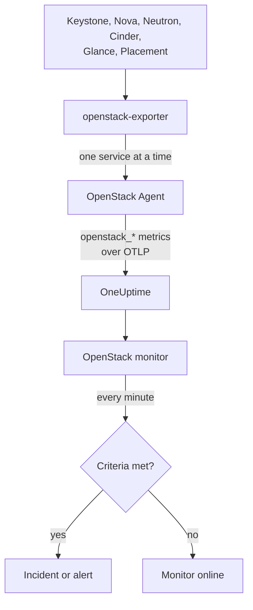

# OpenStack Monitor

An OpenStack monitor watches one cloud - its APIs, the workers behind them, hypervisors, instances, networks, storage pools and project quotas - and tells you when an API stops answering, a worker goes down, a hypervisor has no room to give or a pool fills up. It reads the `openstack_*` series the OneUptime OpenStack Agent collects from openstack-exporter.

:::cards
- [Create the monitor](#create-an-openstack-monitor): Six steps in the dashboard.
- [Templates](#pre-built-alert-templates): Thirty ready-made alerts, one incident per worker, instance, network or region.
- [Identity attributes](#identity-attributes): How to target one region, host or project.
- [Metrics](#collected-metrics): Every series the monitor can alert on.
:::

## How it works

The agent is an OpenTelemetry Collector and an openstack-exporter that you run on a machine that can reach the cloud's APIs. It reads each OpenStack service in its own collection, so a failing Nova costs only Nova's series, and it reads gently: compute, network, volume and placement every 2 minutes, identity and image every 5.

Each series is stamped with the cloud's name, `openstack.cloud.name`, and each datapoint with `openstack.region.name` and `openstack_service`. A cloud is one Keystone, and an OpenStack monitor is tied to one cloud. Every minute it runs its query over that cloud's metrics and compares the result with its criteria.



## Before you begin

- **Collect the cloud's metrics** with the OpenStack Agent. The cloud's **Documentation** page, under **Products → Infrastructure → OpenStack**, walks you through installing it.
- **Check the cloud is registered.** It appears under **Products → Infrastructure → OpenStack**, named after the agent's `OPENSTACK_CLOUD_NAME`, after its first collection.

## Create an OpenStack monitor

:::steps
### Start a new monitor

Go to **Monitors** and click **Create Monitor**.

### Pick OpenStack

Under **Monitor Type**, click **More monitor types** and pick **OpenStack** under **Infrastructure**, or type `openstack` in the search box. Enter a **Name** - it is used in incident and alert titles - and click **Next**.

### Choose the cloud

Under **OpenStack Monitor Configuration**, pick the cloud from **OpenStack Cloud**. Every cloud that has sent data is in the list. Once picked, a line under the field says whether data is arriving.

### Choose what to watch

A new monitor starts on **Cloud Stopped Reporting**, under **What to alert on**. To watch something else:

- **Change** - pick another [template](#pre-built-alert-templates). It sets the metric, the attribute filters, the aggregation, the time range, the group-by and the thresholds, and replaces the criteria below with its own. You can still change the **Time Range**.
- **Custom Metric** (under **More fields**) - pick one metric from **OpenStack Metric**, then set **Aggregation** and **Time Range**, and narrow it with the [filters](#monitor-settings).
- **Advanced** (under **More fields**) - build queries and formulas yourself under **Select Metrics**, with filters on attributes such as `status`, `adminState` or `resourcetype`. Use **Group by** an [identity attribute](#identity-attributes) to judge each part on its own.

### Check the criteria

Open each criteria under **Monitor Criteria** and check its **Metric**, **Aggregation**, **Condition** and **Threshold**. A template fills these in. With **Custom Metric** or **Advanced**, the monitor starts with the default criteria, which only notice the metric sending no data, so set your own threshold.

### Create the monitor

Click **Create Monitor**. OneUptime opens the monitor's page and evaluates it every minute. Incidents and alerts it raises are also listed on the cloud's **Incidents** and **Alerts** pages.
:::

> [!TIP]
> To set up several templates at once, open the cloud from **Products → Infrastructure → OpenStack** and go to **Recommendations**. Pick the templates you want, choose who is paged, and OneUptime creates one monitor per template.

## Monitor settings

| Field | Tab | What it does |
| --- | --- | --- |
| **OpenStack Cloud** | All | Required. Scopes every query to `resource.openstack.cloud.name`. |
| **Region** | Custom Metric, Advanced | Optional. One region: `openstack.region.name`. Every series carries it. |
| **Availability Zone** | Custom Metric, Advanced | Optional. One zone: `availability_zone` on hypervisors, instances, volumes and Neutron agents, `zone` on Nova's and Cinder's workers. |
| **Hypervisor** | Custom Metric, Advanced | Optional. One host: `hostname` on workers, hypervisors and Placement, `hypervisor_hostname` on instances. Nova's workers say the host's short name, and hypervisors, Placement and instances its full name, so use the one the series says. |
| **Service** | Custom Metric, Advanced | Optional. One worker's binary, such as `nova-compute`: `service`. |
| **Project ID** | Custom Metric, Advanced | Optional. One project: `tenant_id` on Nova's and Cinder's series and on networks and subnets, `project_id` on floating IPs, routers and address availability. |
| **OpenStack Metric** | Custom Metric | One metric from the [catalog](#collected-metrics). |
| **Aggregation** | Custom Metric | How samples are combined: **Average**, **Maximum**, **Minimum**, **Sum** or **Count**. Starts at the metric's usual aggregation. |
| **Time Range** | All | The rolling window the query reads, from **Past 1 Minute** to **Past 365 Days**. A new monitor starts at **Past 15 Minutes**; templates set their own. |
| **Select Metrics** | Advanced | The query builder: **Metric**, **Aggregate by**, **Filter by attributes**, **Group by**, plus **Add Metric** and **Add Formula** to combine queries. |

A filter narrows only a series that carries its label: `openstack_nova_up` has no project, so a project filter leaves it as it is.

Keep the window at three collections or more of what you read: 6 minutes for compute, network, volume and placement, 15 for identity and image. A shorter one does not hold enough collections for **All Values** to mean a duration.

## Identity attributes

Every series carries `openstack.cloud.name` as a **resource attribute**, and `openstack.region.name` and `openstack_service` as datapoint attributes. The exporter's own labels say the rest:

| Part | Series | Labels that identify it |
| --- | --- | --- |
| API | `openstack_*_up` | `openstack.region.name`, `openstack_service` |
| Worker | `openstack_nova_agent_state`, `openstack_neutron_agent_state`, `openstack_cinder_agent_state` | `hostname`, `service`. `adminState` says whether an operator left it on. Never group by `uuid` on Cinder's: the exporter makes one up on every collection |
| Hypervisor | `openstack_placement_resource_*`, `openstack_nova_vcpus_*` | `hostname` (its full name), `resourcetype` on Placement's |
| Instance | `openstack_nova_server_status` | `uuid`, `name`, `tenant_id`, `hypervisor_hostname`, `status`. The value is a code: filter on the `status` word |
| Volume | `openstack_cinder_volume_gb` | `id`, `name`, `tenant_id`, `status` |
| Storage pool | `openstack_cinder_pool_capacity_*` | `name`, `volume_backend_name` |
| Network | `openstack_neutron_network_ip_availabilities_*` | `network_id`, `network_name`, `cidr`, `ip_version` |
| Router | `openstack_neutron_l3_agent_of_router` | `router_id`, `agent_host`, `ha_state`, `agent_alive`, `agent_admin_up` |
| Project | `openstack_nova_limits_*`, `openstack_cinder_limits_*` | `tenant_id`, `tenant` |

In monitor filters and group-by keys, a resource attribute starts with `resource.` (`resource.openstack.cloud.name`), and a datapoint attribute does not (`openstack.region.name`, `hostname`, `status`). An empty label does not reach OneUptime, so `disabledReason` is there only on a worker someone disabled.

## Pre-built Alert Templates

OneUptime ships 30 templates for common OpenStack problems, and the **What to alert on** list offers all of them. Each builds a complete monitor: the metric query, its attribute filters, a group-by on what one incident is about, a criteria that fires and one that recovers. Thresholds are the same lines the cloud's own pages draw, and are starting points you can edit.

Every template reads at least three collections of what it watches, and fires only when the condition holds for its whole window. A threshold on a share recovers 10% past its line, so a value hovering there does not flap.

| Template | Category | Severity | Watches | Fires when | Recovers when |
| --- | --- | --- | --- | --- | --- |
| Cloud Stopped Reporting | Availability | Critical | `openstack_identity_up`, Count over the whole cloud, **past 15 minutes** | No data for the whole window: the agent stopped or cannot reach OneUptime, or the exporter cannot log in to Keystone | Data arrives again |
| Identity API Down | Availability | Critical | `openstack_identity_up` and `scrape_samples_scraped` for `identity`, Min per region, **past 15 minutes** | Every call failed, or the collection came back empty because the exporter could not log in | Both read 1 or more |
| Compute API Down | Availability | Critical | `openstack_nova_up` and `scrape_samples_scraped` for `compute`, Min per region, **past 10 minutes** | Every call failed, or the collection came back empty because the exporter could not reach Nova's API | Both read 1 or more |
| Network API Down | Availability | Critical | `openstack_neutron_up` and `up` for `network`, Min per region, **past 10 minutes** | Every call failed, or the exporter did not answer | Both read 1 |
| Block Storage API Down | Availability | Critical | `openstack_cinder_up` and `up` for `volume`, Min per region, **past 10 minutes** | Every call failed, or the exporter did not answer | Both read 1 |
| Image API Down | Availability | Critical | `openstack_glance_up` and `up` for `image`, Min per region, **past 15 minutes** | Every call failed, or the exporter did not answer | Both read 1 |
| Placement API Down | Availability | Critical | `openstack_placement_up` and `up` for `placement`, Min per region, **past 10 minutes** | Every call failed, or the exporter did not answer | Both read 1 |
| Compute Service Down | Control Plane | Critical | `openstack_nova_agent_state` filtered to `service = nova-compute` and `adminState = enabled`, Min per host, **past 10 minutes** | Below 1: an enabled nova-compute is down. One someone disabled never fires | Up, or disabled |
| Scheduler or Conductor Down | Control Plane | Warning | `openstack_nova_agent_state` filtered to `nova-scheduler` or `nova-conductor` and `adminState = enabled`, Min per host and binary, **past 10 minutes** | Below 1. The others carry on while any is left | Up, or disabled |
| Every Scheduler or Conductor Down | Control Plane | Critical | The same, Max per region and binary, **past 10 minutes** | Below 1: none is alive, so nothing new can boot | One is up |
| Network Agent Down | Control Plane | Critical | `openstack_neutron_agent_state` filtered to `adminState = up`, Min per host and binary, **past 10 minutes** | Below 1: an agent set up is not alive. One someone set down never fires | Alive, or set down |
| Block Storage Service Down | Control Plane | Critical | `openstack_cinder_agent_state` filtered to `adminState = enabled`, Min per host and binary, **past 10 minutes** | Below 1: an enabled Cinder service is down. One someone disabled never fires | Up, or disabled |
| vCPU Allocation High | Compute | Warning | `openstack_placement_resource_*` filtered to `resourcetype = VCPU`, usage / ((total - reserved) x ratio), per hypervisor, **past 10 minutes** | Above 90%: allocation, not load | At or below 81% |
| Memory Allocation High | Compute | Warning | The same, `resourcetype = MEMORY_MB` | Above 90% | At or below 81% |
| Local Disk Allocation High | Compute | Warning | The same, `resourcetype = DISK_GB` | Above 90% | At or below 81% |
| Instances in Error | Compute | Warning | `openstack_nova_server_status` filtered to `status = ERROR`, Count per region, **past 10 minutes** | Above 0 | None left |
| Instance Stuck Building | Compute | Warning | `openstack_nova_server_status` filtered to `status = BUILD` or `BUILD(spawning)`, Max per instance, **past 1 hour** | In that status at every collection for an hour | Left it |
| Instance Stuck Transitioning | Compute | Warning | The same for `REBUILD`, `RESIZE`, `REVERT_RESIZE`, `MIGRATING`, `REBOOT`, `HARD_REBOOT` and `PASSWORD`, **past 1 hour** | In one of them at every collection for an hour | Left it |
| Instance Stuck in Verify Resize | Compute | Warning | The same for `VERIFY_RESIZE`, **past 1 hour** | Waiting for someone to confirm or revert for an hour | Confirmed or reverted |
| Router Not Active | Network | Warning | `openstack_neutron_routers_not_active`, Max per region, **past 10 minutes** | Above 0 | At 0 |
| Floating IP Not Active | Network | Warning | `openstack_neutron_floating_ips_associated_not_active`, Max per region, **past 10 minutes** | Above 0: one in use is not ACTIVE. A spare one is meant to be down | At 0 |
| External IP Pool Nearly Full | Network | Warning | `openstack_neutron_network_ip_availabilities_*` for `ip_version = 4`, beside `is_external = true` on `openstack_neutron_network`, per network, **past 10 minutes** | Above 90% of an external network's IPv4 addresses. A tenant's network never fires | At or below 81% |
| Network Out of IPs | Network | Critical | The same | At 100%: no address left | Below 90% |
| Router Without Active Agent | Network | Critical | `openstack_neutron_l3_agent_of_router` filtered to `agent_admin_up = true`, Max per router, **past 10 minutes** | Below 1: no agent holding it is alive. Silent on OVN, which has no such agents | One is alive |
| Router With Two Active Agents | Network | Critical | The same filtered to `ha_state = active` and `agent_alive = true`, Count per router, **past 10 minutes** | Above 1: a split brain. Silent on OVN | At or below 1 |
| Storage Pool Warning | Storage | Warning | `openstack_cinder_pool_capacity_*`, (total - free) / total, per pool, **past 10 minutes** | Above 85% | At or below 76.5% |
| Storage Pool Critical | Storage | Critical | The same | Above 95% | At or below 85.5% |
| Volumes in Error | Storage | Warning | `openstack_cinder_volume_status_counter` for each error word, Max per region and word, **past 10 minutes** | Above 0 | At 0 |
| Volume Stuck | Storage | Warning | `openstack_cinder_volume_gb` for each passing status word, Max per volume, **past 30 minutes** | In that status at every collection for 30 minutes | Left it |
| Project Quota Nearly Reached | Projects | Warning | `openstack_nova_limits_*` and `openstack_cinder_limits_volume_*`, used / max per project, **past 10 minutes** | Above 90% of its vCPU, memory, instance or volume quota. Needs the [limits series on](#turn-on-the-limits-series) | At or below 81% |

**Severity** is the label the picker shows. The incident and alert a template creates start on your project's most severe incident and alert severity; change them in the criteria.

- **Up, alive and state series use Min**, so any one down reads 0. **Counts and info series use Max.** Nothing uses Sum, because a monitor reads one-minute buckets across series and scrapes, and a Sum adds them together.
- **Every template but Cloud Stopped Reporting groups by what one incident is about:** a worker's host and binary, an API's region, an instance, a router, a network, a pool, a project. The incident names it, with the [commands to run next](#commands-to-run-next).
- **A status series' value is a code**, not a count: `openstack_nova_server_status` reads 4 for an instance in ERROR. Templates filter on the `status` word.
- **A series that goes away counts as recovered:** a worker someone disabled, the last instance in ERROR deleted, a pool removed. Each template reads its service's own `_up` series beside its own, so it can tell a part that went away from a cloud that went quiet. When nothing arrives at all, its incidents stay open and **Cloud Stopped Reporting** speaks instead.
- **When an API is down, its own series go too**, so that service's other templates resolve, and fire again a window after it is back if the fault is still there. If every API reads down at once, look at the exporter first.
- **A cloud that has no such service stays quiet.** The exporter answers with nothing for a service that is not in the cloud's catalog, and **Network**, **Block Storage**, **Image** and **Placement API Down** do not read that as an outage. **Identity** and **Compute API Down** do, because that is also how the exporter reports Keystone or Nova's API stopped outright, and every cloud has them.

### Turn on the limits series

**Project Quota Nearly Reached** reads `openstack_nova_limits_*` and `openstack_cinder_limits_*`, which are off by default, because they read the API once per project on every collection. The template stays quiet until you turn them on: delete the `--disable-metric=nova-limits_vcpus_max` and `--disable-metric=cinder-limits_volume_max_gb` lines from the exporter's `command` in `docker-compose.yml`, or from `ExecStart` in `oneuptime-openstack-exporter.service` without Docker, then run `docker compose up -d --force-recreate`, or `sudo systemctl daemon-reload` and restart the exporter.

### Commands to run next

An incident a template opens says what to run for the part it names, always read-only and for its own region. For example:

| The incident names | It suggests |
| --- | --- |
| A nova-compute | `openstack compute service list --host <host> --service nova-compute --long`, `openstack server list --all-projects --host <host>` |
| A Neutron agent | `openstack network agent list --host <host> --long` |
| A Cinder service | `openstack volume service list --host <host> --service <binary> --long` |
| A hypervisor | `openstack hypervisor show <hypervisor>` |
| An instance | `openstack server show <instance>`, `openstack server event list <instance> --long` |
| A router | `openstack router show <router>`, `openstack network agent list --router <router> --long` |
| A network | `openstack ip availability show <network>`, `openstack floating ip list --network <network> --long` |
| A project | `openstack limits show --absolute --project <project>` |

## Collected Metrics

The metrics below are the catalog the monitor form offers. **Reads** is its usual aggregation, which a form starts on. Sizes in GiB and MiB are what OpenStack's own `_gb` and `_mb` fields hold.

### Availability

| Metric | Unit | Reads | Description |
| --- | --- | --- | --- |
| `up` | - | Min | Whether the exporter answered this collection at all (1) or did not (0): it was stopped, it timed out, or it answered with an error. 1 says nothing about the API itself, because the exporter answers even when it could not reach it. Reported by the agent's collector, one series per service per region. |
| `scrape_samples_scraped` | `count` | Min | How many series the exporter answered a collection with. 0 means it had nothing to say: it could not log in to Keystone, or it could not reach Nova's API to agree a microversion, and those failures leave no openstack_* series at all. Reported by the agent's collector, one series per service per region. |
| `openstack_identity_up` | - | Min | Whether Keystone's API answered the exporter's calls (1) or every one of them failed (0). When Keystone cannot be logged in to at all, the exporter answers with nothing, so this series goes away rather than reading 0. |
| `openstack_nova_up` | - | Min | Whether Nova's API answered the exporter's calls (1) or every one of them failed (0). When Nova's API cannot be reached at all, the exporter answers with nothing, so this series goes away rather than reading 0. |
| `openstack_neutron_up` | - | Min | Whether Neutron's API answered the exporter's calls (1) or every one of them failed (0). |
| `openstack_cinder_up` | - | Min | Whether Cinder's API answered the exporter's calls (1) or every one of them failed (0). |
| `openstack_glance_up` | - | Min | Whether Glance's API answered the exporter's calls (1) or every one of them failed (0). |
| `openstack_placement_up` | - | Min | Whether Placement's API answered the exporter's calls (1) or every one of them failed (0). |

### Control Plane

| Metric | Unit | Reads | Description |
| --- | --- | --- | --- |
| `openstack_nova_agent_state` | - | Min | Whether a Nova worker (nova-compute, nova-scheduler, nova-conductor) is up (1) or down (0), one series per worker. adminState says enabled or disabled, and a disabled one is planned work, with its reason in disabledReason. hostname is Nova's short host name, where hypervisor and Placement series say the full name. |
| `openstack_neutron_agent_state` | - | Min | Whether a Neutron agent is alive (1) or not (0), one series per host and binary. adminState says up or down, and one set down is planned work. |
| `openstack_cinder_agent_state` | - | Min | Whether a Cinder service (cinder-volume, cinder-scheduler, cinder-backup) is up (1) or down (0), one series per host and binary. adminState says enabled or disabled, and a disabled one is planned work. The uuid label is made up afresh on every collection, so never group by it. |

### Compute

| Metric | Unit | Reads | Description |
| --- | --- | --- | --- |
| `openstack_placement_resource_total` | - | Max | How much of a resource a hypervisor has, before any allocation ratio: vCPUs for VCPU, MiB for MEMORY_MB, GiB for DISK_GB, by the resourcetype label. hostname is the hypervisor's full name. |
| `openstack_placement_resource_reserved` | - | Max | How much of a resource Placement keeps back from instances on a hypervisor, in the same units as Placement Capacity. |
| `openstack_placement_resource_allocation_ratio` | `ratio` | Max | How many times over Placement will promise a hypervisor's resource. What it will promise is (capacity - reserved) x this ratio. |
| `openstack_placement_resource_usage` | - | Max | How much of a resource Placement has promised to instances on a hypervisor. This is allocation, not load: an idle instance holds all of it. |
| `openstack_placement_resource_generation` | `count` | Max | How many times a hypervisor's inventory has changed, as Placement counts it. It climbs on every change, so it says something changed, not what. |
| `openstack_placement_resource_provider_allocations` | - | Max | How much of a resource one consumer, its uuid, holds on a hypervisor. |
| `openstack_nova_vcpus_available` | `count` | Max | The vCPUs a hypervisor has, whatever the name says, before any allocation ratio. Nova stopped reporting this at microversion 2.88, so Placement's series are the ones to trust. |
| `openstack_nova_vcpus_used` | `count` | Max | The vCPUs Nova has promised to instances on a hypervisor. Allocation, not load. |
| `openstack_nova_memory_available_bytes` | `bytes` | Max | The memory a hypervisor has, whatever the name says, before any allocation ratio. |
| `openstack_nova_memory_used_bytes` | `bytes` | Max | The memory Nova has promised to instances on a hypervisor. Allocation, not load. |
| `openstack_nova_local_storage_available_bytes` | `bytes` | Max | The local disk a hypervisor has, whatever the name says, before any allocation ratio. |
| `openstack_nova_local_storage_used_bytes` | `bytes` | Max | The local disk Nova has promised to instances on a hypervisor. Allocation, not usage. |
| `openstack_nova_free_disk_bytes` | `bytes` | Min | The local disk Nova counts as free on a hypervisor. It can go negative when a hypervisor has promised more than it has. |
| `openstack_nova_current_workload` | `count` | Max | How many build, resize, snapshot, migrate and rescue operations are running on a hypervisor. It is not CPU load. |
| `openstack_nova_running_vms` | `count` | Max | How many ACTIVE instances a hypervisor has. hostname is the hypervisor's full name. |
| `openstack_nova_server_status` | - | Max | One series per instance, whose value is a numeric code for its status: ACTIVE is 0, BUILD is 1, ERROR is 4. Read the word from the status label, and filter on it: the code is not a count and not a severity. address_ipv4 and address_ipv6 are empty on a real cloud, and hypervisor_hostname, host_id and availability_zone are empty until the instance is scheduled. |
| `openstack_nova_server_local_gb` | `GiB` | Max | The local disk one instance holds. _Off by default:_ delete `--disable-metric=nova-server_local_gb` from the exporter. |
| `openstack_nova_total_vms` | `count` | Max | How many instances the region has, in any status. |
| `openstack_nova_flavors` | `count` | Max | How many flavors the region has. |
| `openstack_nova_flavor` | `count` | Max | One series per flavor, always 1, with its size in the vcpus, ram (MiB) and disk (GiB) labels. |
| `openstack_nova_availability_zones` | `count` | Max | How many availability zones Nova has in the region. |
| `openstack_nova_security_groups` | `count` | Max | How many security groups Nova reports in the region. The agent leaves it out with `--disable-metric=nova-security_groups`, because Nova no longer has this route. |

### Network

| Metric | Unit | Reads | Description |
| --- | --- | --- | --- |
| `openstack_neutron_routers_not_active` | `count` | Max | How many routers in the region have a status other than ACTIVE. Reads 0 when all is well. |
| `openstack_neutron_floating_ips_associated_not_active` | `count` | Max | How many floating IPs in the region are attached to something and not ACTIVE. A spare one is meant to be down, so it does not count here. Reads 0 when all is well. |
| `openstack_neutron_l3_agent_of_router` | - | Max | One series per router and L3 agent holding it: 1 while the agent is alive, 0 when it is not, with its ha_state (active or standby) and agent_admin_up labels. A router is fine while any agent is alive, so read it with Max by router. A cloud on OVN has no such agents, and so no such series. |
| `openstack_neutron_network_ip_availabilities_total` | `count` | Max | How many addresses a subnet has, one series per subnet of each network. |
| `openstack_neutron_network_ip_availabilities_used` | `count` | Max | How many of a subnet's addresses are taken, one series per subnet of each network. |
| `openstack_neutron_network` | - | Max | One series per network, whose value is a numeric code for its status: ACTIVE is 0, BUILD is 1, DOWN is 2, ERROR is 3. Whether it is external is in the is_external label. |
| `openstack_neutron_networks` | `count` | Max | How many networks the region has. |
| `openstack_neutron_subnet` | `count` | Max | One series per subnet, always 1, with its details in labels. |
| `openstack_neutron_subnets` | `count` | Max | How many subnets the region has. |
| `openstack_neutron_subnets_total` | `count` | Max | How many subnets of a prefix length a subnet pool could hold in all. _Off by default:_ delete `--disable-metric=neutron-subnets_total` from the exporter. |
| `openstack_neutron_subnets_used` | `count` | Max | How many subnets of a prefix length a subnet pool has given out. _Off by default:_ delete `--disable-metric=neutron-subnets_total` from the exporter. |
| `openstack_neutron_subnets_free` | `count` | Min | How many subnets of a prefix length a subnet pool has left to give. _Off by default:_ delete `--disable-metric=neutron-subnets_total` from the exporter. |
| `openstack_neutron_router` | `count` | Max | One series per router, always 1, with its status and admin_state_up labels. |
| `openstack_neutron_routers` | `count` | Max | How many routers the region has. |
| `openstack_neutron_floating_ip` | `count` | Max | One series per floating IP, always 1, with its status and the router it goes through in labels. A spare one reads DOWN with no router_id. |
| `openstack_neutron_floating_ips` | `count` | Max | How many floating IPs the region has. |
| `openstack_neutron_security_groups` | `count` | Max | How many security groups Neutron has in the region. |
| `openstack_neutron_port` | `count` | Max | One series per port, always 1, with its status and binding_vif_type labels. The agent keeps it off, because listing every port with an admin credential can saturate Neutron on a large cloud. _Off by default:_ delete `--disable-metric=neutron-port` from the exporter. |
| `openstack_neutron_ports` | `count` | Max | How many ports the region has. The agent keeps it off, because listing every port with an admin credential can saturate Neutron on a large cloud. _Off by default:_ delete `--disable-metric=neutron-ports` from the exporter. |
| `openstack_neutron_ports_no_ips` | `count` | Max | How many ACTIVE ports have no address. The agent keeps it off, with the other port series. _Off by default:_ delete `--disable-metric=neutron-ports_no_ips` from the exporter. |
| `openstack_neutron_ports_lb_not_active` | `count` | Max | How many load balancer ports are not ACTIVE. The agent keeps it off, with the other port series. _Off by default:_ delete `--disable-metric=neutron-ports_lb_not_active` from the exporter. |
| `openstack_neutron_vpn_endpoint_groups` | `count` | Max | How many VPN endpoint groups the region has. |
| `openstack_neutron_vpn_ike_policies` | `count` | Max | How many VPN IKE policies the region has. |
| `openstack_neutron_vpn_ipsec_policies` | `count` | Max | How many VPN IPsec policies the region has. |
| `openstack_neutron_vpn_services` | `count` | Max | How many VPN services the region has. |
| `openstack_neutron_vpn_service` | - | Max | One series per VPN service, whose value is a numeric code for its status: ACTIVE is 0, DOWN is 1, BUILD is 2, ERROR is 3. |
| `openstack_neutron_vpn_siteconnections` | `count` | Max | How many VPN site connections the region has. |
| `openstack_neutron_vpn_siteconnection` | - | Max | One series per VPN site connection, whose value is a numeric code for its status: ACTIVE is 0, DOWN is 1, BUILD is 2, ERROR is 3. |

### Storage

| Metric | Unit | Reads | Description |
| --- | --- | --- | --- |
| `openstack_cinder_pool_capacity_total_gb` | `GiB` | Max | How much a Cinder storage pool holds, as its backend says. |
| `openstack_cinder_pool_capacity_free_gb` | `GiB` | Min | How much of a Cinder storage pool is free, as its backend says. |
| `openstack_cinder_volume_status_counter` | `count` | Max | How many volumes are in each status, one series per status word in the status label. A known status with no volumes reads 0. |
| `openstack_cinder_volume_gb` | `GiB` | Max | One series per volume, whose value is its size, with its status word in the status label. |
| `openstack_cinder_volume_status` | - | Max | One series per volume, whose value is a numeric code for its status. The exporter has deprecated it: read Volume Size's status label, or Volumes by Status. |
| `openstack_cinder_volumes` | `count` | Max | How many volumes the region has. |
| `openstack_cinder_snapshots` | `count` | Max | How many volume snapshots the region has. |
| `openstack_cinder_snapshot_gb` | `GiB` | Max | One series per volume snapshot, whose value is its size, with its status word in the status label. Only a probe sends this: the agent's exporter only counts snapshots. |
| `openstack_cinder_backup_gb` | `GiB` | Max | One series per volume backup, whose value is its size, with its status word in the status label, so a backup that keeps failing can be seen. Only a probe sends this: the agent's exporter has no backups. |

### Images

| Metric | Unit | Reads | Description |
| --- | --- | --- | --- |
| `openstack_glance_images` | `count` | Max | How many images the region has. |
| `openstack_glance_image_bytes` | `bytes` | Max | One series per image, whose value is its size. |
| `openstack_glance_image_created_at` | `seconds` | Max | One series per image, whose value is when it was created, as a Unix time. |

### Identity

| Metric | Unit | Reads | Description |
| --- | --- | --- | --- |
| `openstack_identity_project_info` | `count` | Max | One series per project, always 1, with its name, domain and enabled labels. |
| `openstack_identity_projects` | `count` | Max | How many projects the cloud has. |
| `openstack_identity_domain_info` | `count` | Max | One series per domain, always 1, with its name and enabled labels. |
| `openstack_identity_domains` | `count` | Max | How many domains the cloud has. |
| `openstack_identity_users` | `count` | Max | How many users the cloud has. |
| `openstack_identity_groups` | `count` | Max | How many groups the cloud has. |
| `openstack_identity_regions` | `count` | Max | How many regions Keystone knows. |

### Projects

| Metric | Unit | Reads | Description |
| --- | --- | --- | --- |
| `openstack_nova_limits_vcpus_max` | `count` | Max | How many vCPUs a project may use, and -1 for no limit. _Off by default:_ delete `--disable-metric=nova-limits_vcpus_max` from the exporter. |
| `openstack_nova_limits_vcpus_used` | `count` | Max | How many vCPUs a project's instances hold. _Off by default:_ delete `--disable-metric=nova-limits_vcpus_max` from the exporter. |
| `openstack_nova_limits_memory_max` | `MiB` | Max | How much memory, in MiB, a project may use, and -1 for no limit. _Off by default:_ delete `--disable-metric=nova-limits_vcpus_max` from the exporter. |
| `openstack_nova_limits_memory_used` | `MiB` | Max | How much memory, in MiB, a project's instances hold. _Off by default:_ delete `--disable-metric=nova-limits_vcpus_max` from the exporter. |
| `openstack_nova_limits_instances_max` | `count` | Max | How many instances a project may have, and -1 for no limit. _Off by default:_ delete `--disable-metric=nova-limits_vcpus_max` from the exporter. |
| `openstack_nova_limits_instances_used` | `count` | Max | How many instances a project has. _Off by default:_ delete `--disable-metric=nova-limits_vcpus_max` from the exporter. |
| `openstack_cinder_limits_volume_max_gb` | `GiB` | Max | How much volume space a project may use, and -1 for no limit. _Off by default:_ delete `--disable-metric=cinder-limits_volume_max_gb` from the exporter. |
| `openstack_cinder_limits_volume_used_gb` | `GiB` | Max | How much volume space a project holds. _Off by default:_ delete `--disable-metric=cinder-limits_volume_max_gb` from the exporter. |
| `openstack_cinder_limits_backup_max_gb` | `GiB` | Max | How much backup space a project may use, and -1 for no limit. _Off by default:_ delete `--disable-metric=cinder-limits_volume_max_gb` from the exporter. |
| `openstack_cinder_limits_backup_used_gb` | `GiB` | Max | How much backup space a project holds. _Off by default:_ delete `--disable-metric=cinder-limits_volume_max_gb` from the exporter. |
| `openstack_cinder_volume_type_quota_gigabytes` | `GiB` | Max | How much of one volume type a project may use. _Off by default:_ delete `--disable-metric=cinder-limits_volume_max_gb` from the exporter. |
| `openstack_nova_quota_cores` | `count` | Max | A project's vCPU quota. Its type label says which number this is: in_use, reserved or limit. _Off by default:_ delete `--disable-metric=nova-quota_cores` from the exporter. |
| `openstack_nova_quota_instances` | `count` | Max | A project's instance quota. Its type label says which number this is: in_use, reserved or limit. _Off by default:_ delete `--disable-metric=nova-quota_cores` from the exporter. |
| `openstack_nova_quota_ram` | `MiB` | Max | A project's memory quota in MiB. Its type label says which number this is: in_use, reserved or limit. _Off by default:_ delete `--disable-metric=nova-quota_cores` from the exporter. |
| `openstack_nova_quota_key_pairs` | `count` | Max | A project's key pair quota. Its type label says which number this is: in_use, reserved or limit. _Off by default:_ delete `--disable-metric=nova-quota_cores` from the exporter. |
| `openstack_nova_quota_metadata_items` | `count` | Max | A project's quota of metadata items per instance. Its type label says which number this is: in_use, reserved or limit. _Off by default:_ delete `--disable-metric=nova-quota_cores` from the exporter. |
| `openstack_nova_quota_server_groups` | `count` | Max | A project's server group quota. Its type label says which number this is: in_use, reserved or limit. _Off by default:_ delete `--disable-metric=nova-quota_cores` from the exporter. |
| `openstack_nova_quota_server_group_members` | `count` | Max | A project's quota of members per server group. Its type label says which number this is: in_use, reserved or limit. _Off by default:_ delete `--disable-metric=nova-quota_cores` from the exporter. |
| `openstack_nova_quota_fixed_ips` | `count` | Max | A project's fixed IP quota in Nova, which modern clouds leave to Neutron. Its type label says which number this is: in_use, reserved or limit. _Off by default:_ delete `--disable-metric=nova-quota_cores` from the exporter. |
| `openstack_nova_quota_floating_ips` | `count` | Max | A project's floating IP quota in Nova, which modern clouds leave to Neutron. Its type label says which number this is: in_use, reserved or limit. _Off by default:_ delete `--disable-metric=nova-quota_cores` from the exporter. |
| `openstack_nova_quota_security_groups` | `count` | Max | A project's security group quota in Nova, which modern clouds leave to Neutron. Its type label says which number this is: in_use, reserved or limit. _Off by default:_ delete `--disable-metric=nova-quota_cores` from the exporter. |
| `openstack_nova_quota_security_group_rules` | `count` | Max | A project's security group rule quota in Nova, which modern clouds leave to Neutron. Its type label says which number this is: in_use, reserved or limit. _Off by default:_ delete `--disable-metric=nova-quota_cores` from the exporter. |
| `openstack_nova_quota_injected_files` | `count` | Max | A project's quota of files injected per instance. Its type label says which number this is: in_use, reserved or limit. _Off by default:_ delete `--disable-metric=nova-quota_cores` from the exporter. |
| `openstack_nova_quota_injected_file_content_bytes` | `bytes` | Max | A project's quota on the size of an injected file. Its type label says which number this is: in_use, reserved or limit. _Off by default:_ delete `--disable-metric=nova-quota_cores` from the exporter. |
| `openstack_nova_quota_injected_file_path_bytes` | `bytes` | Max | A project's quota on the length of an injected file's path. Its type label says which number this is: in_use, reserved or limit. _Off by default:_ delete `--disable-metric=nova-quota_cores` from the exporter. |
| `openstack_neutron_quota_network` | `count` | Max | A project's network quota. Its type label says which number this is: used, reserved or limit. _Off by default:_ delete `--disable-metric=neutron-quota_network` from the exporter. |
| `openstack_neutron_quota_subnet` | `count` | Max | A project's subnet quota. Its type label says which number this is: used, reserved or limit. _Off by default:_ delete `--disable-metric=neutron-quota_network` from the exporter. |
| `openstack_neutron_quota_subnetpool` | `count` | Max | A project's subnet pool quota. Its type label says which number this is: used, reserved or limit. _Off by default:_ delete `--disable-metric=neutron-quota_network` from the exporter. |
| `openstack_neutron_quota_port` | `count` | Max | A project's port quota. Its type label says which number this is: used, reserved or limit. _Off by default:_ delete `--disable-metric=neutron-quota_network` from the exporter. |
| `openstack_neutron_quota_router` | `count` | Max | A project's router quota. Its type label says which number this is: used, reserved or limit. _Off by default:_ delete `--disable-metric=neutron-quota_network` from the exporter. |
| `openstack_neutron_quota_floatingip` | `count` | Max | A project's floating IP quota. Its type label says which number this is: used, reserved or limit. _Off by default:_ delete `--disable-metric=neutron-quota_network` from the exporter. |
| `openstack_neutron_quota_security_group` | `count` | Max | A project's security group quota. Its type label says which number this is: used, reserved or limit. _Off by default:_ delete `--disable-metric=neutron-quota_network` from the exporter. |
| `openstack_neutron_quota_security_group_rule` | `count` | Max | A project's security group rule quota. Its type label says which number this is: used, reserved or limit. _Off by default:_ delete `--disable-metric=neutron-quota_network` from the exporter. |
| `openstack_neutron_quota_rbac_policy` | `count` | Max | A project's RBAC policy quota. Its type label says which number this is: used, reserved or limit. _Off by default:_ delete `--disable-metric=neutron-quota_network` from the exporter. |

## Terraform

The [OneUptime Terraform provider](/docs/terraform/monitor-steps) carries an OpenStack monitor step's configuration in the `openstack_monitor` attribute: the raw JSON of the `openstackMonitor` configuration (`cloudIdentifier`, `resourceFilters`, `metricViewConfig`, `rollingTime`).

```hcl title="main.tf"
monitor_steps = [{
  openstack_monitor = jsonencode({
    cloudIdentifier = "production"
    resourceFilters = { regionName = "RegionOne" }
    rollingTime     = "Past 10 Minutes"
    metricViewConfig = {
      queryConfigs = [{
        metricAliasData = { metricVariable = "compute_service_up", title = "Compute Service", description = "", legend = "" }
        metricQueryData = {
          filterData = {
            metricName     = "openstack_nova_agent_state"
            attributes     = { service = "nova-compute", adminState = "enabled" }
            aggegationType = "Min"
            aggregateBy    = {}
          }
          groupByAttributeKeys = ["openstack.region.name", "hostname", "service"]
        }
      }]
      formulaConfigs = []
    }
  })
  criteria = [ /* ... */ ]
}]
```

`cloudIdentifier` is the cloud's `openstack.cloud.name` - the `OPENSTACK_CLOUD_NAME` the agent was started with - not its OneUptime ID.

## Troubleshooting

:::details The cloud is not in the cloud list
A cloud registers itself from the agent's data. Check that the agent's containers are running and that it can reach OneUptime with its token.
:::

:::details Project Quota Nearly Reached never fires
Its series are off by default. See [Turn on the limits series](#turn-on-the-limits-series).
:::

:::details Router Without Active Agent never fires
A cloud on OVN has no L3 agents, so `openstack_neutron_l3_agent_of_router` does not exist there, and the two router agent templates stay quiet.
:::

:::details Block Storage API Down did not fire when Keystone went down
Without Keystone the exporter can read nothing, for any service, and answers each collection with nothing. **Identity API Down** and **Cloud Stopped Reporting** are the ones that fire.
:::

:::details A worker I disabled still shows on a chart
Templates filter a worker on `adminState`, so one someone disabled never fires, but a chart with no filter still draws it. Its `disabledReason` says why it was disabled.
:::

:::details A filter on a host matches nothing
Nova's workers say the host's short name in `hostname`, while hypervisors, Placement and instances say its full name. Use the name the series says.
:::

## Next steps

:::cards
- [Proxmox Monitor](/docs/monitor/proxmox-monitor): The same kind of monitor for Proxmox VE.
- [VMware Monitor](/docs/monitor/vmware-monitor): The same kind of monitor for vCenter.
- [Incidents](/docs/incidents/index): What happens after a criteria declares an incident.
:::
