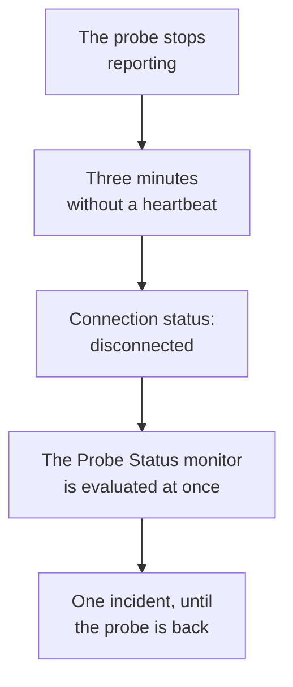

# Probe Status Monitor

A Probe Status monitor tells you when a probe stops reporting: one incident when it disconnects, resolved by itself when it is back. Point it at your custom probes, or, on a self-hosted OneUptime, at the global probe every monitor runs on, so a probe that goes quiet never leaves its monitors unchecked without anyone knowing.

:::cards
- [Create one](#create-a-probe-status-monitor): Pick the probes and keep the default criteria.
- [Criteria](#criteria): Count the connected or disconnected probes, now or over a window.
- [Metrics](#metrics): How many probes were connected, minute by minute.
:::

## How it works

OneUptime evaluates every Probe Status monitor once a minute, and again the moment one of its probes connects or disconnects. It reads each probe's connection status, the one the probe's page shows: a probe is disconnected when nothing has been heard from it for three minutes. After OneUptime itself was down or not receiving, it waits three full minutes before it calls any probe disconnected, so upgrading OneUptime never opens an incident.

A probe that stays down is one incident, not one a minute. The monitor stays offline, with its incident open, until every probe it watches is connected again; then the incident resolves by itself.

A monitor can watch its own project's probes and the global probes. A probe that was deleted is counted neither way. When none of the probes a monitor watches is left, it keeps the status it has, and its overview says so after a day.

## Create a Probe Status monitor

:::steps
### Start a new monitor

Go to **Monitors** and click **Create Monitor**.

### Choose Probe Status

Under **Monitor Type**, click **More monitor types** and pick **Probe Status** under **Other**. Fill in the **Name** and click **Next**.

### Pick the probes

Under **Probes to Watch**, pick the probes. A new monitor starts with your project's own probes. A self-hosted OneUptime with no probe of its own starts with its global probes; on OneUptime Cloud the global probes are run by OneUptime, so a project picks them itself if it wants them.

### Create the monitor

Keep the default criteria, described below, and click **Create Monitor**. The monitor is evaluated at once, and its overview lists each probe it watches, disconnected ones first.
:::

> [!TIP]
> **Monitor this probe**, on a probe's page and in its row's menu under **Monitors → Settings → Probes**, opens **Create Monitor** on a Probe Status monitor that watches that probe and is named after it.

## Criteria

A Probe Status monitor's filters count probes:

| Filter | What it counts |
| --- | --- |
| **Disconnected Probes** | The probes the monitor watches that are disconnected. |
| **Connected Probes** | The probes the monitor watches that are connected. |

Both are whole numbers, compared with **Greater Than**, **Less Than**, **Equal To** and the rest. A new monitor starts with two criteria:

| Criteria | Filter | What it does |
| --- | --- | --- |
| Check if a probe is disconnected | **Disconnected Probes** greater than `0` | Marks the monitor offline and declares an incident titled `Probe disconnected: {{disconnectedProbeNames}}`, which resolves by itself. |
| Check if every probe is connected | **Disconnected Probes** equal to `0` | Marks the monitor operational. |

**Connected Probes** suits a monitor that watches several probes and can lose one: **Connected Probes** less than `2` declares an incident only when fewer than two are left.

### Waiting longer before an incident

A probe is disconnected only after three minutes of silence, so a quick restart opens nothing. To wait longer, tick **Evaluate this criteria over a period of time** under the filter, pick **All Values** under **Evaluate** and a window under **For the last (in minutes)**. With five minutes, a probe has to stay disconnected for five more minutes before the incident is declared.

## Metrics

Each evaluation records two series on the monitor: `oneuptime.monitor.probes.connected` and `oneuptime.monitor.probes.disconnected`, the number of the probes it watches that were connected and disconnected. They are charted on the monitor's **Metrics** page, and a dashboard or a Metrics monitor reads them like any other series.

## Template variables

A Probe Status monitor's incident and alert templates can use these variables, besides the ones every monitor has:

| Variable | Value |
| --- | --- |
| `{{disconnectedProbeNames}}` | The names of the disconnected probes, separated by commas. |
| `{{disconnectedProbeCount}}` | How many of the probes are disconnected. |
| `{{connectedProbeNames}}` | The names of the connected probes, separated by commas. |
| `{{connectedProbeCount}}` | How many of the probes are connected. |
| `{{probeStatusSummary}}` | One sentence naming the disconnected probes, such as `1 of 3 probes is disconnected: EU Probe.`, or saying that every probe is connected. |
| `{{probes}}` | Every probe, each with `probeName`, `isConnected`, `isGlobalProbe` and `lastAliveAt`. |

## Troubleshooting

:::details The monitor says it is waiting for data
A new monitor shows its first evaluation within a minute or two. If it watches no probe, it says **Not set up** instead: pick the probes under **Criteria**.
:::

:::details A probe went offline and no incident was declared
A probe counts as disconnected after three minutes without a heartbeat, and later still after OneUptime itself was down. Check that the monitor is not disabled or in a maintenance window, and that its criteria still declare an incident.
:::

## Next steps

:::cards
- [Custom Probes](/docs/probe/custom-probe): Run a probe in your own network.
- [Monitor Criteria & Statuses](/docs/monitor/criteria-and-statuses): How criteria decide a monitor's status.
- [Incident & Alert Templating](/docs/monitor/incident-alert-templating): Word the incident a monitor declares.
:::
