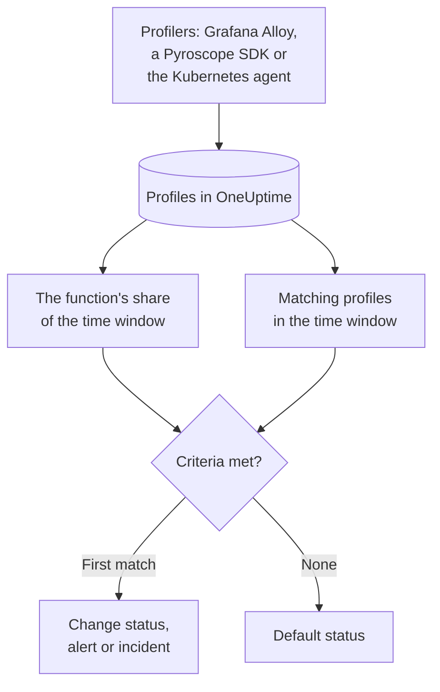

# Profiles Monitor

A Profiles monitor reads the continuous profiles your services send to OneUptime and alerts on two things: a function taking a bigger share of the time than it should, such as a parser that got heavier after a deploy, and profiles that stop arriving from a service. Every minute it measures how much of its time window ran through the function you name, counts the profiles that match its filters, and changes the monitor's status, creates an alert or declares an incident when your criteria are met.

:::cards
- [Create the monitor](#create-a-profiles-monitor): From a function in the Profiler, or from Create Monitor.
- [What it queries](#what-it-queries): The function, the kind of profile, the services and the window.
- [Criteria](#criteria): A function's share of the window, or the profile count.
- [A function gets heavier](#worked-example-a-function-gets-heavier): Alert when one function's share jumps.
:::

## How it works



Every minute, OneUptime reads the profiles that match the monitor's filters and started within its time window. It counts them and, when the monitor names a function, measures the share of that window's time that ran through the function. It checks these numbers against the monitor's criteria from top to bottom, and the first criteria that matches decides what happens. When none matches, the monitor goes back to its default status.

## Before you begin

- Your services send continuous profiling data to OneUptime, through Grafana Alloy (eBPF), a Pyroscope SDK or the OneUptime Kubernetes agent. See [Continuous Profiling](/docs/telemetry/profiles).
- To watch one function, you know its name, or a part of its file or package path, as the Profiler shows it.

## Create a profiles monitor

:::steps
### Start from the Profiler, or from Create Monitor

The quickest way is from the function itself: in **Performance Profiles**, open the function and click the link that offers an alert on its share. **Create Monitor** opens with the monitor filled in for that function and its service, with a threshold above what it takes today, as described in [Worked example: a function gets heavier](#worked-example-a-function-gets-heavier). Otherwise, go to **Monitors** and click **Create Monitor**.

### Choose Profiles

Under **Monitor Type**, click **More monitor types** and pick **Profiles** under **Telemetry**, or type `profiles` in the search box. Enter a **Name**, then click **Next**.

### Choose what it reads

In **Profiles Monitor Configuration**, set **Function** to the function to watch, **What to analyze** to the kind of profile, and **Monitor profiles for (time)** to the window. A new monitor reads **CPU time** over the **Last 5 minutes**. **What this monitor reads now**, under the fields, shows how many profiles match and how much of the window the function takes today, so you can set the threshold above it. Open **More fields** to filter by telemetry service or infrastructure entity.

### Set the criteria

A monitor started from **Create Monitor** has two criteria: offline, with an incident, when the **Profile Count** is 0, and online when it is above 0. To alert on the function, add a **Function Share (in %)** filter — see [Criteria](#criteria).

### Create the monitor

Click **Create Monitor**. The monitor opens on its **Overview** page, and its first evaluation runs within a minute.
:::

### Create it through the API or Terraform

A monitor's step holds the same settings as its `profileMonitor` configuration. This one watches `parseOrder` in the CPU profiles of one service over the last five minutes:

```json
{
  "profileMonitor": {
    "telemetryServiceIds": [],
    "profileTypes": ["cpu"],
    "profileType": "",
    "functionName": "parseOrder",
    "attributes": {},
    "lastXSecondsOfProfiles": 300
  }
}
```

Put the service's ID in `telemetryServiceIds`, or leave the list empty to read profiles from every service, and leave `functionName` empty to only count profiles. Create a monitor with the monitor type `Profiles` and a step that holds this configuration and at least one criteria, through the [API](/docs/api-reference/api-reference) or [Terraform](/docs/terraform/monitor-steps). In Terraform, pass the configuration as the step's `profile_monitor` attribute, written with `jsonencode()`.

## What it queries

| Field | What it matches | Default |
| --- | --- | --- |
| `profileTypes` | Profiles of any of these types, matched exactly, such as `cpu`. | Empty: every type |
| `profileType` | Profiles whose type contains this text, ignoring case. When it is set, `profileTypes` is ignored. | Empty |
| `functionName` | The code whose share **Function Share (in %)** measures: stack frames whose function name or file path contains this text, ignoring case. | Empty: no share is measured |
| `telemetryServiceIds` | Profiles from any of these telemetry services. | Empty: every service |
| `entityKeys` | Profiles from any of these hosts, pods, containers and other infrastructure entities. | Empty: every entity |
| `attributes` | Profiles whose attributes have these values. | Empty: no condition |
| `lastXSecondsOfProfiles` | Profiles that started within this many seconds before the evaluation. | None: always set it, or every stored profile is counted and the count never falls to 0 |

All the filters you set must match for a profile to be read. In the form, **Function** sets `functionName`, **What to analyze** sets `profileTypes` (**Every kind of profile** leaves it empty), **Monitor profiles for (time)** sets `lastXSecondsOfProfiles`, and **Filter by Telemetry Service** and **Filter by Infrastructure Entity** set `telemetryServiceIds` and `entityKeys`.

## How it is evaluated

- **Every minute.** A Profiles monitor is not checked by probes, so it has no interval to set and no **Probes & Interval** page.
- **Two numbers per evaluation.** The monitor counts the profiles that match every filter and started within `lastXSecondsOfProfiles`, and measures the function's share of the same profiles. A profiler uploads at a regular interval, so give the window room for several uploads.
- **One unit at a time.** A share adds up samples of one unit: when the kinds you read mix units, such as CPU time in nanoseconds from an SDK and sample counts from eBPF, it reads the unit with the most samples in the window.
- **No profiles is a count of 0, and no share.** A service whose profiler stops uploading produces a count of 0, and a **Function Share (in %)** criteria does not match a window with nothing in it: alert on the **Profile Count** to know profiling stopped.
- **OneUptime's own downtime is not silence.** While the time window holds time OneUptime itself was not receiving data — it was restarting, being upgraded or catching up — the check waits: the status does not change, and no incident or alert is opened or resolved. See [When OneUptime Is Not Receiving Data](/docs/monitor/when-oneuptime-is-not-receiving).
- **Criteria from top to bottom.** The first criteria that matches decides, so put the most severe one first.

Each status change, with the reason for it, is recorded on the monitor's **Status Timeline**.

## Criteria

A Profiles monitor's criteria compare one of two numbers with a value.

**Function Share (in %)** is the share of the window's time, from 0 to 100, that ran through the monitor's function: each stack with a frame that matches `functionName` counts once, whatever its depth, so the function's own code and everything it calls are both in it.

| Filter Condition | Matches when the function's share is… |
| --- | --- |
| **Greater Than** | above the value |
| **Greater Than Or Equal To** | the value or above |
| **Less Than** | below the value |
| **Less Than Or Equal To** | the value or below |

**Profile Count** is the number of profiles that matched in the window:

| Filter Condition | Matches when the profile count is… |
| --- | --- |
| **Greater Than** | above the value |
| **Greater Than Or Equal To** | the value or above |
| **Less Than** | below the value |
| **Less Than Or Equal To** | the value or below |
| **Equal To** | exactly the value |
| **Not Equal To** | anything but the value |

Profile counts have no anomaly conditions: there is no baseline to compare them with.

## Worked example: a function gets heavier

The checkout service's `parseOrder` takes 18% of its CPU time. A deploy that parses a bigger payload should not go unnoticed:

1. In **Performance Profiles**, pick the checkout service and open `parseOrder`.
2. Click the link that offers an alert on its share. The Profiler suggests 30%: half again above today's share, at least 10 points more, rounded up to a multiple of 5.
3. **Create Monitor** opens on a Profiles monitor of the checkout service that reads **CPU time** over the **Last 5 minutes**, with two criteria: **Function Share (in %)** **Greater Than** `30` raises an alert, which resolves itself, and marks the monitor degraded; **Less Than Or Equal To** `30` marks it operational. The incident is filled in but switched off: turn it on to page someone.
4. Click **Create Monitor**.

When the deploy makes `parseOrder` take 45% of the CPU time, the next evaluation raises the alert. When a fix brings it back under 30%, the alert resolves itself.

## Worked example: profiles stop arriving

The checkout service runs a Pyroscope SDK that uploads CPU profiles. You want an incident when they stop for five minutes:

- `profileTypes`: `["cpu"]`, `telemetryServiceIds`: the checkout service, `lastXSecondsOfProfiles`: `300`
- Criteria 1: **Profile Count** **Equal To** `0` — mark the monitor offline and declare an incident
- Criteria 2: **Profile Count** **Greater Than** `0` — mark the monitor online

While the SDK uploads, every evaluation counts some profiles and criteria 2 keeps the monitor online. When the service is deployed without the SDK, the count falls to 0 five minutes after the last upload, criteria 1 matches, and the incident is declared. The first upload after the fix brings the count above 0 again, and the incident resolves itself if **Auto Resolve Incident** is on for it.

## Troubleshooting

:::details The monitor counts 0, but profiles show up in OneUptime
Check the filters against the profiles you see: `profileTypes` must match the type exactly, and `telemetryServiceIds` must hold the right service IDs. A short `lastXSecondsOfProfiles` can also fall between two uploads.
:::

:::details The function's share stays at 0%
No frame in the window contains the function text. Open the function in the Profiler and copy its name as shown there; part of the name works, and case does not matter. Then check that the service sends the kind of profile **What to analyze** reads.
:::

## Next steps

:::cards
- [Continuous Profiling](/docs/telemetry/profiles): Send profiles, and read them in the Profiler.
- [Terraform Monitor Steps](/docs/terraform/monitor-steps): Pass the step configuration from Terraform.
- [Traces Monitor](/docs/monitor/traces-monitor): Alert on failing spans.
- [Metrics Monitor](/docs/monitor/metrics-monitor): Alert on CPU, memory and other metrics.
:::
