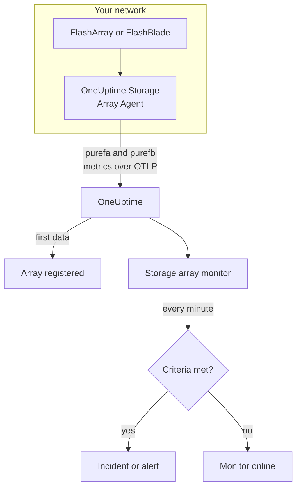

# Storage Array Monitor

A storage array monitor watches one storage array and tells you when the array raises an alert of its own, runs out of space, slows down, loses hardware or a host path, or falls behind on replication. It works with Pure Storage FlashArray and Pure Storage FlashBlade, and reads the metrics the array exports itself - Pure's `purefa_*` and `purefb_*` series - which the OneUptime Storage Array Agent collects.

:::cards
- [Create the monitor](#create-a-storage-array-monitor): Six steps in the dashboard.
- [Templates](#pre-built-alert-templates): Eighteen ready-made alerts, one incident per volume, host or component.
- [How Pure's series work](#how-pures-series-are-shaped): One metric name, many figures.
- [Metrics](#collected-metrics): Every series the monitor can alert on.
:::

## How it works

The OneUptime Storage Array Agent runs on a machine that can reach the array's management interface. It reads the array's metrics with a read-only API token, labels them with the array's name, `storage.array.name`, and its platform, `storage.system`, and sends them to OneUptime over OTLP. The first data registers the array.

A storage array monitor is tied to one array. Every minute it runs its query over that array's metrics and compares the result with its criteria.



## Before you begin

- **Install the Storage Array Agent** where it can reach the array over HTTPS, with the API token of a user that has the array's **readonly** role. The [Storage Array Agent guide](/docs/telemetry/storage-arrays) covers the user, the token and the install, through `ONEUPTIME_URL`, `ONEUPTIME_TELEMETRY_INGESTION_KEY`, `STORAGE_ARRAY_NAME`, and the array's address and token (`PURE_FA_ENDPOINT` and `PURE_FA_API_TOKEN`, or `PURE_FB_ENDPOINT` and `PURE_FB_API_TOKEN`).
- **Check the array is registered.** It appears under **Products → Infrastructure → Storage Arrays → All Storage Arrays**, named after the agent's `STORAGE_ARRAY_NAME`, about a minute after the first scrape.

## Create a storage array monitor

:::steps
### Start a new monitor

Go to **Monitors** and click **Create Monitor**.

### Pick Storage Array

Under **Monitor Type**, click **More monitor types** and pick **Storage Array** under **Infrastructure**, or type `storage` in the search box. Enter a **Name** - it is used in incident and alert titles - and click **Next**.

### Choose the array

Under **Storage Array Monitor Configuration**, pick the array from **Storage Array**. Every array that has sent data is in the list. Its platform decides which metrics and templates the form offers.

### Choose what to watch

Pick one of the three tabs:

- **Quick Setup** - click a [template](#pre-built-alert-templates). It sets the metric, the label filters, the aggregation, the time range and the thresholds, and replaces the criteria below with its own. You can still change the **Time Range**.
- **Custom Metric** - pick one metric from **Storage Array Metric**, then set **Aggregation** and **Time Range**. The [filters](#monitor-settings) narrow it to one volume, host, pod, component, file system or bucket.
- **Advanced** - build queries and formulas yourself under **Select Metrics**, for example the used capacity as `purefa_array_space_bytes` filtered to `space=capacity` minus the same metric filtered to `space=empty`. Use **Group by** an object's label to judge each object on its own.

### Check the criteria

Open each criteria under **Monitor Criteria** and check its **Metric**, **Aggregation**, **Condition** and **Threshold**. A template fills these in. With **Custom Metric** or **Advanced**, the monitor starts with the [default criteria](#default-criteria), which only notice a metric dropping to zero, so set your own threshold.

### Create the monitor

Click **Create Monitor**. OneUptime opens the monitor's page and evaluates it every minute. Incidents and alerts it raises are also listed on the array's **Incidents** and **Alerts** pages.
:::

> [!TIP]
> To set up several templates at once, open the array from **Products → Infrastructure → Storage Arrays** and go to **Recommendations**. Pick the templates you want, choose who is paged, and OneUptime creates one monitor per template.

## Monitor settings

| Field | Tab | What it does |
| --- | --- | --- |
| **Storage Array** | All | Required. Scopes every query to `resource.storage.array.name`, so two arrays that both have a volume called `vol-01` never mix. |
| **Volume** | Custom Metric, Advanced | FlashArray only. One volume, by the `name` label, such as `vol-db-01`. A volume in a pod or a volume group is named `pod::volume` or `group/volume`. |
| **Host** | Custom Metric, Advanced | FlashArray only. One host as the array knows it, by the `host` label, such as `esxi-01`. |
| **Pod** | Custom Metric, Advanced | FlashArray only. One ActiveCluster or ActiveDR pod, by the `name` label, or `local_pod` on replica link series. |
| **Hardware Component** | Custom Metric, Advanced | One hardware component, such as `CH0.BAY1` or `CT0`: the `component_name` label on a FlashArray, `name` on a FlashBlade. |
| **File System** | Custom Metric, Advanced | FlashBlade only. One file system, by the `name` label. |
| **Bucket** | Custom Metric, Advanced | FlashBlade only. One object store bucket, by the `name` label. |
| **Storage Array Metric** | Custom Metric | One metric from the [catalog](#collected-metrics). The form adds the label filter that gives it its meaning, and groups it by the object it describes, so each volume, host or component is judged on its own. |
| **Aggregation** | Custom Metric | How samples are combined: **Average**, **Maximum**, **Minimum**, **Sum** or **Count**. Starts at the metric's usual aggregation. |
| **Time Range** | All | The rolling window the query reads, from **Past 1 Minute** to **Past 365 Days**. A new monitor starts at **Past 5 Minutes**; a custom metric of a file system or bucket at **Past 15 Minutes**; templates set their own. |
| **Select Metrics** | Advanced | The query builder: **Metric**, **Aggregate by**, **Filter by attributes**, **Group by**, plus **Add Metric** and **Add Formula** to combine queries. |

The agent reads the array endpoint every 60 seconds, and volumes, hosts and pods every 2 minutes, so a 5-minute window always holds a sample. It reads a FlashBlade's file systems and buckets every 5 minutes, hence 15, and FlashArray directories every 30 minutes: give a directory monitor a 60-minute window.

## How Pure's series are shaped

Pure puts several figures on **one** metric name and tells them apart with a label:

- **`dimension`** on the performance series. `purefa_array_performance_latency_usec` carries the read latency (`usec_per_read_op`), the write latency (`usec_per_write_op`), the mirrored write latency, and the SAN, queue, QoS and service time of each. Always filter on one `dimension`: an average across them mixes a 200 µs read latency with a queue figure.
- **`space`** on the capacity series: `capacity`, `empty`, `snapshots`, `total_provisioned`, `total_physical`, `available_ratio` and more.

Several series carry their state in a **label**, with a value that is always 1:

| Series | State label | One series per |
| --- | --- | --- |
| `purefa_alerts_open` | `severity`, with `summary`, `code` and `component_type` | Open alert |
| `purefa_hw_component_status` | `component_status` | Hardware component |
| `purefa_host_connectivity_info` | `status`, with `details` | Host |
| `purefa_drive_capacity_bytes` | `component_status` (the value is the drive's capacity) | Drive |

A series filtered to a bad state exists only while something is in that state, so no series means healthy. That is why **Max above 0 fires and 0 recovers** is the right shape for them, and how the templates are built: their recover criteria count a missing series as zero.

In monitor filters and group-by keys, the agent's attributes start with `resource.` (`resource.storage.array.name`, `resource.storage.system`), while Pure's own labels do not (`name`, `host`, `component_name`, `dimension`, `space`, `severity`).

## Pre-built Alert Templates

OneUptime ships 18 templates — 11 for FlashArray and 7 for FlashBlade — and **Quick Setup** offers the ones for the array's platform. Each builds a complete monitor: the metric query, its label filters, a group-by on the object's own label, a criteria that fires and one that recovers. Thresholds are starting points you can edit.

A criteria fires only when the condition holds for **every** value in its window. A monitor that fired on a capacity, latency, lag or ratio threshold recovers only 10% past it, so a value hovering at the threshold does not flap; the alert and hardware templates recover as soon as the state clears.

### FlashArray

| Template                       | Category     | Severity | Watches                                                                                         | Fires when                                                                                                                                       |
| ------------------------------ | ------------ | -------- | ----------------------------------------------------------------------------------------------- | ------------------------------------------------------------------------------------------------------------------------------------------------ |
| Critical Array Alert           | Array Health | Critical | `purefa_alerts_open` filtered to `severity=critical`, Max per `summary`, past 5 minutes        | > 0 — the array has an open critical alert (a failed component, a capacity emergency, a replication failure). One incident per alert; recovers when the alert closes |
| Warning Array Alert            | Array Health | Warning  | `purefa_alerts_open` filtered to `severity=warning`, Max per `summary`, past 5 minutes         | > 0 — the array has an open warning alert. One incident per alert; recovers when the alert closes                                               |
| Capacity Above 80%             | Capacity     | Warning  | `purefa_array_space_utilization`, Max, past 15 minutes                                          | > 80 — Pure's own first capacity threshold; recovers at ≤ 72                                                                                     |
| Capacity Above 90%             | Capacity     | Critical | `purefa_array_space_utilization`, Max, past 5 minutes                                           | > 90 — the array is close to refusing writes; recovers at ≤ 81                                                                                   |
| High Read Latency              | Performance  | Warning  | `purefa_array_performance_latency_usec` filtered to `dimension=usec_per_read_op`, Avg, past 10 minutes  | > 5000 µs (5 ms) — FlashArray reads normally complete well under 1 ms; recovers at ≤ 4500                                                        |
| High Write Latency             | Performance  | Warning  | `purefa_array_performance_latency_usec` filtered to `dimension=usec_per_write_op`, Avg, past 10 minutes | > 5000 µs (5 ms); recovers at ≤ 4500                                                                                                             |
| Hardware Component Failed      | Hardware     | Critical | `purefa_hw_component_status` filtered to `component_status=critical`, Max per `component_name`, past 5 minutes | > 0 — a controller, power supply, fan, bay or port is critical and redundancy is gone. One incident per component; recovers when it reports ok |
| Hardware Component Degraded    | Hardware     | Warning  | `purefa_hw_component_status` filtered to `component_status=degraded`, Max per `component_name`, past 5 minutes | > 0 — a component is degraded. One incident per component; recovers when it reports ok                                                     |
| Drive Failed                   | Hardware     | Critical | `purefa_drive_capacity_bytes` filtered to `component_status=failed`, Max per `component_name`, past 5 minutes | > 0 — a DirectFlash module or SSD failed and the array rebuilds onto the others. One incident per drive; recovers when it is replaced          |
| Host Lost Redundant Paths      | Hosts        | Warning  | `purefa_host_connectivity_info` filtered to `status=critical`, Max per `host`, past 5 minutes  | > 0 — the host reaches the array through one controller or none; a controller failover would take its storage offline. One incident per host; recovers when its paths are back |
| Replication Lag Above 1 Minute | Replication  | Warning  | `purefa_pod_replica_links_lag_max_msec`, Max per `local_pod`, past 10 minutes                   | > 60000 ms (60 s) — a failover now would lose more recent writes than planned. One incident per pod; recovers at ≤ 54000                         |

### FlashBlade

| Template                     | Category     | Severity | Watches                                                                                                        | Fires when                                                                                                          |
| ---------------------------- | ------------ | -------- | -------------------------------------------------------------------------------------------------------------- | ------------------------------------------------------------------------------------------------------------------- |
| Critical Array Alert         | Array Health | Critical | `purefb_alerts_open` filtered to `severity=critical`, Max per `summary`, past 5 minutes                       | > 0 — the FlashBlade has an open critical alert. One incident per alert; recovers when the alert closes              |
| Warning Array Alert          | Array Health | Warning  | `purefb_alerts_open` filtered to `severity=warning`, Max per `summary`, past 5 minutes                        | > 0 — the FlashBlade has an open warning alert. One incident per alert; recovers when the alert closes              |
| Capacity Above 80%           | Capacity     | Warning  | `purefb_array_space_utilization` filtered to `type=array`, Max, past 15 minutes                               | > 80; recovers at ≤ 72                                                                                              |
| Capacity Above 90%           | Capacity     | Critical | `purefb_array_space_utilization` filtered to `type=array`, Max, past 5 minutes                                | > 90 — writes fail for every client when it fills; recovers at ≤ 81                                                 |
| Hardware Component Unhealthy | Hardware     | Critical | `purefb_hardware_health`, Min per `name`, past 5 minutes                                                       | < 1 — a blade, fabric module, power supply or fan is not healthy (an unused slot reports 2). One incident per component; recovers at ≥ 1 |
| High Read Latency            | Performance  | Warning  | `purefb_array_performance_latency_usec` filtered to `dimension=usec_per_read_op` and `protocol=all`, Avg, past 10 minutes | > 10000 µs (10 ms) across all protocols; recovers at ≤ 9000                                            |
| File System Near Full        | File Systems | Warning  | `purefb_file_systems_space_bytes` filtered to `space=available_ratio`, Min per `name`, past 15 minutes        | < 0.1 — less than 10% of a file system's provisioned size is left. One incident per file system; recovers at ≥ 0.11 |

**Severity** is the label the picker shows. The incident and alert a template creates start on your project's most severe incident and alert severity; change them in the criteria.

- **Open alerts and hardware states use Max** of a series that exists only while the alert is open or the component is in that state, so one scrape that shows it trips the threshold.
- **Every per-object template groups by the object's own label** (`summary`, `component_name`, `host`, `local_pod`, `name`), so one incident fires per affected object, and the incident names it.
- **Latency templates use Avg** of the array's own average per operation, and capacity templates **Max** of its own utilization percentage. Latencies are pinned in microseconds and capacity in percent.
- **Hardware Component Unhealthy uses Min** per component: its health is 1 when healthy and drops to 0 when not.

There is no template for the latency of each volume, because the right threshold depends on the workload: build it from the catalog with a group-by on `name`. Capacity forecasting needs a growth trend rather than a threshold, and drive wear has no series to alert on.

## Collected Metrics

The agent sends everything the array exports; the series below are the catalog the monitor form offers. Every value is a gauge the array computes itself - latencies are microseconds per operation and throughput is per second - so no rate math is needed. **Filter** is the label filter that gives the series the meaning its row says; the form applies it for you.

### Array Health

| Metric               | Filter | Platform   | Unit    | Description                                                                                                                                                       |
| -------------------- | ------ | ---------- | ------- | ----------------------------------------------------------------------------------------------------------------------------------------------------------------- |
| `purefa_alerts_open` | —      | FlashArray | `count` | One series per alert open on the array (value 1), labeled `severity` (`critical`, `warning`, `info`, `hidden`), `category`, `code`, `component_type` and `summary` |
| `purefb_alerts_open` | —      | FlashBlade | `count` | One series per alert open on the FlashBlade (value 1), labeled `severity` (`info`, `warning`, `critical`), `code`, `component_name`, `component_type`, `summary` and `kburl` (Pure's knowledge base article) |

### Capacity

| Metric                                    | Filter                       | Platform   | Unit    | Description                                                                                                                           |
| ----------------------------------------- | ---------------------------- | ---------- | ------- | ------------------------------------------------------------------------------------------------------------------------------------- |
| `purefa_array_space_utilization`          | —                            | FlashArray | `%`     | Share of the array's usable capacity in use. Pure raises its own capacity alerts at 80%, 90% and 100%                                 |
| `purefa_array_space_bytes`                | `space=capacity`             | FlashArray | `bytes` | Usable capacity of the array                                                                                                          |
| `purefa_array_space_bytes`                | `space=empty`                | FlashArray | `bytes` | Unused capacity — trend it to forecast when the array fills up                                                                        |
| `purefa_array_space_bytes`                | `space=snapshots`            | FlashArray | `bytes` | Physical space held only by snapshots; a fast climb usually means a protection group keeps more snapshots than planned                 |
| `purefa_array_space_data_reduction_ratio` | —                            | FlashArray | `ratio` | Deduplication and compression across the array, e.g. 4.2 for 4.2:1. A sustained drop means new data reduces poorly                    |
| `purefb_array_space_utilization`          | `type=array`                 | FlashBlade | `%`     | Share of the FlashBlade's usable capacity in use                                                                                      |
| `purefb_array_space_bytes`                | `type=array`, `space=empty`  | FlashBlade | `bytes` | Unused capacity of the FlashBlade                                                                                                     |
| `purefb_array_space_data_reduction_ratio` | `type=array`                 | FlashBlade | `ratio` | Data reduction across the FlashBlade                                                                                                  |

### Performance

| Metric                                     | Filter                                         | Platform   | Unit      | Description                                                                                                  |
| ------------------------------------------ | ---------------------------------------------- | ---------- | --------- | ------------------------------------------------------------------------------------------------------------ |
| `purefa_array_performance_latency_usec`    | `dimension=usec_per_read_op`                   | FlashArray | `µs`      | Average latency of a read as hosts see it; FlashArray reads typically complete well under 1 ms              |
| `purefa_array_performance_latency_usec`    | `dimension=usec_per_write_op`                  | FlashArray | `µs`      | Average latency of a write as hosts see it                                                                   |
| `purefa_array_performance_latency_usec`    | `dimension=usec_per_mirrored_write_op`         | FlashArray | `µs`      | Average latency of a write to an ActiveCluster stretched pod, including the round trip to the peer array    |
| `purefa_array_performance_latency_usec`    | `dimension=san_usec_per_read_op`               | FlashArray | `µs`      | Time a read spends in the SAN; high SAN latency with low service latency points at the fabric or the host   |
| `purefa_array_performance_throughput_iops` | `dimension=reads_per_sec`                      | FlashArray | `ops/s`   | Read operations per second                                                                                   |
| `purefa_array_performance_throughput_iops` | `dimension=writes_per_sec`                     | FlashArray | `ops/s`   | Write operations per second                                                                                  |
| `purefa_array_performance_bandwidth_bytes` | `dimension=read_bytes_per_sec`                 | FlashArray | `bytes/s` | Bytes read per second                                                                                        |
| `purefa_array_performance_bandwidth_bytes` | `dimension=write_bytes_per_sec`                | FlashArray | `bytes/s` | Bytes written per second                                                                                     |
| `purefa_array_performance_queue_depth_ops` | —                                              | FlashArray | `ops`     | Operations queued on the array; a growing queue with rising latency means hosts send more than it can serve |
| `purefa_array_performance_average_bytes`   | `dimension=bytes_per_op`                       | FlashArray | `bytes`   | Average size of an operation — large I/O raises latency without anything being wrong                        |
| `purefb_array_performance_latency_usec`    | `dimension=usec_per_read_op`, `protocol=all`   | FlashBlade | `µs`      | Average read latency across all protocols                                                                    |
| `purefb_array_performance_latency_usec`    | `dimension=usec_per_write_op`, `protocol=all`  | FlashBlade | `µs`      | Average write latency across all protocols                                                                   |
| `purefb_array_performance_throughput_iops` | `dimension=reads_per_sec`, `protocol=all`      | FlashBlade | `ops/s`   | Read operations per second across all protocols                                                              |
| `purefb_array_performance_throughput_iops` | `dimension=writes_per_sec`, `protocol=all`     | FlashBlade | `ops/s`   | Write operations per second across all protocols                                                             |
| `purefb_array_performance_bandwidth_bytes` | `dimension=read_bytes_per_sec`, `protocol=all` | FlashBlade | `bytes/s` | Bytes read per second across all protocols                                                                   |
| `purefb_array_performance_bandwidth_bytes` | `dimension=write_bytes_per_sec`, `protocol=all` | FlashBlade | `bytes/s` | Bytes written per second across all protocols                                                               |

### Volumes

| Metric                                      | Filter                           | Platform   | Unit      | Description                                                   |
| ------------------------------------------- | -------------------------------- | ---------- | --------- | ------------------------------------------------------------- |
| `purefa_volume_performance_latency_usec`    | `dimension=usec_per_read_op`     | FlashArray | `µs`      | Average read latency of each volume — group by `name`         |
| `purefa_volume_performance_latency_usec`    | `dimension=usec_per_write_op`    | FlashArray | `µs`      | Average write latency of each volume                          |
| `purefa_volume_performance_throughput_iops` | `dimension=reads_per_sec`        | FlashArray | `ops/s`   | Read operations per second of each volume                     |
| `purefa_volume_performance_throughput_iops` | `dimension=writes_per_sec`       | FlashArray | `ops/s`   | Write operations per second of each volume                    |
| `purefa_volume_performance_bandwidth_bytes` | `dimension=read_bytes_per_sec`   | FlashArray | `bytes/s` | Bytes read per second from each volume                        |
| `purefa_volume_performance_bandwidth_bytes` | `dimension=write_bytes_per_sec`  | FlashArray | `bytes/s` | Bytes written per second to each volume                       |
| `purefa_volume_space_bytes`                 | `space=total_provisioned`        | FlashArray | `bytes`   | Size of each volume as hosts see it                           |
| `purefa_volume_space_bytes`                 | `space=total_physical`           | FlashArray | `bytes`   | Physical space each volume uses after data reduction          |
| `purefa_volume_space_data_reduction_ratio`  | —                                | FlashArray | `ratio`   | Data reduction ratio of each volume                           |

### Hosts

| Metric                                    | Filter                        | Platform   | Unit    | Description                                                                                                                                    |
| ----------------------------------------- | ----------------------------- | ---------- | ------- | ---------------------------------------------------------------------------------------------------------------------------------------------- |
| `purefa_host_connectivity_info`           | —                             | FlashArray | `count` | One series per host (value 1) labeled with its connectivity `status` (`healthy`, `critical`, `unused`) and `details` (`Redundant`, `Single Controller`, `None`, ...) |
| `purefa_host_performance_latency_usec`    | `dimension=usec_per_read_op`  | FlashArray | `µs`    | Average read latency each host sees — group by `host`                                                                                          |
| `purefa_host_performance_latency_usec`    | `dimension=usec_per_write_op` | FlashArray | `µs`    | Average write latency each host sees                                                                                                           |
| `purefa_host_performance_throughput_iops` | `dimension=reads_per_sec`     | FlashArray | `ops/s` | Read operations per second of each host                                                                                                        |
| `purefa_host_performance_throughput_iops` | `dimension=writes_per_sec`    | FlashArray | `ops/s` | Write operations per second of each host                                                                                                       |

### Replication

| Metric                                               | Filter                                 | Platform   | Unit      | Description                                                                                                                                                  |
| ---------------------------------------------------- | -------------------------------------- | ---------- | --------- | ------------------------------------------------------------------------------------------------------------------------------------------------------------ |
| `purefa_pod_replica_links_lag_max_msec`              | —                                      | FlashArray | `ms`      | Largest replication lag of each pod replica link (ActiveDR / async), labeled `local_pod`, `remote_pod`, `remote`, `direction` and `status` — group by `local_pod` |
| `purefa_pod_replica_links_lag_average_msec`          | —                                      | FlashArray | `ms`      | Average replication lag of each pod replica link                                                                                                             |
| `purefa_pod_performance_replication_bandwidth_bytes` | —                                      | FlashArray | `bytes/s` | Replication traffic of each pod, labeled `direction` and `dimension`                                                                                         |
| `purefa_pod_performance_latency_usec`                | `dimension=usec_per_mirrored_write_op` | FlashArray | `µs`      | Average mirrored write latency of each ActiveCluster pod                                                                                                     |

### Hardware

| Metric                                        | Filter                           | Platform   | Unit       | Description                                                                                                                                                                                                  |
| --------------------------------------------- | -------------------------------- | ---------- | ---------- | ------------------------------------------------------------------------------------------------------------------------------------------------------------------------------------------------------------ |
| `purefa_hw_component_status`                  | —                                | FlashArray | `count`    | One series per hardware component (value 1) — chassis, controllers, drive and NVRAM bays, power supplies, fans, temperature sensors, Ethernet and Fibre Channel ports — labeled `component_status` (`ok`, `critical`, `degraded`, `device_off`, `identifying`, `not_installed`, `unknown`) |
| `purefa_hw_component_temperature_celsius`     | —                                | FlashArray | `°C`       | Temperature of each sensor — group by `component_name`                                                                                                                                                       |
| `purefa_drive_capacity_bytes`                 | —                                | FlashArray | `bytes`    | Raw capacity of each drive, labeled with its `component_status` (`healthy`, `failed`, `missing`, `recovering`, `unhealthy`, `empty`, ...) and type                                                            |
| `purefa_network_interface_performance_errors` | `dimension=total_errors_per_sec` | FlashArray | `errors/s` | Errors per second on each Ethernet and Fibre Channel interface — sustained errors usually mean a bad cable, optic or switch port                                                                              |
| `purefb_hardware_health`                      | —                                | FlashBlade | —          | Health of each hardware component (blades, fabric modules, power supplies, fans, ...): 1 = healthy, 2 = unused, 0 = unhealthy. Take the minimum per `name`                                                    |

### File Systems

| Metric                                         | Filter                        | Platform   | Unit    | Description                                                                                  |
| ---------------------------------------------- | ----------------------------- | ---------- | ------- | -------------------------------------------------------------------------------------------- |
| `purefb_file_systems_performance_latency_usec` | `dimension=usec_per_read_op`  | FlashBlade | `µs`    | Average read latency of each file system — group by `name`                                   |
| `purefb_file_systems_performance_latency_usec` | `dimension=usec_per_write_op` | FlashBlade | `µs`    | Average write latency of each file system                                                    |
| `purefb_file_systems_space_bytes`              | `space=total_physical`        | FlashBlade | `bytes` | Physical space each file system uses                                                         |
| `purefb_file_systems_space_bytes`              | `space=available_ratio`       | FlashBlade | `ratio` | Share of each file system's provisioned size still available, 0 to 1 — near 0 it is about to fill its quota |

### Buckets

| Metric                                    | Filter                       | Platform   | Unit    | Description                                           |
| ----------------------------------------- | ---------------------------- | ---------- | ------- | ----------------------------------------------------- |
| `purefb_buckets_performance_latency_usec` | `dimension=usec_per_read_op` | FlashBlade | `µs`    | Average read latency of each bucket — group by `name` |
| `purefb_buckets_space_bytes`              | `space=total_physical`       | FlashBlade | `bytes` | Physical space each bucket uses                       |
| `purefb_buckets_object_count`             | —                            | FlashBlade | `count` | Number of objects in each bucket                      |

## Monitoring criteria

A criteria compares one of the monitor's queries or formulas with a threshold. A storage array monitor's criteria have no **Filter Type**: every rule checks the metric value, with these fields.

| Field | What it does |
| --- | --- |
| **Metric** | The query or formula to check, by its variable name. |
| **Aggregation** | How the values in the window become one answer: **Average**, **Sum**, **Maximum Value**, **Minimum Value**, **All Values** (every value must match) or **Any Value** (one is enough). |
| **Condition** | **Greater Than**, **Less Than**, **Greater Than Or Equal To**, **Less Than Or Equal To** or **Equal To** — or an anomaly condition: **Anomalously High**, **Anomalously Low** or **Anomalous**. |
| **Threshold** | The value to compare with. A unit list sits beside it when the metric has a unit. Not shown for anomaly conditions. |
| **Sensitivity** | Anomaly conditions only. **Low** (4σ), **Medium** (3σ, the default) or **High** (2σ). |
| **Baseline Window** | Anomaly conditions only. 14 days (the default), 28, 60 or 90 days of history. |
| **If No Data** | Under **More fields**. What happens when the window has no samples: **Ignore** (the default), **Treat As Zero** or **Trigger**. |

Anomaly conditions compare each value with the same hour of the week in the baseline. They stay in a "Learning" state, and raise nothing, until the baseline window holds enough history.

Some criteria to start from:

- **A volume is slow:** `purefa_volume_performance_latency_usec` filtered to `dimension=usec_per_read_op`, Average, grouped by `name`, **Greater Than** `2000`, over the past 10 minutes.
- **The array is filling up:** `purefa_array_space_utilization`, Maximum, **Greater Than** `85`, over the past 15 minutes.
- **A host runs on one controller:** `purefa_host_connectivity_info` filtered to `status=critical`, Maximum, grouped by `host`, **Greater Than** `0`.
- **A FlashBlade file system is almost full:** `purefb_file_systems_space_bytes` filtered to `space=available_ratio`, Minimum, grouped by `name`, **Less Than** `0.05`.

### Default criteria

A monitor you do not build from a template starts with two criteria:

| Order | Criteria | Matches when | Then |
| --- | --- | --- | --- |
| 1 | Check if _monitor name_ is offline | Any value of the first query is `0` | Marks the monitor **Offline** and declares the incident "_monitor name_ is offline", which resolves itself when the monitor recovers. |
| 2 | Check if _monitor name_ is online | Any value is above `0` | Marks the monitor **Operational**. |

> [!IMPORTANT]
> Silence matches neither criteria: an array that stops sending data leaves the monitor as it was. To be told when data stops, set **If No Data** to **Trigger** on a criteria. Time OneUptime itself was not receiving is never no data: a check whose window holds it waits instead, as [When OneUptime Is Not Receiving Data](/docs/monitor/when-oneuptime-is-not-receiving) explains.

## Terraform

The [OneUptime Terraform provider](/docs/terraform/monitor-steps) carries a storage array monitor step's configuration in the `storage_array_monitor` attribute: the raw JSON of the `storageArrayMonitor` configuration (`arrayIdentifier`, `storageSystem`, `resourceFilters`, `metricViewConfig`, `rollingTime`), written with `jsonencode()`:

```hcl title="main.tf"
monitor_steps = [{
  storage_array_monitor = jsonencode({
    arrayIdentifier = "my-storage-array"
    storageSystem   = "purestorage.flasharray"
    resourceFilters = {}
    rollingTime     = "Past 15 Minutes"
    metricViewConfig = {
      queryConfigs = [{
        metricAliasData = { metricVariable = "capacity_used_percent", title = "Capacity Used", description = "", legend = "" }
        metricQueryData = {
          filterData = {
            metricName     = "purefa_array_space_utilization"
            attributes     = {}
            aggegationType = "Max"
            aggregateBy    = {}
          }
        }
      }]
      formulaConfigs = []
    }
  })
  criteria = [ /* ... */ ]
}]
```

`arrayIdentifier` is the array's `storage.array.name` - the `STORAGE_ARRAY_NAME` the agent was started with - not its OneUptime ID. `storageSystem` is `purestorage.flasharray` or `purestorage.flashblade`. It decides which catalog and templates the form shows, and whether a hardware filter reads `component_name` or `name`.

## Troubleshooting

:::details The array is not in the Storage Array list
Arrays register themselves from the agent's data. Check that the agent is running and sending data (see the [Storage Array Agent guide](/docs/telemetry/storage-arrays)), and that `STORAGE_ARRAY_NAME` is set.
:::

:::details An alert or hardware template never fires
That is the healthy case. `purefa_alerts_open`, `purefa_hw_component_status`, `purefa_drive_capacity_bytes` and `purefa_host_connectivity_info` carry their state in a label, and a series filtered to a bad state (`severity=critical`, `component_status=failed`) exists only while something is in that state. To see the series behind a template, run its query without the filter on the **Metrics** page.
:::

:::details A latency monitor reads wrong
Pure puts read, write, mirrored-write, SAN, queue and QoS figures on one metric name, told apart only by the `dimension` label, and a query without a `dimension` filter averages them together. Filter on one dimension, as the templates and the form's catalog do. Per-volume and per-host series keep only `usec_per_read_op`, `usec_per_write_op` and `usec_per_mirrored_write_op`: the agent drops the rest to save series, and only the array-wide `purefa_array_performance_latency_usec` keeps all of them.
:::

:::details A 1-minute window shows no data
The agent reads volumes, hosts and pods every 2 minutes, a FlashBlade's file systems and buckets every 5, and FlashArray directories every 30, so a 1-minute window may hold no sample. Use 5 minutes or more: 15 for file systems and buckets, 60 for directories.
:::

:::details Incidents fire once for the whole array instead of once per volume
Group the query by the object's label: `name` for volumes, pods, directories, file systems and buckets, `host` for hosts, and `component_name` for FlashArray hardware. Pure's labels have no prefix, so `resource.name` matches nothing.
:::

## Next steps

:::cards
- [Storage Array Agent](/docs/telemetry/storage-arrays): Install the agent that sends the metrics.
- [Ceph Monitor](/docs/monitor/ceph-monitor): The same kind of monitor for Ceph storage clusters.
- [Metrics Monitor](/docs/monitor/metrics-monitor): Alert on any metric, from any source.
- [Incidents](/docs/incidents/index): What happens after a criteria declares an incident.
:::
