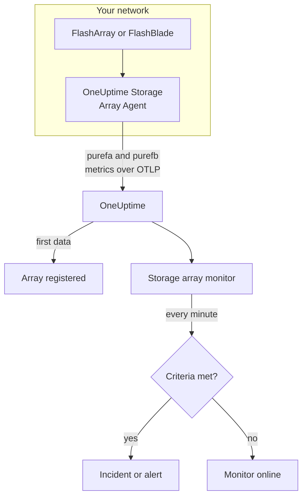

# Storage Array Monitor

A storage array monitor watches one storage array and tells you when the array raises an alert of its own, runs out of space, slows down, loses hardware or a host path, or falls behind on replication. It works with Pure Storage FlashArray and Pure Storage FlashBlade, whose own `purefa_*` and `purefb_*` series the OneUptime Storage Array Agent collects, and with Dell PowerMax, whose `powermax_*` series a OneUptime probe reads from Unisphere for PowerMax.

It also works with Dell PowerStore (`dell.powerstore`), from Dell's `powerstore_*` series.

:::cards
- [Create the monitor](#create-a-storage-array-monitor): Six steps in the dashboard.
- [Templates](#pre-built-alert-templates): Ready-made alerts, one incident per volume, host, appliance or component.
- [How Pure's series work](#how-pures-series-are-shaped): One metric name, many figures.
- [Metrics](#collected-metrics): Every series the monitor can alert on.
:::

## How it works

The OneUptime Storage Array Agent runs on a machine that can reach the array's management interface. It reads the array's metrics with a read-only API token, labels them with the array's name, `storage.array.name`, and its platform, `storage.system`, and sends them to OneUptime over OTLP. The first data registers the array.

A Dell PowerMax needs no agent: a OneUptime probe logs in to Unisphere for PowerMax with a read-only account every 5 minutes and sends every array it manages the same way, named after its Symmetrix ID until you rename it ([Dell PowerMax](/docs/telemetry/storage-arrays#dell-powermax)).

A storage array monitor is tied to one array. Every minute it runs its query over that array's metrics and compares the result with its criteria.



## Before you begin

- **Install the Storage Array Agent** where it can reach the array over HTTPS, with the API token of a user that has the array's **readonly** role. The [Storage Array Agent guide](/docs/telemetry/storage-arrays) covers the user, the token and the install, through `ONEUPTIME_URL`, `ONEUPTIME_TELEMETRY_INGESTION_KEY`, `STORAGE_ARRAY_NAME`, and the array's address and token (`PURE_FA_ENDPOINT` and `PURE_FA_API_TOKEN`, or `PURE_FB_ENDPOINT` and `PURE_FB_API_TOKEN`).
- **Check the array is registered.** It appears under **Products → Infrastructure → Storage Arrays → All Storage Arrays**, named after the agent's `STORAGE_ARRAY_NAME`, about a minute after the first scrape.
- **For a Dell PowerMax**, connect the Unisphere for PowerMax that manages it under **Products → Infrastructure → Storage Arrays → Connections** instead, as [Dell PowerMax](/docs/telemetry/storage-arrays#dell-powermax) explains.

## Create a storage array monitor

:::steps
### Start a new monitor

Go to **Monitors** and click **Create Monitor**.

### Pick Storage Array

Under **Monitor Type**, click **More monitor types** and pick **Storage Array** under **Infrastructure**, or type `storage` in the search box. Enter a **Name** - it is used in incident and alert titles - and click **Next**.

### Choose the array

Under **Storage Array Monitor Configuration**, pick the array from **Storage Array**. Every array that has sent data is in the list. Its platform decides which metrics and templates the form offers. Once picked, a line under the field says whether data is arriving. **Add Storage Array** opens setup steps with your keys filled in, which wait for the first data.

### Choose what to watch

A new monitor starts on **Array Stopped Reporting**, under **What to alert on**. To watch something else:

- **Change** - pick another [template](#pre-built-alert-templates). It sets the metric, the label filters, the aggregation, the time range and the thresholds, and replaces the criteria below with its own. You can still change the **Time Range**.
- **Custom Metric** (under **More fields**) - pick one metric from **Storage Array Metric**, then set **Aggregation** and **Time Range**. The [filters](#monitor-settings) narrow it to one volume, host, pod, component, file system or bucket.
- **Advanced** (under **More fields**) - build queries and formulas yourself under **Select Metrics**, for example the used capacity as `purefa_array_space_bytes` filtered to `space=capacity` minus the same metric filtered to `space=empty`. Use **Group by** an object's label to judge each object on its own.

### Check the criteria

Open each criteria under **Criteria** and check its **Metric**, **Aggregation**, **Condition** and **Threshold**. A template fills these in. With **Custom Metric** or **Advanced**, the monitor starts with the [default criteria](#default-criteria), which only notice the metric sending no data, so set your own threshold.

### Create the monitor

Click **Create Monitor**. OneUptime opens the monitor's page and evaluates it every minute. Incidents and alerts it raises are also listed on the array's **Incidents** and **Alerts** pages.
:::

> [!TIP]
> To set up several templates at once, open the array from **Products → Infrastructure → Storage Arrays** and go to **Recommendations**. Pick the templates you want, choose who is paged, and OneUptime creates one monitor per template.

## Monitor settings

| Field | Tab | What it does |
| --- | --- | --- |
| **Storage Array** | All | Required. Scopes every query to `resource.storage.array.name`, so two arrays that both have a volume called `vol-01` never mix. |
| **Volume** | Custom Metric, Advanced | FlashArray and PowerMax only. One volume: by the `name` label on a FlashArray, such as `vol-db-01` (a volume in a pod or a volume group is named `pod::volume` or `group/volume`), and by the `volume` label on a PowerMax, its device ID such as `00847`. |
| **Host** | Custom Metric, Advanced | FlashArray only. One host as the array knows it, by the `host` label, such as `esxi-01`. |
| **Pod** | Custom Metric, Advanced | FlashArray only. One ActiveCluster or ActiveDR pod, by the `name` label, or `local_pod` on replica link series. |
| **Hardware Component** | Custom Metric, Advanced | One hardware component, such as `CH0.BAY1` or `CT0`: the `component_name` label on a FlashArray, `name` on a FlashBlade, and `component` on a PowerMax, a director such as `FA-1D` or a port such as `FA-1D:4`. |
| **File System** | Custom Metric, Advanced | FlashBlade only. One file system, by the `name` label. |
| **Bucket** | Custom Metric, Advanced | FlashBlade only. One object store bucket, by the `name` label. |
| **Storage Array Metric** | Custom Metric | One metric from the [catalog](#collected-metrics). The form adds the label filter that gives it its meaning, and groups it by the object it describes, so each volume, host or component is judged on its own. |
| **Aggregation** | Custom Metric | How samples are combined: **Average**, **Maximum**, **Minimum**, **Sum** or **Count**. Starts at the metric's usual aggregation. |
| **Time Range** | All | The rolling window the query reads, from **Past 1 Minute** to **Past 365 Days**. A new monitor starts at **Past 5 Minutes**; a custom metric of a file system or bucket at **Past 15 Minutes**; templates set their own. |
| **Select Metrics** | Advanced | The query builder: **Metric**, **Aggregate by**, **Filter by attributes**, **Group by**, plus **Add Metric** and **Add Formula** to combine queries. |

The agent reads the array endpoint every 60 seconds, and volumes, hosts and pods every 2 minutes, so a 5-minute window always holds a sample. It reads a FlashBlade's file systems and buckets every 5 minutes, hence 15, and FlashArray directories every 30 minutes: give a directory monitor a 60-minute window. A probe reads a PowerMax every 5 minutes, as often as Unisphere computes its performance: give a PowerMax monitor a window of 10 minutes or more.

It reads a PowerStore every 5 minutes, and its cluster's state every 60 seconds: give a PowerStore monitor a window of 15 minutes.

## How Pure's series are shaped

Pure puts several figures on **one** metric name and tells them apart with a label:

- **`dimension`** on the performance series. `purefa_array_performance_latency_usec` carries the read latency (`usec_per_read_op`), the write latency (`usec_per_write_op`), the mirrored write latency, and the SAN, queue, QoS and service time of each. Always filter on one `dimension`: an average across them mixes a 200 µs read latency with a queue figure.
- **`space`** on the capacity series: `capacity`, `empty`, `snapshots`, `total_provisioned`, `total_physical`, `available_ratio` and more.

Several series carry their state in a **label**, with a value that is always 1:

| Series | State label | One series per |
| --- | --- | --- |
| `purefa_alerts_open` | `severity`, with `summary`, `code` and `component_type` | Open alert |
| `purefa_hw_component_status` | `component_status` | Hardware component |
| `purefa_host_connectivity_info` | `status`, with `details` | Host |
| `purefa_drive_capacity_bytes` | `component_status` (the value is the drive's capacity) | Drive |

A series filtered to a bad state exists only while something is in that state, so no series means healthy. That is why **Max above 0 fires and 0 recovers** is the right shape for them, and how the templates are built: their recover criteria count a missing series as zero. With no series left at all, such a template recovers only if `purefa_info`, `purefb_info` or `powermax_array_info` arrived in the same window, so an array that stopped reporting closes nothing.

A PowerMax's series hold one figure each, named for it: `powermax_array_response_time_usec` tells reads from writes with `operation`. Its state series exist only while something is wrong, the same way: `powermax_alert_open` while Unisphere has an alert open, `powermax_director_offline` while a director is not online, `powermax_port_offline` while a port someone relies on is down, and `powermax_srdf_group_not_healthy` while an SRDF group is suspended or offline.

In monitor filters and group-by keys, the agent's attributes start with `resource.` (`resource.storage.array.name`, `resource.storage.system`), while Pure's own labels do not (`name`, `host`, `component_name`, `dimension`, `space`, `severity`), nor do PowerMax's (`storage_group`, `volume`, `director`, `port_id`, `srdf_group`).

## How PowerStore's series are shaped

Dell's exporter writes one figure per metric name, so a PowerStore series needs no label filter. Its labels name the object: `appliance_id` an appliance, `name` a part, volume or file system, and `volume_id`, `fc_port_id`, `eth_port_id`, `nas_id` or `volume_group_id` the object of a performance series. Its state series are 1 while healthy and 0 otherwise, so the templates fire below 1. Its own alerts arrive by syslog, and their templates, Logs monitors, are listed after its table below.

## Pre-built Alert Templates

OneUptime ships 49 templates — 12 for FlashArray, 8 for FlashBlade, 16 for PowerStore and 13 for PowerMax — and the **What to alert on** list offers the ones for the array's platform. Each builds a complete monitor: the metric query, its label filters, a group-by on the object's own label, a criteria that fires and one that recovers. Thresholds are starting points you can edit.

A criteria fires only when the condition holds for **every** value in its window. A monitor that fired on a capacity, latency, lag or ratio threshold recovers only 10% past it, so a value hovering at the threshold does not flap. The alert, hardware and connectivity templates fire once a state has shown for their whole 5-minute window, and recover about 5 minutes after it clears. PowerMax's use windows of 10 and 15 minutes: two and three of its 5-minute collections.

### FlashArray

| Template                       | Category     | Severity | Watches                                                                                         | Fires when                                                                                                                                       |
| ------------------------------ | ------------ | -------- | ----------------------------------------------------------------------------------------------- | ------------------------------------------------------------------------------------------------------------------------------------------------ |
| Array Stopped Reporting        | Availability | Critical | `purefa_info`, Count, past 10 minutes                                                           | No data for the whole window — the Storage Array Agent stopped, lost its route to OneUptime or had its token revoked, or the array stopped answering it; recovers when data arrives again |
| Critical Array Alert           | Array Health | Critical | `purefa_alerts_open` filtered to `severity=critical`, Max per `summary`, past 5 minutes        | > 0 — the array has an open critical alert (a failed component, a capacity emergency, a replication failure). One incident per alert; recovers when the alert closes |
| Warning Array Alert            | Array Health | Warning  | `purefa_alerts_open` filtered to `severity=warning`, Max per `summary`, past 5 minutes         | > 0 — the array has an open warning alert. One incident per alert; recovers when the alert closes                                               |
| Capacity Above 80%             | Capacity     | Warning  | `purefa_array_space_utilization`, Max, past 15 minutes                                          | > 80 — Pure's own first capacity threshold; recovers at ≤ 72                                                                                     |
| Capacity Above 90%             | Capacity     | Critical | `purefa_array_space_utilization`, Max, past 5 minutes                                           | > 90 — the array is close to refusing writes; recovers at ≤ 81                                                                                   |
| High Read Latency              | Performance  | Warning  | `purefa_array_performance_latency_usec` filtered to `dimension=usec_per_read_op`, Avg, past 10 minutes  | > 5000 µs (5 ms) — FlashArray reads normally complete well under 1 ms; recovers at ≤ 4500                                                        |
| High Write Latency             | Performance  | Warning  | `purefa_array_performance_latency_usec` filtered to `dimension=usec_per_write_op`, Avg, past 10 minutes | > 5000 µs (5 ms); recovers at ≤ 4500                                                                                                             |
| Hardware Component Failed      | Hardware     | Critical | `purefa_hw_component_status` filtered to `component_status=critical`, Max per `component_name`, past 5 minutes | > 0 — a controller, power supply, fan, bay or port is critical and redundancy is gone. One incident per component; recovers when it reports ok |
| Hardware Component Degraded    | Hardware     | Warning  | `purefa_hw_component_status` filtered to `component_status=degraded`, Max per `component_name`, past 5 minutes | > 0 — a component is degraded. One incident per component; recovers when it reports ok                                                     |
| Drive Failed                   | Hardware     | Critical | `purefa_drive_capacity_bytes` filtered to `component_status=failed`, Max per `component_name`, past 5 minutes | > 0 — a DirectFlash module or SSD failed and the array rebuilds onto the others. One incident per drive; recovers when it is replaced          |
| Host Lost Redundant Paths      | Hosts        | Warning  | `purefa_host_connectivity_info` filtered to `status=critical`, Max per `host`, past 5 minutes  | > 0 — the host reaches the array through one controller or none; a controller failover would take its storage offline. One incident per host; recovers when its paths are back |
| Replication Lag Above 1 Minute | Replication  | Warning  | `purefa_pod_replica_links_lag_max_msec`, Max per `local_pod`, past 10 minutes                   | > 60000 ms (60 s) — a failover now would lose more recent writes than planned. One incident per pod; recovers at ≤ 54000                         |

### FlashBlade

| Template                     | Category     | Severity | Watches                                                                                                        | Fires when                                                                                                          |
| ---------------------------- | ------------ | -------- | -------------------------------------------------------------------------------------------------------------- | ------------------------------------------------------------------------------------------------------------------- |
| Array Stopped Reporting      | Availability | Critical | `purefb_info`, Count, past 10 minutes                                                                          | No data for the whole window — the agent, its exporter or the FlashBlade stopped answering; recovers when data arrives again |
| Critical Array Alert         | Array Health | Critical | `purefb_alerts_open` filtered to `severity=critical`, Max per `summary`, past 5 minutes                       | > 0 — the FlashBlade has an open critical alert. One incident per alert; recovers when the alert closes              |
| Warning Array Alert          | Array Health | Warning  | `purefb_alerts_open` filtered to `severity=warning`, Max per `summary`, past 5 minutes                        | > 0 — the FlashBlade has an open warning alert. One incident per alert; recovers when the alert closes              |
| Capacity Above 80%           | Capacity     | Warning  | `purefb_array_space_utilization` filtered to `type=array`, Max, past 15 minutes                               | > 80; recovers at ≤ 72                                                                                              |
| Capacity Above 90%           | Capacity     | Critical | `purefb_array_space_utilization` filtered to `type=array`, Max, past 5 minutes                                | > 90 — writes fail for every client when it fills; recovers at ≤ 81                                                 |
| Hardware Component Unhealthy | Hardware     | Critical | `purefb_hardware_health`, Min per `name`, past 5 minutes                                                       | < 1 — a blade, fabric module, power supply or fan is not healthy (an unused slot reports 2). One incident per component; recovers at ≥ 1 |
| High Read Latency            | Performance  | Warning  | `purefb_array_performance_latency_usec` filtered to `dimension=usec_per_read_op` and `protocol=all`, Avg, past 10 minutes | > 10000 µs (10 ms) across all protocols; recovers at ≤ 9000                                            |
| File System Near Full        | File Systems | Warning  | `purefb_file_systems_space_bytes` filtered to `space=available_ratio`, Min per `name`, past 15 minutes        | < 0.1 — less than 10% of a file system's provisioned size is left. One incident per file system; recovers at ≥ 0.11 |

### PowerStore

| Template | Category | Severity | Watches | Fires when |
| --- | --- | --- | --- | --- |
| Array Stopped Reporting | Availability | Critical | `powerstore_cluster`, Count, past 10 minutes | No data for the whole window — the agent, Dell's exporter or the cluster stopped answering; recovers when data arrives again |
| Capacity Above 80% | Capacity | Warning | `powerstore_cap_physical_used_percent`, Max per `appliance_id`, past 15 minutes | > 80 — an appliance's capacity is filling; recovers at ≤ 72 |
| Capacity Above 90% | Capacity | Critical | `powerstore_cap_physical_used_percent`, Max per `appliance_id`, past 15 minutes | > 90 — an appliance is close to refusing writes; recovers at ≤ 81 |
| High Read Latency | Performance | Warning | `powerstore_perf_avg_read_latency`, Avg per `appliance_id`, past 15 minutes | > 5000 µs (5 ms); recovers at ≤ 4500 |
| High Write Latency | Performance | Warning | `powerstore_perf_avg_write_latency`, Avg per `appliance_id`, past 15 minutes | > 5000 µs (5 ms); recovers at ≤ 4500 |
| Drive Failed | Hardware | Critical | `powerstore_hardware_Drive_state`, Min per `name`, past 10 minutes | < 1 — a drive failed or was removed; recovers at ≥ 1 |
| Node Unhealthy | Hardware | Critical | `powerstore_hardware_node_state`, Min per `name`, past 10 minutes | < 1 — a node is not Healthy; recovers at ≥ 1 |
| Power Supply Unhealthy | Hardware | Warning | `powerstore_hardware_Power_Supply_state`, Min per `name`, past 10 minutes | < 1 — a power supply failed or lost power; recovers at ≥ 1 |
| Fan Unhealthy | Hardware | Warning | `powerstore_hardware_Fan_state`, Min per `name`, past 10 minutes | < 1 — a fan failed; recovers at ≥ 1 |
| Battery Unhealthy | Hardware | Warning | `powerstore_hardware_Battery_state`, Min per `name`, past 10 minutes | < 1 — a battery backup module faulted; recovers at ≥ 1 |
| Drive Wearing Out | Hardware | Warning | `powerstore_wear_metrics_by_drive`, Min per `name`, past 15 minutes | < 10 — less than 10% of a drive's endurance is left; recovers at ≥ 11 |
| NAS Server Not Started | File Systems | Warning | `powerstore_nas_server_operational_status`, Max per `name`, past 10 minutes | < 1 — a NAS server is stopped or degraded; recovers at ≥ 1 |
| Volume Not Ready | Array Health | Warning | `powerstore_volume_state`, Max per `name`, past 15 minutes | < 1 — a volume is offline; recovers at ≥ 1 |
| File System Near Full | File Systems | Warning | `powerstore_filesystem_logical_used_percent`, Max per `name`, past 15 minutes | > 90 — a file system is almost full; recovers at ≤ 81 |
| Cluster Not Configured | Array Health | Warning | `powerstore_cluster`, Max, past 10 minutes | < 1 — the cluster is not Configured; recovers at ≥ 1 |
| Metro Witness Not Connected | Replication | Warning | `powerstore_metro_witness_status`, Min per `name`, past 10 minutes | > 0 — a Metro witness is not connected; recovers when it is OK again |

### PowerStore alerts, by syslog

A PowerStore's own alerts arrive as logs, so their templates are **Logs** monitors, offered on the array's **Recommendations** page under **Array Alerts**. Each opens one alert per PowerStore alert, grouped by `powerstore.resource.name` and `powerstore.alert.id`, and resolves it when the PowerStore clears that alert:

| Template | Severity | Opens on a line with | Resolves on |
| --- | --- | --- | --- |
| Critical Array Alert | Critical | `powerstore.alert.severity=Critical` | `powerstore.alert.state=Cleared` |
| Major Array Alert | Warning | `powerstore.alert.severity=Major` | `powerstore.alert.state=Cleared` |
| Port Link Down | Warning | `powerstore.event.code=0x00307404` | `powerstore.alert.state=Cleared` |

### PowerMax

| Template | Category | Severity | Watches | Fires when |
| --- | --- | --- | --- | --- |
| Array Stopped Reporting | Availability | Critical | `powermax_array_info`, Count, past 10 minutes | No data for the whole window — the probe stopped collecting the array: its connection fails (its page under **Connections** says why), the probe is disconnected, or Unisphere no longer manages the array; recovers when data arrives again |
| Critical Unisphere Alert | Array Health | Critical | `powermax_alert_open` filtered to `severity=critical`, Max per `description`, past 10 minutes | > 0 — Unisphere has an open alert of severity Critical or Fatal for the array. One incident per alert; recovers when the alert is acknowledged or cleared in Unisphere |
| Warning Unisphere Alert | Array Health | Warning | `powermax_alert_open` filtered to `severity=warning`, Max per `description`, past 10 minutes | > 0 — Unisphere has an open alert of severity Warning or Minor. One incident per alert; recovers when the alert is acknowledged or cleared |
| Performance Collection Off | Array Health | Warning | `powermax_array_performance_collection`, Min, past 15 minutes | < 1 — Unisphere does not collect the array's 5-minute performance, so no response time, IOPS or throughput is charted or alerted on; recovers at ≥ 1 |
| Storage Resource Pool Above 80% | Capacity | Warning | `powermax_srp_capacity_used_percent`, Max per `srp`, past 15 minutes | > 80 — the pool's storage groups stop taking new writes when it fills. One incident per pool; recovers at ≤ 72 |
| Storage Resource Pool Above 90% | Capacity | Critical | `powermax_srp_capacity_used_percent`, Max per `srp`, past 15 minutes | > 90 — writes to its storage groups fail once it is full. One incident per pool; recovers at ≤ 81 |
| Storage Group Response Time Above 5 ms | Performance | Warning | `powermax_storage_group_response_time_usec`, Avg per `storage_group`, past 15 minutes | > 5000 µs (5 ms) — a PowerMax normally answers in well under a millisecond. One incident per storage group; recovers at ≤ 4500 |
| High Read Response Time | Performance | Warning | `powermax_array_response_time_usec` filtered to `operation=read`, Avg, past 15 minutes | > 3000 µs (3 ms); recovers at ≤ 2700 |
| High Write Response Time | Performance | Warning | `powermax_array_response_time_usec` filtered to `operation=write`, Avg, past 15 minutes | > 3000 µs (3 ms) — synchronous SRDF adds the round trip to the remote array to every write; recovers at ≤ 2700 |
| Director Not Online | Hardware | Critical | `powermax_director_offline`, Max per `component`, past 10 minutes | > 0 — a director is not online, and the array runs on the others. One incident per director; recovers when it is online again |
| Port Down | Hardware | Warning | `powermax_port_offline`, Max per `component`, past 10 minutes | > 0 — a port in a port group, masking view or SRDF group is not up. One incident per port; recovers when it is up again |
| SRDF Group Suspended or Offline | Replication | Critical | `powermax_srdf_group_not_healthy`, Max per `srdf_group`, past 10 minutes | > 0 — the group's link is offline or its pairs are suspended, split or failed over, so the remote copy is not kept current. One incident per group; recovers when it is back in sync |
| SRDF/A Lag Above 2 Minutes | Replication | Warning | `powermax_srdf_group_lag_seconds`, Avg per `srdf_group`, past 15 minutes | > 120 (2 minutes) — a failover now would lose more recent writes than planned. One incident per group; recovers at ≤ 108 |

**Severity** is the label the picker shows. The incident and alert a template creates start on your project's most severe incident and alert severity; change them in the criteria.

- **Array Stopped Reporting** counts the platform's identity series (`purefa_info` or `purefb_info`, which every endpoint the agent scrapes exports on every scrape, or `powermax_array_info`, which every PowerMax collection writes). When data stops, the other templates have nothing to compare and keep their last status, so this is the one that tells you.
- **Open alerts and hardware states use Max** of a series that exists only while the alert is open or the component is in that state, so the state trips the threshold once it has shown for the whole 5-minute window.
- **Every per-object template groups by the object's own label** (`summary`, `component_name`, `host`, `local_pod`, `name`, and on a PowerMax `description`, `component`, `srp`, `srdf_group` and `storage_group`), so one incident fires per affected object, and the incident names it.
- **Latency templates use Avg** of the array's own average per operation, and capacity templates **Max** of its own utilization percentage. Latencies are pinned in microseconds and capacity in percent.
- **Hardware Component Unhealthy uses Min** per component: its health is 1 when healthy and drops to 0 when not.

There is no template for the latency of each volume, because the right threshold depends on the workload: build it from the catalog with a group-by on `name`. Capacity forecasting needs a growth trend rather than a threshold, and drive wear has no series to alert on.

## Collected Metrics

The agent sends everything the array exports, and a probe everything it reads of a PowerMax, in the same units (Unisphere's milliseconds as microseconds, its MB per second as bytes per second); the series below are the catalog the monitor form offers. Every value is a gauge the array computes itself - latencies are microseconds per operation and throughput is per second - so no rate math is needed. **Filter** is the label filter that gives the series the meaning its row says; the form applies it for you.

### Array Health

| Metric               | Filter | Platform   | Unit    | Description                                                                                                                                                       |
| -------------------- | ------ | ---------- | ------- | ----------------------------------------------------------------------------------------------------------------------------------------------------------------- |
| `purefa_alerts_open` | —      | FlashArray | `count` | One series per alert open on the array (value 1), labeled `severity` (`critical`, `warning`, `info`, `hidden`), `category`, `code`, `component_type` and `summary` |
| `purefb_alerts_open` | —      | FlashBlade | `count` | One series per alert open on the FlashBlade (value 1), labeled `severity` (`info`, `warning`, `critical`), `code`, `component_name`, `component_type`, `summary` and `kburl` (Pure's knowledge base article) |
| `powerstore_cluster` | — | PowerStore | `count` | 1 while the PowerStore cluster is Configured (formed and serving), 0 in any other state: Configuring, Expanding, Removing, Clustering_Failed or Unconfigured. |
| `powermax_alert_open` | — | PowerMax | `count` | One series per alert Unisphere has open for the array (value 1): not acknowledged, not cleared, and Minor or worse. Its severity label is critical (Critical and Fatal) or warning (Warning and Minor); its alert_type, object and description labels say what it is about. Acknowledge the alert in Unisphere and the series goes away |
| `powermax_array_health_score` | — | PowerMax | `score` | Unisphere's health score of the array, from 0 to 100, per health_metric: overall, and each area it scores (capacity, configuration, performance, service level compliance) |
| `powermax_array_performance_collection` | — | PowerMax | `count` | 1 while Unisphere collects 5-minute performance data for the array, 0 while it does not. With it off, OneUptime still lists the array's inventory and alerts, but charts no performance. Turn it on in Unisphere at Settings > Performance > System Registrations |

### Capacity

| Metric                                    | Filter                       | Platform   | Unit    | Description                                                                                                                           |
| ----------------------------------------- | ---------------------------- | ---------- | ------- | ------------------------------------------------------------------------------------------------------------------------------------- |
| `purefa_array_space_utilization`          | —                            | FlashArray | `%`     | Share of the array's usable capacity in use. Pure raises its own capacity alerts at 80%, 90% and 100%                                 |
| `purefa_array_space_bytes`                | `space=capacity`             | FlashArray | `bytes` | Usable capacity of the array                                                                                                          |
| `purefa_array_space_bytes`                | `space=empty`                | FlashArray | `bytes` | Unused capacity — trend it to forecast when the array fills up                                                                        |
| `purefa_array_space_bytes`                | `space=snapshots`            | FlashArray | `bytes` | Physical space held only by snapshots; a fast climb usually means a protection group keeps more snapshots than planned                 |
| `purefa_array_space_data_reduction_ratio` | —                            | FlashArray | `ratio` | Deduplication and compression across the array, e.g. 4.2 for 4.2:1. A sustained drop means new data reduces poorly                    |
| `purefb_array_space_utilization`          | `type=array`                 | FlashBlade | `%`     | Share of the FlashBlade's usable capacity in use                                                                                      |
| `purefb_array_space_bytes`                | `type=array`, `space=empty`  | FlashBlade | `bytes` | Unused capacity of the FlashBlade                                                                                                     |
| `purefb_array_space_data_reduction_ratio` | `type=array`                 | FlashBlade | `ratio` | Data reduction across the FlashBlade                                                                                                  |
| `powerstore_cap_physical_used_percent` | — | PowerStore | `%` | Share of each appliance's physical capacity in use, in percent: its physical used over its physical total, from PowerStore's daily space rollup. PowerStore raises its own capacity alerts from 70%. Group by appliance_id. |
| `powerstore_cap_last_physical_total` | — | PowerStore | `bytes` | Usable physical capacity of each appliance in bytes. |
| `powerstore_cap_last_physical_used` | — | PowerStore | `bytes` | Physical capacity each appliance uses in bytes, after deduplication and compression. Trend it to forecast when an appliance fills up. |
| `powerstore_cap_last_logical_provisioned` | — | PowerStore | `bytes` | Logical capacity provisioned on each appliance in bytes: the size of every volume, file system and vVol it holds, which can be far above its physical capacity. |
| `powerstore_cap_last_logical_used` | — | PowerStore | `bytes` | Data hosts have written to each appliance in bytes, before deduplication and compression. |
| `powerstore_cap_last_data_reduction` | — | PowerStore | `ratio` | Deduplication and compression on each appliance, for example 3.4 for 3.4:1. A sustained drop means newly written data reduces poorly: encrypted or already-compressed data. |
| `powerstore_cap_last_efficiency_ratio` | — | PowerStore | `ratio` | Overall efficiency of each appliance: data reduction together with the savings of snapshots and thin provisioning. |
| `powermax_array_capacity_used_percent` | — | PowerMax | `%` | Share of the array's usable capacity in use, in percent, across its storage resource pools |
| `powermax_array_capacity_usable_bytes` | — | PowerMax | `bytes` | The array's usable capacity, in bytes, as Unisphere reports it |
| `powermax_array_capacity_used_bytes` | — | PowerMax | `bytes` | The array's usable capacity in use, in bytes |
| `powermax_array_capacity_subscribed_bytes` | — | PowerMax | `bytes` | The capacity of every thin volume on the array, in bytes: what hosts were promised, which can exceed the usable capacity |
| `powermax_array_data_reduction_ratio` | — | PowerMax | `ratio` | How many times larger the data hosts wrote is than the space it takes after compression and deduplication, as Unisphere reports it |
| `powermax_srp_capacity_used_percent` | — | PowerMax | `%` | Share of each storage resource pool's usable capacity in use, in percent, by its srp label. A pool that fills stops taking new writes for every storage group in it |
| `powermax_srp_capacity_used_bytes` | — | PowerMax | `bytes` | Each storage resource pool's usable capacity in use, in bytes, by its srp label |

### Performance

| Metric                                     | Filter                                         | Platform   | Unit      | Description                                                                                                  |
| ------------------------------------------ | ---------------------------------------------- | ---------- | --------- | ------------------------------------------------------------------------------------------------------------ |
| `purefa_array_performance_latency_usec`    | `dimension=usec_per_read_op`                   | FlashArray | `µs`      | Average latency of a read as hosts see it; FlashArray reads typically complete well under 1 ms              |
| `purefa_array_performance_latency_usec`    | `dimension=usec_per_write_op`                  | FlashArray | `µs`      | Average latency of a write as hosts see it                                                                   |
| `purefa_array_performance_latency_usec`    | `dimension=usec_per_mirrored_write_op`         | FlashArray | `µs`      | Average latency of a write to an ActiveCluster stretched pod, including the round trip to the peer array    |
| `purefa_array_performance_latency_usec`    | `dimension=san_usec_per_read_op`               | FlashArray | `µs`      | Time a read spends in the SAN; high SAN latency with low service latency points at the fabric or the host   |
| `purefa_array_performance_throughput_iops` | `dimension=reads_per_sec`                      | FlashArray | `ops/s`   | Read operations per second                                                                                   |
| `purefa_array_performance_throughput_iops` | `dimension=writes_per_sec`                     | FlashArray | `ops/s`   | Write operations per second                                                                                  |
| `purefa_array_performance_bandwidth_bytes` | `dimension=read_bytes_per_sec`                 | FlashArray | `bytes/s` | Bytes read per second                                                                                        |
| `purefa_array_performance_bandwidth_bytes` | `dimension=write_bytes_per_sec`                | FlashArray | `bytes/s` | Bytes written per second                                                                                     |
| `purefa_array_performance_queue_depth_ops` | —                                              | FlashArray | `ops`     | Operations queued on the array; a growing queue with rising latency means hosts send more than it can serve |
| `purefa_array_performance_average_bytes`   | `dimension=bytes_per_op`                       | FlashArray | `bytes`   | Average size of an operation — large I/O raises latency without anything being wrong                        |
| `purefb_array_performance_latency_usec`    | `dimension=usec_per_read_op`, `protocol=all`   | FlashBlade | `µs`      | Average read latency across all protocols                                                                    |
| `purefb_array_performance_latency_usec`    | `dimension=usec_per_write_op`, `protocol=all`  | FlashBlade | `µs`      | Average write latency across all protocols                                                                   |
| `purefb_array_performance_throughput_iops` | `dimension=reads_per_sec`, `protocol=all`      | FlashBlade | `ops/s`   | Read operations per second across all protocols                                                              |
| `purefb_array_performance_throughput_iops` | `dimension=writes_per_sec`, `protocol=all`     | FlashBlade | `ops/s`   | Write operations per second across all protocols                                                             |
| `purefb_array_performance_bandwidth_bytes` | `dimension=read_bytes_per_sec`, `protocol=all` | FlashBlade | `bytes/s` | Bytes read per second across all protocols                                                                   |
| `purefb_array_performance_bandwidth_bytes` | `dimension=write_bytes_per_sec`, `protocol=all` | FlashBlade | `bytes/s` | Bytes written per second across all protocols                                                               |
| `powerstore_perf_avg_read_latency` | — | PowerStore | `µs` | Average latency of a read on each appliance, in microseconds, over PowerStore's latest five-minute sample. PowerStore reads typically complete well under 1 ms. |
| `powerstore_perf_avg_write_latency` | — | PowerStore | `µs` | Average latency of a write on each appliance, in microseconds. |
| `powerstore_perf_avg_read_iops` | — | PowerStore | `ops/s` | Read operations per second on each appliance. |
| `powerstore_perf_avg_write_iops` | — | PowerStore | `ops/s` | Write operations per second on each appliance. |
| `powerstore_perf_avg_read_bandwidth` | — | PowerStore | `bytes/s` | Bytes read per second on each appliance. |
| `powerstore_perf_avg_write_bandwidth` | — | PowerStore | `bytes/s` | Bytes written per second on each appliance. |
| `powerstore_perf_avg_io_workload_cpu_utilization` | — | PowerStore | `%` | Share of the CPU cores each appliance dedicates to storage I/O that is busy, in percent. Sustained high values mean the appliance is near the load it can serve. |
| `powermax_array_response_time_usec` | `operation=read` | PowerMax | `µs` | Average time a host read takes on the array, in microseconds, over Unisphere's last 5-minute interval (operation read) |
| `powermax_array_response_time_usec` | `operation=write` | PowerMax | `µs` | Average time a host write takes on the array, in microseconds, over Unisphere's last 5-minute interval (operation write) |
| `powermax_array_read_iops` | — | PowerMax | `ops/s` | Host reads per second on the array: Unisphere's host IOs times its share of reads |
| `powermax_array_write_iops` | — | PowerMax | `ops/s` | Host writes per second on the array: Unisphere's host IOs times its share of writes |
| `powermax_array_read_throughput_bytes` | — | PowerMax | `bytes/s` | Bytes per second hosts read from the array |
| `powermax_array_write_throughput_bytes` | — | PowerMax | `bytes/s` | Bytes per second hosts write to the array |
| `powermax_array_cache_hit_percent` | — | PowerMax | `%` | Share of host I/O the array answered from cache, in percent |
| `powermax_array_write_pending_percent` | — | PowerMax | `%` | Share of the array's cache holding writes not yet destaged to its drives, in percent. Near the array's limit, it slows host writes down |
| `powermax_array_frontend_busy_percent` | — | PowerMax | `%` | How busy the directors that serve hosts are, in percent |
| `powermax_array_backend_busy_percent` | — | PowerMax | `%` | How busy the directors that serve the drives are, in percent |
| `powermax_array_srdf_busy_percent` | — | PowerMax | `%` | How busy the directors that replicate to other arrays are, in percent |
| `powermax_srp_response_time_usec` | — | PowerMax | `µs` | Average time an I/O takes in each storage resource pool, in microseconds, by its srp label |

### Volumes

| Metric                                      | Filter                           | Platform   | Unit      | Description                                                   |
| ------------------------------------------- | -------------------------------- | ---------- | --------- | ------------------------------------------------------------- |
| `purefa_volume_performance_latency_usec`    | `dimension=usec_per_read_op`     | FlashArray | `µs`      | Average read latency of each volume — group by `name`         |
| `purefa_volume_performance_latency_usec`    | `dimension=usec_per_write_op`    | FlashArray | `µs`      | Average write latency of each volume                          |
| `purefa_volume_performance_throughput_iops` | `dimension=reads_per_sec`        | FlashArray | `ops/s`   | Read operations per second of each volume                     |
| `purefa_volume_performance_throughput_iops` | `dimension=writes_per_sec`       | FlashArray | `ops/s`   | Write operations per second of each volume                    |
| `purefa_volume_performance_bandwidth_bytes` | `dimension=read_bytes_per_sec`   | FlashArray | `bytes/s` | Bytes read per second from each volume                        |
| `purefa_volume_performance_bandwidth_bytes` | `dimension=write_bytes_per_sec`  | FlashArray | `bytes/s` | Bytes written per second to each volume                       |
| `purefa_volume_space_bytes`                 | `space=total_provisioned`        | FlashArray | `bytes`   | Size of each volume as hosts see it                           |
| `purefa_volume_space_bytes`                 | `space=total_physical`           | FlashArray | `bytes`   | Physical space each volume uses after data reduction          |
| `purefa_volume_space_data_reduction_ratio`  | —                                | FlashArray | `ratio`   | Data reduction ratio of each volume                           |
| `powerstore_volume_state` | — | PowerStore | `count` | 1 while a volume is Ready, 0 while it is Initializing, Offline or being destroyed. Group by name to find the volume hosts cannot reach. |
| `powerstore_volume_size` | — | PowerStore | `bytes` | Size of each volume as hosts see it, in bytes. |
| `powerstore_volume_logical_used` | — | PowerStore | `bytes` | Data hosts have written to each volume in bytes, before deduplication and compression. |
| `powerstore_metricVolume_avg_read_latency` | — | PowerStore | `µs` | Average read latency of each volume in microseconds. Group by volume_id, which holds the volume's name, to find the slow volume. |
| `powerstore_metricVolume_avg_write_latency` | — | PowerStore | `µs` | Average write latency of each volume in microseconds. |
| `powerstore_metricVolume_avg_read_iops` | — | PowerStore | `ops/s` | Read operations per second of each volume. |
| `powerstore_metricVolume_avg_write_iops` | — | PowerStore | `ops/s` | Write operations per second of each volume. |
| `powerstore_metricVolume_avg_read_bandwidth` | — | PowerStore | `bytes/s` | Bytes read per second from each volume. |
| `powerstore_metricVolume_avg_write_bandwidth` | — | PowerStore | `bytes/s` | Bytes written per second to each volume. |
| `powerstore_volumegroup_logical_provisioned` | — | PowerStore | `bytes` | Capacity provisioned to each volume group's volumes, in bytes. Group by name. |
| `powerstore_volumegroup_logical_used` | — | PowerStore | `bytes` | Data hosts have written to each volume group's volumes in bytes, before deduplication and compression. |
| `powerstore_metricVg_avg_read_latency` | — | PowerStore | `µs` | Average read latency across each volume group's volumes, in microseconds. Group by volume_group_id, which holds the group's name. |
| `powerstore_metricVg_avg_write_latency` | — | PowerStore | `µs` | Average write latency across each volume group's volumes, in microseconds. |
| `powerstore_metricVg_avg_total_iops` | — | PowerStore | `ops/s` | Read and write operations per second across each volume group's volumes. |
| `powermax_storage_group_response_time_usec` | — | PowerMax | `µs` | Average time an I/O takes for each storage group, in microseconds, by its storage_group label, over Unisphere's last 5-minute interval |
| `powermax_storage_group_read_response_time_usec` | — | PowerMax | `µs` | Average time a read takes for each storage group, in microseconds, by its storage_group label |
| `powermax_storage_group_write_response_time_usec` | — | PowerMax | `µs` | Average time a write takes for each storage group, in microseconds, by its storage_group label |
| `powermax_storage_group_iops` | — | PowerMax | `ops/s` | Host I/Os per second for each storage group, by its storage_group label |
| `powermax_storage_group_throughput_bytes` | — | PowerMax | `bytes/s` | Bytes per second hosts read and write for each storage group, by its storage_group label |
| `powermax_storage_group_used_bytes` | — | PowerMax | `bytes` | The capacity each storage group's volumes use, in bytes, by its storage_group label |
| `powermax_storage_group_host_io_limit_exceeded_percent` | — | PowerMax | `%` | Share of the interval each storage group spent held back by its host I/O limit, in percent. Only storage groups with a limit set report it |
| `powermax_storage_group_realtime_read_response_time_usec` | — | PowerMax | `µs` | Read response time of the storage groups registered for real-time collection in Unisphere, in microseconds, every 5 seconds. Up to 100 storage groups per array can be registered |
| `powermax_storage_group_realtime_write_response_time_usec` | — | PowerMax | `µs` | Write response time of the storage groups registered for real-time collection in Unisphere, in microseconds, every 5 seconds |
| `powermax_storage_group_realtime_iops` | — | PowerMax | `ops/s` | Host I/Os per second of the storage groups registered for real-time collection, every 5 seconds |
| `powermax_storage_group_realtime_throughput_bytes` | — | PowerMax | `bytes/s` | Bytes per second of the storage groups registered for real-time collection, every 5 seconds |
| `powermax_volume_response_time_usec` | — | PowerMax | `µs` | Average time an I/O takes for each volume, in microseconds, by its volume label. Unisphere reports it only for volumes of storage groups registered for real-time collection |
| `powermax_volume_iops` | — | PowerMax | `ops/s` | Host I/Os per second for each volume, by its volume label, for volumes of storage groups registered for real-time collection |
| `powermax_volume_used_bytes` | — | PowerMax | `bytes` | The capacity each volume uses, in bytes, by its volume label |

### Hosts

| Metric                                    | Filter                        | Platform   | Unit    | Description                                                                                                                                    |
| ----------------------------------------- | ----------------------------- | ---------- | ------- | ---------------------------------------------------------------------------------------------------------------------------------------------- |
| `purefa_host_connectivity_info`           | —                             | FlashArray | `count` | One series per host (value 1) labeled with its connectivity `status` (`healthy`, `critical`, `unused`) and `details` (`Redundant`, `Single Controller`, `None`, ...) |
| `purefa_host_performance_latency_usec`    | `dimension=usec_per_read_op`  | FlashArray | `µs`    | Average read latency each host sees — group by `host`                                                                                          |
| `purefa_host_performance_latency_usec`    | `dimension=usec_per_write_op` | FlashArray | `µs`    | Average write latency each host sees                                                                                                           |
| `purefa_host_performance_throughput_iops` | `dimension=reads_per_sec`     | FlashArray | `ops/s` | Read operations per second of each host                                                                                                        |
| `purefa_host_performance_throughput_iops` | `dimension=writes_per_sec`    | FlashArray | `ops/s` | Write operations per second of each host                                                                                                       |

### Replication

| Metric                                               | Filter                                 | Platform   | Unit      | Description                                                                                                                                                  |
| ---------------------------------------------------- | -------------------------------------- | ---------- | --------- | ------------------------------------------------------------------------------------------------------------------------------------------------------------ |
| `purefa_pod_replica_links_lag_max_msec`              | —                                      | FlashArray | `ms`      | Largest replication lag of each pod replica link (ActiveDR / async), labeled `local_pod`, `remote_pod`, `remote`, `direction` and `status` — group by `local_pod` |
| `purefa_pod_replica_links_lag_average_msec`          | —                                      | FlashArray | `ms`      | Average replication lag of each pod replica link                                                                                                             |
| `purefa_pod_performance_replication_bandwidth_bytes` | `direction=total`                      | FlashArray | `bytes/s` | Replication traffic of each pod, labeled `direction` and `dimension`                                                                                         |
| `purefa_pod_performance_latency_usec`                | `dimension=usec_per_mirrored_write_op` | FlashArray | `µs`      | Average mirrored write latency of each ActiveCluster pod                                                                                                     |
| `powerstore_metro_witness_status` | — | PowerStore | `count` | State of each Metro witness: 0 OK, 1 partially connected, 2 disconnected, 3 being deleted, 4 initializing. Above 0, a Metro session may not fail over on its own. |
| `powermax_srdf_group_not_healthy` | — | PowerMax | `count` | One series per SRDF group whose link is offline or whose pairs are suspended, partitioned, split, failed over or invalid (value 1), with its srdf_group, state and remote_symmetrix_id labels. The series is absent while the group replicates |
| `powermax_srdf_group_lag_seconds` | — | PowerMax | `s` | How far each asynchronous SRDF group's remote copy is behind, in seconds, by its srdf_group label. A failover now would lose the writes of that long |
| `powermax_srdf_group_throughput_bytes` | — | PowerMax | `bytes/s` | Bytes per second each SRDF group sends to its remote array, by its srdf_group label |
| `powermax_srdf_group_response_time_usec` | — | PowerMax | `µs` | Average time a replicated write takes to reach the remote array for each SRDF group, in microseconds, by its srdf_group label |

### Hardware

| Metric                                        | Filter                           | Platform   | Unit       | Description                                                                                                                                                                                                  |
| --------------------------------------------- | -------------------------------- | ---------- | ---------- | ------------------------------------------------------------------------------------------------------------------------------------------------------------------------------------------------------------ |
| `purefa_hw_component_status`                  | —                                | FlashArray | `count`    | One series per hardware component (value 1) — chassis, controllers, drive and NVRAM bays, power supplies, fans, temperature sensors, Ethernet and Fibre Channel ports — labeled `component_status` (`ok`, `critical`, `degraded`, `device_off`, `identifying`, `not_installed`, `unknown`) |
| `purefa_hw_component_temperature_celsius`     | —                                | FlashArray | `°C`       | Temperature of each sensor — group by `component_name`                                                                                                                                                       |
| `purefa_drive_capacity_bytes`                 | —                                | FlashArray | `bytes`    | Raw capacity of each drive, labeled with its `component_status` (`healthy`, `failed`, `missing`, `recovering`, `unhealthy`, `empty`, ...) and type                                                            |
| `purefa_network_interface_performance_errors` | `dimension=total_errors_per_sec` | FlashArray | `errors/s` | Errors per second on each Ethernet and Fibre Channel interface — sustained errors usually mean a bad cable, optic or switch port                                                                              |
| `purefb_hardware_health`                      | —                                | FlashBlade | —          | Health of each hardware component (blades, fabric modules, power supplies, fans, ...): 1 = healthy, 2 = unused, 0 = unhealthy. Take the minimum per `name`                                                    |
| `powerstore_hardware_node_state` | — | PowerStore | `count` | 1 while a node of an appliance is Healthy, 0 in any other state, which its state label names (Failed, Disconnected, Initializing...). Group by name and appliance_id. |
| `powerstore_hardware_Drive_state` | — | PowerStore | `count` | 1 while a drive is Healthy, 0 when it has failed, been removed or is not ready. Group by name to fire one incident per drive. |
| `powerstore_wear_metrics_by_drive` | — | PowerStore | `%` | Share of each drive's write endurance left, in percent. A drive near 0 is close to the end of its life: plan its replacement. |
| `powerstore_hardware_Fan_state` | — | PowerStore | `count` | 1 while a node's fan module is Healthy, 0 when it has failed or been removed. |
| `powerstore_hardware_Power_Supply_state` | — | PowerStore | `count` | 1 while a node's power supply is Healthy, 0 when it has failed, lost input power or been disconnected. |
| `powerstore_hardware_Battery_state` | — | PowerStore | `count` | 1 while a node's battery backup module is Healthy, 0 when it has faulted or been disconnected. |
| `powerstore_fc_port_is_link_up` | — | PowerStore | `count` | 1 while a Fibre Channel port's link is up, 0 while it is down, which a port nothing is cabled to always is. Group by fc_port_id, which holds the port's name. |
| `powerstore_eth_port_is_link_up` | — | PowerStore | `count` | 1 while an Ethernet port's link is up, 0 while it is down. Group by eth_port_id, which holds the port's name. |
| `powerstore_metricFcPort_avg_read_latency` | — | PowerStore | `µs` | Average latency of a read through each Fibre Channel port, in microseconds. |
| `powerstore_metricFcPort_avg_write_latency` | — | PowerStore | `µs` | Average latency of a write through each Fibre Channel port, in microseconds. |
| `powerstore_metricFcPort_avg_total_iops` | — | PowerStore | `ops/s` | Read and write operations per second through each Fibre Channel port. |
| `powerstore_metricFcPort_avg_total_bandwidth` | — | PowerStore | `bytes/s` | Bytes read and written per second through each Fibre Channel port. |
| `powerstore_metricFcPort_avg_invalid_crc_count_ps` | — | PowerStore | `errors/s` | Frames with an invalid CRC received per second on each Fibre Channel port. Sustained errors usually mean a bad cable, optic or switch port. |
| `powerstore_metricFcPort_avg_link_failure_count_ps` | — | PowerStore | `errors/s` | Link failures per second on each Fibre Channel port. Any is worth a look at the port's cable, optic and switch. |
| `powerstore_metricEthPort_avg_bytes_rx_ps` | — | PowerStore | `bytes/s` | Bytes received per second on each Ethernet port. |
| `powerstore_metricEthPort_avg_bytes_tx_ps` | — | PowerStore | `bytes/s` | Bytes transmitted per second on each Ethernet port. |
| `powerstore_metricEthPort_avg_pkt_rx_crc_error_ps` | — | PowerStore | `errors/s` | Packets received with a CRC error per second on each Ethernet port. Sustained errors usually mean a bad cable, optic or switch port. |
| `powermax_director_offline` | — | PowerMax | `count` | One series per director that is not online (value 1), with its director, role and status labels. The series is absent while every director is online |
| `powermax_director_busy_percent` | — | PowerMax | `%` | How busy each director is, in percent, by its component label (such as FA-1D) |
| `powermax_port_offline` | — | PowerMax | `count` | One series per port that serves hosts or SRDF (in a port group, a masking view or an SRDF group) but is not up (value 1), with its component, protocol and status labels. Ports nobody uses are left out: they may be off on purpose |
| `powermax_port_busy_percent` | — | PowerMax | `%` | How busy each port is, in percent, by its component label (such as FA-1D:4) |
| `powermax_port_read_throughput_bytes` | — | PowerMax | `bytes/s` | Bytes per second read through each port, by its component label |
| `powermax_port_rx_power_milliwatts` | — | PowerMax | `mW` | The light power each optical port receives, in milliwatts, by its component label. A falling value is an optic or cable going bad. Needs Unisphere 10.3 or later |

### File Systems

| Metric                                         | Filter                        | Platform   | Unit    | Description                                                                                  |
| ---------------------------------------------- | ----------------------------- | ---------- | ------- | -------------------------------------------------------------------------------------------- |
| `purefb_file_systems_performance_latency_usec` | `dimension=usec_per_read_op`  | FlashBlade | `µs`    | Average read latency of each file system — group by `name`                                   |
| `purefb_file_systems_performance_latency_usec` | `dimension=usec_per_write_op` | FlashBlade | `µs`    | Average write latency of each file system                                                    |
| `purefb_file_systems_space_bytes`              | `space=total_physical`        | FlashBlade | `bytes` | Physical space each file system uses                                                         |
| `purefb_file_systems_space_bytes`              | `space=available_ratio`       | FlashBlade | `ratio` | Share of each file system's provisioned size still available, 0 to 1 — near 0 it is about to fill its quota |
| `powerstore_nas_server_operational_status` | — | PowerStore | `count` | 1 while a NAS server is Started, 0 while it is Stopped, Starting, Stopping, failed over or Degraded (running without its backup node). Group by name. |
| `powerstore_metricNas_avg_read_latency` | — | PowerStore | `µs` | Average latency of a read served by each NAS server, in microseconds. Group by nas_id, which holds the server's name. |
| `powerstore_metricNas_avg_write_latency` | — | PowerStore | `µs` | Average latency of a write served by each NAS server, in microseconds. |
| `powerstore_metricNas_avg_total_iops` | — | PowerStore | `ops/s` | Read and write operations per second served by each NAS server. |
| `powerstore_filesystem_logical_used_percent` | — | PowerStore | `%` | Share of each file system's size in use, in percent: its logical used over its provisioned size. Group by name. |
| `powerstore_filesystem_logical_provisioned` | — | PowerStore | `bytes` | Size of each file system as clients see it, in bytes. |
| `powerstore_filesystem_logical_used` | — | PowerStore | `bytes` | Data clients have written to each file system, in bytes. |
| `powerstore_metricFilesystem_avg_read_latency` | — | PowerStore | `µs` | Average latency of a read from each file system, in microseconds. Group by name. |
| `powerstore_metricFilesystem_avg_write_latency` | — | PowerStore | `µs` | Average latency of a write to each file system, in microseconds. |
| `powerstore_metricFilesystem_avg_read_iops` | — | PowerStore | `ops/s` | Read operations per second of each file system. |
| `powerstore_metricFilesystem_avg_write_iops` | — | PowerStore | `ops/s` | Write operations per second of each file system. |

### Buckets

| Metric                                    | Filter                       | Platform   | Unit    | Description                                           |
| ----------------------------------------- | ---------------------------- | ---------- | ------- | ----------------------------------------------------- |
| `purefb_buckets_performance_latency_usec` | `dimension=usec_per_read_op` | FlashBlade | `µs`    | Average read latency of each bucket — group by `name` |
| `purefb_buckets_space_bytes`              | `space=total_physical`       | FlashBlade | `bytes` | Physical space each bucket uses                       |
| `purefb_buckets_object_count`             | —                            | FlashBlade | `count` | Number of objects in each bucket                      |

## Criteria

A criteria compares one of the monitor's queries or formulas with a threshold. A storage array monitor's criteria have no **Filter Type**: every rule checks the metric value, with these fields.

| Field | What it does |
| --- | --- |
| **Metric** | The query or formula to check, by its variable name. |
| **Aggregation** | How the values in the window become one answer: **Average**, **Sum**, **Maximum Value**, **Minimum Value**, **All Values** (every value must match, over the whole window) or **Any Value** (one is enough). |
| **Condition** | **Greater Than**, **Less Than**, **Greater Than Or Equal To**, **Less Than Or Equal To**, **Equal To** or **Not Equal To** — or an anomaly condition: **Anomalously High**, **Anomalously Low** or **Anomalous**. **Has No Data** matches when the query sent nothing in the window, **Has Data** when it sent anything. **Forecast To Rise Above** and **Forecast To Fall Below** match when the metric's trend over the window will be past the threshold by the end of **Within**. |
| **Threshold** | The value to compare with. A unit list sits beside it when the metric has a unit. Not shown for anomaly conditions. |
| **Sensitivity** | Anomaly conditions only. **Low** (4σ), **Medium** (3σ, the default) or **High** (2σ). |
| **Baseline Window** | Anomaly conditions only. 14 days (the default), 28, 60 or 90 days of history. |
| **If No Data** | Under **More fields**. What happens when the window has no samples: **Ignore** (the default), **Treat As Zero** or **Trigger**. |

Anomaly conditions compare each value with the same hour of the week in the baseline. They stay in a "Learning" state, and raise nothing, until the baseline window holds enough history. This monitor filters its queries by attributes, so each query, and each series of a grouped one, is compared with its own history, as far back as your metrics are kept. If that is under two weeks, a Sum, a Count or a query on a histogram stays in that state for good, and anything else is compared with every series of the metric. A percentile of a histogram always stays in that state.

Some criteria to start from:

- **A volume is slow:** `purefa_volume_performance_latency_usec` filtered to `dimension=usec_per_read_op`, Average, grouped by `name`, **Greater Than** `2000`, over the past 10 minutes.
- **The array is filling up:** `purefa_array_space_utilization`, Maximum, **Greater Than** `85`, over the past 15 minutes.
- **A host runs on one controller:** `purefa_host_connectivity_info` filtered to `status=critical`, Maximum, grouped by `host`, **Greater Than** `0`.
- **A FlashBlade file system is almost full:** `purefb_file_systems_space_bytes` filtered to `space=available_ratio`, Minimum, grouped by `name`, **Less Than** `0.05`.

### Default criteria

A monitor you do not build from a template starts with two criteria:

| Order | Criteria | Matches when | Then |
| --- | --- | --- | --- |
| 1 | Check if _monitor name_ is offline | The first query has no data for the whole window | Marks the monitor **Offline** and declares the incident "_monitor name_ is offline", which resolves itself when the monitor recovers. |
| 2 | Check if _monitor name_ is online | The first query has data | Marks the monitor **Operational**. |

> [!IMPORTANT]
> A value of `0` is data, so a metric that is often zero, such as restarts or errors, does not make the monitor offline. To alert on a value, start from a template or add a criteria with a threshold. When no data arrives at all and no criteria matches, the monitor keeps its status and open incidents stay open: silence is not recovery. Time OneUptime itself was not receiving is never no data: a check whose window holds it waits instead, as [When OneUptime Is Not Receiving Data](/docs/monitor/when-oneuptime-is-not-receiving) explains.

## Terraform

The [OneUptime Terraform provider](/docs/terraform/monitor-steps) carries a storage array monitor step's configuration in the `storage_array_monitor` attribute: the raw JSON of the `storageArrayMonitor` configuration (`arrayIdentifier`, `storageSystem`, `resourceFilters`, `metricViewConfig`, `rollingTime`), written with `jsonencode()`:

```hcl title="main.tf"
monitor_steps = [{
  storage_array_monitor = jsonencode({
    arrayIdentifier = "my-storage-array"
    storageSystem   = "purestorage.flasharray"
    resourceFilters = {}
    rollingTime     = "Past 15 Minutes"
    metricViewConfig = {
      queryConfigs = [{
        metricAliasData = { metricVariable = "capacity_used_percent", title = "Capacity Used", description = "", legend = "" }
        metricQueryData = {
          filterData = {
            metricName     = "purefa_array_space_utilization"
            attributes     = {}
            aggegationType = "Max"
            aggregateBy    = {}
          }
        }
      }]
      formulaConfigs = []
    }
  })
  criteria = [ /* ... */ ]
}]
```

`arrayIdentifier` is the array's `storage.array.name` - the `STORAGE_ARRAY_NAME` the agent was started with, or a PowerMax's name in OneUptime, its Symmetrix ID until you rename it - not its OneUptime ID. `storageSystem` is `purestorage.flasharray`, `purestorage.flashblade` or `dell.powermax`. It decides which catalog and templates the form shows, and whether a hardware filter reads `component_name`, `name` or `component`.

## Troubleshooting

:::details The array is not in the Storage Array list
Arrays register themselves from the agent's data. Check that the agent is running and sending data (see the [Storage Array Agent guide](/docs/telemetry/storage-arrays)), and that `STORAGE_ARRAY_NAME` is set.
:::

:::details An alert or hardware template never fires
That is the healthy case. `purefa_alerts_open`, `purefa_hw_component_status`, `purefa_drive_capacity_bytes` and `purefa_host_connectivity_info` carry their state in a label, and a series filtered to a bad state (`severity=critical`, `component_status=failed`) exists only while something is in that state. To see the series behind a template, run its query without the filter on the **Metrics** page.
:::

:::details A latency monitor reads wrong
Pure puts read, write, mirrored-write, SAN, queue and QoS figures on one metric name, told apart only by the `dimension` label, and a query without a `dimension` filter averages them together. Filter on one dimension, as the templates and the form's catalog do. Per-volume and per-host series keep only `usec_per_read_op`, `usec_per_write_op` and `usec_per_mirrored_write_op`: the agent drops the rest to save series, and only the array-wide `purefa_array_performance_latency_usec` keeps all of them.
:::

:::details A 1-minute window shows no data
The agent reads volumes, hosts and pods every 2 minutes, a FlashBlade's file systems and buckets every 5, and FlashArray directories every 30, so a 1-minute window may hold no sample. Use 5 minutes or more: 15 for file systems and buckets, 60 for directories.
:::

:::details A PowerMax monitor shows no data
A probe reads a PowerMax every 5 minutes, so use a window of 10 minutes or more. Response times, IOPS and throughput need Unisphere's performance collection, which the **Performance Collection Off** template watches, and a volume's figures need its storage group registered for real time in Unisphere. The connection's page under **Products → Infrastructure → Storage Arrays → Connections** says what its last collection could not read.
:::

:::details Incidents fire once for the whole array instead of once per volume
Group the query by the object's label: `name` for volumes, pods, directories, file systems and buckets, `host` for hosts, and `component_name` for FlashArray hardware; on a PowerMax, `storage_group`, `volume`, `component` or `srdf_group`. Pure's and PowerMax's labels have no prefix, so `resource.name` matches nothing.
:::

## Next steps

:::cards
- [Storage Array Agent](/docs/telemetry/storage-arrays): Install the agent that sends the metrics.
- [Ceph Monitor](/docs/monitor/ceph-monitor): The same kind of monitor for Ceph storage clusters.
- [Metrics Monitor](/docs/monitor/metrics-monitor): Alert on any metric, from any source.
- [Incidents](/docs/incidents/index): What happens after a criteria declares an incident.
:::
