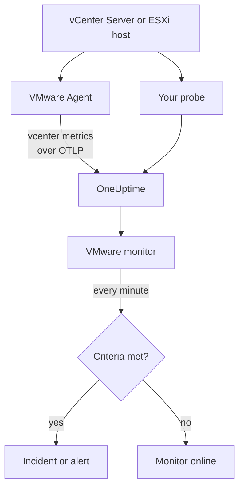

# VMware Monitor

A VMware monitor watches one vCenter - its datacenters, clusters, ESXi hosts, virtual machines, datastores, resource pools and vSAN - and tells you when a host saturates, a VM is starved of CPU or memory, a datastore fills up, or vSphere raises an alarm. It reads the `vcenter.*` metrics the OneUptime VMware Agent collects, or one of your probes collects without an agent.

:::cards
- [Create the monitor](#create-a-vmware-monitor): Six steps in the dashboard.
- [Templates](#pre-built-alert-templates): Twenty-three ready-made alerts, one incident per host, VM or datastore.
- [Identity attributes](#identity-attributes): How to target one host, VM or datastore.
- [Metrics](#collected-metrics): Every `vcenter.*` series the monitor can alert on.
:::

## How it works

The metrics come from vCenter's API, read with a read-only account in one of two ways:

- **The VMware Agent**, an OpenTelemetry Collector with its `vcenter` receiver, which you run on a machine that can reach vCenter. See [VMware Agent](/docs/telemetry/vmware).
- **A probe**, with nothing to install: you connect the vCenter in OneUptime and pick the probe that reaches it. See [VMware Without an Agent](/docs/telemetry/vmware-agentless).

Both send the same series every collection interval (2 minutes by default), stamped with the vCenter's name, `vmware.vcenter.name`. A vCenter is one vSphere endpoint: a vCenter Server or a standalone ESXi host. A VMware monitor is tied to one vCenter. Every minute it runs its query over that vCenter's metrics and compares the result with its criteria.



## Before you begin

- **Collect the vCenter's metrics**, with the [VMware Agent](/docs/telemetry/vmware) or [without an agent](/docs/telemetry/vmware-agentless). Both use a vSphere user with the **Read-Only** role on the top-level vCenter object, with **Propagate to children** ticked. The agent reads `ONEUPTIME_URL`, `ONEUPTIME_TELEMETRY_INGESTION_KEY`, `VMWARE_VCENTER_NAME`, `VCENTER_ENDPOINT`, `VCENTER_USERNAME` and `VCENTER_PASSWORD`.
- **Check the vCenter is registered.** It appears under **Products → Infrastructure → VMware → All vCenters**: through the agent, named after its `VMWARE_VCENTER_NAME`, after its first full collection; without an agent, from the moment you connect it.

## Create a VMware monitor

:::steps
### Start a new monitor

Go to **Monitors** and click **Create Monitor**.

### Pick VMware

Under **Monitor Type**, click **More monitor types** and pick **VMware** under **Infrastructure**, or type `vmware` in the search box. Enter a **Name** - it is used in incident and alert titles - and click **Next**.

### Choose the vCenter

Under **VMware Monitor Configuration**, pick the vCenter from **vCenter**. Every vCenter that has sent data, or that you connected without an agent, is in the list.

### Choose what to watch

Pick one of the three tabs:

- **Quick Setup** - click a [template](#pre-built-alert-templates). It sets the metric, the attribute filters, the aggregation, the time range, the group-by and the thresholds, and replaces the criteria below with its own. You can still change the **Time Range**.
- **Custom Metric** - pick one metric from **VMware Metric**, then set **Aggregation** and **Time Range**. The form groups it by the object it describes, so each host, VM or datastore is judged on its own, and the [filters](#monitor-settings) narrow it to one datacenter, cluster, host, VM, datastore or resource pool.
- **Advanced** - build queries and formulas yourself under **Select Metrics**, with filters on attributes such as `disk_state`, `power_state` or `status`. Use **Group by** an [identity attribute](#identity-attributes) to judge each object on its own.

### Check the criteria

Open each criteria under **Monitor Criteria** and check its **Metric**, **Aggregation**, **Condition** and **Threshold**. A template fills these in. With **Custom Metric** or **Advanced**, the monitor starts with the [default criteria](#default-criteria), which only notice a metric dropping to zero, so set your own threshold.

### Create the monitor

Click **Create Monitor**. OneUptime opens the monitor's page and evaluates it every minute. Incidents and alerts it raises are also listed on the vCenter's **Incidents** and **Alerts** pages.
:::

> [!TIP]
> To set up several templates at once, open the vCenter from **Products → Infrastructure → VMware** and go to **Recommendations**. Pick the templates you want, choose who is paged, and OneUptime creates one monitor per template.

## Monitor settings

| Field | Tab | What it does |
| --- | --- | --- |
| **vCenter** | All | Required. Scopes every query to `resource.vmware.vcenter.name`. |
| **Datacenter** | Custom Metric, Advanced | Optional. One datacenter: `resource.vcenter.datacenter.name`. Every series carries it. |
| **Cluster** | Custom Metric, Advanced | Optional. One cluster: `resource.vcenter.cluster.name`. Matches the cluster's own series and those of the hosts, VMs and resource pools in it; a standalone ESXi host has none. |
| **ESXi Host** | Custom Metric, Advanced | Optional. One ESXi host: `resource.vcenter.host.name`. Matches the host's own series **and** those of every VM it runs, because a VM carries its host's name. |
| **Virtual Machine** | Custom Metric, Advanced | Optional. One VM: `resource.vcenter.vm.name`. VM names need not be unique: add a host or a cluster when two VMs share one. |
| **Datastore** | Custom Metric, Advanced | Optional. One datastore: `resource.vcenter.datastore.name`. |
| **Resource Pool Path** | Custom Metric, Advanced | Optional. One resource pool, by its inventory path (`/DC/host/Cluster/Resources/pool`): `resource.vcenter.resource_pool.inventory_path`. A path, because pool names are unique only within their parent. |
| **VMware Metric** | Custom Metric | One metric from the [catalog](#collected-metrics). |
| **Aggregation** | Custom Metric | How samples are combined: **Average**, **Maximum**, **Minimum**, **Sum** or **Count**. Starts at the metric's usual aggregation. |
| **Time Range** | All | The rolling window the query reads, from **Past 1 Minute** to **Past 365 Days**. A new monitor starts at **Past 5 Minutes**; templates set their own. |
| **Select Metrics** | Advanced | The query builder: **Metric**, **Aggregate by**, **Filter by attributes**, **Group by**, plus **Add Metric** and **Add Formula** to combine queries. |

vCenter is read once per collection interval, 2 minutes by default, so a 1-minute window may hold no sample at all. Keep the window at 5 minutes or more, and longer if you raised the collection interval for a large inventory.

## Identity attributes

The `vcenter` receiver sends one OpenTelemetry resource per vSphere object, and names it with **resource attributes**. Which ones a series carries tells you what kind of object it describes:

| vSphere object      | Identity resource attributes                                                                                                   |
| ------------------- | ------------------------------------------------------------------------------------------------------------------------------ |
| Datacenter          | `vcenter.datacenter.name`                                                                                                      |
| Cluster             | `vcenter.datacenter.name`, `vcenter.cluster.name`                                                                              |
| ESXi host           | `vcenter.datacenter.name`, `vcenter.host.name` (+ `vcenter.cluster.name` when clustered)                                       |
| Virtual machine     | `vcenter.datacenter.name`, `vcenter.host.name`, `vcenter.vm.name`, `vcenter.vm.id` (+ `vcenter.cluster.name`; `vcenter.resource_pool.*` or `vcenter.virtual_app.*`) |
| VM template         | `vcenter.datacenter.name`, `vcenter.host.name`, `vcenter.vm_template.name`, `vcenter.vm_template.id`                           |
| Datastore           | `vcenter.datacenter.name`, `vcenter.datastore.name`                                                                            |
| Resource pool       | `vcenter.datacenter.name`, `vcenter.resource_pool.name`, `vcenter.resource_pool.inventory_path` (+ `vcenter.cluster.name` or `vcenter.host.name`) |

In monitor filters and group-by keys, resource attributes start with `resource.` (`resource.vcenter.host.name`), while datapoint attributes do not (`disk_state`, `power_state`, `status`, `effective`, `direction`, `object`, `type`). The boolean `effective` attribute is stored as the text `"true"` or `"false"`, so filter it with the text. Filter on an identity attribute to target one object, and group by it to judge each object on its own.

## Pre-built Alert Templates

OneUptime ships 23 templates for common VMware problems, and **Quick Setup** offers all of them. Each builds a complete monitor: the metric query, its attribute filters, a group-by on the object's own identity attribute, a criteria that fires and one that recovers. Thresholds are starting points you can edit.

Templates read the past 5 minutes unless the table says otherwise. A criteria fires only when the condition holds for every minute of its window, and a threshold criteria recovers 10% past its threshold, so a value hovering at the line does not flap.

| Template | Category | Severity | Watches | Fires when | Recovers when |
| --- | --- | --- | --- | --- | --- |
| Host CPU Saturation | Host | Warning | `vcenter.host.cpu.utilization`, Avg per `resource.vcenter.host.name` | Above 90%: every VM on the host competes for cores, and shows CPU ready time | At or below 81% |
| Host Memory Saturation | Host | Warning | `vcenter.host.memory.utilization`, Avg per host | Above 90%: the host starts taking memory back by ballooning, compression and swapping | At or below 81% |
| Host Disk Latency High | Host | Warning | `vcenter.host.disk.latency.max`, Max per host | Above 50 ms: every VM whose disks are on that path waits on storage. Needs performance counter level 3 | At or below 45 ms |
| Host Network Packet Errors | Host | Warning | `vcenter.host.network.packet.error.rate`, Max per host | Above 0: almost always a cable, SFP or switch-port fault | At 0 |
| Host Network Packet Drops | Host | Warning | `vcenter.host.network.packet.drop.rate`, Max per host | Above 0: an oversubscribed uplink, or NIC ring buffers that overflow | At 0 |
| VM CPU Saturation | Virtual Machine | Warning | `vcenter.vm.cpu.utilization`, Avg per `resource.vcenter.vm.name`, **past 15 minutes** | Above 90% of the VM's vCPUs for all 15 minutes: a VM may use what it was given, so only one that never comes down pages | At or below 81% |
| VM CPU Ready Contention | Virtual Machine | Warning | `vcenter.vm.cpu.readiness`, Avg per VM | Above 10%: the VM was ready to run, but the host had no physical core for it. Invisible from inside the guest | At or below 9% |
| VM Memory Saturation | Virtual Machine | Warning | `vcenter.vm.memory.utilization`, Avg per VM | Above 90% of its memory: the guest is about to page | At or below 81% |
| VM Memory Ballooning | Virtual Machine | Warning | `vcenter.vm.memory.ballooned`, Max per VM | Above 0: the host is short of memory and takes it back from this guest | At 0 |
| VM Memory Swapping | Virtual Machine | Critical | `vcenter.vm.memory.swapped`, Max per VM | Above 0: the host swaps the VM's memory, the last resort after ballooning and compression | At 0 |
| VM Disk Latency High | Virtual Machine | Warning | `vcenter.vm.disk.latency.max`, Max per VM | Above 50 ms: applications in the guest time out on I/O | At or below 45 ms |
| VM Disk Usage High | Virtual Machine | Warning | `vcenter.vm.disk.utilization`, Avg per VM | Above 90% of its provisioned storage committed: a thin-provisioned VM is about to claim its full size | At or below 81% |
| Datastore Capacity Warning | Datastore | Warning | `vcenter.datastore.disk.utilization`, Avg per `resource.vcenter.datastore.name` | Above 80%: an early warning, as thin disks and snapshots use the rest quickly | At or below 72% |
| Datastore Capacity Critical | Datastore | Critical | `vcenter.datastore.disk.utilization`, Avg per datastore | Above 90%: a full datastore pauses every VM with a disk on it | At or below 81% |
| Cluster Host Not Effective | Cluster | Critical | `vcenter.cluster.host.count` filtered to `effective = false`, Max per `resource.vcenter.cluster.name` | Above 0: a host is in maintenance mode, disconnected or unresponsive, so the cluster runs with less capacity than it was sized for | At 0 |
| Datacenter Hosts Unhealthy | Datacenter | Critical | `vcenter.datacenter.host.count` filtered to `status = red`, Max per `resource.vcenter.datacenter.name` | Above 0: a host has a critical alarm, such as a hardware sensor, a lost storage path or an HA agent error | At 0 |
| Datacenter Hosts Degraded | Datacenter | Warning | `vcenter.datacenter.host.count` filtered to `status = yellow`, Max per datacenter | Above 0: a host has a warning alarm | At 0 |
| Datacenter Hosts Powered Off | Datacenter | Warning | `vcenter.datacenter.host.count` filtered to `power_state = off`, Max per datacenter | Above 0: a host is powered off - it crashed, lost power, or was put on standby by DPM | At 0 |
| Datacenter VMs Unhealthy | Datacenter | Warning | `vcenter.datacenter.vm.count` filtered to `status = red`, Max per datacenter | Above 0: a VM has a critical alarm, such as a failed HA restart, a lost datastore or a lost Tools heartbeat | At 0 |
| Datacenter Clusters Unhealthy | Datacenter | Critical | `vcenter.datacenter.cluster.count` filtered to `status = red`, Max per datacenter | Above 0: a cluster has a critical alarm, such as too few HA failover resources, a failed HA election or a critical vSAN health check | At 0 |
| vSAN Latency High | vSAN | Warning | `vcenter.cluster.vsan.latency.avg`, Avg per cluster | Above 20 000 µs (20 ms): storage slows down for every VM on the vSAN datastore. Silent on clusters without vSAN | At or below 18 000 µs |
| vSAN Congestion | vSAN | Warning | `vcenter.cluster.vsan.congestions`, Max per cluster | Above 0: a disk group cannot keep up, and vSAN slows down the I/O of its clients | At 0 |
| Resource Pool Memory Swapped | Cluster | Warning | `vcenter.resource_pool.memory.swapped`, Max per `resource.vcenter.resource_pool.inventory_path` | Above 0: the pool's VMs take memory from host swap, usually because the pool's memory limit or shares are too low | At 0 |

**Severity** is the label the picker shows. The incident and alert a template creates start on your project's most severe incident and alert severity; change them in the criteria.

- **Utilization templates use Avg:** the receiver reports a real 0 to 100 percentage for each object, so the average in a minute is the sustained utilization.
- **Latency templates use Max:** the metric is already the worst latency across the object's disks, so its highest sample is the honest one.
- **Count and state templates use Max**, so one collection that shows the condition trips them: packet errors, ballooning, swapping, red and yellow status, hosts that are not effective, congestion.
- **Every template groups by the object's own identity attribute**, so one incident fires per affected object, and the incident names it.
- **Thresholds are pinned to their unit** (`%`, `ms`, `us`), so they keep their meaning whatever unit a chart shows.

## Collected Metrics

The metrics below are the catalog the monitor form offers. Units are the receiver's own: `MHz`, `%`, `MiBy` (mebibytes), `By` (bytes), `KiBy`, `ms`, `us` (microseconds), `{KiBy/s}`, `By/s` and counts. A metric marked _off by default_ is not collected until you turn it on in the agent's `otel-collector-config.yaml`; the shipped configuration already turns on `vcenter.host.memory.capacity`.

### Datacenter

| Metric                               | Unit                | Description                                                                                                                                                    |
| ------------------------------------ | ------------------- | -------------------------------------------------------------------------------------------------------------------------------------------------------------- |
| `vcenter.datacenter.cluster.count`   | `{clusters}`        | Clusters in the datacenter, fanned out by `status` (`red` / `yellow` / `green` / `gray`). Sum for the total; filter `status = red` for clusters with a critical alarm |
| `vcenter.datacenter.cpu.limit`       | `MHz`               | Total CPU available to the datacenter across every ESXi host                                                                                                   |
| `vcenter.datacenter.datastore.count` | `{datastores}`      | Datastores in the datacenter                                                                                                                                   |
| `vcenter.datacenter.disk.space`      | `By`                | Datastore space across the datacenter, fanned out by `disk_state` (`used` / `available`). used ÷ (used + available) is the datacenter-wide storage utilization |
| `vcenter.datacenter.host.count`      | `{hosts}`           | ESXi hosts in the datacenter, fanned out by `status` and `power_state` (`on` / `off` / `standby` / `unknown`). Filter `status = red` or `power_state = off`      |
| `vcenter.datacenter.memory.limit`    | `By`                | Total physical memory available to the datacenter across every ESXi host                                                                                       |
| `vcenter.datacenter.vm.count`        | `{virtual_machines}` | Virtual machines in the datacenter, fanned out by `status` and `power_state` (`on` / `off` / `suspended` / `unknown`). Filter `power_state = on` for running VMs |

### Cluster

| Metric                              | Unit                          | Description                                                                                                                                                  |
| ----------------------------------- | ----------------------------- | ------------------------------------------------------------------------------------------------------------------------------------------------------------ |
| `vcenter.cluster.cpu.effective`     | `MHz`                         | CPU the cluster can actually schedule — excludes hosts in maintenance mode or unresponsive. Compare with `vcenter.cluster.cpu.limit` for capacity out of service |
| `vcenter.cluster.cpu.limit`         | `MHz`                         | Total CPU of every ESXi host in the cluster, regardless of host state                                                                                         |
| `vcenter.cluster.host.count`        | `{hosts}`                     | ESXi hosts in the cluster, fanned out by `effective` (`"true"` / `"false"`). A host is not effective while in maintenance mode, disconnected, or unresponsive |
| `vcenter.cluster.memory.effective`  | `By`                          | Memory the cluster can actually allocate to VMs — excludes maintenance-mode / unresponsive hosts and ESXi's own reserved memory                                |
| `vcenter.cluster.memory.limit`      | `By`                          | Total physical memory of every ESXi host in the cluster                                                                                                      |
| `vcenter.cluster.vm.count`          | `{virtual_machines}`          | Virtual machines in the cluster, fanned out by `power_state`. Sum for the total; filter `power_state = on` for running VMs                                    |
| `vcenter.cluster.vm_template.count` | `{virtual_machine_templates}` | Virtual machine templates in the cluster                                                                                                                     |

### Host (ESXi)

| Metric                                   | Unit          | Description                                                                                                                                                       |
| ---------------------------------------- | ------------- | ----------------------------------------------------------------------------------------------------------------------------------------------------------------- |
| `vcenter.host.cpu.capacity`              | `MHz`         | Total CPU capacity of the ESXi host (cores × clock) — the denominator for `vcenter.host.cpu.usage`                                                                |
| `vcenter.host.cpu.reserved`              | `MHz`         | CPU reserved for virtual machines, fanned out by `cpu_reservation_type` (`total` / `used`). `used` approaching `total` means new reservations will fail admission control |
| `vcenter.host.cpu.usage`                 | `MHz`         | CPU currently consumed on the host across every VM and the hypervisor itself                                                                                      |
| `vcenter.host.cpu.utilization`           | `%`           | CPU utilization of the host as a percentage (0–100) of its capacity                                                                                               |
| `vcenter.host.disk.latency.avg`          | `ms`          | Average disk latency (device + kernel time), fanned out by `direction` (`read` / `write`) and `object` (disk device). Requires performance counter level 2         |
| `vcenter.host.disk.latency.max`          | `ms`          | Highest latency observed across every disk the host uses, per `object`, over the latest 20 s interval. Requires performance counter level 3                        |
| `vcenter.host.disk.throughput`           | `{KiBy/s}`    | Kilobytes per second read from or written to the host's disks, by `direction` and `object`. Requires performance counter level 4                                  |
| `vcenter.host.memory.active`             | `MiBy`        | Memory the host's powered-on VMs are actively touching. _Off by default_ — enable `vcenter.host.memory.active` in the agent config                                |
| `vcenter.host.memory.ballooned`          | `MiBy`        | Guest memory reclaimed from the host's VMs by the balloon driver; above 0 means host memory pressure. _Off by default_                                            |
| `vcenter.host.memory.capacity`           | `MiBy`        | Total physical memory of the host — the denominator for `vcenter.host.memory.usage`. Off by default upstream; the shipped agent config enables it                 |
| `vcenter.host.memory.granted`            | `MiBy`        | Machine memory granted to the powered-on VMs on the host. _Off by default_                                                                                        |
| `vcenter.host.memory.usage`              | `MiBy`        | Memory currently consumed on the host, including the hypervisor's own overhead                                                                                    |
| `vcenter.host.memory.utilization`        | `%`           | Memory utilization of the host as a percentage (0–100) of its physical capacity                                                                                   |
| `vcenter.host.network.packet.drop.rate`  | `{packets/s}` | Packets per second dropped on each physical NIC, by `direction` (`transmitted` / `received`) and `object` (e.g. `vmnic0`) — an oversubscribed uplink or a failing NIC |
| `vcenter.host.network.packet.error.rate` | `{errors/s}`  | Packet errors per second on the host's physical NICs, by `direction` and `object` — almost always a cable, SFP, or switch-port fault                             |
| `vcenter.host.network.packet.rate`       | `{packets/s}` | Packets per second transmitted or received on each physical NIC, by `direction` and `object`                                                                     |
| `vcenter.host.network.throughput`        | `{KiBy/s}`    | Kilobytes per second transmitted or received by the host, by `direction` and `object`                                                                            |
| `vcenter.host.network.usage`             | `{KiBy/s}`    | Combined transmit + receive rate across the host's NICs, per `object`                                                                                             |

### Virtual Machine

| Metric                                     | Unit          | Description                                                                                                                                                                   |
| ------------------------------------------ | ------------- | ----------------------------------------------------------------------------------------------------------------------------------------------------------------------------- |
| `vcenter.vm.cpu.readiness`                 | `%`           | Percentage of time the VM was ready to run but could not be scheduled on a physical CPU (CPU ready). Above 5% the guest feels sluggish; above 10% the host is oversubscribed. Powered-on VMs only |
| `vcenter.vm.cpu.time`                      | `%`           | Time the VM's vCPUs spent in each state, by `cpu_state` (`idle` / `ready` / `wait`) and `object` (vCPU). _Off by default_ — enable `vcenter.vm.cpu.time`                        |
| `vcenter.vm.cpu.usage`                     | `MHz`         | CPU consumed by the VM. Powered-on VMs only — its presence is how OneUptime infers a VM's power state                                                                          |
| `vcenter.vm.cpu.utilization`               | `%`           | CPU utilization of the VM as a percentage (0–100) of its configured vCPUs. Powered-on VMs only                                                                                 |
| `vcenter.vm.disk.latency.avg`              | `ms`          | Average disk latency, by `direction` (`read` / `write`), `disk_type` (`virtual` / `physical`), and `object` (virtual disk). Requires performance counter level 2                |
| `vcenter.vm.disk.latency.max`              | `ms`          | Highest total latency (device + kernel time) the VM saw on any disk over a 20 s interval, per `object`                                                                         |
| `vcenter.vm.disk.throughput`               | `{KiBy/s}`    | Kilobytes per second read from or written to the VM's disks, by `direction` and `object`. Requires performance counter level 2                                                  |
| `vcenter.vm.disk.usage`                    | `By`          | Datastore space consumed by the VM's files, fanned out by `disk_state` (`used` / `available`). Also emitted for VM templates. Filter `disk_state = used` for the committed size |
| `vcenter.vm.disk.utilization`              | `%`           | Percentage (0–100) of the VM's provisioned storage that is committed on the datastore — a thin-provisioned VM approaching 100% is about to claim its full size                  |
| `vcenter.vm.memory.ballooned`              | `MiBy`        | Guest memory reclaimed from the VM by the balloon driver (VMware Tools). Above 0 means the ESXi host is short of memory                                                        |
| `vcenter.vm.memory.granted`                | `MiBy`        | Machine memory granted to the VM by the host. _Off by default_ — enable `vcenter.vm.memory.granted`                                                                            |
| `vcenter.vm.memory.swapped`                | `MiBy`        | Memory granted to the VM from the host's swap file — the last resort after ballooning and compression; any value above 0 means the VM is paying disk latency for RAM           |
| `vcenter.vm.memory.swapped_ssd`            | `KiBy`        | Memory of the VM swapped to the host's flash swap cache — less painful than the swap file, but still memory pressure                                                           |
| `vcenter.vm.memory.usage`                  | `MiBy`        | Memory actively used by the VM's guest. Emitted for powered-on and powered-off VMs alike (0 when off)                                                                          |
| `vcenter.vm.memory.utilization`            | `%`           | Memory utilization of the VM as a percentage (0–100) of its configured memory                                                                                                  |
| `vcenter.vm.network.broadcast.packet.rate` | `{packets/s}` | Broadcast packets per second per vNIC, by `direction` and `object`. _Off by default_                                                                                           |
| `vcenter.vm.network.multicast.packet.rate` | `{packets/s}` | Multicast packets per second per vNIC, by `direction` and `object`. _Off by default_                                                                                           |
| `vcenter.vm.network.packet.drop.rate`      | `{packets/s}` | Packets per second dropped by each vNIC, by `direction` and `object`. Receive-side drops usually mean the guest is not draining its ring buffer fast enough                   |
| `vcenter.vm.network.packet.rate`           | `{packets/s}` | Packets per second transmitted or received by each vNIC, by `direction` and `object`                                                                                          |
| `vcenter.vm.network.throughput`            | `By/s`        | Bytes per second transmitted or received over the VM's network, by `direction` and `object`                                                                                   |
| `vcenter.vm.network.usage`                 | `{KiBy/s}`    | Combined transmit + receive rate of the VM, per `object`                                                                                                                       |

### Datastore

| Metric                               | Unit | Description                                                                                                                                  |
| ------------------------------------ | ---- | -------------------------------------------------------------------------------------------------------------------------------------------- |
| `vcenter.datastore.disk.usage`       | `By` | Space on the datastore, fanned out by `disk_state` (`used` / `available`). used + available is the datastore's capacity                     |
| `vcenter.datastore.disk.utilization` | `%`  | Percentage (0–100) of the datastore's capacity in use. A full datastore pauses every VM writing to it, so alert well before 100%             |

### Resource Pool

| Metric                                   | Unit       | Description                                                                                                                                                              |
| ---------------------------------------- | ---------- | ------------------------------------------------------------------------------------------------------------------------------------------------------------------------ |
| `vcenter.resource_pool.cpu.shares`       | `{shares}` | CPU shares configured on the pool — its relative priority against sibling pools when the parent is contended                                                             |
| `vcenter.resource_pool.cpu.usage`        | `MHz`      | CPU consumed by every VM in the pool (and its child pools)                                                                                                               |
| `vcenter.resource_pool.memory.ballooned` | `MiBy`     | Memory reclaimed by the balloon driver across every VM in the pool                                                                                                       |
| `vcenter.resource_pool.memory.granted`   | `MiBy`     | Host memory granted to the pool's VMs, fanned out by `type` (`private` / `shared` — shared pages are deduplicated by transparent page sharing)                            |
| `vcenter.resource_pool.memory.shares`    | `{shares}` | Memory shares configured on the pool                                                                                                                                     |
| `vcenter.resource_pool.memory.swapped`   | `MiBy`     | Memory granted to the pool's VMs from the ESXi hosts' swap space — any value above 0 means at least one VM in the pool is being host-swapped                              |
| `vcenter.resource_pool.memory.usage`     | `MiBy`     | Memory used by the pool, fanned out by `type` (`guest` / `host` / `overhead`) on recent collector builds; older builds emit a single untyped series. Filter `type = guest` |

### vSAN

Only sent for clusters with vSAN, the hosts in them, and the VMs on a vSAN datastore. Latencies are in **microseconds** (`us`), unlike the millisecond latencies of hosts and VMs:

| Metric                              | Unit              | Description                                                                                                                                     |
| ----------------------------------- | ----------------- | ----------------------------------------------------------------------------------------------------------------------------------------------- |
| `vcenter.cluster.vsan.congestions`  | `{congestions/s}` | Congestion events per second raised against I/O from every vSAN client in the cluster — vSAN's own back-pressure signal                        |
| `vcenter.cluster.vsan.latency.avg`  | `us`              | Average latency the cluster sees when accessing vSAN storage, by `type` (`read` / `write`). 20 000 µs = 20 ms                                   |
| `vcenter.cluster.vsan.operations`   | `{operations/s}`  | vSAN I/O operations per second across the cluster, by `type` (`read` / `write` / `unmap`)                                                       |
| `vcenter.cluster.vsan.throughput`   | `By/s`            | vSAN throughput of the cluster, by `direction` (`read` / `write`)                                                                               |
| `vcenter.host.vsan.cache.hit_rate`  | `%`               | Percentage of the host's vSAN read I/O served from its local client cache over the latest 5 min interval — a falling rate means reads hit the capacity tier |
| `vcenter.host.vsan.congestions`     | `{congestions/s}` | Congestion events per second raised against vSAN I/O from the host                                                                              |
| `vcenter.host.vsan.latency.avg`     | `us`              | Average latency the host sees when accessing vSAN storage, by `type`                                                                            |
| `vcenter.host.vsan.operations`      | `{operations/s}`  | vSAN I/O operations per second issued by the host, by `type`                                                                                    |
| `vcenter.host.vsan.throughput`      | `By/s`            | vSAN throughput of the host, by `direction`                                                                                                     |
| `vcenter.vm.vsan.latency.avg`       | `us`              | Average latency the VM sees when accessing vSAN storage, by `type`                                                                              |
| `vcenter.vm.vsan.operations`        | `{operations/s}`  | vSAN I/O operations per second issued by the VM, by `type`                                                                                      |
| `vcenter.vm.vsan.throughput`        | `By/s`            | vSAN throughput of the VM, by `direction`                                                                                                       |

> [!NOTE]
> A VM's power state is not a metric. The receiver sends `vcenter.vm.cpu.*` only for powered-on VMs, so OneUptime tells **Powered on** from **Powered off** by whether CPU data arrived in the same collection as the VM's memory and disk data; the vCenter's **Virtual Machines** page shows the result. To alert on powered-off hosts or on how many VMs run, use the `power_state` attribute of `vcenter.datacenter.host.count`, `vcenter.datacenter.vm.count` or `vcenter.cluster.vm.count`.

## Monitoring criteria

A criteria compares one of the monitor's queries or formulas with a threshold. A VMware monitor's criteria have no **Filter Type**: every rule checks the metric value, with these fields.

| Field | What it does |
| --- | --- |
| **Metric** | The query or formula to check, by its variable name. |
| **Aggregation** | How the values in the window become one answer: **Average**, **Sum**, **Maximum Value**, **Minimum Value**, **All Values** (every value must match) or **Any Value** (one is enough). |
| **Condition** | **Greater Than**, **Less Than**, **Greater Than Or Equal To**, **Less Than Or Equal To** or **Equal To** — or an anomaly condition: **Anomalously High**, **Anomalously Low** or **Anomalous**. |
| **Threshold** | The value to compare with. A unit list sits beside it when the metric has a unit. Not shown for anomaly conditions. |
| **Sensitivity** | Anomaly conditions only. **Low** (4σ), **Medium** (3σ, the default) or **High** (2σ). |
| **Baseline Window** | Anomaly conditions only. 14 days (the default), 28, 60 or 90 days of history. |
| **If No Data** | Under **More fields**. What happens when the window has no samples: **Ignore** (the default), **Treat As Zero** or **Trigger**. |

Anomaly conditions compare each value with the same hour of the week in the baseline. They stay in a "Learning" state, and raise nothing, until the baseline window holds enough history.

Some criteria to start from:

- **A host is saturated:** `vcenter.host.cpu.utilization`, Average, grouped by `resource.vcenter.host.name`, **Greater Than** `90`, over the past 5 minutes.
- **A datastore is filling up:** `vcenter.datastore.disk.utilization`, Average, grouped by `resource.vcenter.datastore.name`, **Greater Than** `80`.
- **A cluster lost a host:** `vcenter.cluster.host.count` filtered to `effective = false`, Maximum, grouped by `resource.vcenter.cluster.name`, **Greater Than** `0`.
- **Fewer VMs run than expected:** `vcenter.cluster.vm.count` filtered to `power_state = on` and `resource.vcenter.cluster.name = Production`, Sum, **Less Than** the number you expect.
- **A VM is being host-swapped:** `vcenter.vm.memory.swapped`, Maximum, grouped by `resource.vcenter.vm.name`, **Greater Than** `0`.

### Default criteria

A monitor you do not build from a template starts with two criteria:

| Order | Criteria | Matches when | Then |
| --- | --- | --- | --- |
| 1 | Check if _monitor name_ is offline | Any value of the first query is `0` | Marks the monitor **Offline** and declares the incident "_monitor name_ is offline", which resolves itself when the monitor recovers. |
| 2 | Check if _monitor name_ is online | Any value is above `0` | Marks the monitor **Operational**. |

> [!IMPORTANT]
> Silence matches neither criteria: a vCenter that stops sending data leaves the monitor as it was. To be told when data stops, set **If No Data** to **Trigger** on a criteria. Time OneUptime itself was not receiving is never no data: a check whose window holds it waits instead, as [When OneUptime Is Not Receiving Data](/docs/monitor/when-oneuptime-is-not-receiving) explains.

## Terraform

The [OneUptime Terraform provider](/docs/terraform/monitor-steps) carries a VMware monitor step's configuration in the `vmware_monitor` attribute: the raw JSON of the `vmwareMonitor` configuration (`vcenterIdentifier`, `resourceFilters`, `metricViewConfig`, `rollingTime`), written with `jsonencode()`:

```hcl title="main.tf"
monitor_steps = [{
  vmware_monitor = jsonencode({
    vcenterIdentifier = "prod-vcenter"
    resourceFilters   = { clusterName = "Production" }
    rollingTime       = "Past 5 Minutes"
    metricViewConfig = {
      queryConfigs = [{
        metricAliasData = { metricVariable = "host_cpu", title = "Host CPU", description = "", legend = "" }
        metricQueryData = {
          filterData = {
            metricName     = "vcenter.host.cpu.utilization"
            attributes     = {}
            aggegationType = "Avg"
            aggregateBy    = {}
          }
          groupByAttributeKeys = ["resource.vcenter.host.name"]
        }
      }]
      formulaConfigs = []
    }
  })
  criteria = [ /* ... */ ]
}]
```

`vcenterIdentifier` is the vCenter's `vmware.vcenter.name` - the `VMWARE_VCENTER_NAME` the agent was started with - not its OneUptime ID.

## Troubleshooting

:::details The vCenter is not in the vCenter list
A vCenter the agent collects registers itself from the agent's data. Check that the agent is running and sending data (see [Verify the Installation](/docs/telemetry/vmware#verify-the-installation)), that `VMWARE_VCENTER_NAME` is set, and that one collection interval has passed: nothing is sent until the first full walk of the inventory completes.
:::

:::details Hosts have metrics, but VMs, datastores or clusters do not
The read-only vSphere user was given its role without **Propagate to children**, or on an object below the vCenter root. Objects the user cannot see are simply missing from the metrics. Set the permission on the top-level vCenter object, with propagation ticked.
:::

:::details Host CPU Saturation never fires
The template averages `vcenter.host.cpu.utilization` per `resource.vcenter.host.name`, so each host is checked on its own. If you built your own query, group it by the identity attribute with its `resource.` prefix: the bare `vcenter.host.name` matches nothing, and an average across every host is pulled down by the idle ones.
:::

:::details The vSAN templates never fire
`vcenter.cluster.vsan.*`, `vcenter.host.vsan.*` and `vcenter.vm.vsan.*` are only sent for clusters with vSAN, the hosts in them, and the VMs on a vSAN datastore. Without vSAN the series do not exist, and the templates stay silent.
:::

:::details A criteria filtered on effective matches nothing
The receiver's boolean `effective` attribute is stored as the text `"true"` or `"false"`. Filter it with the text, not a boolean.
:::

:::details Disk latency or throughput metrics are missing
`vcenter.host.disk.latency.avg` and `vcenter.vm.disk.*` need vCenter's statistics level 2, `vcenter.host.disk.latency.max` needs level 3, and `vcenter.host.disk.throughput` level 4. Raise the statistics level of the 5-minute interval under _vCenter → Configure → General → Statistics_.
:::

:::details A 1-minute window shows no data
vCenter is read once per collection interval, 2 minutes by default and often longer for a large inventory, so a 1-minute window may hold no sample. Use 5 minutes or more.
:::

## Next steps

:::cards
- [VMware Agent](/docs/telemetry/vmware): Install the agent that collects from vCenter.
- [VMware Without an Agent](/docs/telemetry/vmware-agentless): Let a probe collect instead.
- [Proxmox Monitor](/docs/monitor/proxmox-monitor): The same kind of monitor for Proxmox VE.
- [Incidents](/docs/incidents/index): What happens after a criteria declares an incident.
:::
