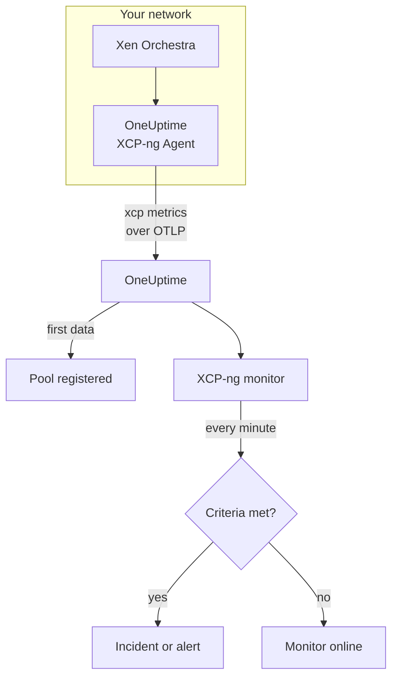

# XCP-ng Monitor

An XCP-ng monitor watches one XCP-ng pool — its hosts, VMs, storage repositories and virtual disks — and tells you when Xen Orchestra loses the pool, a host goes offline or stays disabled, a VM that was running stops or is starved of CPU, or a storage repository fills up or slows down. It reads the `xcp_*` series of Xen Orchestra's OpenMetrics plugin, which the OneUptime XCP-ng Agent collects, and the health series OneUptime derives from them, so nothing is probed from outside.

:::cards
- [Create the monitor](#create-an-xcp-ng-monitor): Six steps in the dashboard.
- [Templates](#pre-built-alert-templates): Ten ready-made alerts, one incident per host, VM or storage repository.
- [Resource identity](#resource-identity): How to target one host, VM or storage repository.
- [Metrics](#collected-metrics): Every series the monitor can alert on.
:::

## How it works

The OneUptime XCP-ng Agent runs on a machine that can reach Xen Orchestra. Every 60 seconds it reads Xen Orchestra's OpenMetrics plugin, which reads every host of every pool that Xen Orchestra manages, and sends the series to OneUptime over OTLP, one resource per pool, stamped with the pool's UUID, `xcp_ng.pool.id`. The first data registers each pool.

An XCP-ng monitor is tied to one pool. Every minute it runs its query over that pool's metrics and compares the result with its criteria.



## Before you begin

- **Install the XCP-ng Agent** where it can reach Xen Orchestra, with the secret of Xen Orchestra's OpenMetrics plugin. The [XCP-ng Agent guide](/docs/telemetry/xcp-ng) covers the plugin, Xen Orchestra's certificate and the install.
- **Check the pool is registered.** It appears under **Products → Infrastructure → XCP-ng → All Pools**, named as Xen Orchestra names it, about a minute after the first scrape.

## Create an XCP-ng monitor

:::steps
### Start a new monitor

Go to **Monitors** and click **Create Monitor**.

### Pick XCP-ng

Under **Monitor Type**, click **More monitor types** and pick **XCP-ng** under **Infrastructure**, or type `xcp` in the search box. Enter a **Name** — it is used in incident and alert titles — and click **Next**.

### Choose the pool

Under **XCP-ng Monitor Configuration**, pick the pool from **XCP-ng Pool**. Every pool that has sent data is in the list. Once picked, a line under the field says whether data is arriving. **Add XCP-ng Pool** opens setup steps with your keys filled in, which wait for the first data.

### Choose what to watch

A new monitor starts on **Pool Disconnected**, under **What to alert on**. To watch something else:

- **Change** — pick another [template](#pre-built-alert-templates). It sets the metrics, filters, aggregation, time range and thresholds, and replaces the criteria below with its own. You can still change the **Time Range**.
- **Custom Metric** (under **More fields**) — pick one metric from **XCP-ng Metric**, then set **Aggregation** and **Time Range**. The [filters](#monitor-settings) narrow it to a kind of object or to one object.
- **Advanced** (under **More fields**) — build queries and formulas yourself under **Select Metrics**, for example a storage repository's used share from `xcp_sr_physical_usage_bytes / xcp_sr_physical_size_bytes`. Use **Group by** `xcp_ng.id` to judge each object on its own.

### Check the criteria

Open each criteria under **Criteria** and check its **Metric**, **Aggregation**, **Condition** and **Threshold**. A template fills these in. With **Custom Metric** or **Advanced**, the monitor starts with the [default criteria](#default-criteria), which only notice the metric sending no data, so set your own threshold.

### Create the monitor

Click **Create Monitor**. OneUptime opens the monitor's page and evaluates it every minute. Incidents and alerts it raises are also listed on the pool's **Incidents** and **Alerts** pages.
:::

> [!TIP]
> To set up several templates at once, open the pool from **Products → Infrastructure → XCP-ng** and go to **Recommendations**. Pick the templates you want, choose who is paged, and OneUptime creates one monitor per template.

## Monitor settings

| Field | Tab | What it does |
| --- | --- | --- |
| **XCP-ng Pool** | All | Required. Scopes every query to `resource.xcp_ng.pool.id`, the pool's UUID, so two pools with the same name never mix. |
| **Resource Scope** | Custom Metric, Advanced | Optional. **Host**, **VM**, **Storage Repository**, **Virtual Disk**, **XOSTOR** or **XCP-ng Pool** — an exact match on `xcp_ng.scope`. |
| **UUID** | Custom Metric, Advanced | Optional. Exact match on `xcp_ng.id`: the UUID of one host, VM, storage repository or virtual disk, as Xen Orchestra shows it. Pair it with a scope to target one object. |
| **Host Name** | Custom Metric, Advanced | Optional. Exact match on Xen Orchestra's `host_name` label: the host's own series and those of the VMs running on it. |
| **XCP-ng Metric** | Custom Metric | One metric from the [catalog](#collected-metrics). |
| **Aggregation** | Custom Metric | How samples are combined: **Average**, **Maximum**, **Minimum**, **Sum** or **Count**. Starts at the metric's usual aggregation. |
| **Time Range** | All | The rolling window the query reads, from **Past 1 Minute** to **Past 365 Days**. A new monitor starts at **Past 1 Minute**; templates set their own. |
| **Select Metrics** | Advanced | The query builder: **Metric**, **Aggregate by**, **Filter by attributes**, **Group by**, plus **Add Metric** and **Add Formula** to combine queries. |

The agent reads Xen Orchestra every 60 seconds, and Xen Orchestra reads its hosts at 60-second resolution, so a 1-minute window holds about one sample; the templates read 5 minutes or more.

## Resource identity

Xen Orchestra names a host or a VM by its `uuid` label, a storage repository by `sr_uuid` and a virtual disk by `vdi_uuid`. OneUptime stamps two attributes on every datapoint as it arrives, so one filter reads every series of an object whatever label named it. The templates rely on them:

| Attribute | Values | For a VM |
| --- | --- | --- |
| `xcp_ng.scope` | `pool`, `host`, `vm`, `sr` (a storage repository), `vdi` (a virtual disk), `xostor` | `vm` |
| `xcp_ng.id` | The object's UUID, in lower case: the `uuid` of a host or VM, the `sr_uuid` of a storage repository or an XOSTOR cluster, the `vdi_uuid` of a virtual disk, and the pool's own UUID on the pool's series | `5c6d7e8f-1a2b-4c3d-9e8f-0a1b2c3d4e5f` |

Filter on `xcp_ng.scope` for one kind of object, on `xcp_ng.id` for one object, and group by `xcp_ng.id` to judge each object on its own. Xen Orchestra's own labels stay as it sends them: `host_name` names a host on its series and a VM's host on the VM's, `vm_name`, `sr_name` and `vdi_name` name the rest, `power_state` and `enabled` carry a host's or a VM's state on the status series, and `is_control_domain` is `true` on a control domain's VM series.

The pool itself is the resource the series arrive on, so its attributes take a `resource.` prefix in filters and group-by keys: `resource.xcp_ng.pool.id` (its UUID), `resource.xcp_ng.pool.name` (its name in Xen Orchestra) and `resource.xen_orchestra.name` (the Xen Orchestra it is read from).

## Pre-built Alert Templates

The **What to alert on** list offers 12 templates. Each builds a complete monitor — queries, attribute filters, a group-by, a criteria that fires and one that recovers. Most group by `xcp_ng.id`, so each host, VM or storage repository gets its own incident and alert. Thresholds are starting points you can edit.

A criteria fires only when the condition holds for every minute of its window, and a threshold criteria recovers 10% past its threshold so a value hovering at the line does not flap. A 0/1 series recovers at the other value.

| Template | Category | Severity | Watches | Fires when | Recovers when |
| --- | --- | --- | --- | --- | --- |
| Pool Disconnected | Availability | Critical | `xcp_pool_connected`, Count over the whole pool, past 10 minutes | No data for the whole window | Data arrives again |
| Host Offline | Availability | Critical | `xcp_ng.host.running` for `xcp_ng.scope = host`, Min per `xcp_ng.id`, past 5 minutes | Below 1 | At 1 |
| HA Cannot Tolerate a Host Failure | Availability | Critical | `xcp_ng.pool.ha.can_tolerate_host_failure` for `xcp_ng.scope = pool`, Max over the whole pool, past 5 minutes | Below 1 | At 1 |
| VM Stopped | VM | Warning | `xcp_ng.vm.stopped_after_running` for `xcp_ng.scope = vm`, Min per `xcp_ng.id`, past 5 minutes | Above 0 | At 0 |
| VM Not Backed Up | VM | Warning | `xcp_ng.vm.backup_overdue` for `xcp_ng.scope = vm`, Min per `xcp_ng.id`, past 10 minutes | Above 0 | At 0 |
| Storage Repository Near Full | Storage | Critical | `xcp_sr_physical_usage_bytes` ÷ `xcp_sr_physical_size_bytes` × 100 for `xcp_ng.scope = sr` (both Sum), per `xcp_ng.id`, past 5 minutes | Above 90% | At or below 81% |
| Host Disabled | Host | Warning | `xcp_ng.host.enabled` for `xcp_ng.scope = host`, Max per `xcp_ng.id`, past 30 minutes | Below 1 | At 1 |
| Host Restarted | Host | Warning | `xcp_host_uptime_seconds` and `xcp_ng.host.running` for `xcp_ng.scope = host`, Min per `xcp_ng.id`, past 5 minutes | `xcp_host_uptime_seconds` is below 900 (15 minutes) while `xcp_ng.host.running` is 1 | `xcp_host_uptime_seconds` is at 990 or more, or `xcp_ng.host.running` is 0 |
| High Host CPU Usage | Host | Warning | `xcp_host_cpu_average` for `xcp_ng.scope = host`, Avg per `xcp_ng.id`, past 10 minutes | Above 0.9 (90% of the host's CPU) | At or below 0.81 |
| High Host Memory Usage | Host | Warning | (`xcp_host_memory_total_bytes` − `xcp_host_memory_free_bytes`) ÷ `xcp_host_memory_total_bytes` × 100 for `xcp_ng.scope = host` (both Sum), per `xcp_ng.id`, past 10 minutes | Above 95% | At or below 85.5% |
| VM Starved of CPU | VM | Warning | `xcp_vm_runstate_full_contention` for `xcp_ng.scope = vm`, Avg per `xcp_ng.id`, past 15 minutes | Above 0.1 (10% of the time) | At or below 0.09 |
| Storage Repository Slow | Storage | Warning | `xcp_host_disk_latency_seconds` for `xcp_ng.scope = host`, Avg per `sr`, past 15 minutes | Above 0.05 (50 ms) | At or below 0.045 |

**Severity** is the label the picker shows. The incident and alert a template creates start on your project's most severe incident and alert severity; change them in the criteria.

- **Pool Disconnected** fires when `xcp_pool_connected` stops arriving for ten minutes. Xen Orchestra sends it on every scrape while it is connected to the pool, and stops sending it, rather than sending 0, when it loses the pool's master; it also stops when Xen Orchestra, its plugin or the XCP-ng Agent stops, or the agent loses its route to OneUptime. It resolves when the series comes back. When data stops, the other templates have nothing to compare and keep their last status, so this is the one that tells you.
- **Host Offline** reads `xcp_ng.host.running`, which OneUptime derives from `xcp_host_status`: 0 while Xen Orchestra reports the host Halted, or its state Unknown because the pool master lost contact with it. The VMs that ran on the host are down too unless HA restarted them elsewhere.
- **HA Cannot Tolerate a Host Failure** reads `xcp_ng.pool.ha.can_tolerate_host_failure`. Read straight from XAPI, it is HA's own plan: overcommitted, or covering fewer host failures than it is set to tolerate. Read through Xen Orchestra, whose REST API does not report the plan, it is fewer than two hosts up and enabled to restart VMs on, so disabling one host of a two-host HA pool is enough. It never fires while HA is off.
- **VM Stopped** reads `xcp_ng.vm.stopped_after_running`: 1 while a VM that ran in the last 24 hours is Halted or Paused. A VM switched off for more than a day counts as off on purpose and stops alerting, a suspended VM never alerts, and control domains and templates are left out.
- **VM Not Backed Up** reads `xcp_ng.vm.backup_overdue`, from Xen Orchestra's backup logs: 1 while a VM a scheduled backup job includes has had no successful backup within its interval, the longest gap between two runs of its jobs' schedules, and a quarter of it more, at least an hour. A nightly job's VM fires after 30 hours, and a VM no scheduled job includes never fires.
- **Host Disabled** fires for a host that stays disabled for 30 minutes: in maintenance mode, or left disabled by an evacuation. XAPI starts no VM on it and HA cannot fail over to it. Thirty minutes lets a planned reboot or update pass without a page.
- **Host Restarted** fires for a host that is running but has been up for less than 15 minutes: it rebooted, or it crashed and came back. It resolves once the host has been up for 16.5 minutes, 10% past the threshold; a host that is down raises **Host Offline** instead.
- **Ratio formulas** take the **Sum** of both sides. Both come from the same scrape, so the result is a true percentage. A storage repository that reports a size of 0, as some ISO libraries and removable media do, never fires.
- **VM Starved of CPU** reads full contention: the share of time all of a VM's vCPUs were ready to run but waited for a physical CPU. Its host has more runnable vCPUs than CPU threads, so the VM runs slower than its own CPU use suggests.
- **Storage Repository Slow** groups by `sr`, Xen Orchestra's short id of a storage repository on every host disk series, so each storage repository gets one incident, its latency averaged over the hosts that read and write it.

**HA Cannot Tolerate a Host Failure** and **VM Not Backed Up** read series a probe's read of the pool adds, so they need the pool connected from a probe: the plugin the XCP-ng Agent reads reports no HA state and no backups. A pool read by a probe can also alert on its XAPI messages and alarms, such as a crashed VM or a host HA lost, and on failed backup jobs: turn those templates on from the pool's **Recommendations**, as [XCP-ng Without an Agent](/docs/telemetry/xcp-ng-agentless) explains.

## Collected Metrics

The agent reads every series of Xen Orchestra's OpenMetrics plugin every 60 seconds; the series below are the catalog the monitor form offers. Xen Orchestra already turns XAPI's KiB, MiB/s and microseconds into bytes, bytes per second and seconds. Eight series it names `_total` and types as counters hold per-second rates, and OneUptime stores them as the rates they are, as the [XCP-ng Agent guide](/docs/telemetry/xcp-ng#what-the-agent-collects) explains. The `xcp_ng.*` series are OneUptime's own: four derived from Xen Orchestra's status series as they arrive, and six from what a probe reads beyond the metrics, which a pool only the XCP-ng Agent reads does not have.

### Availability

| Metric | Unit | Description |
| --- | --- | --- |
| `xcp_pool_connected` | — | 1 while Xen Orchestra is connected to the pool. Xen Orchestra stops sending it when it loses the pool, rather than sending 0: watch for it to stop. |
| `xcp_ng.host.running` | — | 1 while Xen Orchestra reports a host Running, 0 while it is Halted or its state is Unknown. Derived by OneUptime from the host's status. |
| `xcp_ng.host.enabled` | — | 1 while a host is enabled, 0 while it is in maintenance mode or being evacuated, when XAPI starts no VM on it. Derived by OneUptime from the host's status. |
| `xcp_ng.vm.running` | — | 1 while a VM is Running, 0 while it is Halted, Paused or Suspended. Control domains are left out. Derived by OneUptime from the VM's status. |
| `xcp_ng.vm.stopped_after_running` | — | 1 while a VM that ran in the last 24 hours is Halted or Paused, else 0. A VM nobody saw running for a day counts as switched off on purpose, and a suspended VM never counts. Derived by OneUptime. |
| `xcp_ng.pool.ha.enabled` | — | 1 while the pool's high availability is on, else 0. Read by a probe through Xen Orchestra's REST API or straight from XAPI; the XCP-ng Agent does not read it. |
| `xcp_ng.pool.ha.can_tolerate_host_failure` | — | While HA is on: 1 while it can still survive a host failure, 0 once it cannot. Straight from XAPI it is HA's own plan; through Xen Orchestra, which does not report the plan, whether a host is up and enabled beyond the one that fails. Derived by OneUptime. |
| `xcp_ng.pool.ha.host_failures_to_tolerate` | — | How many host failures HA is set to tolerate. Read straight from XAPI only: Xen Orchestra's REST API does not report it. |
| `xcp_ng.pool.ha.plan_exists_for` | — | How many host failures HA's plan can still survive with every protected VM restarted. Read straight from XAPI only. |
| `xcp_host_status` | count | Always 1 for every host, running or not; the host's state is in the `power_state` (Running, Halted, Unknown) and `enabled` labels. |
| `xcp_vm_status` | count | Always 1 for every VM but control domains and templates; the VM's state is in the `power_state` label (Running, Halted, Paused, Suspended). |
| `xcp_host_uptime_seconds` | seconds | How long a host has been up since it booted. |
| `xcp_vm_uptime_seconds` | seconds | How long a running VM has been up since it started. Reported only while the VM runs. |

### Host

| Metric | Unit | Description |
| --- | --- | --- |
| `xcp_ng.host.missing_patches` | — | How many patches a host misses, as Xen Orchestra last listed them (checked every six hours). |
| `xcp_host_cpu_average` | ratio | A host's CPU use averaged over its cores, as a ratio from 0 to 1. |
| `xcp_host_cpu_core_usage` | ratio | One CPU thread's use on a host, as a ratio from 0 to 1; the `core` label says which. |
| `xcp_host_load` | — | The vCPUs running or waiting to run on a host, per physical CPU. Above 1, VMs wait for a CPU. |
| `xcp_host_load_average` | — | The load average of a host's control domain (dom0). |
| `xcp_host_memory_total_bytes` | bytes | A host's physical memory. |
| `xcp_host_memory_free_bytes` | bytes | A host's memory not given to any VM. Compare it with `xcp_host_memory_total_bytes` to see how full the host is. |
| `xcp_host_memory_reclaimed_bytes` | bytes | Memory reclaimed from a host's VMs by dynamic memory control. |
| `xcp_host_memory_reclaimed_max_bytes` | bytes | The most memory dynamic memory control could reclaim from a host's VMs. |
| `xcp_host_running_vcpus` | count | The vCPUs of the VMs running on a host, added up. |
| `xcp_host_power_consumption_watts` | W | A host's power draw, read from its DCMI sensor. Where Xen Orchestra reads it over IPMI instead, it sends that reading without its pool, so the agent does not keep it; each VM's estimated share of it is kept. |

### VM

| Metric | Unit | Description |
| --- | --- | --- |
| `xcp_ng.vm.backup_overdue` | — | For a VM in a scheduled Xen Orchestra backup job: 1 while it has had no successful backup within its jobs' interval and a quarter of it more (at least an hour), else 0. Derived by OneUptime from the backup logs. |
| `xcp_vm_cpu_usage` | ratio | A VM's CPU use averaged over its vCPUs, as a ratio from 0 to 1. |
| `xcp_vm_cpu_core_usage` | ratio | One vCPU's use, as a ratio from 0 to 1; the `core` label says which. |
| `xcp_vm_runstate_full_contention` | ratio | The share of time all of a VM's vCPUs were ready to run but waited for a physical CPU, from 0 to 1. A high value means the VM is starved of CPU by its neighbours. |
| `xcp_vm_runstate_partial_contention` | ratio | The share of time some of a VM's vCPUs waited for a physical CPU while the rest were blocked, from 0 to 1. |
| `xcp_vm_runstate_concurrency_hazard` | ratio | The share of time some of a VM's vCPUs ran while others waited for a physical CPU, from 0 to 1. |
| `xcp_vm_runstate_fullrun` | ratio | The share of time all of a VM's vCPUs were running, from 0 to 1. |
| `xcp_vm_runstate_partial_run` | ratio | The share of time some of a VM's vCPUs were running and the rest were blocked, from 0 to 1. |
| `xcp_vm_runstate_blocked` | ratio | The share of time all of a VM's vCPUs were blocked, with nothing to do or waiting on I/O, from 0 to 1. |
| `xcp_vm_memory_bytes` | bytes | The memory a VM has been given. |
| `xcp_vm_memory_target_bytes` | bytes | The memory dynamic memory control aims to give a VM. |
| `xcp_vm_memory_internal_free_bytes` | bytes | The memory the guest reports free. Needs the guest tools in the VM. |
| `xcp_vm_power_consumption_watts` | W | Xen Orchestra's estimate of a VM's share of its host's power, split by CPU load. Its `data_complete` label is `false` when the VM's CPU reading was missing. |

### Storage

| Metric | Unit | Description |
| --- | --- | --- |
| `xcp_sr_physical_size_bytes` | bytes | A storage repository's physical size. Some ISO libraries and removable media report 0. |
| `xcp_sr_physical_usage_bytes` | bytes | The space used on a storage repository. Divide it by its size to see how full it is. |
| `xcp_sr_virtual_size_bytes` | bytes | The virtual size of every disk on a storage repository, added up. Above its size, the repository is thin-provisioned past what it can hold. |
| `xcp_vdi_virtual_size_bytes` | bytes | A virtual disk's size as its VM sees it. |
| `xcp_vdi_physical_usage_bytes` | bytes | The space a virtual disk takes on its storage repository. |
| `xcp_host_disk_iops_read` | ops/s | Read operations per second from a host to a storage repository; the `sr_name` label says which. |
| `xcp_host_disk_iops_write` | ops/s | Write operations per second from a host to a storage repository. |
| `xcp_host_disk_iops_total` | ops/s | Read and write operations per second from a host to a storage repository. |
| `xcp_host_disk_throughput_read_bytes` | bytes/s | Bytes per second a host reads from a storage repository. |
| `xcp_host_disk_throughput_write_bytes` | bytes/s | Bytes per second a host writes to a storage repository. |
| `xcp_host_disk_throughput_total_bytes` | bytes/s | Bytes per second a host reads from and writes to a storage repository. |
| `xcp_host_disk_read_latency_seconds` | seconds | How long a host's reads from a storage repository take. |
| `xcp_host_disk_write_latency_seconds` | seconds | How long a host's writes to a storage repository take. |
| `xcp_host_disk_latency_seconds` | seconds | How long a host's reads and writes to a storage repository take. |
| `xcp_host_disk_iowait` | ratio | The share of time a host waited on a storage repository, from 0 to 1. |
| `xcp_vm_disk_read_bytes_total` | bytes/s | Bytes per second a VM reads from one of its disks; the `device` label says which. A rate, though Xen Orchestra names it `_total` and types it a counter. |
| `xcp_vm_disk_write_bytes_total` | bytes/s | Bytes per second a VM writes to one of its disks. A rate, though Xen Orchestra names it `_total` and types it a counter. |
| `xcp_vm_disk_iops_read` | ops/s | Read operations per second on a VM's disk. |
| `xcp_vm_disk_iops_write` | ops/s | Write operations per second on a VM's disk. |
| `xcp_vm_disk_iops_total` | ops/s | Read and write operations per second on a VM's disk. |
| `xcp_vm_disk_throughput_read_bytes` | bytes/s | Bytes per second read from a VM's disk. |
| `xcp_vm_disk_throughput_write_bytes` | bytes/s | Bytes per second written to a VM's disk. |
| `xcp_vm_disk_throughput_total_bytes` | bytes/s | Bytes per second read from and written to a VM's disk. |
| `xcp_vm_disk_read_latency_seconds` | seconds | How long reads from a VM's disk take. |
| `xcp_vm_disk_write_latency_seconds` | seconds | How long writes to a VM's disk take. |
| `xcp_vm_disk_latency_seconds` | seconds | How long reads and writes on a VM's disk take, on average. |
| `xcp_vm_disk_iowait` | ratio | The share of time a VM waited on one of its disks, from 0 to 1. |
| `xcp_vm_disk_inflight` | count | The requests on a VM's disk not answered yet. |
| `xcp_vm_disk_queue_size` | count | The average queue of requests on a VM's disk. |

### Network

| Metric | Unit | Description |
| --- | --- | --- |
| `xcp_host_network_receive_bytes_total` | bytes/s | Bytes per second a host receives on one physical interface; the `interface` label says which. A rate, though Xen Orchestra names it `_total` and types it a counter. |
| `xcp_host_network_transmit_bytes_total` | bytes/s | Bytes per second a host sends on one physical interface. A rate, though Xen Orchestra names it `_total` and types it a counter. |
| `xcp_host_network_aggregated_receive_bytes` | bytes/s | Bytes per second a host receives on all its physical interfaces. |
| `xcp_host_network_aggregated_transmit_bytes` | bytes/s | Bytes per second a host sends on all its physical interfaces. |
| `xcp_vm_network_receive_bytes_total` | bytes/s | Bytes per second a VM receives on one of its network interfaces; the `vif` label says which. A rate, though Xen Orchestra names it `_total` and types it a counter. |
| `xcp_vm_network_transmit_bytes_total` | bytes/s | Bytes per second a VM sends on one of its network interfaces. A rate, though Xen Orchestra names it `_total` and types it a counter. |
| `xcp_vm_network_receive_errors_total` | errors/s | Receive errors per second on one of a VM's network interfaces. A rate, though Xen Orchestra types it a counter. |
| `xcp_vm_network_transmit_errors_total` | errors/s | Send errors per second on one of a VM's network interfaces. A rate, though Xen Orchestra types it a counter. |

### XOSTOR

Sent only for pools that run XOSTOR, Vates' replicated storage built on LINSTOR.

| Metric | Unit | Description |
| --- | --- | --- |
| `xcp_xostor_up` | — | 1 when Xen Orchestra read an XOSTOR cluster's health, 0 when it could not. |
| `xcp_xostor_node_status` | count | Always 1 for every node of an XOSTOR cluster; its role and state are in the `role` and `state` labels. |
| `xcp_xostor_resource_total` | count | The LINSTOR resources an XOSTOR cluster defines. |
| `xcp_xostor_resource_state_count` | count | An XOSTOR cluster's resource replicas in each disk state; the `state` label says which. |
| `xcp_xostor_alarms_up` | — | 1 when Xen Orchestra read an XOSTOR cluster's alarms, 0 when it could not. |
| `xcp_xostor_alarms_count` | count | Active XAPI alarms on an XOSTOR storage repository or its hosts, by `alarm_name` and `target_type`. Absent when none is raised. |
| `xcp_xostor_smart_up` | — | 1 when Xen Orchestra read a host's SMART data for XOSTOR, 0 when it could not. |
| `xcp_xostor_disk_smart_status` | count | Always 1 for every disk of an XOSTOR host; its SMART health is in the `status` label. |
| `xcp_xostor_updates_up` | — | 1 when a host's XOSTOR update check answered, 0 when it failed. |
| `xcp_xostor_package_update_available` | count | 1 for every XOSTOR package with an update waiting on a host; the `package` label says which. |

## Criteria

A criteria compares one of the monitor's queries or formulas with a threshold. An XCP-ng monitor's criteria have no **Filter Type**: every rule checks the metric value, with these fields.

| Field | What it does |
| --- | --- |
| **Metric** | The query or formula to check, by its variable name. |
| **Aggregation** | How the values in the window become one answer: **Average**, **Sum**, **Maximum Value**, **Minimum Value**, **All Values** (every value must match, over the whole window) or **Any Value** (one is enough). |
| **Condition** | **Greater Than**, **Less Than**, **Greater Than Or Equal To**, **Less Than Or Equal To**, **Equal To** or **Not Equal To** — or an anomaly condition: **Anomalously High**, **Anomalously Low** or **Anomalous**. **Has No Data** matches when the query sent nothing in the window, **Has Data** when it sent anything. **Forecast To Rise Above** and **Forecast To Fall Below** match when the metric's trend over the window will be past the threshold by the end of **Within**. |
| **Threshold** | The value to compare with. A unit list sits beside it when the metric has a unit. Not shown for anomaly conditions. |
| **Sensitivity** | Anomaly conditions only. **Low** (4σ), **Medium** (3σ, the default) or **High** (2σ). |
| **Baseline Window** | Anomaly conditions only. 14 days (the default), 28, 60 or 90 days of history. |
| **If No Data** | Under **More fields**. What happens when the window has no samples: **Ignore** (the default), **Treat As Zero** or **Trigger**. |

Anomaly conditions compare each value with the same hour of the week in the baseline. They stay in a "Learning" state, and raise nothing, until the baseline window holds enough history. This monitor filters its queries by attributes, so each query, and each series of a grouped one, is compared with its own history, as far back as your metrics are kept. If that is under two weeks, a Sum, a Count or a query on a histogram stays in that state for good, and anything else is compared with every series of the metric. A percentile of a histogram always stays in that state.

Each criteria also says what to do when it matches: change the monitor status, create an alert, or declare an incident. Criteria are checked from top to bottom, and the first one that matches decides.

### Default criteria

A monitor you do not build from a template starts with two criteria:

| Order | Criteria | Matches when | Then |
| --- | --- | --- | --- |
| 1 | Check if _monitor name_ is offline | The first query has no data for the whole window | Marks the monitor **Offline** and declares the incident "_monitor name_ is offline", which resolves itself when the monitor recovers. |
| 2 | Check if _monitor name_ is online | The first query has data | Marks the monitor **Operational**. |

> [!IMPORTANT]
> A value of `0` is data, so a metric that is often zero, such as a VM's network errors, does not make the monitor offline. To alert on a value, start from a template or add a criteria with a threshold. When no data arrives at all and no criteria matches, the monitor keeps its status and open incidents stay open: silence is not recovery. Time OneUptime itself was not receiving is never no data: a check whose window holds it waits instead, as [When OneUptime Is Not Receiving Data](/docs/monitor/when-oneuptime-is-not-receiving) explains.

## Terraform

The [OneUptime Terraform provider](/docs/terraform/monitor-steps) carries an XCP-ng monitor step's configuration in the `xcp_ng_monitor` attribute: the raw JSON of the `xcpNgMonitor` configuration (`poolIdentifier`, `resourceFilters`, `metricViewConfig`, `rollingTime`), written with `jsonencode()`:

```hcl title="main.tf"
monitor_steps = [{
  xcp_ng_monitor = jsonencode({
    poolIdentifier  = "b7569d99-30f8-178a-7d94-801de3e29b5b"
    resourceFilters = { scope = "host" }
    rollingTime     = "Past 10 Minutes"
    metricViewConfig = {
      queryConfigs = [{
        metricAliasData = { metricVariable = "host_cpu", title = "Host CPU", description = "", legend = "" }
        metricQueryData = {
          filterData = {
            metricName     = "xcp_host_cpu_average"
            attributes     = {}
            aggegationType = "Avg"
            aggregateBy    = {}
          }
          groupByAttributeKeys = ["xcp_ng.id"]
        }
      }]
      formulaConfigs = []
    }
  })
  criteria = [ /* ... */ ]
}]
```

`poolIdentifier` is the pool's UUID, its `xcp_ng.pool.id` as the pool's **Settings** show it, not its OneUptime ID. `resourceFilters` holds the [filters](#monitor-settings) the form calls **Resource Scope**, **UUID** and **Host Name**: `scope` (`host`, `vm`, `sr`, `vdi`, `xostor` or `pool`), `xcpNgId` and `hostName`.

## Troubleshooting

:::details The pool is not in the XCP-ng Pool list
Pools register themselves from the agent's data. Check that the agent is running and sending data (see the [XCP-ng Agent guide](/docs/telemetry/xcp-ng)), and that Xen Orchestra is connected to the pool: a pool Xen Orchestra does not report never reaches OneUptime.
:::

:::details Host Offline or VM Stopped never fires
They read `xcp_ng.host.running` and `xcp_ng.vm.stopped_after_running`, which OneUptime derives from `xcp_host_status` and `xcp_vm_status`. Both status series come from the OpenMetrics plugin of Xen Orchestra 6.9 or later: on an older Xen Orchestra, upgrade it. **VM Stopped** also stays quiet for a VM nobody saw running in the last 24 hours, and for a suspended one.
:::

:::details Incidents fire once for the whole pool instead of once per host
Group the query by `xcp_ng.id`, as the templates do. Without a group-by, the query reads every host, VM or storage repository of the pool as one series, and an average across them hides the one in trouble.
:::

:::details A throughput chart reads far too high, or drops below zero
The eight `_total` series that hold rates are stored as gauges in bytes or errors per second, the values Xen Orchestra serves. Read them as they are, with **Average** or **Maximum**: **Convert to per-second rate** in the query builder would take a rate of a rate. A collector you configured yourself must turn them into gauges too, as the agent's `transform/xcp-ng-rates` processor does; OneUptime also converts any that still arrive as counters.
:::

:::details Pool Disconnected fires for every pool of a Xen Orchestra at once
The agent, Xen Orchestra or its OpenMetrics plugin stopped, or the agent lost its route to OneUptime: every pool of that Xen Orchestra went quiet together. The agent's `troubleshoot.sh` names the step that fails, as the [XCP-ng Agent guide](/docs/telemetry/xcp-ng#troubleshooting) explains.
:::

## Next steps

:::cards
- [XCP-ng Agent](/docs/telemetry/xcp-ng): Install the agent that sends the metrics.
- [Proxmox Monitor](/docs/monitor/proxmox-monitor): The same kind of monitor for Proxmox VE.
- [VMware Monitor](/docs/monitor/vmware-monitor): The same kind of monitor for vSphere.
- [Incidents](/docs/incidents/index): What happens after a criteria declares an incident.
:::
