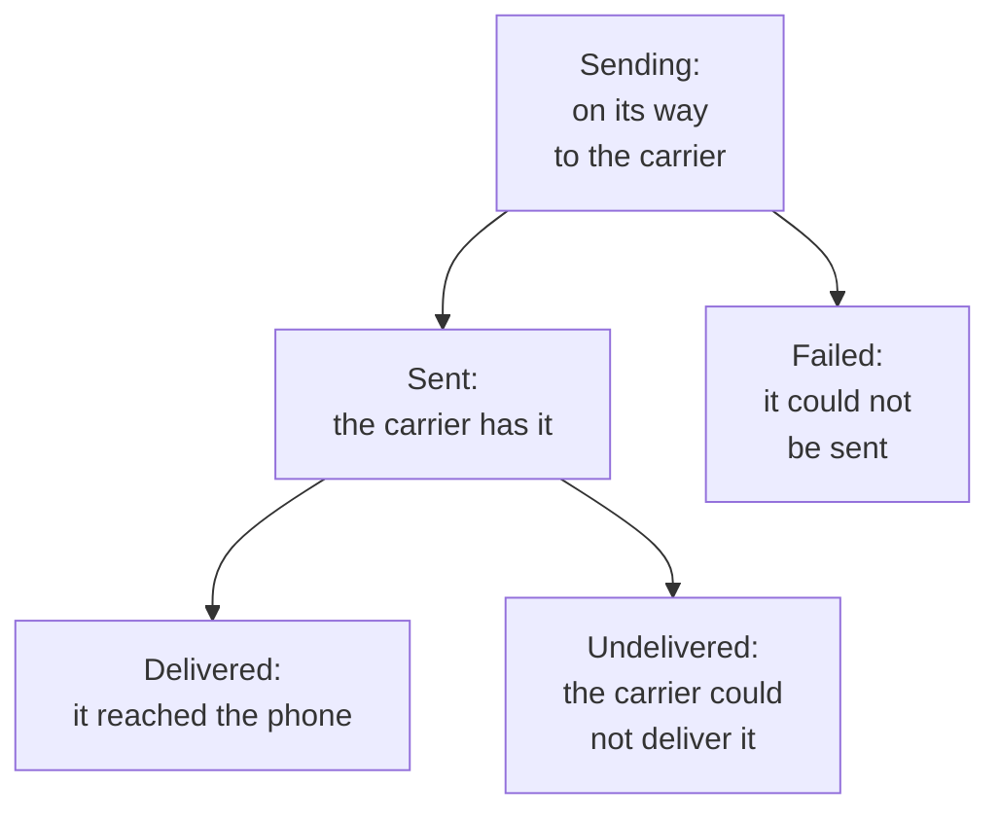

# Notification Logs

Notification logs list every message OneUptime sent for your project, one tab per channel, and what became of each: whether it went out, whether it arrived, and if not, why. Open them under **Project Settings → Notifications → Notification Logs**, or under **Notification Logs** on an incident, an alert, a maintenance event, a status page or an on-call policy, for what was sent about it.

:::cards
- [How to read a status](#how-to-read-a-status): Its colour says where the message is, and pointing at it says what it means.
- [SMS](#sms): Sending, then Sent, then Delivered, as the carrier reports it.
- [Calls](#calls): Calling, then how the call ended.
- [WhatsApp and Telegram](#whatsapp-and-telegram): What each app reports after it takes a message.
- [Email, push, webhooks and workspaces](#email-push-webhooks-and-workspaces): Success, or Error and why.
- [When an SMS stays Sent](#when-an-sms-stays-sent): Carriers that never report back, and reports that never arrive.
:::

## How to read a status

Each status is a pill whose colour says where the message is:

| Colour | Where the message is |
| --- | --- |
| Grey | Handed over, and nothing has come back yet, such as **Sending**. |
| Blue | The provider has it, and has yet to say how it ended, such as an SMS's **Sent** or a call's **Calling**. |
| Green | It reached them, such as **Delivered**, or this is the last status it will have. |
| Yellow | It reached the phone and nobody answered, such as **Missed call**, or it went with a warning. |
| Red | It did not reach them, such as **Undelivered**, **Failed**, **Error** or **Low Balance**. |

Point at a status, tap it, or move to it with the Tab key, and it says what it means and what comes next. **View Status Message**, in the row's menu, shows what the provider said, such as the message's ID or why it failed. Each tab's **Status** filter lists every status the tab can show, in the order a message moves through them.

## SMS

| Status | What it means |
| --- | --- |
| **Sending** | OneUptime handed the SMS to Twilio, which is passing it to the carrier. |
| **Sent** | The carrier accepted the SMS. It moves to **Delivered** or **Undelivered** once the carrier reports back. |
| **Delivered** | The carrier confirmed the SMS reached the phone. This is the last status of an SMS that arrived. |
| **Undelivered** | The carrier could not deliver it. **Error Code** says why: `30003` is a phone that is off or out of reach, `30005` a number that does not exist, `30006` a landline, and `30007` a message the carrier filtered. |
| **Failed** | Twilio could not send it. **Error Code** says why. |
| **Error** | It was not sent, for example because SMS are off for the project, or Twilio refused the number. **View Status Message** says why. |
| **Low Balance** | It was not sent: the project's balance was too low to pay for it. |
| **Success** | It was sent before OneUptime tracked delivery, and Twilio accepted it. |

An SMS that the server's own SMS and call gateway took stays **Sent**, in green: the gateway does not report delivery, so that is its last status.

Twilio reports each change to OneUptime as it happens, signed with the auth token of the account the SMS went out on, and OneUptime refuses any report that is not Twilio's. For that, Twilio must be able to reach your server: see [Twilio Integration](/docs/self-hosted/twilio-integration).

## Calls

| Status | What it means |
| --- | --- |
| **Calling** | Twilio placed the call. It changes once Twilio says how the call ended. |
| **Success** | The call was answered, and **View Status Message** says how long it lasted. A call that the server's own SMS and call gateway took is **Success** once the gateway accepts it. |
| **Missed call** | The call rang out: nobody answered. |
| **Busy** | The line was busy, or the call was declined. |
| **Voicemail** | Voicemail answered an on-call call. **View Status Message** says whether a message was left. |
| **Error** | The call could not be made or connected. |
| **Low Balance** | It was not made: the project's balance was too low to pay for it. |

## WhatsApp and Telegram

A WhatsApp message is **Queued** while OneUptime hands it over, **Sent** once WhatsApp accepts it, **Delivered** once it reaches the phone, and **Read** once it is opened, if the person shares read receipts. **Failed** is a message WhatsApp could not deliver, and **Warning** one it sent with a warning: **View Status Message** says what WhatsApp reported. **Error** and **Low Balance** mean it was not sent, as for an SMS.

Telegram reports nothing after it takes a message, so a Telegram message's **Sent** is green: Telegram posted it in the chat, and that is its last status.

## Email, push, webhooks and workspaces

These tabs say **Success** or **Error**. **Success** is the last status: the mail server accepted the email, the push service accepted the notification, the webhook's address answered that it took the request, or the workspace did what was asked. OneUptime does not track an email after the mail server accepts it, and a push notification changes to **Error** if the push service reports later that it was not delivered. **View Status Message** says why a message is **Error**, as **Reason** does on the **Workspace** tab.

## When an SMS stays Sent

**Sent** means the carrier has the SMS and has not reported back yet. Most carriers report within seconds or minutes, but some never do: Twilio then keeps the SMS at `sent` too, as its message logs show, and OneUptime cannot know whether it arrived.

An SMS that stays **Sending** is another matter: Twilio's reports are not reaching OneUptime. Check that Twilio can reach your server, and look in the server's log for lines that start with `Twilio callback refused`: see [Twilio Integration](/docs/self-hosted/twilio-integration).

## Next steps

:::cards
- [Twilio Integration](/docs/self-hosted/twilio-integration): Connect Twilio, and let its delivery reports reach OneUptime.
- [SMS and Call Gateway](/docs/self-hosted/sms-and-call-gateway): Send SMS and calls through a gateway of your own.
- [Notification Delivery Metrics](/docs/self-hosted/notification-delivery-metrics): Count what was delivered across the installation.
:::
