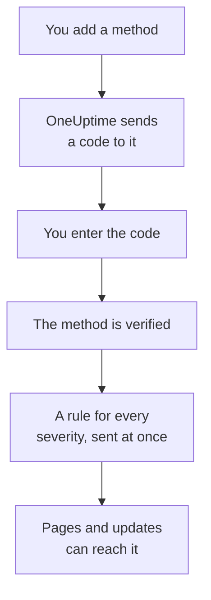

# Notification Methods

A notification method is an address OneUptime may reach you at in one project: an email address, a phone number for SMS or calls, a WhatsApp number, a Telegram account, your Slack or Microsoft Teams account, a phone or browser for push notifications, or a webhook. You add them under **User Settings → Notification Methods**, verify them, and OneUptime starts using them for your pages straight away.

:::cards
- [Pick a method](#pick-a-method): What each method needs, and how it is verified.
- [Add and verify a method](#add-and-verify-a-method): Email, SMS, calls and WhatsApp, with a 6-digit code.
- [Webhooks](#webhooks): Send pages to your own endpoint, signed if you like.
- [Turn a channel on for your project](#turn-a-channel-on-for-your-project): Why SMS, calls, WhatsApp or Telegram may be missing.
:::

## How a method goes live



A method you have not verified is never used. Push devices, Slack, Microsoft Teams and webhooks skip the code: registering a device or linking your account proves it is yours, and a webhook needs no proof. Verifying a method adds your [default rules](/docs/notifications/on-call-rules#the-rules-you-start-with) for it at once, so a new phone number pages you for every severity until you change its rules.

## Pick a method

Each tab of **Notification Methods** holds one or more cards, one per kind of method:

| Card | Tab | What you add | How it is verified |
| --- | --- | --- | --- |
| **Emails for Notifications** | **Direct Contact** | An email address | A code by email |
| **Phone Numbers for SMS Notifications** | **Direct Contact** | A phone number | A code by SMS |
| **Phone Numbers for Call Notifications** | **Direct Contact** | A phone number | A code read out in a call, or none for a number verified for SMS |
| **WhatsApp Numbers for Notifications** | **Direct Contact** | A WhatsApp number | A code on WhatsApp |
| **Telegram Accounts for Notifications** | **Direct Contact** | Your Telegram account | A message to the OneUptime bot |
| **Slack Account for Notifications** | **Workspace Apps** | Your Slack account | Linking your account to the project's workspace |
| **Microsoft Teams Account for Notifications** | **Workspace Apps** | Your Microsoft Teams account | Linking your account to the project's workspace |
| **Push Notification Devices** | **Push Notifications** | A phone with the OneUptime On-Call app, or a browser | Registering the device |
| **Webhooks for Notifications** | **Webhooks** | An HTTPS endpoint of your own | None |

**Workspace Apps** shows only when the project has connected Slack or Microsoft Teams, and holds only the ones it connected. SMS, calls, WhatsApp and Telegram can be turned off for the whole project; see [Turn a channel on for your project](#turn-a-channel-on-for-your-project).

## Add and verify a method

Email addresses, SMS numbers, call numbers and WhatsApp numbers are verified with a 6-digit code.

:::steps
### Open your methods

Go to **User Settings → Notification Methods**. **Direct Contact** is the first tab.

### Add the address

In the method's card, click its add button, such as **Add Phone Number for SMS Notifications**. Enter the **Email**, or the **Phone Number** in international format, such as `+11234567890`, and save.

### Enter the code

The verify dialog opens by itself, and says where the code went and until when it works. Type the code into **Verification Code** and click **Verify**.

### Check the row

The row is now marked **Verified**. Closed the dialog too soon? Click **Verify** on the row to open it again.
:::

- A code works for 15 minutes. Five wrong tries cancel it, and you need a new one.
- **Send a new code**, or **Call me with a new code** for a call number, is in the dialog. You can ask for one a minute after the last.
- A number you verified for SMS is verified for calls too. Adding it under **Phone Numbers for Call Notifications** needs no code, and verifying an SMS number also verifies the call number you added for it.
- Your sign-in email is already there, verified, from the day you joined the project.

## Link Telegram

:::steps
### Add the account

In **Telegram Accounts for Notifications**, click **Add Telegram Account**. **Telegram Handle (optional)** is only a label for you, and can stay empty.

### Message the bot

Click **Verify** on the new row. The **Verify Telegram Account** dialog gives you three ways to reach the OneUptime bot: scan the QR code with your phone, click **Open in Telegram**, or search Telegram for the bot and send it the `/start` command the dialog shows.

### Confirm it

Back in OneUptime, click **I've sent the message — check**. Once the bot has your message, the account is verified.
:::

**Rotate Code** makes a new code for an account that is not verified yet. The QR code and the link you opened before stop working. On a self-hosted OneUptime, the server's admin connects a Telegram bot before anyone can link an account.

## Slack and Microsoft Teams

1. Link your own account to the project's workspace: **User Settings → Workspace → Slack**, or **Microsoft Teams**. See [Slack](/docs/workspace-connections/slack) and [Microsoft Teams](/docs/workspace-connections/microsoft-teams).
2. On the **Workspace Apps** tab, click **Add Slack Account** or **Add Microsoft Teams Account**. The account is verified as it is added.
3. Click **Send Test Message** on its row. Pages arrive as direct messages from the OneUptime app.

## Push notifications

The **Push Notifications** tab lists your **Push Notification Devices**.

- **A phone.** Install the OneUptime On-Call app, connect it to your OneUptime, sign in and allow notifications: the phone adds itself to this list. See [Apps Overview](/docs/mobile-desktop-apps/index).
- **This browser.** Click **Register Device**, give it a **Device Name**, and allow notifications when the browser asks.
- **Test Notification** on a device's row sends a push to it now.
- **Critical Alerts** says whether the phone's pages ring through silent mode and Do Not Disturb. It is turned on in the app, never here, and a browser cannot do it. See [Critical on-call alerts](/docs/self-hosted/push-notifications#critical-on-call-alerts-overriding-silent-mode).
- A device marked **Not receiving notifications** is not sent anything. Open the app on that phone, or register the browser again, and it comes back.

## Webhooks

A webhook posts each page to an HTTPS endpoint of yours as JSON, for a tool of your own to act on.

:::steps
### Add the webhook

On the **Webhooks** tab, click **Add Webhook**. Fill in a **Name** you will recognize, the **Webhook URL**, and a **Signing Secret (optional)**.

### Send a test

Click **Send Test** on its row. Your endpoint receives an event whose `eventType` is `test`.

### Check what arrives

A page is a JSON `POST` like the one below. Answer with any `2xx` status within 10 seconds; redirects are not followed.
:::

```json title="A page, as your endpoint receives it"
{
  "eventType": "on-call.incident.created",
  "timestamp": "2026-10-15T09:30:00.000Z",
  "projectId": "6a3f0d2e-1c4b-4e8a-9b7d-2f5c8e1a0b3c",
  "userId": "0c9e8d7f-6b5a-4c3d-8e2f-1a0b9c8d7e6f",
  "incident": {
    "id": "5b4a3c2d-1e0f-4a9b-8c7d-6e5f4a3b2c1d",
    "title": "Checkout API is down",
    "description": "Health check failed from 3 probes.",
    "incidentNumber": 42,
    "incidentNumberWithPrefix": "INC-42",
    "severity": "Critical Incident",
    "state": "Identified"
  },
  "onCallPolicyId": "7d6c5b4a-3e2f-4d1c-9b8a-7f6e5d4c3b2a",
  "onCallPolicyEscalationRuleId": "8e7d6c5b-4a3f-4e2d-8c1b-9a8f7e6d5c4b"
}
```

| `eventType` | Sent for | The record's key |
| --- | --- | --- |
| `on-call.incident.created` | An incident | `incident` |
| `on-call.alert.created` | An alert | `alert` |
| `on-call.incidentEpisode.created` | An incident episode | `incidentEpisode` |
| `on-call.alertEpisode.created` | An alert episode | `alertEpisode` |

The updates you turn on for Webhook in **Notification Settings** arrive at the same endpoint, with the setting's event in `eventType` and a short summary in `subject` and `message`.

Every request carries `X-OneUptime-Event`, the event type. With a signing secret, it also carries `X-OneUptime-Signature`: `sha256=` followed by the HMAC-SHA256 of the raw body, in hex. Check it before you trust the request:

```javascript title="verify-signature.js"
const crypto = require("crypto");

// rawBody: the request body exactly as it arrived, before any JSON parsing.
function isFromOneUptime(rawBody, signatureHeader, secret) {
  const expected =
    "sha256=" + crypto.createHmac("sha256", secret).update(rawBody).digest("hex");
  const received = Buffer.from(signatureHeader || "");
  const wanted = Buffer.from(expected);
  return received.length === wanted.length && crypto.timingSafeEqual(received, wanted);
}
```

A webhook needs no verification, so adding one adds its rules at once. Private and internal addresses are refused, unless a self-hosted server's admin allows them: see [Private Network Access](/docs/self-hosted/private-network-access#webhooks-and-workflows).

## Turn a channel on for your project

**SMS**, **Phone Calls**, **WhatsApp** and **Telegram** start off in every new project, because each message costs money: on OneUptime Cloud it is paid from the project's balance, and SMS and calls go through the project's own Twilio account instead when its default Twilio config sends them. Email, push, Slack, Microsoft Teams and webhooks are always on.

While a channel is off, nobody in the project can add a method on it: its card has no add button, and says who can turn it on. A project owner, a **Billing Admin** or someone with **Manage Billing** turns it on, in the **Notification Channels** card on **Project Settings → Notifications → Notification Settings**. A project admin cannot. On a self-hosted OneUptime, SMS and calls also need a Twilio account, and Telegram a bot the server's admin connects; see [Twilio Integration](/docs/self-hosted/twilio-integration).

## Delete a method

Click **Delete** on the method's row. Deleting a method deletes every on-call rule that uses it, so the dialog first counts those rules, and names any severity the delete would leave with no rule at all.

## Troubleshooting

:::details A card has no add button
That channel is off in this project. The card says who can turn it on; see [Turn a channel on for your project](#turn-a-channel-on-for-your-project).
:::

:::details The code never arrived
Emails can take a few minutes, and sometimes land in spam; texts can take a minute. Wait a minute, then click **Send a new code** in the dialog. **Project Settings → Notifications → Notification Logs** shows what happened to the message.
:::

:::details Adding my Slack account fails
Link your account under **User Settings → Workspace → Slack** first, then click **Add Slack Account** again. The error dialog has a button that takes you there.
:::

:::details My phone gets no push notifications
Check that the phone is listed under **Push Notification Devices**, and send it a **Test Notification**. See [FAQ & Troubleshooting](/docs/mobile-desktop-apps/faq-troubleshooting#notifications).
:::

## Next steps

:::cards
- [Personal On-Call Rules](/docs/notifications/on-call-rules): Decide which method each page tries, and when.
- [Notification Settings](/docs/notifications/notification-settings): Choose the updates you hear about, and on which channels.
- [Apps Overview](/docs/mobile-desktop-apps/index): Get pages on your phone or desktop.
- [How OneUptime Reaches You](/docs/notifications/index): How methods, rules and settings fit together.
:::
