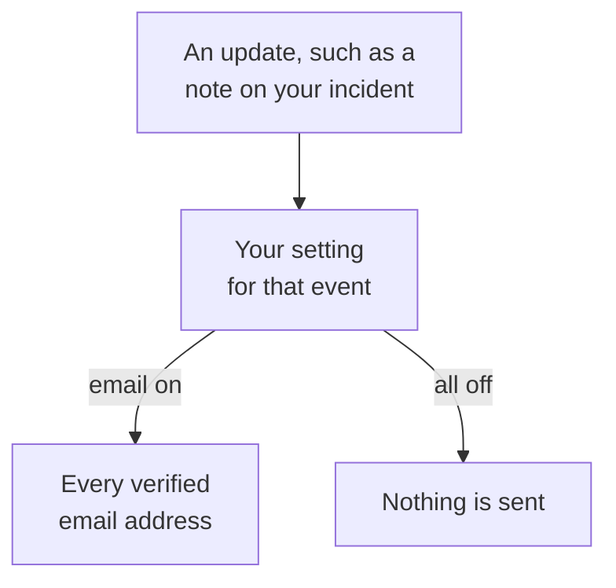

# Notification Settings

Notification settings decide which updates reach you about the records you own, such as an incident, a monitor or a status page, and about your own on-call shifts, and on which channels. They never page you: paging is your on-call rules' job. You set them under **User Settings → Notification Settings**, one switch per event and channel.

:::cards
- [How settings work](#how-settings-work): One switch per event and channel, sent to every verified method.
- [Change a setting](#change-a-setting): Three clicks, saved at once.
- [What is on for a new member](#what-is-on-for-a-new-member): The defaults, tab by tab.
- [Fewer emails](#fewer-emails): Roll up bursts, or drop the routine ones.
:::

## How settings work

- Each row is an event, and each column a channel: Email, SMS, Call, Push, WhatsApp, Telegram, Slack and Microsoft Teams, and Webhook. Slack and Microsoft Teams are columns only when the project has connected them.
- A channel that is on sends to every verified method you have on it in this project, not just one.
- A channel that is on, with no verified method behind it, sends nothing. **Your setup checklist** says so under **Staying informed**.
- An update goes to the record's owners: the people named as owners, and the members of its owner teams. When a record has no owners, it goes to the project's owners instead. An event about being added as an owner goes only to the person added.
- Security cases have no owners. A new case goes to everyone who can see the project's cases, at the priority each of them chooses, and an assigned case to the people it is assigned to. See [Security Cases](/docs/telemetry/security-cases#notifications).
- Every owner email ends with a "Manage notification preferences" link back to this page.

## Change a setting

:::steps
### Open your settings

Go to **User Settings → Notification Settings**. The tabs are **Incidents**, **Alerts**, **Monitoring**, **Status Pages**, **Scheduled Maintenance**, **On-Call** and **Security**.

### Find the event

Each tab holds one or more cards, such as **Incident Episodes** on the **Incidents** tab. Every row is an event, with a line saying when it is sent.

### Click a channel

Click a channel's circle to switch it on, and again to switch it off. A check mark means on. Changes save automatically.
:::

## What is on for a new member

When you join a project, these events start on, by email. Everything else starts off, and sends nothing until you switch a channel on.

| Tab | On by email | Off until you turn them on |
| --- | --- | --- |
| **Incidents** | **Incident created**, **Incident state changed**, **Incident reminder**, **Incident SLA breached**, **Incident episode created**, **Incident episode state changed**, **Incident added to incident episode** | **Incident note posted**, **Added as incident owner**, **Assigned to an incident**, **Incident episode note posted**, **Added as incident episode owner** |
| **Alerts** | **Alert created**, **Alert state changed**, **Alert reminder**, **Alert episode created**, **Alert episode state changed**, **Alert added to alert episode** | **Alert note posted**, **Added as alert owner**, **Alert episode note posted**, **Added as alert episode owner** |
| **Monitoring** | **Probe status changed for your monitor**, **Monitor has no active probes**, **SLO status changed**, **Added as SLO owner**, **Probe status changed**, **Added as probe owner** | **Monitor created**, **Monitor status changed**, **Added as monitor owner**, **AI agent status changed**, **Added as AI agent owner** |
| **Status Pages** | None | **Status page created**, **Status page announcement posted**, **Added as status page owner** |
| **Scheduled Maintenance** | **Maintenance reminder** | **Maintenance event created**, **Maintenance state changed**, **Maintenance note posted**, **Added as maintenance owner** |
| **On-Call** | **You go on-call**, **You are up next on-call**, **You go off-call**, **Added to on-call policy**, **Removed from on-call policy**, **Missed call**, and by push too: **Before my on-call shift starts**, **My upcoming on-call shift is reassigned** | None |
| **Security** | By push too: **New security case** (High and Critical cases), **Security case assigned to me**, **Playbook step waiting for my approval**, **Security case response target**, **Security case task assigned to me** | None |

> [!IMPORTANT]
> **Monitor status changed** starts off. To hear when a monitor you own goes down or comes back, switch it on, on the **Monitoring** tab.

## Your shifts

The **On-Call** tab is about you, not about records you own:

- **You go on-call**, **You are up next on-call** and **You go off-call** follow your turns on the on-call schedules you are in.
- **Added to on-call policy** and **Removed from on-call policy** tell you when an on-call policy starts or stops naming you.
- **Before my on-call shift starts** sends reminders at the times you pick on **User Settings → Calendar → Calendar Feed**, and **My upcoming on-call shift is reassigned** tells you when someone else covers a shift you were reminded about. See [Calendar Feeds](/docs/on-call/calendar-feeds#reminders-and-reassignment-notices).
- **Missed call**, on the **Incoming Call Policies** card, tells the owners of an incoming call policy that a caller reached nobody. See [Incoming Call Policy](/docs/on-call/incoming-call-policy#missed-calls).

## Security cases

The **Security** tab is about the security cases you can see:

- **New security case** has a priority under its name: the lowest priority of case that notifies you. It is **High and above** unless you choose **Critical only**, **Medium and above**, **Low and above** or **Every case**.
- **Security case assigned to me** follows the cases assigned to you, and to the teams you are on.
- **Playbook step waiting for my approval** asks you to approve or reject a playbook step on a case you can approve.

See [Security Cases](/docs/telemetry/security-cases#notifications).

## Fewer emails

These switches decide which updates reach you, not how many emails they add up to. **User Settings → Email Preferences** has two cards for that, both for you alone, in this project:

- **Email Rollup** packs a burst of updates into one email: the first few still arrive one by one, and the rest together a few minutes later.
- **Fewer routine emails** switches off, with **Reduce routine emails**, the emails about notes, new owners, new monitors and status pages, additions to episodes, and on-call policy changes.

See [Notification Rollup](/docs/emails/notification-rollup).

## Troubleshooting

:::details A switch is on, but nothing arrives
Check that you have a verified method on that channel under **User Settings → Notification Methods**. For SMS, Call, WhatsApp and Telegram, the project must have the channel turned on too.
:::

:::details I own a monitor, but I never hear when it goes down
**Monitor status changed** starts off. Switch a channel on for it, on the **Monitoring** tab.
:::

:::details I still get emails after switching everything off
Pages follow your on-call rules, not these switches, and sign-in, security and billing emails are not updates about records. Each project has its own settings, so check the project the email came from. See [Personal On-Call Rules](/docs/notifications/on-call-rules).
:::

## Next steps

:::cards
- [Notification Methods](/docs/notifications/notification-methods): Add the methods your settings send to.
- [Personal On-Call Rules](/docs/notifications/on-call-rules): Decide how a page reaches you.
- [Notification Rollup](/docs/emails/notification-rollup): Fewer, fuller emails during a burst.
- [How OneUptime Reaches You](/docs/notifications/index): How methods, rules and settings fit together.
:::
