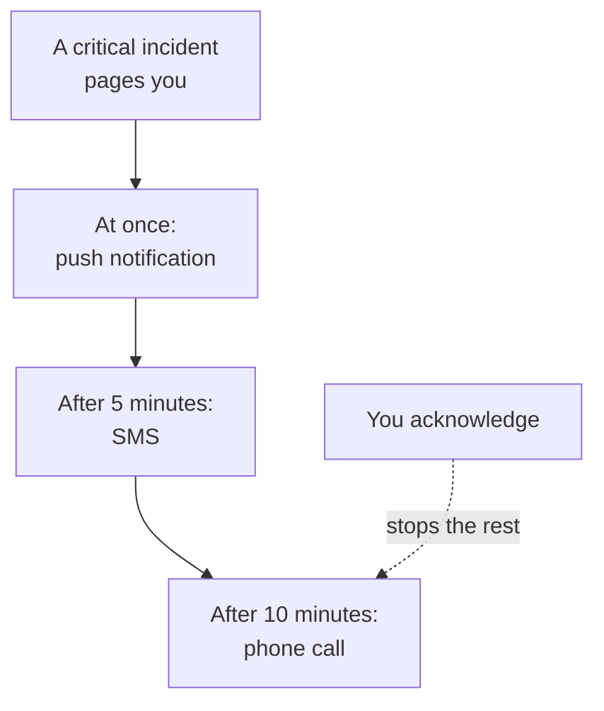

# Personal On-Call Rules

Your on-call rules decide how a page reaches you: which of your notification methods OneUptime tries, and how long after the page starts. Each kind of page has its own rules, one set per severity, so a critical incident can call you at once while a low alert waits for an email. You set them under **User Settings → On-Call Rules**.

> [!NOTE]
> These rules are yours alone. The **On-Call Rules** under **Incidents → Rules** and **Alerts → Rules** are something else: they decide which on-call policies a new incident or alert runs.

:::cards
- [How a page reaches you](#how-a-page-reaches-you): Your rules for one page, step by step.
- [The rules you start with](#the-rules-you-start-with): What every verified method adds, and how to trim it.
- [Add a rule](#add-a-rule): A method and a delay for one severity.
- [Push rules](#push-rules): Ring through silent mode, and repeat until someone acknowledges.
:::

## How a page reaches you

An on-call policy pages you when one of its escalation rules names you, a team you are in, or a schedule you are on call in. OneUptime then works through your rules for that kind of page and its severity: each rule fires on its own method once its delay has passed since the page started. Acknowledging the incident or alert, from any message or in OneUptime, stops every rule that has not fired yet.

Most messages can acknowledge the page: emails, texts and WhatsApp, Telegram, Slack and Microsoft Teams messages carry an acknowledge link, and a call asks you to press 1. When you cannot take a page, the same messages let you escalate it, and a call asks you to press 2: the policy pages its next level straight away, and you are not paged again for it. See [Escalating a page](/docs/on-call/escalation-rules#escalating-a-page). Each page you get is listed under **User Settings → On-Call Logs**, where **View Timeline** shows every message it sent and whether it was delivered.

## The four tabs

**User Settings → On-Call Rules** has a tab for each kind of page. Each tab has a card per severity, named and coloured as your project named it:

| Tab | Pages for | Cards for |
| --- | --- | --- |
| **Incidents** | Incidents | Incident severities |
| **Incident Episodes** | Episodes that group incidents | Incident severities |
| **Alerts** | Alerts | Alert severities |
| **Alert Episodes** | Episodes that group alerts | Alert severities |

An episode pages you through its own on-call policies, apart from the incidents or alerts in it, so its rules are on their own tab. The page's address names the open tab, such as `/dashboard/{projectId}/user-settings/on-call-rules?type=alerts`; the other values are `incident-episodes` and `alert-episodes`, and with no `type` the page opens on **Incidents**.

A severity your project has archived comes after the others, marked **Archived**, while you have rules for it: incidents and alerts that still have it page you by them. You can change or remove those rules, but not add new ones.

## The rules you start with

Every method you verify gets a rule on every card of every tab, sent as soon as you are paged. Your sign-in email has them from the day you join, so a page always reaches you. Verify a phone number for SMS, and every page texts you too.

That is a safe start, and usually too much. Trim it to what each severity deserves:

| Severity | A sensible set |
| --- | --- |
| Critical | Push at once, a call after 5 minutes |
| Major | Push at once, SMS after 10 minutes |
| Minor or low | Email at once |

Your own rules have no quiet hours: keep low severities on email, or on a push rule set to **Standard**, so they never wake you. To make a low-severity page wait for working hours for everyone, set the on-call rule that pages it to **Only during working hours**: see [On-call rules](/docs/alerts/settings#on-call-rules).

## Add a rule

:::steps
### Open the card

Go to **User Settings → On-Call Rules**, open the tab for the kind of page, and find the card of the severity.

### Pick the method

Click **Add Notification Rule**. In **Notification Method**, pick one of your verified methods; a method you have not verified is not offered.

### Choose how a push sounds

For a phone, pick **Push notification**: **Critical alert** or **Standard**. For any push device, pick **Repeat until acknowledged**. See [Push rules](#push-rules).

### Set the delay

Pick **Notify me after**: **Immediately**, **5 minutes**, **10 minutes**, **15 minutes**, **30 minutes** or **1 hour**. Then click **Add Notification Rule** in the dialog.
:::

The card lists its rules in order of their delay, with **Notification Method** and **Notify After** for each one.

## Change or delete a rule

- **Edit** on a rule's row changes its delay. To send a rule to another method, delete it and add a new one.
- On a push rule, click the label under the method to switch between **Critical alert** and **Standard**, or to change how often it repeats. It saves at once.
- **Delete** asks first, and says whether the severity is left with no rule. A severity with no rule falls back to your verified methods; see [When a severity has no rule](#when-a-severity-has-no-rule).

## Push rules

A rule that pages a phone says how its push sounds:

| Choice | What the phone does |
| --- | --- |
| **Critical alert** | Rings even when the phone is on silent or in Do Not Disturb, once Critical On-Call Alerts is on in the OneUptime On-Call app. A new phone rule starts here. |
| **Standard** | Follows the phone's sound, silent and Do Not Disturb settings. |

A push rule, for a phone or a browser, can also send its push again until someone acknowledges: **Don't repeat**, the default, or **Every minute**, **Every 2 minutes**, **Every 3 minutes**, **Every 5 minutes**, **Every 10 minutes**, **Every 15 minutes** or **Every 30 minutes**. It repeats up to 10 more times, and stops as soon as the incident, alert or episode is acknowledged. See [Critical on-call alerts](/docs/self-hosted/push-notifications#critical-on-call-alerts-overriding-silent-mode).

## When a severity has no rule

A severity your project adds later gets rules within a few minutes, made from the choices you already made on that tab: the same methods, after the same delays. If you had no rules on that tab, it gets your verified email, at once.

A page that still finds no rule is sent to your verified methods anyway, and you are emailed about it; see [When no rule matches](/docs/notifications/index#when-no-rule-matches).

:::details Turning a severity off on purpose
The API can store an opt-out rule, with `isOptOut` set and no method: you are then not paged for that kind of page and severity at all, and nothing falls back. The row reads **Muted - notifications turned off for this rule**, and deleting it turns paging back on. A severity added later is muted too, when every rule you have on that tab is an opt-out.
:::

:::details Turning the fallback off for a whole project
A project owner, or someone with **Manage Billing**, can set the project's `disableOnCallNotificationFallback` through the API. A page that finds no rule is then not delivered, and its log says the user should add rules under **User Settings → On-Call Rules**.
:::

## Rules for a teammate

Project owners and admins can see and change the same page for anyone in the project: under **Users**, open the person, then **On-Call Rules** in the **On-Call** section. **Readiness**, beside it, shows whether every severity reaches them. When someone else adds, changes or deletes your rules, you get an email about it, and each change is in the project's audit log.

## Troubleshooting

:::details My phone stayed silent for a critical page
Check that the rule's push is **Critical alert**, not **Standard**, and that **Critical Alerts** is on for the phone under **User Settings → Notification Methods**, on the **Push Notifications** tab.
:::

:::details I am paged twice for every incident
Each verified method has a rule for every severity, sent at once. Delete the rules you do not want, or give them a delay. An incident in an episode can page you once for the incident and once for the episode, through two policies.
:::

:::details I got an email although my rule says SMS
The page found no rule for its kind or severity, and fell back to your free methods: add the rule on the right tab and card. Or the email was an update about a record you own, which follows **Notification Settings**, not your rules. Your **On-Call Logs** list only pages.
:::

## Next steps

:::cards
- [Notification Methods](/docs/notifications/notification-methods): Add and verify the methods your rules point at.
- [Escalation Rules](/docs/on-call/escalation-rules): How an on-call policy pages people, level by level.
- [Push Notifications](/docs/self-hosted/push-notifications): Critical alerts, alarm sounds and repeats on phones.
- [How OneUptime Reaches You](/docs/notifications/index): How methods, rules and settings fit together.
:::
