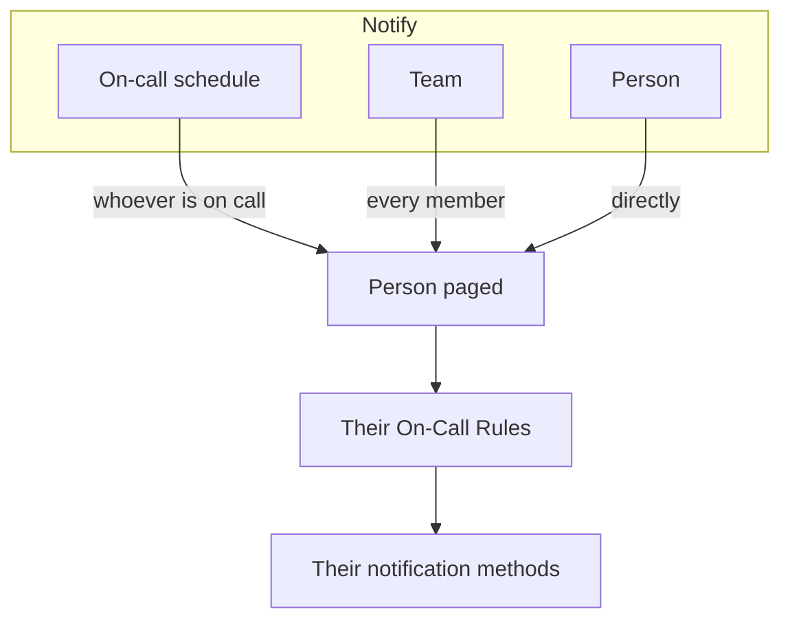

# Escalation Rules

An on-call policy pages people in levels. Each escalation rule is one level: who gets paged, and how long to wait for somebody to acknowledge before the next level is paged. A policy's rules are listed, in order, on its **Escalation Rules** page.

```mermaid title="An on-call policy pages level by level until someone acknowledges"
flowchart TB
    trigger["Incident or alert"] --> level1["Level 1 pages"]
    level1 --> ack1{"Acknowledged<br/>in time?"}
    ack1 -->|Yes| stop["Paging stops"]
    ack1 -->|No| level2["Level 2 pages"]
    level2 --> ack2{"Acknowledged<br/>in time?"}
    ack2 -->|Yes| stop
    ack2 -->|"No, last level"| repeat{"Repeat the policy?"}
    repeat -->|Yes| level1
    repeat -->|No| done["Policy stops"]
```

:::cards
- [Who gets paged first](#who-gets-paged-first): Create a policy with its first level.
- [Adding an escalation rule](#adding-an-escalation-rule): Add the next level, step by step.
- [How the levels page people](#how-the-levels-page-people): Timing, repeats, and how each person is reached.
- [The next person in the rotation](#escalating-to-the-next-person-in-the-rotation): Page the on-call person's backup from the same rotation.
- [Escalating a page](#escalating-a-page): Can't take a page? Page the next level at once.
- [API and Terraform](#creating-rules-with-the-api-or-terraform): Create policies and rules as code.
:::

## Who gets paged first

When you create an on-call policy on the **On-Call Policies** page, the form asks for its **Name** and **Who gets paged first?**. The question uses the same picker as **Notify**: on-call schedules, teams and people, as many as you need. Whoever you pick becomes the policy's first escalation rule, **Level 1**, which waits **30 minutes** for an acknowledgement before the next level is paged.

:::steps
1. Go to **On-Call Duty** > **On-Call Policies** and click **Create On-Call Policy**.
2. Enter a **Name**.
3. Under **Who gets paged first?**, click **Add responder** and pick the on-call schedules, teams and people to page first.
4. Click **Create On-Call Policy**. The new policy then opens on its **Escalation Rules** page, where you can add more levels.
:::

**Who gets paged first?** is optional. Leave it empty and the policy starts without escalation rules: it pages nobody until you add one, and its overview says so. The description and the labels wait under **More fields**. The question is asked only of people who may add escalation rules.

## Adding an escalation rule

:::steps
### Open the policy's escalation rules

Open the on-call policy, choose **Escalation Rules** in its side menu and click **Add Escalation Rule**. The dialog is one short page.

### Choose who to notify

Under **Notify**, click **Add responder**, search, and pick as many on-call schedules, teams and people as this level should page. Add at least one.

| Responder | Who is paged when the level runs |
| --- | --- |
| An **on-call schedule** | Whoever is on call in it when the level runs, not a fixed person. |
| A schedule's **Next in rotation** | The person after whoever is on call in it, from the same rotation. See [Escalating to the next person in the rotation](#escalating-to-the-next-person-in-the-rotation). |
| A **team** | Every member of the team. |
| A **person** | That person, directly. |

### Set how long to wait

**Escalate after (in minutes)** is how long to wait for an acknowledgement before the next level is paged. It starts at **30 minutes**; change it to whatever suits the level.

### Name the rule, if you want to

Everything else waits under **More fields**, folded until you open it:

- **Name**: optional. A rule you do not name is called after its level: the first rule of a policy is **Level 1**, the second **Level 2**, and so on. The name field shows the name the rule will get.
- **Description**: optional notes, such as who this level pages and why.

Folded, the header of **More fields** names the two and shows the ones the rule has: a description, or a name of your own.

### Create the rule

Click **Create Rule**. The rule is added below the others, as the policy's next level.
:::

## How the levels page people

When an incident or alert reaches the policy, **Level 1** pages its responders straight away. If nobody acknowledges within its wait, **Level 2** is paged, and so on down the list. Once the last level's wait has passed with no acknowledgement, the policy starts again from **Level 1** if its **Repeat Policy** (below the rules) says to repeat, as many times as it allows, and otherwise stops. Acknowledging or resolving the incident or alert stops the paging at any level. Somebody paged who cannot take it can escalate it, and the next level is paged without waiting: see [Escalating a page](#escalating-a-page).

An incident, alert or episode that is created already acknowledged or resolved — recorded after the fact — runs none of its policies: no one is paged, and its feed says so, naming them. See [Declared already acknowledged or resolved](/docs/incidents/declaring-incidents#declared-already-acknowledged-or-resolved).

A level that has nobody to page when it is reached is passed at once: the next level is paged straight away, without waiting. That is a level with no responders, and one whose responders give it nobody to page at that moment: a team with no members, a schedule with nobody on call, or people who are away with nobody to cover, have left the project, or cannot be reached at all. When no level has anybody to page, the policy stops at once and does not repeat.

To repeat a policy, click **Edit** on the **Repeat Policy** card, choose **Start again from Level 1** and set **How many more times?**.

### The escalation summary

The summary at the top of the **Escalation Rules** page shows the whole ladder: when each level is paged, who it pages, and what happens after the last one. A level whose responders cannot all be paged says so on its card; click the label to see who and why. A level with no responders shows **Skipped at once**, and its wait is not counted towards when the next level is paged.

### How each person is reached

Each person a level pages is reached the way their own on-call rules say: **User Settings** > **On-Call Rules**, with a tab for incidents, incident episodes, alerts and alert episodes, and a card per severity listing which notification method is tried and after how long. A project admin can see and change a member's rules under **Users** > the member > **On-Call Rules**. See [Personal On-Call Rules](/docs/notifications/on-call-rules).



A user override that is in effect for a person sends their pages to the person covering for them instead. One that names nobody to cover skips them: they are not paged, the policy's run says they are away and until when, and in an on-call schedule each of their turns goes to the next person in the rotation. See [User Overrides](/docs/on-call/user-overrides).

Every message is one its provider takes, so a page always goes out. Each channel carries this much:

| Channel | The longest message it carries |
| --- | --- |
| SMS | 1,600 characters |
| Phone call | What fits in Twilio's 4,000-character call script |
| Push notification | 4 KB, of which its title, text and data take up to 3 KB |
| WhatsApp | 1,024 characters |
| Telegram | 4,096 characters |

A longer message, with a long title or a long description a template placed in it, is cut and ends with a note that the full text is in OneUptime: "… (truncated — see OneUptime for the full text)". A WhatsApp message's wording is a fixed template, so there the longest values are cut instead, each ending with "…". The links in a message are never cut.

### What a page's text message says

A text message is sent, and billed, in parts of 160 characters. A page by SMS is written to fit in one part wherever it can, and says only what you need on a locked phone: who sends it, what happened, and the one link to acknowledge the page or escalate it. On a phone it reads:

```text
OneUptime: Critical Incident INC-42 in Acme Prod: Checkout API is down.
Ack or escalate: https://oneuptime.com/l/XJlaZRsd
```

It names the severity and what happened (an incident, an alert or an episode of either), its number, the project and the title, in that order. When they do not all fit in one part:

1. The project is left out first.
2. Then the title is cut, and ends with `...`.

The severity, the number and the link are never cut. A title keeps at least 20 characters: when even that does not fit, as with a very long address or product name, the text takes a second part and says it all.

When a policy pages again because an acknowledged incident or alert is still not resolved, the text says so after the number and the project, and those words are never cut either:

```text
OneUptime: Critical Incident INC-42 in Acme Prod is still not resolved:
Checkout API is down. Ack or escalate: https://oneuptime.com/l/XJlaZRsd
```

When somebody pages you from Slack or Microsoft Teams, the text says who paged whom after `OneUptime:`, and those words are never cut either:

```text
OneUptime: Alice Kim paged Platform about Critical Incident INC-42
in Acme Prod: Checkout API is down.
Ack or escalate: https://oneuptime.com/l/XJlaZRsd
```

One character outside the plain alphabet of text messages makes the whole text go out in parts of 70 characters. So curly quotes and dashes are written as `"`, `'` and `-`, `…` as `...`, and letters such as `ç` and `ł` lose their accents; emoji are left out. A title in another script, such as Japanese or Russian, is sent as written, and takes two parts or more.

The other text messages OneUptime sends you, such as a change to an incident you own or the start of your on-call shift, start with `OneUptime:` too and end with `Turn off in User Settings > Notification Settings.`, a sentence that is left out when that is what makes the text fit in one part.

### When a page is not sent

A page that is not sent says why in the person's **On-Call Logs** (User Settings): its row shows **Error**, and its status message gives the reason. It no longer stays at **Sending**. The message says one of:

- the project's balance could not pay for it, and who can add balance;
- the channel is off in the project, and who can turn it on.

The project's owners are emailed about it once, until the balance is topped up or the channel is on again.

On OneUptime Cloud each SMS, call, WhatsApp and Telegram message is paid from the project's balance on **Project Settings > Notifications > Notification Settings**: its exact cost comes off the balance when the provider takes it, however many messages go out at once.

- With **Auto Recharge** on there, the message that finds the balance below its threshold adds the amount Auto Recharge is set to first, charging the project's card; messages that find it low at the same moment charge the card once.
- If that charge fails (there is no payment method, or the card was declined), Auto Recharge tries the card again an hour later, and **Notification Settings** says so at the top until then. Adding balance by hand, or saving Auto Recharge again, tries at once.
- Pages keep going out on the balance that is left while Auto Recharge cannot charge the card.

> [!IMPORTANT]
> SMS, phone calls, WhatsApp and Telegram start off in a new project: on OneUptime Cloud every message is paid from the project's balance, and a self-hosted installation needs a Twilio account or a Telegram bot set up first. Until a channel is on, nobody in the project can add a method on it. Only a project owner, a **Billing Admin** or someone with the **Manage Billing** permission can turn one on, in the **Notification Channels** card on **Project Settings > Notifications > Notification Settings** — a project admin cannot. Everyone else is told exactly who can, wherever a channel is off: above their own list of methods on it, on their setup checklist, and in the message they get when something needs it.

## Escalating to the next person in the rotation

A level can page the next person in an on-call schedule's rotation: the person after whoever is on call in it. So a policy can page the on-call person first, then their backup from the same rotation, then a team or a manager, all from one schedule.

| Level | Notify | Who is paged |
| --- | --- | --- |
| **Level 1** | The Payments primary schedule | Whoever is on call in it, say Alex |
| **Level 2** | The same schedule's **Next in rotation** | The person after Alex in the rotation, say Sam |
| **Level 3** | The Platform team | Every member of the team |

:::steps
1. Make sure the policy's first level, **Level 1**, notifies the on-call schedule.
2. Click **Add Escalation Rule**, then **Add responder**, and pick the same schedule under **Next in rotation**. Set **Escalate after (in minutes)** and click **Create Rule**.
3. Add one more level for the team or the manager who should hear next.
:::

The next person is worked out when the level runs, from the schedule as it is then:

- It is the person after whoever is on call, in the order the rotation's people take turns. After the last person comes the first again.
- People who are away are passed over, whether or not someone covers for them, and so is anyone on call in someone else's place.
- It is always someone from the same rotation: with several layers, the layer whoever is on call comes from. A rotation with nobody else in it, or with everybody else away, has nobody next, and the level pages nobody there and says so.
- When nobody is on call in the schedule at all, nobody is next either, and the level pages nobody there.

The run's message in Slack and Microsoft Teams, the incident's feed and the run's **Execution Timeline** say who was paged as the next in the rotation, and from which schedule: "Sam Lee (next in the Payments primary rotation)".

> [!TIP]
> One schedule is all it takes: there is no second, backup schedule to keep in step with the first, and the time away its people book counts for both levels.

## Escalating a page

Somebody paged who cannot take it, because they are asleep, on a plane or already working another incident, can escalate the page instead of letting it ring out. The policy pages its next level straight away, without waiting out the level's **Escalate after (in minutes)**, and they are not paged again for it.

```mermaid title="Escalating a page moves the policy to its next level at once"
flowchart TB
    page["Level 1 pages Alex"] --> take{"Can Alex<br/>take it?"}
    take -->|Yes| ack["Alex acknowledges:<br/>paging stops"]
    take -->|No| pass["Alex escalates"]
    pass --> others{"Anyone else on<br/>Level 1 still paged?"}
    others -->|Yes| wait["The policy waits<br/>for them, as before"]
    others -->|No| next["Level 2 is<br/>paged now"]
```

Every page can be escalated from where it reached you:

| Where | How to escalate |
| --- | --- |
| Email | The **Escalate** button, then **Escalate** on the page it opens |
| SMS and WhatsApp | The link in the message opens the acknowledge page, which has **Escalate** too |
| Telegram, Slack and Microsoft Teams | The "Can't take it? Escalate" link, then **Escalate** on the page it opens |
| Phone call | Press 2. The call then says what happened |
| Push notification | Tap it: the incident, alert or episode opens in the OneUptime On-Call app, with **Escalate** under it |
| OneUptime | **Escalate** at the top of the incident, alert or episode, after its state buttons |

Every way but the call asks before it does anything, and says what will happen, such as "This will immediately page Platform leads (Level 2 of 3), without waiting."; on a call, pressing 2 is the answer. Only the person being paged can escalate the page: the button in OneUptime shows only to them, and the link in a message escalates only the page it was sent about, for the person it was sent to, for 7 days.

What happens next depends on who else is being paged:

- Others on the same level are still being paged: the policy waits for them, as before. It moves on when the level's wait runs out, or as soon as the last of them escalates it too.
- Nobody else on the level is left: the next level is paged straight away.
- It was the last level: if the **Repeat Policy** says to repeat, the policy starts again from **Level 1** straight away. Otherwise paging stops, and somebody needs to take it.

Escalating a page does not acknowledge it: the incident or alert still waits for somebody to acknowledge it, and whoever escalated it can still acknowledge it themselves. This run does not page them about it again: a later level, or a repeat, that names them passes over them. Once everybody it paged has escalated it and nobody is left to page, paging stops, and the incident's feed says so.

A page a workflow sends to people directly has no levels: escalating it stops paging you, and once everybody it paged has escalated it, paging stops.

Escalating is recorded. The run's **Execution Timeline** marks the person's line **Escalated**, the incident's feed says "Alex Kim escalated the page from on-call policy Payments at Level 1 of 3.", the run's message in Slack and Microsoft Teams says they escalated it, and their **On-Call Logs** show the page as **Escalated**.

## Editing, reordering and deleting rules

Each rule's card has **Edit rule**, and a **⋯** menu with the other actions:

- **Edit rule** opens the same one-page dialog, filled in with the rule as it is: its responders, its wait, and its name and description under **More fields**. Add or remove responders and click **Save Changes**. Clearing the name gives the rule its level's name again.
- **Move up** and **Move down** in a rule's **⋯** menu change its level. A rule named after its level keeps a name that matches its place: when **Level 3** moves up past **Level 2**, the two swap names. A name you chose, such as **Managers**, stays the same wherever the rule goes.
- **Delete rule** asks first and says what the level pages. Deleting a level moves the levels below it up, and rules named after their level are renamed to match.

## Creating rules with the API or Terraform

Escalation rules are the `/api/on-call-duty-policy-escalation-rule` resource; the people, teams and schedules a rule pages are the `/api/on-call-duty-policy-escalation-rule-user`, `-team` and `-schedule` resources.

- A rule created without a `name` is named after its level, as in the dashboard: **Level 3** for a rule that becomes the third level of its policy. Terraform's escalation rule resource still takes a name.
- `escalateAfterInMinutes` has no default outside the dashboard. A rule created without it does not wait: the next level is paged as soon as this one has run. Set it explicitly — 30 is what the dashboard suggests.
- A rule created with `onCallSchedules`, `teams` or `users` (lists of ids) in its `miscDataProps` gets those responders, which is how the dashboard's **Notify** picker sends them. A rule created without them pages nobody until you add responders through the resources above.
- A rule created with `nextInRotationSchedules` (a list of schedule ids) in its `miscDataProps` pages the next person in each of those schedules' rotations. On the `-schedule` resource, a row with `pageNextInRotation` set to `true` does the same; it is set when the row is created.
- Renaming rules that are named after their level happens when you move or delete rules in the dashboard. Changing `order` through the API or Terraform changes only the order.
- Creating an on-call policy at `/api/on-call-duty-policy` with `onCallSchedules`, `teams` or `users` (lists of ids) in its `miscDataProps` gives it its first escalation rule, as the dashboard does: **Level 1**, paging them, with an `escalateAfterInMinutes` of 30. Every id must belong to the project and the caller must be allowed to create escalation rules, or the policy is not created. A policy created without them has no rules, as before; Terraform's policy resource does not send them.

```bash
curl -X POST https://oneuptime.com/api/on-call-duty-policy \
  -H "apikey: $ONEUPTIME_API_KEY" \
  -H "Content-Type: application/json" \
  -d '{
    "data": {
      "projectId": "<project-id>",
      "name": "Production on-call"
    },
    "miscDataProps": {
      "onCallSchedules": ["<schedule-id>"],
      "users": ["<user-id>"]
    }
  }'
```

## Next steps

:::cards
- [On-Call Schedules](/docs/on-call/schedules): Build the rotations a level pages.
- [Schedule Timeline](/docs/on-call/schedule-timeline): Check who is on call across every schedule, and spot coverage gaps.
- [Incoming Call Policy](/docs/on-call/incoming-call-policy): Let callers reach the on-call engineer by phone.
:::
