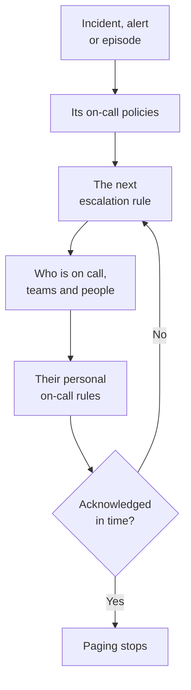

# On-Call Overview

On-call is how OneUptime gets a person onto a problem, at any hour. When an incident, an alert or an episode needs someone, its on-call policies page people level by level until somebody acknowledges, and each person is reached the way they chose: a push notification, a text, a call, an email or a chat message. This page shows how the pieces fit together and where each one lives.

:::cards
- [How a page reaches someone](#how-a-page-reaches-someone): From a new incident to the person who answers.
- [The building blocks](#the-building-blocks): Policies, escalation rules, schedules, overrides and personal rules.
- [Set up on-call](#set-up-on-call): From nothing to a team that is paged, in five steps.
- [Where on-call lives](#where-on-call-lives): The On-Call Duty menu, section by section.
:::

## How a page reaches someone

1. A new incident, alert or episode runs its on-call policies at once: the ones picked on it, and the ones its on-call rules add. Each policy runs on its own. An on-call rule set to **Only during working hours** makes the policies it adds wait until those hours begin.
2. A policy's first escalation rule pages straight away: whoever is on call in its schedules right now, every member of its teams, and the people it names.
3. If one of them is away, a user override sends their page to the person who covers for them, or skips them.
4. Each person is reached through their personal on-call rules: which of their methods is tried, and after how long. A page with no rule still reaches them on the methods they verified.
5. If nobody acknowledges before the rule's wait runs out, the next rule pages. After the last one, the policy starts again if it repeats, and otherwise stops.

Acknowledging or resolving the incident, alert or episode stops every policy that is still paging for it. OneUptime moves running policies on every minute, and records each run, rule by rule, in **Execution Logs**.

The first time a page reaches someone, OneUptime records it on the incident, alert or episode as `First Paged At`. A measurement can count from it: **Time to acknowledge after paging** times how long people took to answer once they were paged, not how long the record waited before anyone was. See [Time to acknowledge after paging](/docs/incidents/settings#time-to-acknowledge-after-paging).

> [!NOTE]
> An incident, alert or episode that is created already acknowledged or resolved runs none of its policies, and its feed says so. See [Created already acknowledged or resolved](/docs/alerts/index#created-already-acknowledged-or-resolved).

## The building blocks

| Piece | What it decides | Read more |
| --- | --- | --- |
| On-call policy | Who is paged about an incident or alert, level by level | [On-Call Policies](/docs/on-call/policies) |
| Escalation rule | One level of a policy: who it pages, and how long it waits for an acknowledgement | [Escalation Rules](/docs/on-call/escalation-rules) |
| On-call schedule | Who is on call at any moment, as people take turns | [On-Call Schedules](/docs/on-call/schedules) |
| User override | Who covers for someone while they are away | [User Overrides](/docs/on-call/user-overrides) |
| Personal on-call rules | How one person is reached: which method, and after how long | [Personal On-Call Rules](/docs/notifications/on-call-rules) |
| Incoming call policy | A phone number that rings whoever is on call | [Incoming Call Policy](/docs/on-call/incoming-call-policy) |

Policies, escalation rules, schedules and overrides belong to the project, under **On-Call Duty**. Notification methods and personal on-call rules belong to each person, under **User Settings**: an admin can look at someone's setup, but only that person can verify their phone or email. See [How OneUptime Reaches You](/docs/notifications/index).

## Set up on-call

:::steps
### Build a schedule

Open **On-Call Duty** from the **Products** menu and go to **On-Call Schedules**. Click **Create On-Call Schedule**, name it, and under **Who takes turns?** pick the people in the order they take turns. See [On-Call Schedules](/docs/on-call/schedules).

### Create a policy

Go to **On-Call Policies** and click **Create On-Call Policy**. Under **Who gets paged first?**, pick the schedule. It becomes the policy's first escalation rule, **Level 1**, which waits 30 minutes for an acknowledgement.

### Add the next levels

On the policy's **Escalation Rules** page, click **Add Escalation Rule** for each level after the first: the next person in the same schedule's rotation, a team lead, a manager. See [Escalation Rules](/docs/on-call/escalation-rules).

### Run the policy automatically

A project's first policy can do this as it is created: leave **Page it for every new incident and alert** on. For any other policy, go to **Incidents → Rules → On-Call Rules** or **Alerts → Rules → On-Call Rules**, and add a rule that runs it for the incidents or alerts it matches, such as every critical one. See [What runs a policy](/docs/on-call/policies#what-runs-a-policy).

### Check that everyone can be reached

Open **On-Call Duty → Readiness**. Everyone your policies can page is listed as **Ready**, **Needs setup** or **Unreachable**, with what is missing. See [Readiness & Reports](/docs/on-call/readiness).
:::

> [!NOTE]
> On OneUptime Cloud, on-call policies and escalation rules are on every plan. On-call schedules, user overrides, execution logs and the on-call time report need the **Growth** plan.

## Where on-call lives

Open **On-Call Duty** from the **Products** menu in the top bar. It opens on **On-Call Policies**, at `/dashboard/{projectId}/on-call-duty/policies`, and its side menu holds the rest:

| Section | Pages |
| --- | --- |
| **Policies** | **On-Call Policies**, and **Readiness**: who your policies can actually reach |
| **Schedules** | **On-Call Schedules**, **Schedule Timeline** and **Calendar Feeds** |
| **Incoming Calls** | **Incoming Call Policies**: a phone number that rings whoever is on call |
| **Advanced** | **User Overrides**, **Execution Logs** and **Archived Policies** |
| **Reports** | **User On Call Time**: how long each person was on call |
| **Workspace** | **Slack** and **Microsoft Teams**: rules that post on-call events to a channel |
| **Settings** | **Custom Fields**, **Label Rules** and **Owner Rules** |
| **Developer** | **Terraform**, **API** and **AI Assistants**: on-call set up from code |

**Policies**, **Schedules** and **Incoming Calls** are open; the other sections start folded, and a section opens by itself when you are on one of its pages. **Workspace** lists the chat tools the project has connected, or **Connect Slack or Teams** when it has none.

When you are on duty for a policy, the bell at the top right says so. Click it to open **My On-Call Policies**: every policy you are on call for, in all your projects, and whether you are named on it, in a team or on a schedule.

## Troubleshooting

:::details Nobody was paged for a new incident
Open the incident's **On-Call Executions** page. Empty means the incident had no on-call policy: none was picked on it, and no on-call rule matched it. A run with **Execution Completed - No One Notified** went through every escalation rule and found nobody: usually a schedule with nobody on call. See [Execution logs](/docs/on-call/policies#execution-logs). A run that is **Waiting** is waiting for working hours, for an on-call rule set to **Only during working hours**, and pages nobody until they begin.
:::

:::details Someone was paged on the wrong channel, or not at all
Open **On-Call Duty → Readiness** and click **Coverage** on their row. It shows the methods they verified and every severity they have no rule for. Only they can fix it, under **User Settings**: send them a setup reminder from the same page. See [Readiness & Reports](/docs/on-call/readiness). On OneUptime Cloud, a phone that blocks unknown callers can silence a page: add [OneUptime's numbers](/docs/on-call/phone-number-whitelist) to its allow list.
:::

:::details A person on holiday is still being paged
Add a user override with them under **Who is away?**. One under **On-Call Duty → Advanced → User Overrides** covers every policy; one on a policy's own **User Overrides** page covers that policy only. See [User Overrides](/docs/on-call/user-overrides).
:::

## Next steps

:::cards
- [On-Call Policies](/docs/on-call/policies): Create a policy, decide what runs it, and read what it did.
- [Escalation Rules](/docs/on-call/escalation-rules): Page people level by level until someone responds.
- [On-Call Schedules](/docs/on-call/schedules): Rotations, layers and hand-offs.
- [How OneUptime Reaches You](/docs/notifications/index): The methods and rules that decide how each person is reached.
:::
