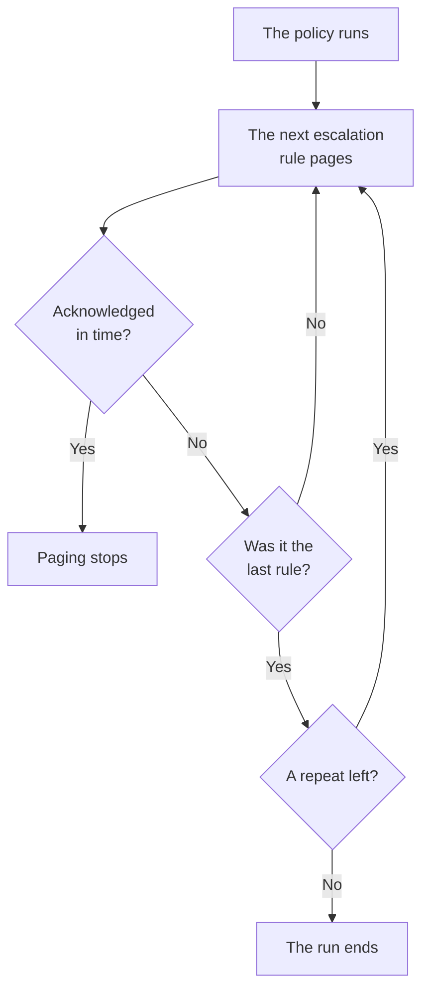

# On-Call Policies

An on-call policy decides who is paged about an incident or alert, and who is next if nobody acknowledges. Its escalation rules are its levels, and the incidents, alerts and episodes that use it run it. This page covers creating a policy, what runs it, what its pages show, and how each run is recorded.

:::cards
- [Create a policy](#create-a-policy): A name, and who gets paged first.
- [What runs a policy](#what-runs-a-policy): Rules, templates, monitors, chat and you.
- [Execution logs](#execution-logs): Every run, rule by rule, and why it stopped.
- [Archive or delete a policy](#archive-or-delete-a-policy): Take a policy out of service.
:::

## Create a policy

:::steps
1. Go to **On-Call Duty → On-Call Policies** and click **Create On-Call Policy**.
2. Enter a **Name**, such as "Payments primary".
3. Under **Who gets paged first?**, click **Add responder** and pick the on-call schedules, teams and people to page first.
4. Click **Create On-Call Policy**. The policy opens on its **Escalation Rules** page, with **Level 1** in place.
:::

**Who gets paged first?** is optional, and asked only of people who may add escalation rules: left empty, the policy pages nobody until it has a rule. **Description** and **Labels** wait under **More fields**. To add the next levels, see [Escalation Rules](/docs/on-call/escalation-rules).

A project's first policy is also asked **Page this policy for every new incident and alert**, which starts on. It adds a rule under **Incidents → Rules → On-Call Rules** and one under **Alerts → Rules → On-Call Rules**, each matching everything and running this policy. It is asked of people who may add on-call rules, while the project has no on-call policy and no on-call rule.

The **On-Call Duty Policies** list shows each policy's **Name**, **Description**, **Labels** and **Owners**. Select policies to **Add Labels**, **Remove Labels**, **Add Owner**, **Remove Owner**, **Archive**, **Export JSON** or delete them. **Import JSON** creates policies from an export: an export holds a policy's own settings, not its escalation rules or owners.

## What runs a policy

A policy pages nobody until something runs it. Every incident, alert and episode runs the policies it has as soon as it is created:

| What | How it adds the policy | Read more |
| --- | --- | --- |
| The record itself | The **On-Call Policy** field when an incident or alert is created, an incident template, or the **On-Call** fold of a monitor's criteria | [Declaring an Incident](/docs/incidents/declaring-incidents) |
| On-call rules | **Incidents → Rules → On-Call Rules** and **Alerts → Rules → On-Call Rules** add the policies of every rule that matches | [Incident on-call rules](/docs/incidents/settings#incident-on-call-rules) |
| Grouping rules | A grouping rule runs its policies when it opens an episode | [Alert Episodes & Grouping Rules](/docs/alerts/episodes) |
| By hand | **Execute On-Call Policy**, in the **Actions** menu of a feed, or on a Slack or Microsoft Teams message | [The incident feed](/docs/incidents/notes-owners-and-feed#the-incident-feed) |
| Chat and workflows | `/oneuptime page` in Slack or Microsoft Teams, and a workflow's **Page an On-Call Policy** step | [Paging](/docs/workflows/components#paging) |

A policy that several rules add runs once. A severity never runs a policy on its own: an on-call rule that matches the severity does. An incident or alert created already acknowledged or resolved runs none of its policies. An on-call rule set to **Only during working hours** makes the policies it adds wait until those hours begin.

## A policy's pages

Open a policy from the list. Its side menu holds everything about it:

| Section | Pages |
| --- | --- |
| **Basic** | **Overview**, **Escalation Rules** and **Owners** |
| **Logs** | **Execution Logs** and **Notification Logs** |
| **Developer** | **Terraform**, **API** and **AI Assistants** |
| **Advanced** | **User Overrides**, **Custom Fields**, **Settings**, **Audit Logs** and **Delete Policy** |

**Basic** is open; the other sections start folded until you click them.

- **Overview** shows the **On-Call Policy Details**, then **Policy at a glance**: how many levels and responders the policy has, how long until its last level, and how often it repeats. **Responder readiness** says whether everyone it can page can be reached now, and **On-Call Policy Feed** lists what changed: people, teams and schedules added or removed, overrides and hand-offs.
- **Owners** are the people and teams responsible for the policy. When a page it sends finds no rule for someone, or cannot be delivered, they are emailed; a policy with no owners emails the project's owners instead.
- **Notification Logs** lists every message the policy sent, with a tab per channel.
- **User Overrides** covers people on this policy only. See [User Overrides](/docs/on-call/user-overrides).
- **Settings** has **Export On-Call Policy** and the card that archives the policy.

## Repeat a policy

When the last level's wait runs out with nobody acknowledging, a policy stops, unless it repeats. To choose, open the policy's **Escalation Rules** page and click **Edit** on the **Repeat Policy** card below the rules. **Edit Repeat Policy** asks **If nobody acknowledges after the last level**:

| Answer | What it does |
| --- | --- |
| **Stop paging** | Nobody is paged again, so the policy runs once. A new policy starts with this answer. |
| **Start again from Level 1** | Every level is paged again, in order. **How many more times?** says how often: 1 or more. |

A policy that starts again three more times goes through its levels four times in all. The card's **After the last level** row says what the policy does, and **Policy at a glance** on the **Overview** says the same in words.

## Page again if it is not resolved

Acknowledging stops a policy's paging for good, even when nobody resolves the incident or alert afterwards. A policy can page again instead: open its **Escalation Rules** page, open **More settings** at the bottom, and click **Edit** on the **Acknowledgement Timeout** card. **Edit Acknowledgement Timeout** asks **If it is acknowledged but not resolved**:

| Answer | What it does |
| --- | --- |
| **Don't page again** | Acknowledging stops the paging for good. A new policy starts with this answer. |
| **Page again** | Pages whoever acknowledged it, and whoever is on call now. **After how many minutes?** says when: from 5 to 1440, 30 to start with. |

The minutes are counted from each acknowledgement, and a policy pages again at most 5 times about one incident, alert or episode. A page again starts at the level that was paging when it was acknowledged, pages whoever is on call there now, and goes on through the levels as the first run did. The incident or alert stays acknowledged: the page again is a run of its own, in its feed and in the policy's execution logs, where its **Status** says "Paged again (1 of 5)".

Whoever is paged again acknowledges it from its message, or with **Acknowledge again** on the incident's or alert's page, and the minutes start again; **Escalate** passes it to the next level. Resolving or deleting the incident or alert, archiving or deleting the policy, or choosing **Don't page again** stops it. The card's **After an acknowledgement** row says what the policy does, and **More settings** shows the minutes while it is folded. **Policy at a glance** on the **Overview** and the **Escalation summary** say the same in words.

## Execution logs

Every time a policy runs, it writes an execution log, and the log moves through its statuses as the run goes on:

| Status | What it means |
| --- | --- |
| **Waiting** | An on-call rule set to **Only during working hours** makes the run wait until those hours begin: it says when paging starts, and pages nobody until then. It ends without paging if the incident or alert is acknowledged or resolved first. It starts paging at once if the incident or alert changes and now matches an on-call rule that pages right away. |
| **Scheduled**, **Started** | The run is being set up. One still here after 5 minutes is stopped as **Error**. |
| **Executing** | The run is paging. OneUptime moves it on every minute. |
| **Execution Completed** | Someone acknowledged, the incident or alert was resolved, every rule and repeat was used, or the policy was archived. |
| **Execution Completed - No One Notified** | The run went through every rule and paged nobody: usually a schedule with nobody on call. |
| **Error** | The run failed. **View Status Message** says why. |

You find execution logs in three places:

- the policy's own **Execution Logs**, under **Logs**;
- **On-Call Duty → Advanced → Execution Logs**, for every policy, with direct pages from workflows and chat listed as **Direct page**;
- the **On-Call Executions** page of an incident or an alert.

Each row shows what triggered the run, when, its **Status** and who acknowledged it. **View Timeline** opens its **Execution Timeline**: each escalation rule, who it paged, through which schedule, and how each page ended. A schedule with nobody on call shows **No one was on call** instead of a person. On OneUptime Cloud, execution logs need the **Growth** plan.

## Archive or delete a policy

Archiving takes a policy out of service and keeps everything: open the policy's **Settings** and click **Archive** on its archive card, or select policies in the list and choose **Archive**.

- An archived policy pages no one. Incidents and alerts that use it skip it, and a run that is still escalating stops at its next step.
- It leaves the **On-Call Policies** list for **On-Call Duty → Advanced → Archived Policies**, where **Unarchive** puts it back in service.

**Delete Policy**, under **Advanced**, deletes the policy with its escalation rules and user overrides. The list's delete asks first, and suggests archiving instead.

## Who can change a policy

**Project Owner**, **Project Admin**, **Project Member**, **On-Call Admin** and **On-Call Member** can create, change and delete policies; **Viewer** and **On-Call Viewer** can read them. In a custom role, the permissions are **Create On-Call Duty Policy**, **Edit On-Call Duty Policy**, **Delete On-Call Duty Policy** and **Read On-Call Duty Policy**, and a role limited to some labels reaches only the policies carrying them. Adding owners and custom fields needs the **Growth** plan on OneUptime Cloud.

## API and Terraform

On-call policies are the `/api/on-call-duty-policy` resource, and the `oneuptime_on_call_policy` resource in Terraform:

| Setting | API field |
| --- | --- |
| **Name** | `name` |
| **Description** | `description` |
| **If nobody acknowledges after the last level** | `repeatPolicyIfNoOneAcknowledges` |
| **How many more times?** | `repeatPolicyIfNoOneAcknowledgesNoOfTimes` |
| **After how many minutes?** | `acknowledgementTimeoutInMinutes` |
| Archived | `isArchived` |

`repeatPolicyIfNoOneAcknowledges` is `false` for **Stop paging** and `true` for **Start again from Level 1**. With it `true`, `repeatPolicyIfNoOneAcknowledgesNoOfTimes` must be a whole number of 1 or more: OneUptime refuses `0`. An older policy saved with `0` never repeats, and the dashboard shows it as **Stop paging**.

`acknowledgementTimeoutInMinutes` is `null` for **Don't page again**, and a whole number of minutes from 5 to 1440 for **Page again**. OneUptime refuses anything else.

To create a policy with its first level in one request, see [Creating rules with the API or Terraform](/docs/on-call/escalation-rules#creating-rules-with-the-api-or-terraform).

## Troubleshooting

:::details A policy ran, but nobody was paged
Its run says **Execution Completed - No One Notified**. Open **View Timeline**: a row reading **No one was on call** points at a schedule with a gap, and a **Skipped** row's status message says why, such as someone away with nobody to cover. **On-Call Duty → Readiness** shows who could not be reached.
:::

:::details The next level was paged a minute after its wait
OneUptime moves running policies on once a minute, so a level is paged at the first check after its wait runs out.
:::

:::details An incident lists a policy that paged nobody
The policy is archived: an archived policy stays on the incidents and alerts that use it, and pages nobody, and its execution log says it was not executed. Unarchive it under **On-Call Duty → Advanced → Archived Policies**.
:::

## Next steps

:::cards
- [Escalation Rules](/docs/on-call/escalation-rules): Add the levels a policy pages, and how long each one waits.
- [User Overrides](/docs/on-call/user-overrides): Send someone's pages to a teammate while they are away.
- [Readiness & Reports](/docs/on-call/readiness): Check that everyone a policy pages can be reached.
:::
