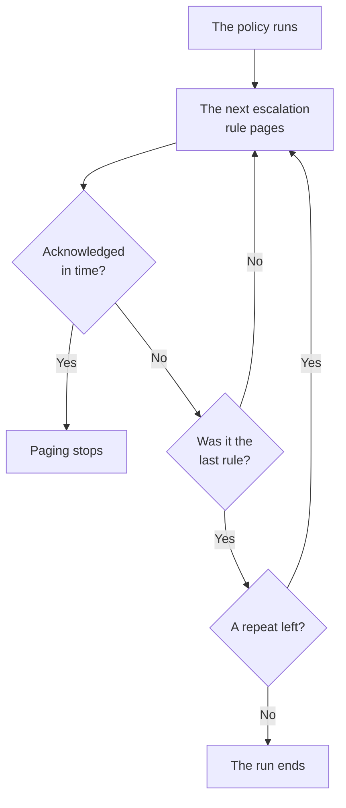

# On-Call Policies

An on-call policy decides who is paged about an incident or alert, and who is next if nobody acknowledges. Its escalation rules are its levels, and the incidents, alerts and episodes that use it run it. This page covers creating a policy, what runs it, what its pages show, and how each run is recorded.

:::cards
- [Create a policy](#create-a-policy): A name, and who gets paged first.
- [What runs a policy](#what-runs-a-policy): Rules, templates, monitors, chat and you.
- [Execution logs](#execution-logs): Every run, rule by rule, and why it stopped.
- [Archive or delete a policy](#archive-or-delete-a-policy): Take a policy out of service.
:::

## Create a policy

:::steps
1. Go to **On-Call → On-Call Policies** and click **Create On-Call Policy**.
2. Enter a **Name**, such as "Payments primary".
3. Under **Who gets paged first?**, click **Add responder** and pick the on-call schedules, teams and people to page first.
4. Click **Create On-Call Policy**. The policy opens on its **Escalation Rules** page, with **Level 1** in place.
:::

**Who gets paged first?** is optional, and asked only of people who may add escalation rules: left empty, the policy pages nobody until it has a rule. **Description** and **Labels** wait under **More fields**. To add the next levels, see [Escalation Rules](/docs/on-call/escalation-rules).

The form also asks **Page this policy for every new incident and alert**, of people who may add on-call rules. It adds a rule under **Incidents → Rules → On-Call Rules** and one under **Alerts → Rules → On-Call Rules**, each matching everything and running this policy. It starts on for a project's first policy, while the project has no on-call policy and no on-call rule, and off for any later one: paging two policies for every new incident and alert is a choice to make. Left off, a policy pages nobody until a rule, a monitor or a person runs it.

To be walked through paging instead, from your phone to a test page, click **Guided setup**: on the empty **On-Call Policies** list, or under **How it works**. See [Get Paged by Phone, SMS or Push](/docs/guides/paging).

The **On-Call Policies** list shows each policy's **Name**, **Description**, **Labels** and **Owners**. Select policies to **Add Labels**, **Remove Labels**, **Add Owner**, **Remove Owner**, **Archive**, **Export JSON** or delete them. **Import JSON** creates policies from an export: an export holds a policy's own settings, not its escalation rules or owners.

## What runs a policy

A policy pages nobody until something runs it. Every incident, alert and episode runs the policies it has as soon as it is created:

| What | How it adds the policy | Read more |
| --- | --- | --- |
| The record itself | The **On-Call Policy** field when an incident or alert is created, an incident template, or the **On-Call** fold of a monitor's criteria | [Declaring an Incident](/docs/incidents/declaring-incidents) |
| On-call rules | **Incidents → Rules → On-Call Rules** and **Alerts → Rules → On-Call Rules** add the policies of every rule that matches | [Incident on-call rules](/docs/incidents/settings#incident-on-call-rules) |
| Grouping rules | A grouping rule runs its policies when it opens an episode | [Alert Episodes & Grouping Rules](/docs/alerts/episodes) |
| By hand | **Execute On-Call Policy**, in the **Actions** menu of a feed, or on a Slack or Microsoft Teams message | [The incident feed](/docs/incidents/notes-owners-and-feed#the-incident-feed) |
| Chat and workflows | `/oneuptime page` in Slack or Microsoft Teams, and a workflow's **Page an On-Call Policy** step | [Paging](/docs/workflows/components#paging) |

A policy that several rules add runs once. A severity never runs a policy on its own: an on-call rule that matches the severity does. An incident or alert created already acknowledged or resolved runs none of its policies. An on-call rule set to **Only during working hours** makes the policies it adds wait until those hours begin.

## A policy's pages

Open a policy from the list. Its side menu holds everything about it:

| Section | Pages |
| --- | --- |
| **Basic** | **Overview**, **Escalation Rules** and **Owners** |
| **Logs** | **Execution Logs** and **Notification Logs** |
| **Developer** | **Terraform**, **API**, **CLI** and **AI Assistants** |
| **Advanced** | **User Overrides**, **Custom Fields**, **Settings**, **Audit Logs** and **Delete Policy** |

**Basic** is open; the other sections start folded until you click them.

- **Overview** shows the **On-Call Policy Details**, then **Policy at a glance**: how many levels and responders the policy has, how long until its last level, and how often it repeats. **Responder readiness** says whether everyone it can page can be reached now, and **On-Call Policy Feed** lists what changed: people, teams and schedules added or removed, overrides and hand-offs. Its Slack, Microsoft Teams and Mattermost rules post them to your channels, a hand-off in one line: see [On-call messages](/docs/workspace-connections/slack#on-call-messages).
- **Owners** are the people and teams responsible for the policy. When a page it sends finds no rule for someone, or cannot be delivered, they are emailed; a policy with no owners emails the Project Owners instead.
- **Notification Logs** lists every message the policy sent, with a tab per channel.
- **User Overrides** covers people on this policy only. See [User Overrides](/docs/on-call/user-overrides).
- **Settings** has **Export On-Call Policy** and the card that archives the policy.

**What runs this policy**, on the **Overview**, lists the on-call rules, the monitors whose criteria page the policy, the templates and other rules that page it, and the workflows that do, each with a link. A rule that is switched off says **Off**. When nothing runs the policy, the card says so: it pages nobody until something does. Deleting or archiving the policy says the same first. What you may not open is counted, not named.

## Repeat a policy

When the last level's wait runs out with nobody acknowledging, a policy stops, unless it repeats. To choose, open the policy's **Escalation Rules** page and click **Edit** on the **Repeat Policy** card below the rules. **Edit Repeat Policy** asks **If nobody acknowledges after the last level**:

| Answer | What it does |
| --- | --- |
| **Stop paging** | Nobody is paged again, so the policy runs once. A new policy starts with this answer. |
| **Start again from Level 1** | Every level is paged again, in order. **How many more times?** says how often: 1 or more. |

A policy that starts again three more times goes through its levels four times in all. A pass in which no level had anybody to page is not repeated: another would page nobody either, so the policy stops. The card's **After the last level** row says what the policy does, and **Policy at a glance** on the **Overview** says the same in words.

## Page again if it is not resolved

Acknowledging stops a policy's paging for good, even when nobody resolves the incident or alert afterwards. A policy can page again instead: open its **Escalation Rules** page, open **More settings** at the bottom, and click **Edit** on the **Acknowledgement Timeout** card. **Edit Acknowledgement Timeout** asks **If it is acknowledged but not resolved**:

| Answer | What it does |
| --- | --- |
| **Don't page again** | Acknowledging stops the paging for good. A new policy starts with this answer. |
| **Page again** | Pages whoever acknowledged it, and whoever is on call now. **After how many minutes?** says when: from 5 to 1440, 30 to start with. |

The minutes are counted from each acknowledgement, and a policy pages again at most 5 times about one incident, alert or episode. A page again starts at the level that was paging when it was acknowledged, pages whoever is on call there now, and goes on through the levels as the first run did. The incident or alert stays acknowledged: the page again is a run of its own, in its feed and in the policy's execution logs, where its **Status** says "Paged again (1 of 5)".

Whoever is paged again acknowledges it from its message, or with **Acknowledge again** on the incident's or alert's page, and the minutes start again; **Escalate** passes it to the next level. Resolving or deleting the incident or alert, archiving or deleting the policy, or choosing **Don't page again** stops it. The card's **After an acknowledgement** row says what the policy does, and **More settings** shows the minutes while it is folded. **Policy at a glance** on the **Overview** and the **Escalation summary** say the same in words.

## When several policies page

An incident, alert or episode runs each of its policies on its own, at the same time.

- Someone on call in two of them is paged once. When a policy's level reaches someone another policy is already paging about it, it does not page them again: its execution log shows them as **Already Paged**, and the incident's feed and the policy's Slack and Microsoft Teams message name the policy that is paging them. The level still waits its minutes before the next level, as it does for anybody it paged. Answering that one page answers it for both policies. Within one policy, someone a level names twice, in person and through a team or a schedule, is paged once.
- A page sent to people directly counts too. When a policy's level reaches someone a page from Slack or Microsoft Teams, or a workflow's paging block, is paging about it already, it does not page them again: its execution log names who sent that page, or the workflow. A workflow's paging block does not page again someone a policy or another page is paging already, either.
- Acknowledging the incident or alert stops every policy running for it within a minute, wherever it is acknowledged: from any page about it, on its own page, in the mobile app, or in Slack or Microsoft Teams. No next level is paged, and no call or text still waiting to go out is sent. Notifications already sent stay sent.

Nobody misses a page for being paged once. Their page can end without their answer: they escalate it from one of its messages, which escalates that page only, it cannot be sent, or it stops. Then the other policy, or the workflow's block, pages them itself within a minute, without sending again what reached them. **Escalate** on the incident's page or in the mobile app escalates both. A page again, a policy started by hand and a page someone sent from Slack or Microsoft Teams always page their people themselves, even someone another policy is paging. An observer's page and a responder's page are never merged.

Some pages go on after it is acknowledged, until somebody they paged answers or it is resolved: a page again, a page to observers, a page someone sent to people from Slack or Microsoft Teams, and a policy started by hand.

A policy started by hand is one started with **Execute On-Call Policy**, or by a page from Slack or Microsoft Teams that names it. It pages level by level as any run does, calls and repeated pushes included, and somebody else acknowledging the incident does not stop it: that is how you page another team into an incident somebody is already on. Whoever it paged answers from their page's message, a call or a text, or by acknowledging the incident themselves; once the incident is acknowledged, its page offers them **Acknowledge again**. **Escalate** passes it to the next level. On an incident, alert or episode that is resolved, nothing is started, and you are told why: the dashboard turns **Execute On-Call Policy** off and shows the reason. Its notifications say who started which policy, and carry the message sent with a page from Slack or Microsoft Teams.

## Test a policy

**Test this policy**, on a policy's escalation rules, pages its first level as a test, with no incident behind it: every message says TEST, and no status page, subscriber or channel is told. Turn on **Walk every escalation level** to page each level in turn, at most 2 minutes apart, until someone acknowledges it. Before anything is sent, the dialog lists who the test pages and how, and what it costs on OneUptime Cloud.

**Send test page** stays off while the test would reach nobody: everybody it pages has opted out of the severity, has no rule for it and nothing to fall back to, or has only methods that are not verified or are switched off in the project. One line under the list says why. When only a later level can be reached, the line offers **Walk every escalation level** in one click.

Whoever is paged acknowledges the test from any of its messages: an email's, a text's or a chat message's link, a call's 1, or its push notification in the OneUptime On-Call app, in versions newer than 1.6.0. A policy can be tested once every 5 minutes, and a project sends at most 20 tests an hour.

### Run a fire drill on a monitor

**Run Fire Drill**, on a monitor's **When this goes down** card, rehearses one of the monitor's failures: an incident or alert one of its criteria opens, or the incident an alert incident rule declares from such an alert. It tests every on-call policy that failure would page, each as **Test this policy** tests it, and nothing public happens: no incident or alert is created, and no status page, subscriber or channel is told. Before anything is sent, the dialog names the failure, each policy and who that policy pages now. For a declared incident, it names the rule too, and how long the alert stays open first: the drill tests the incident's policies at once, without that wait.

A drill pages each policy's first level. Under **More fields**, turn on **Walk every escalation level** to page each policy's levels in turn, at most 2 minutes apart, until someone acknowledges it: the dialog then lists every level each policy reaches, and what the walk costs at most. When nobody on the first levels can be reached but a later level can, the line under the list offers **Walk every escalation level** in one click.

**Start Fire Drill** stays off while one of those policies is one you can't test, because you can't edit it, or while nobody they page can be reached. Each policy of a drill counts as a test of its own: a policy tested in the last 5 minutes stops the whole drill, and a drill of three policies takes three of the project's 20 tests an hour.

Once the dialog is closed, **Last fire drill** on the card says which failure the monitor's last drill rehearsed, when it was started and by whom, and how many of its tests were acknowledged. **Show details** lists each policy's test: whether it was acknowledged, by whom, by what and how fast. Each test stays in its policy's execution logs, marked as a fire drill of the monitor. A drill's results show to whoever can read the monitor and every one of those execution logs.

## Execution logs

Every time a policy runs, it writes an execution log, and the log moves through its statuses as the run goes on:

| Status | What it means |
| --- | --- |
| **Waiting** | An on-call rule set to **Only during working hours** makes the run wait until those hours begin: it says when paging starts, and pages nobody until then. It ends without paging if the incident or alert is acknowledged or resolved first. It starts paging at once if the incident or alert changes and now matches an on-call rule that pages right away. |
| **Scheduled**, **Started** | The run is being set up. One still here after 5 minutes did not finish starting: it moves on to **Executing** and pages from where its start stopped. A direct page or a test page still here is stopped as **Error**. |
| **Executing** | The run is paging. OneUptime moves it on every minute. A step that fails for a moment, because the database could not be reached for example, is tried again a minute later, then 2 and 4 minutes later, then every 5 minutes. |
| **Execution Completed** | Someone acknowledged, the incident or alert was resolved, every rule and repeat was used, or the policy was archived. |
| **Execution Completed - No One Notified** | The run went through every rule and paged nobody: usually a schedule with nobody on call, or a level with no responders. |
| **Error** | The run failed: a step failed in a way a retry cannot fix, such as an escalation rule that was deleted, or failed 10 tries in a row, over about 37 minutes. **View Status Message** says why. |

You find execution logs in three places:

- the policy's own **Execution Logs**, under **Logs**;
- **On-Call → Advanced → Execution Logs**, for every policy, with direct pages from workflows and chat listed as **Direct page**;
- the **On-Call Executions** page of an incident or an alert.

Each row shows what triggered the run, when, its **Status** and who acknowledged it. **View Timeline** opens its **Execution Timeline**: each escalation rule, who it paged, through which schedule, and how each page ended. **Notified Via** shows how each page reached its person: phone call, SMS, email, push notification and so on. A schedule with nobody on call shows **No one was on call** instead of a person. A level that paged nobody says why, with **Moved on at once** under it: the policy did not wait for it. Someone another policy, or a page sent to them directly, was paging already shows **Already Paged**: see [When several policies page](#when-several-policies-page). On OneUptime Cloud, execution logs need the **Growth** plan.

## Archive or delete a policy

Archiving takes a policy out of service and keeps everything: open the policy's **Settings** and click **Archive** on its archive card, or select policies in the list and choose **Archive**.

- An archived policy pages no one. Incidents and alerts that use it skip it, and a run that is still escalating stops at its next step.
- It leaves the **On-Call Policies** list for **On-Call → Advanced → Archived Policies**, where **Unarchive** puts it back in service.

**Delete Policy**, under **Advanced**, deletes the policy with its escalation rules and user overrides. The list's delete asks first, and suggests archiving instead.

## Who can change a policy

**Project Owner**, **Project Admin**, **Project Member**, **On-Call Admin** and **On-Call Member** can create, change and delete policies; **Viewer** and **On-Call Viewer** can read them. In a custom role, the permissions are **Create On-Call Policy**, **Edit On-Call Policy**, **Delete On-Call Policy** and **Read On-Call Policy**, and a role limited to some labels reaches only the policies carrying them. Adding owners and custom fields needs the **Growth** plan on OneUptime Cloud.

## API and Terraform

On-call policies are the `/api/on-call-duty-policy` resource, and the `oneuptime_on_call_policy` resource in Terraform:

| Setting | API field |
| --- | --- |
| **Name** | `name` |
| **Description** | `description` |
| **If nobody acknowledges after the last level** | `repeatPolicyIfNoOneAcknowledges` |
| **How many more times?** | `repeatPolicyIfNoOneAcknowledgesNoOfTimes` |
| **After how many minutes?** | `acknowledgementTimeoutInMinutes` |
| Archived | `isArchived` |

`repeatPolicyIfNoOneAcknowledges` is `false` for **Stop paging** and `true` for **Start again from Level 1**. With it `true`, `repeatPolicyIfNoOneAcknowledgesNoOfTimes` must be a whole number of 1 or more: OneUptime refuses `0`. An older policy saved with `0` never repeats, and the dashboard shows it as **Stop paging**.

`acknowledgementTimeoutInMinutes` is `null` for **Don't page again**, and a whole number of minutes from 5 to 1440 for **Page again**. OneUptime refuses anything else.

To create a policy with its first level in one request, see [Creating rules with the API or Terraform](/docs/on-call/escalation-rules#creating-rules-with-the-api-or-terraform).

## Troubleshooting

:::details A policy ran, but nobody was paged
Its run says **Execution Completed - No One Notified**. Open **View Timeline**: a row reading **No one was on call** points at a schedule with a gap, and a **Skipped** row's status message says why, such as someone away with nobody to cover. **On-Call → Readiness** shows who could not be reached.
:::

:::details The next level was paged a minute after its wait
OneUptime moves running policies on once a minute, so a level is paged at the first check after its wait runs out.
:::

:::details The next level was paged at once, without waiting
The level before it had nobody to page: no responders, nobody on call in its schedules, or nobody who could be reached. A level that pages nobody holds no wait, so the next level is paged as soon as the policy reaches it. **View Timeline** shows why that level paged nobody.
:::

:::details An incident lists a policy that paged nobody
The policy is archived: an archived policy stays on the incidents and alerts that use it, and pages nobody, and its execution log says it was not executed. Unarchive it under **On-Call → Advanced → Archived Policies**.
:::

:::details Someone was paged twice about one incident
Someone on call in two of the policies the incident runs is paged once, by the first policy to reach them, and so is someone a policy and a page from Slack, Microsoft Teams or a workflow both reach. The second pages them too when it is a page again, a policy started by hand, a page sent from Slack or Microsoft Teams or a page to observers, which page their people themselves, or when their first page was over before it reached them: they escalated it, or it had stopped. A person the second page did not page again shows **Already Paged** in its **View Timeline**.
:::

:::details A policy kept paging after the incident was acknowledged
It was started by hand, or it is a page again: it goes on until somebody it paged answers, or the incident is resolved. See [When several policies page](#when-several-policies-page).
:::

## Next steps

:::cards
- [Escalation Rules](/docs/on-call/escalation-rules): Add the levels a policy pages, and how long each one waits.
- [User Overrides](/docs/on-call/user-overrides): Send someone's pages to a teammate while they are away.
- [Readiness & Reports](/docs/on-call/readiness): Check that everyone a policy pages can be reached.
:::
