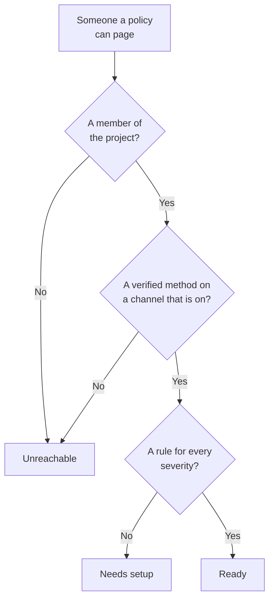

# Readiness & Reports

Readiness answers a question before an incident does: if something fired right now, would everyone your on-call policies page actually be reached? It lists every responder in the project, says who is ready and who is not, and lets you remind people to finish their setup. The **User On Call Time** report then shows how long each person was on call.

:::cards
- [How a status is worked out](#how-a-status-is-worked-out): Ready, Needs setup or Unreachable, and why.
- [The Readiness page](#the-readiness-page): Every responder in the project, in one list.
- [Remind people to finish their setup](#remind-people-to-finish-their-setup): An email that names what is missing.
- [User On Call Time](#user-on-call-time): How long each person was on call.
:::

## How a status is worked out

A responder is anyone an on-call policy can page: a person named on an escalation rule, a member of a team a rule pages, someone in a layer of a schedule a rule pages, and the person covering in a user override that has not ended. A schedule that no policy pages adds nobody.

| Status | What it means |
| --- | --- |
| **Ready** | They have a verified method on a channel the project has on, and a rule for every severity, on every tab of their on-call rules. |
| **Needs setup** | They can be reached, but some severities have no rule. The row counts these gaps. |
| **Unreachable** | Nothing reaches them: no verified method, every verified method is on a channel the project has turned off, or they are not a member of the project. |

A gap is a severity with no rule, on the incidents, incident episodes, alerts or alert episodes tab. A rule that turns a severity off on purpose is not a gap. A page that finds a gap still reaches the person on their verified methods, unless the project has turned that fallback off: see [When no rule matches](/docs/notifications/index#when-no-rule-matches).

## The Readiness page

Open **On-Call Duty → Readiness**. The **On-call readiness** card lists everyone any on-call policy in the project can reach, the people who need something first. Anyone in the project can open it.

Above the list, the tiles count **Responders**, **Ready**, **Needs setup** and **Unreachable**. Click **Ready**, **Needs setup** or **Unreachable** to list only those responders, and click it again to list everyone.

| Column | What it shows |
| --- | --- |
| **Responder** | The person, with their email address. |
| **Status** | **Ready**, **Unreachable**, or how many gaps they have. |
| **Channels** | A segment per channel: filled for a verified method, hollow for one that is not verified yet. |
| **Coverage** | How many severities have a rule, on every tab, out of all of them. |
| **Reached via** | How the policies reach them: each team that pages them through an escalation rule, by its name, or **Direct**, **Schedule** or **Override**. |

**Coverage** on a row shows the person's notification methods, why they have their status, and a grid of every severity with or without a rule. The funnel filters the list by **Responder**, **Status**, **Team** or **Reached via**. The answer can be a minute old: **Refresh** works it out again.

## Remind people to finish their setup

Only the person can add and verify their own notification methods and rules, so the fix is to ask them.

:::steps
1. On the Readiness page, tick the responders to remind. Ready responders cannot be ticked: there is nothing to remind them about.
2. Click **Send setup reminder**. The confirmation names everyone it is about to email.
3. Confirm. Each person gets one email naming what is missing from their own setup, with a link to the page that fixes it.
:::

A banner then says how many reminders were sent, skipped or failed, and why for each one that was not sent. Nobody is reminded more than once in 24 hours, and one go reminds at most 250 people. Sending reminders takes **Project Owner**, **Project Admin** or **On-Call Admin**, or **Edit On-Call Duty Policy** in a custom role.

## Readiness on other pages

- On a policy's **Overview**, **Responder readiness** lists everyone that policy can page who needs attention, and **Recheck** reads it again. Your own row has a button to the page that fixes it; someone else's opens an email to them in your own mail app, with the fix in it.
- On a policy's **Escalation Rules**, a level whose responders cannot all be paged says so on its card. See [The escalation summary](/docs/on-call/escalation-rules#the-escalation-summary).
- Under **Users**, open a member, then **Readiness** in the **On-Call** section: their status, their methods and their coverage grid.
- For your own setup, **User Settings → Setup Checklist** walks you through it. See [The setup checklist](/docs/notifications/index#the-setup-checklist).

## The weekly readiness email

Once a week, OneUptime checks every project that has an on-call policy. When anyone in it is **Unreachable** or **Needs setup**, the project's owners get one email that lists them in two groups, who cannot be paged at all and who can be reached with gaps, up to 20 names each, with a link to the Readiness page.

A week with everyone ready sends nothing, so the email always means something needs fixing. When someone cannot be paged at all, its subject starts with `[Action Required]`.

## User On Call Time

**On-Call Duty → Reports → User On Call Time** shows how long each person was on call, over a range you pick: **Past 1 Month** to start with.

| Column | What it shows |
| --- | --- |
| **User** | The person. |
| **Time user was on call** | Their time on call in the range, in hours and minutes. |

Time is recorded as people go on and off call: from when a schedule that a rule pages hands them a turn, or they are added to a rule directly or through a team, until the hand-off or until they are taken off. Time on call through two policies at once counts once, and time still going on counts up to now.

The **Schedule Timeline** and the calendar feeds show past shifts as the rotation is set up today. This report is written as it happens, so use it for fairness reviews and on-call pay.

> [!NOTE]
> On OneUptime Cloud, the report needs the **Growth** plan, and time that ended more than 200 days ago is deleted. A self-hosted installation keeps all of it.

## Troubleshooting

:::details Someone is Unreachable, but they have a verified phone number
Their methods may all be on channels the project has turned off: SMS, calls, WhatsApp and Telegram start off in a new project. See [Turn a channel on for your project](/docs/notifications/notification-methods#turn-a-channel-on-for-your-project).
:::

:::details Someone is missing from the list
The list holds only people an on-call policy can page. A team member who has not accepted their invitation, someone in a schedule that no policy pages, and a cover whose override has ended are left out.
:::

:::details The owners never get the weekly email
It is sent only in a week when someone is **Unreachable** or **Needs setup**, and only to the project's owners.
:::

## Next steps

:::cards
- [How OneUptime Reaches You](/docs/notifications/index): The methods, rules and fallback behind every status.
- [Notification Methods](/docs/notifications/notification-methods): Add and verify the ways OneUptime reaches someone.
- [Personal On-Call Rules](/docs/notifications/on-call-rules): Close the gaps, severity by severity.
:::
