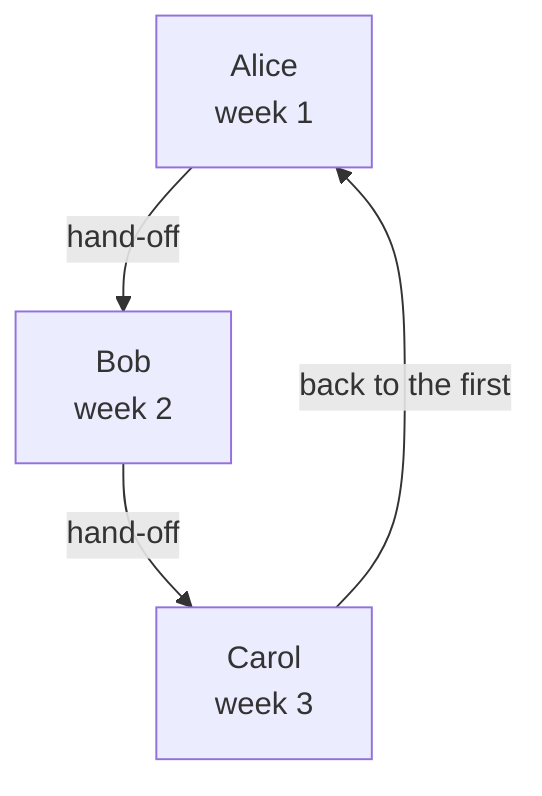

# On-Call Schedules

An on-call schedule decides who is on call at any moment. People take turns in it: each is on call for a while, then the next one takes over. Add a schedule to an on-call policy's escalation rules, and the policy pages whoever is on call in it when that level runs.

> [!NOTE]
> On OneUptime Cloud, on-call schedules are on the **Growth** plan and above. A schedule a project still has keeps paging the people on it, through the escalation rules that name it, after a Growth trial ends or the plan goes down. So below **Growth**, the **On-Call Schedules** page shows the plan note with the schedules still set up under it, where you can delete them. Creating or changing a schedule needs **Growth**.

:::cards
- [Who takes turns](#who-takes-turns): Create a schedule with its first rotation.
- [Layers](#layers): Stack rotations, limit on-call hours and add fall-back cover.
- [When someone is away](#when-someone-is-away): Skip someone in the rotation until they are back.
- [API and Terraform](#creating-schedules-with-the-api-or-terraform): Create schedules and their rotations as code.
:::

## Who takes turns

When you create a schedule on the **On-Call Schedules** page, the form asks for its **Name** and **Who takes turns?**. The people you pick become the schedule's first layer, **Layer 1**, on call around the clock.

:::steps
1. Go to **On-Call** > **On-Call Schedules** and click **Create On-Call Schedule**.
2. Enter a **Name**. A name another schedule of the project has is refused, whatever its case or spacing, so every picker tells the schedules apart.
3. Under **Who takes turns?**, click **Add user** and pick the people, in the order they take turns.
4. Optionally, open **More fields** to change how long each turn lasts, the time zone, the description or the labels.
5. Click **Create On-Call Schedule**. The new schedule then opens on its **Layers** page, where you can change the rotation or add more layers.
:::

The people take turns one at a time, and the first one is on call as soon as the schedule is created:



**Who takes turns?** is optional. Leave it empty and the schedule starts without layers: it puts nobody on call until you add a layer on its **Layers** page. The question is asked only of people who may add layers.

Everything else waits under **More fields**, folded until you open it:

| Field | What it does |
| --- | --- |
| **Each turn lasts** | **1 day**, **1 week**, **2 weeks** or **1 month**, and **1 week** unless you change it. It is asked once somebody takes turns. Each person is on call that long, then the next one takes over, at the time of day the schedule was created. |
| **Timezone** | The time zone hand-off times and on-call hours are kept in. It starts at yours. |
| **Description** | Notes about the schedule. |
| **Labels** | Labels for finding and grouping the schedule. |

While somebody takes turns and nothing under **More fields** is changed, its folded header says what will happen: each person is on call for a week, then the next one takes over.

## Layers

A schedule's rotation is made of layers, on its **Layers** page. Layers are read from the top down: the highest layer with someone on call is the one that pages, so put the main rotation on top and fall-back cover below it.

```mermaid title="The highest layer with someone on call is the one that pages"
flowchart TB
    start["A level pages the schedule"] --> first{"Someone on call<br/>in the top layer?"}
    first -->|Yes| pageTop["Page that person"]
    first -->|No| next{"Someone on call<br/>in the next layer?"}
    next -->|Yes| pageNext["Page that person"]
    next -->|No| gap["Nobody is paged<br/>a coverage gap"]
```

**Add Layer** adds a layer that starts the way the first one does: on call from now, each person for a week, around the clock. Expand a layer to add people to it, and to change when it starts, how often it hands off, when it first hands off and the hours it is on call:

| Field | What it sets |
| --- | --- |
| **Layer name** | What the layer covers, such as "Weekday primary". |
| **Rotation starts at** | The date and time the layer's rotation begins. |
| **Rotate every** | How often on-call duty passes to the next person in the layer. |
| **First hand-off time** | The first hand-off to the next person, at or after the start. Later hand-offs follow every rotation interval. |
| **Restrictions** | The hours the layer is on call: **No Restrictions**, **Specific Times of the Day** or **Specific Times of the Week**, in the schedule's time zone. Outside them, lower layers take over. |

To change which layer comes first, use the arrows on a layer's card: **Move layer up (higher priority)** or **Move layer down (lower priority)**.

Changes to who takes turns wait until you save them, so you can make several and check them before anyone's turn moves. Drag people into a new order, add or remove people, move a layer up or down, or delete one, and the page shows each change before it is saved:

- Someone you added is marked **New**, and someone you dragged to a new place **Moved**. The people you removed are listed under **Removed when you save**, each with **Undo**.
- A layer you delete says it will be deleted when you save, with **Undo**.
- Each layer, and the final schedule, show the rotation as it will be. The final schedule is marked **Includes unsaved changes**.
- A bar at the foot of the page names the changes, with **Save changes** and **Discard**.

**Save changes** saves every change at once. Who is on call is then worked out once, for the layers as saved: someone who goes on or off call, or is next, hears it once, not once for each change. **Discard** puts the layers back as they were last saved. Leaving the page before you save asks first: **Save Changes** saves and then leaves, **Keep Editing** stays on it, and **Discard Changes** leaves without saving.

If someone else changed the layers after you opened the page, your changes are not saved over theirs. The bar says so, and **Reload layers** shows the layers as they are now, for you to make your changes again. **Add Layer** adds its layer at once, and a layer's settings are saved with its own **Save Layer** button.

Each person keeps one colour everywhere, so you can follow them at a glance: on every layer, in the final schedule and its overrides, and on the **Schedule Timeline**.

## When someone is away

When someone goes on holiday, skip them until they are back. On the schedule's **Layers** page, expand a layer and click **Skip until…** beside their name. It opens the form for time away with them under **Who is away?**, **Next person in the rotation** under **Who covers?** and **Starts** at now: set **Ends** to when they are back, and save it. If they already have time away then, the form says so beside the times as you pick them, with **Edit that override** to change that one instead.

While they are away:

- Each of their turns goes to the next person in the layer who is not away, in every schedule they are in. Nobody else's turns move, and theirs are theirs again once they are back.
- If everyone in a layer is away, the layer has nobody on call and the layers below it take over. The layer says **Everyone in this layer is away right now**.
- Escalation rules that page them directly, or through a team, skip them. The policy's run says they are away, and until when.
- Their row in the layer says until when they are away, and the final schedule and the **Schedule Timeline** show who has each of their turns.

Pick someone under **Who covers?** instead, and that person gets all of their pages, from every schedule and every policy, rather than the rotation taking their turns.

Time away added this way applies to every on-call policy, so it takes the override permission over the whole project. If your team's role is limited to its own policies or to some labels, it goes instead on the policies of this schedule you may cover, one override on each, listed on each policy's own **User Overrides** page; with several, you tick them under **On-call policies**. **Skip until…** is locked and says why only where you may cover none of them. It is listed under **On-Call** > **Schedules** > **User Overrides**, and with the schedule's user overrides on its **Layers** page, where **End Now** brings them back early. To skip someone in one policy only, add the override on that policy's **User Overrides** page and leave **Who covers?** as it is. See [User Overrides](/docs/on-call/user-overrides).

With the API, a user override (`/api/on-call-duty-policy-user-override`) created without `routeAlertsToUserId` skips the person in `overrideUserId` from `startsAt` to `endsAt`.

A schedule's **Overview** has a **Used by** card: the on-call policies whose escalation rules page whoever is on call, with the rules that do. When none does, it says so and links to the on-call policies. Deleting the schedule, on its page or from the list, says first which policies page it. Policies you may not open are counted, not named. A schedule that has the same name as another schedule, from before names had to differ, is marked **Same name as another schedule** on the **On-Call Schedules** list, which says how many there are: compare their layers, then rename one with **Rename** on its row.

## Creating schedules with the API or Terraform

On-call schedules are the `/api/on-call-duty-policy-schedule` resource; their layers and the people in them are the `/api/on-call-duty-schedule-layer` and `/api/on-call-duty-schedule-layer-user` resources.

- Creating a schedule with `firstLayerUsers` (a list of user ids, in the order they take turns) in its `miscDataProps` gives it its first layer, as the dashboard does: **Layer 1**, on call from now, around the clock. `firstLayerRotation` says how long each turn lasts, as a rotation such as `{"_type": "Recurring", "value": {"intervalType": "Week", "intervalCount": 1}}`; without it, a week. Every user must be a member of the project and the caller must be allowed to create layers, or the schedule is not created.
- A schedule created without them has no layers, as before; Terraform's schedule resource does not send them.
- A layer created without a `rotation` hands off daily, as it always has.
- A change to a schedule's layers and the people in them, made through the API or Terraform, is told as one change: who is on call is worked out once the layers have had no change for half a minute, and someone who goes on or off call, or is next, hears it once, not once for each layer or person written. Pages go to whoever the layers put on call as soon as each change is saved.
- To change who takes turns in a schedule's layers all at once, as the **Layers** page's **Save changes** does, read the layers with `GET /api/on-call-duty-policy-schedule/<schedule-id>/layers` and send them back, changed, to `POST /api/on-call-duty-policy-schedule/<schedule-id>/save-layers`. They list every layer the schedule keeps, the highest priority first, each with its people in turn order: someone already in a layer by their `layerUserId`, someone added by `userId` alone. `deletedLayerIds` lists the layers to delete.
- A save is written all or nothing, and who is on call is worked out once, at once. One made after someone else changed the layers is refused with 409, as its `basedOnVersion` is no longer theirs: read the layers again and make the change to what is there now. Terraform's `oneuptime_on_call_schedule_layers` resource saves a schedule's layers this way.

```bash
curl -X POST https://oneuptime.com/api/on-call-duty-policy-schedule \
  -H "apikey: $ONEUPTIME_API_KEY" \
  -H "Content-Type: application/json" \
  -d '{
    "data": {
      "projectId": "<project-id>",
      "name": "Primary on-call",
      "timezone": "Europe/Berlin"
    },
    "miscDataProps": {
      "firstLayerUsers": ["<user-id-1>", "<user-id-2>", "<user-id-3>"],
      "firstLayerRotation": {"_type": "Recurring", "value": {"intervalType": "Week", "intervalCount": 1}}
    }
  }'
```

```bash
curl https://oneuptime.com/api/on-call-duty-policy-schedule/<schedule-id>/layers \
  -H "apikey: $ONEUPTIME_API_KEY"

curl -X POST https://oneuptime.com/api/on-call-duty-policy-schedule/<schedule-id>/save-layers \
  -H "apikey: $ONEUPTIME_API_KEY" \
  -H "Content-Type: application/json" \
  -d '{
    "basedOnVersion": "<the version the read answered>",
    "layers": [
      {
        "layerId": "<layer-id>",
        "users": [
          {"layerUserId": "<row-of-user-2>", "userId": "<user-id-2>"},
          {"layerUserId": "<row-of-user-1>", "userId": "<user-id-1>"},
          {"userId": "<user-id-4>"}
        ]
      }
    ],
    "deletedLayerIds": []
  }'
```

## Next steps

:::cards
- [Escalation Rules](/docs/on-call/escalation-rules): Page this schedule from a level of an on-call policy.
- [Schedule Timeline](/docs/on-call/schedule-timeline): See every schedule side by side, with coverage gaps.
- [Calendar Feeds](/docs/on-call/calendar-feeds): Put shifts in Google Calendar, Outlook or Apple Calendar.
- [How to Reach Me](/docs/notifications/on-call-rules): Decide how a page reaches you while you are on call.
:::
