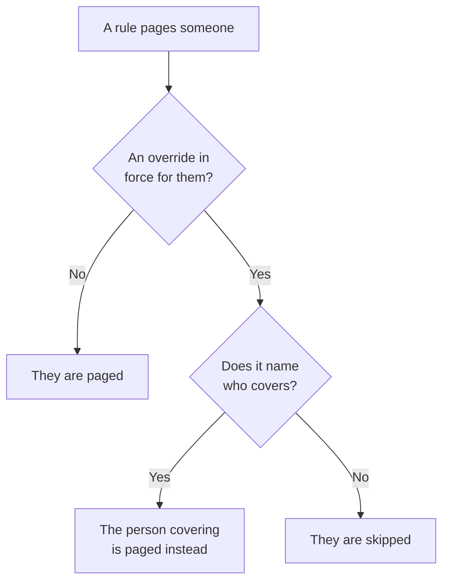

# User Overrides

While someone is away, a user override sends the pages that would reach them to the person who covers for them, for a set time. With nobody named to cover, it skips them instead: each of their turns in an on-call schedule goes to the next person in the rotation. Use one for a holiday, a sick day or a swapped shift.

:::cards
- [How an override changes a page](#how-an-override-changes-a-page): Who is paged instead, and when.
- [Add an override](#add-an-override): Who is away, who covers, from when and until when.
- [Every policy, or one](#every-policy-or-one): Where to add an override, and which one wins.
- [Other ways to add one](#other-ways-to-add-one): From a schedule, and from your upcoming shifts.
:::

## How an override changes a page



While an override is in force, from its start to its end:

- With somebody under **Who covers?**, that person gets all of the away person's pages, from every schedule, team and rule the override applies to. The page reaches them through their own personal on-call rules.
- With nobody to cover, the person is skipped. In an on-call schedule, each of their turns goes to the next person in the rotation who is not away; if everyone in a layer is away, the layers below it take over. A rule that names them directly, or through a team, does not page them, and the policy's run says they are away, and until when.
- Overrides do not chain. If the person covering is away too, they are still the one paged for the person they cover.

Once the override ends, the pages are theirs again. The **Schedule Timeline**, a schedule's layers and the calendar feeds all show who has each covered shift.

## Add an override

:::steps
### Open the overrides

Go to **On-Call Duty → User Overrides** to cover someone on every on-call policy, or to a policy's own **User Overrides** page, under **Advanced**, to cover them on that policy only. Click **Add User Override**.

### Say who is away

**Who is away?** starts as you, because booking your own time off is the most common case. Pick someone else to book cover for them.

### Say who covers

Leave **Who covers?** on **Next person in the rotation** to skip them, or pick the teammate who takes all of their pages. The person who is away is not offered.

### Set the time

**Starts** is now unless you pick another time. Set **Ends** to when they are back: it has to come after the start. Click **Add User Override**.
:::

Each override is a row: **Away**, **Covered by**, **Starts** and **Ends**, filtered by its start and end. **Covered by** reads **Next person in the rotation** for a skip. An override cannot be edited: delete it and add a new one, or delete it to bring someone back early.

## Every policy, or one

| Added under | Card | Applies to |
| --- | --- | --- |
| **On-Call Duty → User Overrides** | **Global User Overrides** | Every on-call policy in the project |
| A policy's **User Overrides** | **On-Call Policy User Overrides** | That policy only |

When two overrides for the same person overlap, the policy's own one wins over a global one, and one that names who covers wins over a skip. A page sent without a policy, from a workflow or from chat, follows the global overrides only.

## Other ways to add one

- From a schedule: on a schedule's **Layers** page, expand a layer and click **Skip until…** beside a person. It opens the same form with them away and the rotation covering, as a global override. See [When someone is away](/docs/on-call/schedules#when-someone-is-away).
- From your upcoming shifts: **Get cover** on one of your shifts, under **User Settings → Calendar → Calendar Feed**, opens the form with you away for that shift's times, so all that is left is **Who covers?**. See [Upcoming shifts and cover](/docs/on-call/calendar-feeds#upcoming-shifts-and-cover).

When someone leaves the project, every override that names them and has not ended yet is deleted, on either side.

## Who can add overrides

**Project Owner**, **Project Admin**, **Project Member**, **On-Call Admin** and **On-Call Member** can add and delete overrides; **Viewer** and **On-Call Viewer** can see them. In a custom role, the permissions are **Create On-Call Duty Policy User Override**, **Delete On-Call Duty Policy User Override** and **Read On-Call Duty Policy User Override**. On the **Schedule Timeline**, only people who can read overrides see whose shift is being covered.

On OneUptime Cloud, user overrides need the **Growth** plan.

## API

User overrides are the `/api/on-call-duty-policy-user-override` resource:

| Field | What it holds |
| --- | --- |
| `overrideUserId` | The person who is away. Required. |
| `routeAlertsToUserId` | The person who covers. Leave it out to skip the person instead. |
| `startsAt`, `endsAt` | When the override starts and ends. Both are required, and the end comes after the start. |
| `onCallDutyPolicyId` | The policy it applies to. Leave it out for a global override. |

```bash
curl -X POST https://oneuptime.com/api/on-call-duty-policy-user-override \
  -H "apikey: $ONEUPTIME_API_KEY" \
  -H "Content-Type: application/json" \
  -d '{
    "data": {
      "projectId": "<project-id>",
      "overrideUserId": "<away-user-id>",
      "routeAlertsToUserId": "<cover-user-id>",
      "startsAt": "2026-12-22T09:00:00Z",
      "endsAt": "2027-01-05T09:00:00Z"
    }
  }'
```

An override whose away person and cover are the same is refused, and so is one that ends before it starts.

## Troubleshooting

:::details The person on holiday was still paged
Check where the override was added. One on a policy's **User Overrides** page covers that policy only, and other policies still page them: add it under **On-Call Duty → User Overrides** to cover every policy. Check its **Starts** and **Ends** too: times are shown in your time zone.
:::

:::details The person covering was not paged either
They are reached through their own personal on-call rules and verified methods. Look them up on **On-Call Duty → Readiness**, and check the policy's **Execution Logs** for the run.
:::

:::details I cannot add an override
Adding one takes one of the roles above, and on OneUptime Cloud the **Growth** plan.
:::

## Next steps

:::cards
- [On-Call Schedules](/docs/on-call/schedules): Rotations, layers, and skipping someone in a layer.
- [Schedule Timeline](/docs/on-call/schedule-timeline): See every covered shift across all schedules.
- [Calendar Feeds](/docs/on-call/calendar-feeds): Get cover for one of your own shifts.
:::
