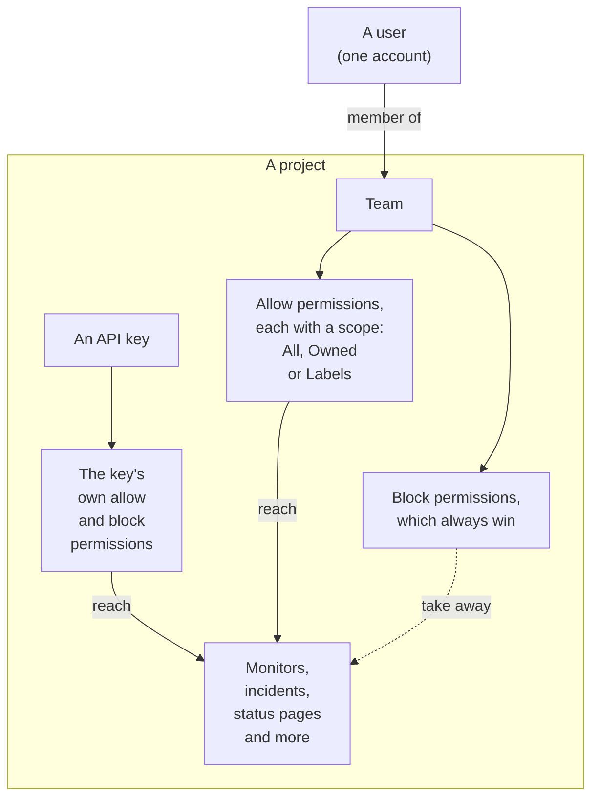
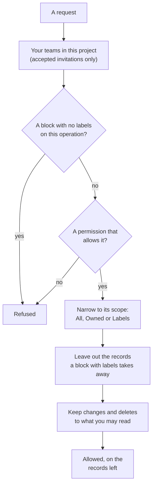

# Users, Teams & Permissions

Everything in OneUptime lives inside a **project**. Who can do what inside that project comes down to three things: the **users** in it, the **teams** those users belong to, and the **permissions** granted to those teams.

> [!IMPORTANT]
> **Users never hold permissions directly.** A user's access is the union of the permissions of every team they belong to in that project. If you want to change what somebody can do, you change their team membership or you change that team's permissions.

**Owners** are a separate idea. An owner is whoever is responsible for a specific resource — a monitor, an incident, a dashboard. Owners get notified about their resources, and permissions can optionally be narrowed to "only the things I own".

## How access works

| Concept | What it is |
| --- | --- |
| User | A single OneUptime account. One login, any number of projects. |
| Project | The tenant boundary. Monitors, incidents, teams and data all belong to exactly one project. |
| Team | A named group inside a project that carries permissions. |
| Team member | A user who has been invited to a team and accepted. |
| Permission | A single capability, e.g. `CreateProjectMonitor`, or a role that bundles many, e.g. `MonitorAdmin`. |
| Custom role | A set of permissions you name once and give to teams and API keys. |
| Scope | How wide an allow permission reaches: all resources, only owned ones, or only labelled ones. |
| Owner | A user or team marked as responsible for one specific resource. |
| Label | A tag you put on resources, used to restrict permissions and to organise. |

## Users

A user account is global to the OneUptime instance — the same login works across every project the user has been invited to.

A user is "in" a project when they are a member of **at least one team** in it. There is no separate "add user to project" step: inviting somebody to a project invites them to a team.

:::steps
1. Open **Users** from the **Products** menu, under **Settings**, and click **Invite User**. The list shows everyone in the project and their invitation status.
2. Type their **Email**. Someone who has no OneUptime account yet is also asked for a **Name**.
3. Pick their **Team**, which decides what they can do, and click **Invite**.
4. They accept from the bell at the top right, on **Project Invitations**, and are in the project from then on.
:::

- Invitations create a pending team member. The user only counts as a project member — and only gains any permission — **after they accept the invitation.**
- **Invite User** starts on the project's members team: the team that holds `ProjectMember` for the whole project, which is **Members** unless you renamed it. Pick another team to give the person more or less access. Nothing is picked when you could not invite to that team yourself — inviting someone hands them the team's permissions, and you can only hand on permissions you hold — or when the project has no such team. The Admin Dashboard starts on the same team wherever an instance administrator adds someone to a project: **Invite User** on a project, **Add to Project** on a user and on several users at once, and the projects attached to a [global SSO provider](/docs/identity/global-sso).
- Removing a user from every team in a project removes their access to it, from their next request on — including while they are signed in. Their account and their other projects are not affected. They are taken off the project's on-call schedules, escalation rules and overrides, off the roles of its open incidents and episodes, and off the owners of its resources; resolved incidents keep the record of who owned and ran them.
- On a self-hosted installation, removing someone's master admin access in the Admin Dashboard takes it away from their next request on — including while they are signed in. They stay signed in, and keep the projects they are a member of.
- Someone who leaves a project stops getting its notifications. Their own notification methods, rules and settings for the project go with their last team — email, SMS, phone, WhatsApp, Telegram, push, webhook, Slack and Microsoft Teams, their email rollup and the rollup email not sent yet, their number for incoming calls and their shift reminders — so joining again starts from the defaults. Anything that still names them, such as the user an incoming call rule rings or an owner kept on a resolved incident, no longer notifies them: nothing is sent on a project's behalf to anyone who is not a member of it, and a pending invitation is not membership yet. Those places show **No longer a member** next to their name, so you can put someone else there. Someone invited who has not accepted yet shows **Invitation not accepted yet** instead. If an override routes someone's pages to a person who has left, the person it covers is paged instead. Leaving also disconnects the MCP clients they connected to the project, and their personal on-call calendar link shows an empty calendar from then on. On OneUptime Cloud, someone who comes back through the project's single sign-on confirms it from their mailbox again.
- If your project enforces SSO and a user has not authenticated through the identity provider yet, they are treated as an unauthorised SSO user and see nothing until they do. See [SSO](/docs/identity/sso).
- With SCIM configured, your identity provider can create, update and remove users and their team memberships automatically. See [SCIM](/docs/identity/scim).

## Teams

Teams are how permissions get to people. Every new project starts with three:

| Team | Permission it holds | Editable |
| --- | --- | --- |
| Owners | `ProjectOwner` | No. Always has at least one member. |
| Admin | `ProjectAdmin` | No |
| Members | `ProjectMember` | Yes — this one is a starting point, change it freely |

The **Owners** and **Admin** teams are deliberately locked: their permissions cannot be edited and the teams cannot be deleted or renamed. This is what stops a project from being accidentally locked out of itself. The Owners team must always keep at least one member.

`ProjectOwner` is the highest level of access: billing, deleting the project, and everything an admin can do. `ProjectAdmin` covers everything except billing and deleting the project.

Turning SMS, phone calls, WhatsApp or Telegram on or off for the project counts as billing, because every message costs money. Only `ProjectOwner`, the `BillingAdmin` role (**Billing Admin**) and the `ManageProjectBilling` permission (**Manage Billing**) can change those switches, on **Project Settings > Notifications > Notification Settings** — not `ProjectAdmin`.

Recharging the project's prepaid balances counts as billing too. On OneUptime Cloud, SMS, phone calls, WhatsApp and Telegram are paid from the balance on **Project Settings > Notifications > Notification Settings**, and AI from the AI credits on **Project Settings > AI > AI Credits**. Only a project owner or someone with **Manage Billing** can recharge them or change their **Auto Recharge** — a project admin cannot. A message about a balance that has run low names who can add to it, and only those people get a working **Recharge Balance** button or a link to the page.

Create as many additional teams as you like — "Frontend On-Call", "Support", "Read-Only Auditors" — and give each the permissions it needs. On OneUptime Cloud, creating a team and changing its permissions needs the Scale plan.

**Creating a team** asks for a name and its **Access**, what the team's members can do:

| Access | What the team's members can do |
| --- | --- |
| Project Admin | Create, change and delete anything in the project, its settings included. Not billing, and not deleting the project. |
| Project Member | Create, change and delete monitors, incidents, status pages and the project's other resources. |
| Viewer | Read everything in the project, and change nothing. |
| Choose permissions later | Nothing yet. Picked to start with. |

:::steps
1. Open **Teams** from the **Products** menu, under **Settings**, and click **Create Team**.
2. Type the team's **Name** and pick its **Access**. The description is under **More fields**.
3. Create the team. A team with a role opens on its **Members** page, ready for you to invite people; with **Choose permissions later** it opens on its **Permissions** page, where you add a narrower role such as `IncidentMember`, or single permissions.
:::

The role you pick becomes the team's first permission, for all resources in the project, as soon as the team exists — exactly as if you had added it with **Add Role** on the team's Permissions page. You are offered only the roles you hold yourself, because everyone you invite to the team gets its permissions, and someone who may create teams but not change what they can do is not asked. If the role cannot be added, the team is still created and a notice above the list links to it.

Where to find it: open a team from **Teams** to reach **Members** and **Permissions**; its custom roles and **Block Permissions** are under **More settings** at the bottom of the Permissions page, whose folded header shows how many of each the team has.

## Permissions

A permission is one capability. There are two ways to hand them out, and both live on the team's **Permissions** tab.

### Roles

A role bundles a whole product area at one of three levels:

- **Admin** — what the Member does, and the area's own configuration, such as incident and alert severities and states, monitor statuses and maintenance states.
- **Member** — day-to-day work: create, change and delete the area's resources, with their notes, owners and templates. For status pages and on-call, the Member does everything the Admin does.
- **Viewer** — read-only.

`MonitorAdmin`, `IncidentMember`, `StatusPageViewer` and so on. Roles are what you want almost all of the time — they stay correct as OneUptime adds features, because a new monitor-related table is added to the existing monitor roles rather than needing a new grant from you.

**Add Role** asks first how far the role reaches. **Whole project** lists the four roles that reach all of it — Project Owner, Project Admin, Project Member and Viewer — each with a line on what it is for. **One area** lists the areas, each with its product's icon: pick one, then its level. **Search roles** finds any role by its name, its area or what it does.

Workflows and runbooks are the exception. Both run code in your project — a workflow its steps, a runbook its scripts on your Runners — so `WorkflowMember` opens workflows and their runs and runs them by hand, and `RunbookMember` opens runbooks and their runs and runs them: it starts a run, completes or skips its steps and cancels it. Neither creates, changes or deletes what it runs; `WorkflowAdmin` and `RunbookAdmin` build them. A role runs only the runbooks its scope reaches, so a `RunbookMember` limited to some labels runs the runbooks that carry them. See [Workflow permissions](/docs/workflows/configuration#permissions) and [Runbook permissions](/docs/runbooks/configuration#permissions).

An area's rules (label, owner, on-call, grouping and reminder rules), custom fields, SLAs and secrets are project configuration: they take `ProjectAdmin`, whatever area role someone holds. So do API keys, teams and their permissions, labels, SSO and domains — the Settings roles look after the project's services, probes, infrastructure and integrations, not who may do what.

Billing has three roles of its own. `BillingViewer` reads the project's billing — the plan and subscription, invoices, usage, balances, AI credits, payment methods and the billing contact details — and changes nothing. `BillingMember` also downloads invoices and changes the billing contact details. `BillingAdmin` does what `BillingMember` does and turns SMS, phone calls, WhatsApp and Telegram on and off. Changing the plan, payment methods or balances, and paying invoices, takes `ProjectOwner` or **Manage Billing**; on the billing pages those buttons are locked for everyone else, and say who may.

All {{PERMISSION_ROLE_COUNT}} roles are listed in the [Permission Reference](/docs/permissions/reference).

### Granular permissions

Every individual capability is also assignable on its own — `CreateProjectMonitor`, `ReadProjectIncident`, `DeleteProjectStatusPage`, and {{PERMISSION_TOTAL_COUNT}} others. Use these when a role is too broad and you need to hand out exactly one thing.

A permission to change or delete something reaches only what you may also read, so give the matching read permission with it: `EditProjectIncident` changes no incident without `ReadProjectIncident`. A record read through another one, such as an incident's note, also needs a permission to read that other record: `ReadIncidentInternalNote` reaches no note without one to read incidents, and `CreateIncidentInternalNote` adds a note only to an incident you may read. The roles hold both already.

These are also the keys you use when creating API keys, and the ones the API and the Terraform provider expect.

The full list is in the [Permission Reference](/docs/permissions/reference).

### Custom roles

A custom role is a set of permissions you name once and give to teams and API keys: an Incident Responder made of `IncidentMember`, `AlertMember` and `OnCallViewer`, say, or a Team Lead. Every team and key you give it to gets the same permissions, and you change them for all of them in one place. On OneUptime Cloud, custom roles need the Scale plan, as changing a team's permissions does. Self-hosted, they are part of the Enterprise Edition: on the Community Edition, the roles your teams and API keys already have keep applying, and can be taken from a team or key or deleted, but not created or changed.

:::steps
1. Open **Teams** from the **Products** menu, under **Settings**. Expand **Settings** in its side menu, choose **Roles**, and click **Create Custom Role**.
2. Type its **Name** and pick the built-in roles it bundles under **Permissions**, for every resource in the project. The description is under **More fields**.
3. Create the role. It opens on its page, where **Add Role** adds another built-in role and **Add Permission** (in the card's **⋯** menu) a single permission, each with a scope and labels, as on a team.
4. Click **Give to a Team** under **Teams with this Role**, or **Give to an API Key** under **API Keys with this Role**. A team's **Permissions** page and an API key's page have **Add Custom Role** too, under **More settings**, and **Create Team** and **Create API Key** offer the custom roles you could give under **Access**.
:::

- A team's members get every permission of its custom roles, at the same scope and with the same labels, exactly as if the team held them itself. A block on the team still wins.
- A role stays linked to the teams and API keys that have it: a change to it reaches all of them at once, and the role's page says how many teams, people and keys that is. **Remove** takes the role from one team or key. Deleting the role takes its permissions from every team and key that has it; they keep everything else they have.
- You can put into a role, and give a team or an API key a role, only what you could give it directly: a role holding a permission you do not hold at the same or a broader scope is refused, and the refusal names the permission. A role never holds `ProjectOwner`, and **Owners** and **Admin** are never given one.
- A team's **Permissions** page and an API key's page list their custom roles under **More settings**, after their own permissions; its folded header says how many they have. What a role gives is changed on the role's page, not on the team's or the key's.
- An API key gets every permission of its custom roles, with the same labels, as if the key held them itself, and a block on the key still wins. A permission the role limits to what someone owns gives a key nothing: a key owns nothing.
- The built-in roles are listed under **Built-in Roles**, at the bottom of the **Roles** page.

### Allow and block

Each team has two lists:

- **Permissions** (allow) — what this team can do.
- **Block Permissions** — what this team can never do, regardless of any allow entry.

Both are on the team's **Permissions** page. Few teams need a block, so block permissions are folded under **More settings** at the bottom of the page.

> [!WARNING]
> **Block always wins.** A block entry with no labels removes that capability outright for the team. A block entry with labels removes it only for resources carrying those labels — useful for "this team can edit monitors, except the ones labelled Production".

A permission cannot carry restriction labels in both lists at once; OneUptime rejects the second one with an explanation.

A user's allow entries add up across all their teams, but a block applies to everything the user does: a block with no labels on one team takes the capability away even where another team allows it, and a block entry never grants anything. If somebody has less access than you expect, check each of their teams for a block; if they have more, check each team for an allow.

### Changing a state

An incident, an alert, an alert or incident episode and a scheduled maintenance event change state, and a monitor changes status, by a new row on their state timeline. **Acknowledge**, **Resolve**, **Change State**, the **State Timeline** page, the API and workflows all add one. Adding it takes the timeline's own create permission, with a permission to read the record it changes:

| To change the state of | It takes |
| --- | --- |
| An incident | **Create Incident State Timeline** |
| An alert | **Create Alert State Timeline** |
| An alert episode | **Create Alert Episode State Timeline** |
| An incident episode | **Create Incident Episode State Timeline** |
| A scheduled maintenance event | **Create Scheduled Maintenance State Timeline** |
| A monitor (its status) | **Create Monitor Status Timeline** |

The record then takes the new state from OneUptime itself, with what goes with it, such as when an episode was resolved or when a maintenance event next reminds its subscribers. So a change does not also take a permission to edit the record: a custom role with **Create Incident State Timeline** but not **Edit Incident** changes an incident's state. To keep a team from changing states, block the timeline's create permission; a block on **Edit Incident** leaves state changes alone. Labels, owners and private records narrow the timeline's create permission as they narrow any other, through the record whose state it changes: see the scope rules below.

Only the state is written for you. A note posted with a change is posted as you and takes the note's own permission, as described in [Telling status page subscribers about a state change](/docs/incidents/states-and-severities#telling-status-page-subscribers-about-a-state-change). Acknowledging the alerts of an incident as you declare it takes the same as acknowledging each of them on its own page: **Create Alert State Timeline**, narrowed through each alert, and no **Edit Alert**. See [Acknowledging the alerts as you declare](/docs/incidents/linked-alerts#acknowledging-the-alerts-as-you-declare).

## Scope: how far an allow permission reaches

Every allow permission is granted with a scope: when you add it, **Scope** is under **More fields**, and starts on the first of these:

| Scope | Meaning |
| --- | --- |
| All resources in the project | The default, and what most teams want. The permission applies to every matching resource. |
| Only resources they own | The permission applies only to resources the person acting, or the team it is given to, owns — not to resources only another of their teams owns. |
| Only resources with certain labels | The permission applies only to resources carrying at least one of the labels you pick. |

**Owned** is the simplest way to build a "you look after your own services" model: give a team `MonitorAdmin` scoped to Owned, then make that team the owner of the monitors it is responsible for. It narrows every resource that can have owners — monitors, incidents, dashboards, services, monitor groups, on-call schedules and the like — and what belongs to them, such as a schedule's layers. Probes, Runners, AI agents, on-call schedules and incident and maintenance templates are what other resources are set up with, so a permission scoped to Owned still reads all of them, and you can pick any of them; it changes and deletes only the ones you or your teams own. A Runner's key, which lets whoever holds it act as the Runner, shows only on the Runners you or your teams own. Project configuration (incident states, labels, teams themselves) has no owner, so an Owned-scoped role behaves normally there.

Each team's Owned permission reaches what that team owns, not what the person's other teams own. Someone on two teams, one given `IncidentMember` scoped to Owned and one given `Viewer` scoped to Owned, changes the incidents the first team owns and the ones they own themselves, and only views the incidents the second team owns. An Owned permission also adds owners only to resources the person or the team it is given to owns, so the first team cannot be made an owner of the second team's incidents to get around this. A custom role's Owned permission reaches what each team given the role owns.

**Labels** is the more manual version of the same idea: tag resources, then grant permissions restricted to those tags.

**Acting on the whole project takes a permission that reaches it.** A rule's **Run Now** applies the rule to every resource of the project, and a network's site assignment, device label and auto import rules to every network device or scan, so it takes permissions scoped to all resources in the project: a permission restricted to labels or to owned resources is not enough, and a block with labels on the resources a run changes refuses the run, because it would change the resources carrying those labels too.

Some roles are project-wide by definition and do not offer a scope at all, because scoping them would be meaningless — "Billing Admin, but only for the billing I own" does not describe anything:

{{PERMISSION_SCOPE_EXEMPT_ROLES}}

## Owners

An owner is a user or a team attached to one specific resource. Most resources that represent something you operate — monitors, incidents, alerts, scheduled maintenance events, on-call policies, dashboards, services, status pages, workflows, runbooks and SLOs — have an **Owners** tab.

Owners do two jobs:

1. **Notification.** Owners are who OneUptime tells when something happens to the resource — a monitor goes down, an incident is created, an SLO starts burning through its error budget.
2. **Access, when you ask for it.** Ownership is what the `Owned` permission scope resolves against. A user matches if they are personally an owner, or if any team they belong to is an owner.

Ownership on its own grants nothing. Being the owner of a monitor does not let you edit it unless a team you belong to also holds a monitor permission. Ownership narrows access; it never widens it.

Who owns a resource is read through the resource. The owners of a monitor or of any other resource are listed, read, added and removed only by someone who may read that resource, and a permission on owners alone reaches the owners of no resource you may not read. Adding and removing owners keeps to the scope of the permission that does it, too: scoped to `Owned`, it reaches only the resources you or one of your teams already own, however many more you may read, so reading a monitor does not let you make yourself its owner. An owner is added or removed, never moved to another resource.

## Labels

Labels are project-wide tags you attach to resources. They serve two purposes: filtering and grouping in the dashboard, and restricting permissions as described above.

A label restriction is satisfied if the resource carries **at least one** of the labels on the permission. A resource with no labels at all matches no label-restricted permission.

A record with no labels of its own, such as an incident's note, a status page announcement or an AI insight about a service, carries the labels of the records it belongs to or is about. A permission restricted to labels reaches it when one of those records carries one of the permission's labels, and a block with labels takes it away when one of them carries a blocked label, for reading, changing and deleting alike. A record that is about none of them, such as an AI insight about no service, belongs to the project: a label restriction does not narrow it, and a block with labels does not take it away.

Where to find it: **Project Settings > Basic > Labels**. A new label's color is already picked when its form opens, one the labels listed on the page don't use yet; pick another if you like. On OneUptime Cloud, creating and changing labels needs the Growth plan.

## Telemetry

Logs, traces, metrics, exceptions, profiles and session replays belong to the resource that sent them: a service, a host, a Kubernetes cluster, a monitor, a RUM application and the like. A telemetry permission reads as far as its scope reaches:

- **All resources** reads the telemetry of every resource in the project.
- **Owned** reads the telemetry of the resources you or one of your teams own, and telemetry that names no resource.
- **Labels** reads the telemetry of the resources carrying one of the permission's labels.

A block with labels on a telemetry permission leaves out the telemetry of the resources carrying those labels, whatever else you hold. This holds wherever telemetry is read: the explorers and their charts, filters and attribute lists, exports, session replays, and what the AI assistant reads for you. The list of metric names shows the metrics a service you may read reports, and the metrics no service reports, such as host and cluster metrics. If you may also read the telemetry of other kinds of resources, such as hosts or clusters, it shows every metric name.

Deleting telemetry keeps to the same resources: a delete reaches the rows of the resources that both your permission to read the signal and your permission to delete it reach, less those a block with labels on either takes away, and it is made in one project at a time.

Monitor logs, SLO history, network flows and Kubernetes cost allocations are read the same way, through the monitor, SLO, network device or cluster they belong to: Owned and Labels reach the rows of the records you may read, and a block with labels leaves out the rows of the records carrying those labels. The audit log and threat intelligence indicators are read across the project by whoever may read them.

## API keys

API keys are granted permissions directly, on the key itself, or through the custom roles they are given — they do not belong to teams and are not affected by team membership.

- Assign the same granular permissions, roles and custom roles you would give a team.
- Keys support **block permissions** and **label restrictions**, the same way teams do.
- Keys do **not** support the Owned scope. Ownership resolves against a user, and a key is not a user, so grant keys the access they need explicitly. A custom role's permission scoped to Owned gives a key nothing.

**Creating a key** asks for a name and its **Access**:

| Access | What the key can do |
| --- | --- |
| Project Admin | Create, change and delete anything in the project, its settings included. Not billing, and not deleting the project. |
| Project Member | Create, change and delete monitors, incidents, status pages and the project's other resources, as a project member can. |
| Viewer | Read everything in the project, and change nothing. |
| A custom role | Everything the role allows, but what it limits to resources someone owns. Listed when your project has one you could give. |
| Choose permissions later | Nothing yet. Picked to start with. |

:::steps
1. Open **Project Settings > Advanced > API Keys** and click **Create API Key**. On OneUptime Cloud, API keys need the Growth plan.
2. Type the key's **Name** and pick its **Access**. The description and the expiry date are under **More fields**; a key expires a year from the day it is created unless you pick another date, and the folded section says so.
3. Create the key. It opens on its page, where you copy it.
:::

The role you pick becomes the key's first permission as soon as the key exists, exactly as if you had added it on the key's page. You are offered only the roles you hold yourself — a key can never be given more than the person giving it has — and someone who may create keys but not change what they can do is not asked.

On a key's page, **Custom Roles**, under **More settings**, lists the key's custom roles once your project has one, and **Add Custom Role** gives it another. **Add Role** adds a role from the same list a team's Permissions tab offers, and **Add Permission** (in the card's **⋯** menu) adds one granular permission. **Block Permissions** are under **More settings** at the bottom of the page, whose folded header shows how many the key has.

> [!TIP]
> Give each integration its own key with the narrowest set of permissions that works, so you can revoke one without disturbing the others.

## How OneUptime decides whether a request is allowed

For a signed-in user, in order:

1. Find the teams the user belongs to in this project, counting only accepted invitations. A request reaches the records of this project only: a record of another project, named by its id or in a filter, is answered as if it did not exist.
2. Collect every permission row on those teams — allow and block, each with its labels and scope.
3. Check the block list first. A block with no labels on any permission the target table accepts for this operation rejects the request outright, whichever team it is on.
4. Check the allow list. The request needs at least one permission that the target table accepts for this operation. On an operational resource — a monitor, an incident, a dashboard and the like — the matching **All Operational Resources** permission (Create, Read, Edit or Delete) counts too, unless it is blocked itself.
5. Apply scope. Owned-scoped grants narrow the query to owned resources; label-scoped grants narrow it to matching labels. If any other grant for the same operation is broader, the broader one wins. A record with no labels of its own, such as an incident note, matches a label-scoped grant when one of the records it belongs to carries one of the grant's labels. An **All Operational Resources** permission restricted to labels narrows the same way: it reaches the operational resources carrying one of its labels, as the resource's own permission restricted to those labels would. A create is scoped the same way: a permission to create status pages restricted to labels creates only status pages carrying one of its labels, and a permission to create incident notes restricted to labels adds notes only to incidents carrying one, unless another permission for the create reaches the whole project; a create outside them is refused with a message naming the labels it allows. A permission to create scoped to Owned creates a resource with owners of its own, such as a monitor or a status page, only for a person, who becomes its owner, and a note only on an incident you or one of your teams own. A change of the labels a record carries is scoped the same way: with a permission to change it restricted to labels, the record keeps at least one of them, unless another permission to change it reaches the whole project, and a change that takes the last of them away is refused with a message naming the labels. When your permission to create a kind of record reaches only what you own, you are made the owner of what you create before anything else happens to it, and the create is refused, with nothing left behind, if you cannot be.
6. Apply label blocks. A block with labels rejects the request if the target resource carries one of them. A block with labels on an **All Operational Resources** permission takes the resources carrying those labels away from what that permission grants. When a record has no labels of its own, such as an incident note or a status page announcement, a block with labels leaves it out of reads, changes and deletes if a record it belongs to carries one of those labels. A list of records from all of your projects at once, such as the incidents on your home page, narrows each project's records by your blocks and grants in that project. A block with labels on a permission to create keeps you from creating a record that carries one of its labels or, for a record with no labels of its own, that belongs to a record carrying one. A block with labels on a permission to change keeps you from giving a record one of its labels or, for a record with no labels of its own, from pointing it at a record that carries one.
7. Keep changes and deletes to what you may read. A change or a delete is narrowed by your read permissions as well as by the permission for the change: a record you may not read — outside your labels or owners, or carrying a label a block on reading takes away — is not one you may change or delete, and a block with no labels on reading a kind of record takes changing and deleting it away too. A record read through another one, such as an incident's note or a status page announcement, is reached only through a record you may read: with no permission to read incidents, a permission on notes reaches no note, a block with labels on reading incidents leaves out the notes of the incidents carrying them, and when your permission to read incidents is scoped to Owned, a permission on notes reaches only the notes of the incidents you or one of your teams own. Such a record is also created only under one you may read: a note goes only on an incident you may read, and an announcement only on status pages you may read, each of them; naming one you may not read is refused as if it did not exist. A change keeps to the same rule: a record moved under another one, such as an announcement put on another status page, goes only under one you may read, and what it is under already stays as it is. The records a create or a change lists, such as the monitors of an incident or the services of an alert, keep to your permission to read them when you have one, and to a block with labels on reading them either way: one outside them is refused as if it did not exist, while one the record lists already stays. The one record a create or a change names in a field of its own, such as the monitor of an alert or the monitor a status page shows, keeps to the same rule, and so do the records a template fills in, such as the monitors and status pages an incident template adds to an incident declared from it; OneUptime's global probes and AI agents stay open to every project. A change or a delete of one record, named by its ID, that reaches nothing is answered as if the record did not exist (`404`) when you may not read it, and refused when you may read it but not change it. A read of one record by its ID answers `404` the same way when the record does not exist or you may not read it.

Every field of a record is read with the record's own read permission: a permission for another kind of record never opens it. Some fields are narrower on purpose. Secrets are read only by people who may edit or administer the record they belong to, such as a monitor's incoming request and incoming email keys and its server agent key, or a workflow's webhook and incoming email keys. Watching a session replay's recording takes **Watch Session Replays**, not just **List Session Replays**. Telemetry is read signal by signal: **Read Telemetry Service Log** reads logs, **Read Telemetry Service Traces** reads traces, and **Read Telemetry Service Metrics** reads metrics, metric charts included.

Fields follow the same rule. A block with no labels on a field's permission takes the field away, and on an operational resource the matching **All Operational Resources** permission opens every field that everyone who may read or change the record may open — but not a field that is narrower on purpose, such as a secret key.

A setting that holds credentials is named only by someone who may read it. A create or a change names an SMTP server, a call and SMS provider, SNMP credentials, a video call connection, an API key or an external MCP server — such as the SMTP server a status page sends email with — only when you may read that kind of setting; one you may not read is refused as if it did not exist, while a record keeps the one it names already. Searching a call and SMS provider for numbers to buy, or listing the numbers it owns, takes the same read. A workflow's step acts as a Project Admin but is never lent the read of a setting that holds credentials: it names none of them, and a person who may read them has to.

The same rule decides everything else that asks whether you hold a permission: actions that are not a plain read or write, such as adding SMS, call or AI credit, paying an invoice or testing a notification rule, and the buttons OneUptime shows you. A button you may not use is shown locked and says why; when a block on one of your teams is the reason, it names the blocked permission.

Live updates follow the same rule. When a record is created, changed or deleted, OneUptime tells the open pages of the people who may read that record, and nobody else. Whatever limits what you read limits your live updates too: labels, owners, a block with labels, a private incident or someone else's AI conversation. When a change takes a record away from you, such as making it private, your open pages are told too, so they stop showing it. A change to your permissions, a block, or no longer being a master admin reaches your open pages at once.

Live updates also end with the sign-in that opened them. Signing out, changing your password or being blocked stops the live updates of your open pages at once. An open page renews its sign-in every 15 minutes and picks its live updates back up; when the sign-in cannot be renewed, it takes you to the sign-in page. A project that requires SSO gives live updates only to pages signed in with SSO, as it does with everything else.

Every logged-in user additionally holds a small set of automatic permissions that cover things like reading their own profile and their own notification rules. These are not admin permissions and do not unlock anyone else's data.

Resolved permissions are cached per user and project, and refreshed when team membership or team permissions change. If you change permissions and a user does not see the change immediately, have them reload.

## Recipes

**A team that only watches.** Create the team with **Viewer** under **Access**. For just some areas, pick **Choose permissions later** and add the per-area `*Viewer` roles they should see.

**On-call engineers who manage their own services.** Give the team `MonitorAdmin`, `IncidentMember` and `OnCallMember` scoped to **Owned**, then add the team as owner of the monitors, on-call policies and schedules it runs. Whatever its people create with these permissions, they own already.

**Contractors kept away from production.** Give the team the roles it needs at **All** scope, then add a **block permission** (under **More settings** on the team's Permissions page) for the sensitive capabilities, restricted to the `Production` label.

**A CI pipeline that only reports deployments.** Create an API key with **Choose permissions later**, then add just the granular permissions it needs on its page — no roles.

**Someone who should not change billing or see invoices.** Give them `ProjectMember`, not `ProjectAdmin`: a project admin cannot change the plan, payment methods or balances, but reads and downloads invoices. To let someone read the billing pages without changing anything, give them `BillingViewer`.

When access is not what you expect:

:::details Someone cannot see or change something they should
Check that they accepted the invitation: a pending team member has no permissions. Then open each of their teams: a block with no labels on any team takes the capability away, and a scope of **Owned** or labels reaches only owned or labelled resources. A locked button names the permission it needs, or the block that refuses it.
:::

:::details Someone can do more than you expect
Their access is the union of every team they are in, so look for an allow on each team, including **Admin** and **Owners**. To take one capability away whatever their teams allow, add a block permission on one of their teams.
:::

## Next steps

:::cards
- [Permission Reference](/docs/permissions/reference): Every role and every granular permission, generated from the OneUptime source.
- [SSO](/docs/identity/sso): Let people sign in with your identity provider.
- [SCIM](/docs/identity/scim): Create users and team memberships from your identity provider.
- [API Reference](/docs/api-reference/api-reference): Call the API with an API key and its permissions.
:::
