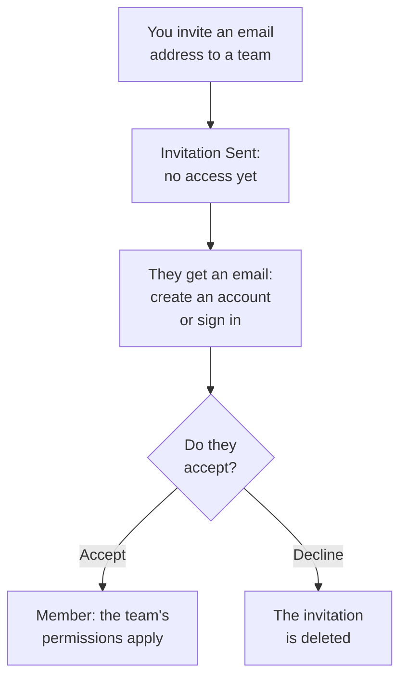

# Inviting People

People join a project by invitation. You invite someone's email address to a team, they accept, and from then on their team decides what they can do. This page shows how to invite people, what they see, and how to change or end their access later.

:::cards
- [Invite someone](#invite-someone): An email address and a team.
- [Accept an invitation](#accept-an-invitation): What the invited person sees and does.
- [Change someone's teams](#change-someones-teams): Give them more access, or less.
- [Remove someone](#remove-someone-from-the-project): What leaving the project takes away.
:::

## How an invitation works

- **Their team decides what they can do.** Nobody holds permissions of their own: a person can do what the teams they are in allow. See [Users, Teams & Permissions](/docs/permissions/index).
- **Nothing is granted until they accept.** A pending invitation shows as **Invitation Sent**, and gives no access to the project.
- **One acceptance covers the project.** Accepting one invitation accepts every other invitation the person has to the same project. A member you add to another team later is on it at once, with nothing to accept.

## Before you begin

- **A role that invites people.** Project Owner, Project Admin, or a role with the **Invite New Members** permission. You can invite people only to a team whose permissions you hold yourself, because an invitation hands them the team's access. A Project Admin with no block counts as holding everything Project Admin can already do: they can invite people to **Members** or to a team with any narrower role, but not to a team that holds Project Owner, a billing permission, **Delete Project**, **Edit Project**, **Edit Team** or **Invite New Members**.
- **On OneUptime Cloud, room in your plan.** Every person in the project is a seat on its bill, from the moment they are invited. The Free plan has room for one person. See [Billing & Usage](/docs/configuration/billing#your-plan-and-seats).
- **No SCIM Push Groups.** While your identity provider manages the project's teams through SCIM Push Groups, you invite and remove people there, not in OneUptime.

## Invite someone

:::steps
### Open Users

Go to **Products → Settings → Users**. The **Users** list shows everyone in the project, the teams they are in, and whether they have joined.

### Click Invite User

Click **Invite User**. The **Invite New User** dialog opens.

### Enter their email address

Type their address in **Email**. If no OneUptime account uses it yet, the dialog also asks for a **Name**, which their new account starts with.

### Pick their team

**Team** starts on the project's members team: the team that holds Project Member for the whole project, or else the one named Members. Pick another team to give them more access, or less. **Team** starts empty when the project has no such team, or when you could not invite anyone to it yourself.

### Send the invitation

Click **Invite**. OneUptime emails the invitation and opens the person's page. They show as **Invitation Sent** until they accept.
:::

> [!TIP]
> Invite people to the narrowest team that lets them do their work. You can add them to more teams later, and each team they join adds to what they can do.

## Accept an invitation

The invitation email names the project. Its button is **Create Your Account** for someone who has no OneUptime account yet, and **Sign In to OneUptime** for someone who has one. Once signed in, they accept in one of two places:

| Where they are | What they see | What they click |
| --- | --- | --- |
| In no project yet | The invitation, on the page they land on after signing in | **Accept & Join**, or **Decline** |
| In another project already | The pending invitation on the bell at the top right, which opens **Project Invitations** | **Accept**, or **Reject** |

Accepting puts them in the project straight away, with their team's permissions and the notification setup every member starts with: see [What you start with](/docs/notifications/index#what-you-start-with). Declining deletes the invitation, so joining later takes a new one.

## See who is in the project

**Users** has one row per person:

| Column | What it shows |
| --- | --- |
| **User** | Their name and email address. |
| **Teams** | Every team of the project they are in, or invited to. |
| **Status** | **Member** once they have joined, with a count of any invitations to other teams they have not accepted yet. **Invitation Sent** until then. |

Filter the list by **User**, **Status** or **Team**. Click a row to open the person's page:

| Page | What it is for |
| --- | --- |
| **Profile** | Their name, email address, picture and user ID. |
| **Teams** | The teams they are in. Add or remove a team here. |
| **Readiness**, **Notification Methods**, **On-Call Rules** | Whether they can be paged, and how. Shown to Project Owners, Project Admins, the person themselves, and anyone who may read people's notification rules. See [Readiness & Reports](/docs/on-call/readiness). |
| **Custom Fields** | The project's custom fields for people, when it has any. |
| **Remove from Project** | Take them out of the project. |

## Change someone's teams

:::steps
### Open their Teams page

On **Users**, click the person, then **Teams**.

### Add them to a team

Click **Invite**, pick the **Team**, and click **Invite** in the dialog. A member is on the new team at once. Someone who has not joined yet gets one more invitation, and accepting either one accepts both.

### Take them off a team

Click **Remove** on the team's row. If it is the last team they have joined, removing it takes them out of the project, and the dialog says so before anything changes.
:::

The Owners team always keeps at least one member who has joined, so a project never loses its last owner.

## Remove someone from the project

On **Users**, open the person's row menu, **⋯**, and click **Remove from Project**. Or open the person and choose **Remove from Project** in their side menu. To remove several people at once, select their rows and delete the selection: each of them is removed the same way.

Removing someone takes them off every team of the project. They lose access at once, even while signed in, are taken off its on-call schedules and escalation rules, and stop getting its notifications. Their OneUptime account is not deleted, and you can invite them again. [Users, Teams & Permissions](/docs/permissions/index#users) lists everything that leaving a project takes with it.

## Other ways people join

- **Single sign-on.** Someone who signs in with the project's identity provider for the first time joins the teams the provider names. See [Roles and teams for SSO users](/docs/identity/sso#roles-and-teams-for-sso-users).
- **SCIM.** Your identity provider creates people and adds them to the connection's default teams. See [SCIM](/docs/identity/scim#how-a-project-user-is-provisioned).
- **The Admin Dashboard.** On a self-hosted installation, a master admin can add someone to a project and accept the invitation for them. See [Users, Teams & Permissions](/docs/permissions/index#users).

## Troubleshooting

:::details "This user has already been invited to this team"
They are on that team already, as a member or with an invitation they have not accepted. Open them on **Users** to see their teams, or invite them to another team.
:::

:::details "You have reached the user limit for the free plan"
On OneUptime Cloud, a project on the Free plan has room for one person. Change the plan, then invite again. See [Change the plan](/docs/configuration/billing#change-the-plan).
:::

:::details "Too many invitations were sent to this email address in the last hour"
One address can be sent 10 invitations an hour, to projects and private status pages together, whoever sends them. Wait an hour, then invite them again.
:::

:::details The invitation email did not arrive, or its link expired
The invitation does not depend on the email. Ask them to sign up with the address you invited: OneUptime emails that address a new link to finish creating the account. Someone who already has an account signs in and finds the invitation waiting.
:::

:::details Invite User says users are managed by SCIM Push Groups
Your identity provider manages the project's teams. Invite or remove people in the identity provider, or turn Push Groups off under **Project Settings → Security → SCIM** to manage them here.
:::

## Next steps

:::cards
- [Users, Teams & Permissions](/docs/permissions/index): Decide what each team can do.
- [Project Settings](/docs/configuration/project-settings): Everything that applies to the whole project.
- [Your Account](/docs/introduction/your-account): Sign-in, profile and the projects you belong to.
- [SCIM](/docs/identity/scim): Let your identity provider manage people and teams.
:::
