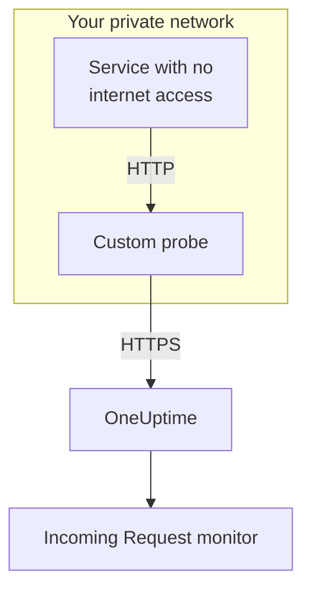

# Incoming Request Ingress

A service with no internet access can still send heartbeats to an [Incoming Request Monitor](/docs/monitor/incoming-request-monitor). It sends them to a [Custom Probe](/docs/probe/custom-probe) on its own network instead, and the probe passes them on to OneUptime.

:::cards
- [How it works](#how-it-works): From your service, through the probe, to the monitor.
- [Turn on the listener](#turn-on-the-listener): One setting on the probe, for Docker, Docker Compose or Kubernetes.
- [Send requests to the probe](#send-requests-to-the-probe): Change the URL your service sends to, and nothing else.
- [Troubleshooting](#troubleshooting): What the probe logs when a request does not get through.
:::

## How it works



1. **Your service sends the request to the probe.** The same `GET` or `POST`, with the same secret key, that it would send to OneUptime, to a port the probe listens on.
2. **The probe answers at once.** It replies `200` before it passes the request on, so your service never waits on OneUptime.
3. **The probe forwards it.** It sends the request on to OneUptime with its method, headers and body, and adds a `OneUptime-Probe-Id` header that names the probe.
4. **OneUptime reads it as usual.** The monitor's criteria see the request as if the service had sent it directly.

The listener runs on a port of its own, apart from the probe's health checks, so you can open it to your private network without opening anything else.

## When to use it

Use the listener when:

- Your services run in an isolated network segment with no outbound HTTPS access
- You need to keep all monitoring traffic within your VPC / on-prem network
- You want a single egress point — the probe — that is allowed to reach OneUptime
- You already deployed a [Custom Probe](/docs/probe/custom-probe) and want to reuse it for inbound heartbeats

If your services can already reach `https://oneuptime.com` (or your self-hosted URL) directly, you do **not** need this feature — call the heartbeat URL directly from the service.

## Before you begin

- **A running custom probe.** Its **Status** reads **Connected**. See [Custom Probes](/docs/probe/custom-probe) to install one.
- **An Incoming Request monitor.** Its heartbeat URL holds the secret key your service sends: see [Incoming Request Monitor](/docs/monitor/incoming-request-monitor).
- **A port your services can reach on the probe's host.** The examples use `3875`.

## Turn on the listener

Set `PROBE_INGRESS_PORT` to the port the listener should use. Any value greater than `0` turns it on; unset, or `0`, leaves it off.

:::tabs
@tab Docker
```bash
docker run --name oneuptime-probe --network host \
  -e PROBE_KEY=<probe-key> \
  -e PROBE_ID=<probe-id> \
  -e ONEUPTIME_URL=https://oneuptime.com \
  -e PROBE_INGRESS_PORT=3875 \
  -d oneuptime/probe:release
```

Without `--network host`, publish the port with `-p 3875:3875`.
@tab Docker Compose
```yaml title="docker-compose.yml"
services:
  oneuptime-probe:
    image: oneuptime/probe:release
    container_name: oneuptime-probe
    environment:
      - PROBE_KEY=<probe-key>
      - PROBE_ID=<probe-id>
      - ONEUPTIME_URL=https://oneuptime.com
      - PROBE_INGRESS_PORT=3875
    network_mode: host
    restart: always
```

Without `network_mode: host`, publish the port under `ports:` as `"3875:3875"`.
@tab Kubernetes
```yaml title="oneuptime-probe.yaml"
apiVersion: apps/v1
kind: Deployment
metadata:
  name: oneuptime-probe
spec:
  selector:
    matchLabels:
      app: oneuptime-probe
  template:
    metadata:
      labels:
        app: oneuptime-probe
    spec:
      containers:
        - name: oneuptime-probe
          image: oneuptime/probe:release
          env:
            - name: PROBE_KEY
              value: "<probe-key>"
            - name: PROBE_ID
              value: "<probe-id>"
            - name: ONEUPTIME_URL
              value: "https://oneuptime.com"
            - name: PROBE_INGRESS_PORT
              value: "3875"
          ports:
            - name: ingress
              containerPort: 3875
---
apiVersion: v1
kind: Service
metadata:
  name: oneuptime-probe-ingress
spec:
  selector:
    app: oneuptime-probe
  ports:
    - name: ingress
      port: 3875
      targetPort: 3875
  type: ClusterIP
```

Services in the cluster then send to `http://oneuptime-probe-ingress.<namespace>.svc.cluster.local:3875/heartbeat/<secret-key>`.
:::

When the listener is up, the probe's log says `Probe ingress listener started on port 3875 (heartbeat / incoming-request endpoints)`.

## Send requests to the probe

Your service sends to the probe instead of OneUptime. Replace the public heartbeat URL:

```text
https://oneuptime.com/heartbeat/<secret-key>
```

with the probe's ingress URL:

```text
http://<probe-host>:<PROBE_INGRESS_PORT>/heartbeat/<secret-key>
```

The path, method, body, and headers are otherwise identical, so any existing client code only needs the base URL changed. The probe also takes `/incoming-request/<secret-key>`, which works the same way.

```bash
# GET heartbeat
curl http://probe.internal:3875/heartbeat/YOUR_SECRET_KEY

# POST heartbeat with JSON body
curl -X POST http://probe.internal:3875/heartbeat/YOUR_SECRET_KEY \
  -H "Content-Type: application/json" \
  -d '{"status": "healthy", "version": "1.2.3"}'

# Cron job
*/5 * * * * curl -s http://probe.internal:3875/heartbeat/YOUR_SECRET_KEY > /dev/null
```

## How requests are forwarded

| What | How the probe handles it |
| --- | --- |
| The answer | `200` with an empty JSON object (`{}`), sent before the request is forwarded. As on OneUptime, it is sent whatever happens next: a wrong secret key gets it too. |
| Methods | `POST` is forwarded as `POST`. `GET`, and `HEAD`, are forwarded as `GET`. Other methods get a `404` from the probe. |
| Headers | All of them except the hop-by-hop ones (`Host`, `Connection`, `Content-Length`, `Transfer-Encoding`, `Keep-Alive`, `Proxy-Authenticate`, `Proxy-Authorization`, `TE`, `Trailer`, `Upgrade`) and `Content-Encoding`, as the probe forwards the body uncompressed. The probe adds `OneUptime-Probe-Id`. |
| The body | JSON and form bodies of up to 50 MB, as when you send to OneUptime directly. As there, any other body reaches the monitor empty. |
| Retries | When a forward fails, the probe tries again up to `PROBE_INGRESS_FORWARD_RETRY_LIMIT` times, waiting 2 s, then 4 s, then 8 s, and never more than 15 s. Then it logs the failure and drops the request. |
| Proxies | The forward goes through the probe's proxy when `HTTP_PROXY_URL` or `HTTPS_PROXY_URL` is set. |
| Where it goes | `ONEUPTIME_URL` followed by `/incoming-request-ingest/incoming-request/<secret-key>`. |

## Environment variables

| Variable | Default | What it does |
| --- | --- | --- |
| `PROBE_INGRESS_PORT` | unset (off) | The port the listener uses. Any value greater than `0` turns it on. |
| `PROBE_INGRESS_FORWARD_TIMEOUT_MS` | `10000` | How long each forward to OneUptime may take, in milliseconds. A value below `1000` falls back to the default. |
| `PROBE_INGRESS_FORWARD_RETRY_LIMIT` | `3` | How many times a failed forward is tried again. `0` turns retries off. |

The standard probe variables (`PROBE_KEY`, `PROBE_ID`, `ONEUPTIME_URL` and the proxy variables) all apply: see [Custom Probes](/docs/probe/custom-probe) for the full list.

## Security considerations

- **The endpoint is unauthenticated by design** — the secret key in the URL path *is* the authentication, just as it is on the public `oneuptime.com` endpoint. Treat the secret key as a credential.
- **Keep the listener on your private network.** It should not be reachable from the internet. Use a network policy, a firewall rule or a `ClusterIP` service to restrict who can reach it.
- **Add TLS in front of it if you need encryption on your network.** The listener speaks plain HTTP. Put it behind an internal load balancer or ingress controller for TLS on that hop. The forward from the probe to OneUptime uses HTTPS when `ONEUPTIME_URL` starts with `https://`.
- **Cap the body size yourself if 50 MB is too much.** Put a reverse proxy in front of the listener with a lower limit.

## Troubleshooting

:::details The probe's log never says the listener started
`PROBE_INGRESS_PORT` is unset, `0` or not a number. Set it to a port number and restart the probe. The log line is `Probe ingress listener started on port <port> (heartbeat / incoming-request endpoints)`.
:::

:::details The probe logs `Probe ingress: failed to forward to <url> after N attempts`
The probe could not reach OneUptime, even after its retries. Check the probe's outbound connectivity, its proxy settings and the value of `ONEUPTIME_URL`. If the probe also shows **Disconnected**, see [Custom Probes](/docs/probe/custom-probe) to find where its requests stop.
:::

:::details The probe logs `Probe ingress: probe ID not available, forwarding without it`
The probe has not finished connecting to OneUptime yet, so it forwards the request without the `OneUptime-Probe-Id` header. The request still reaches the monitor.
:::

:::details The monitor gets the requests, but not through the probe
Your service is still sending to the public URL. Check that it sends to `http://<probe-host>:<port>/...`: a DNS name or `/etc/hosts` entry that points somewhere else is the usual cause.
:::

:::details The monitor gets nothing, and the probe logs nothing
The request never reached the probe. Check that the service can reach the probe's host on the port: a firewall rule, a port that is not published, or a Kubernetes Service that does not select the probe's pod.
:::

## Next steps

:::cards
- [Incoming Request Monitor](/docs/monitor/incoming-request-monitor): Decide what counts as a healthy heartbeat.
- [Custom Probes](/docs/probe/custom-probe): Install the probe, and every setting it reads.
:::
