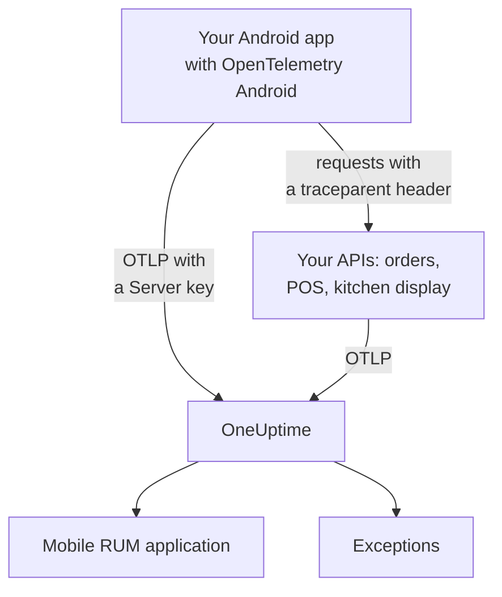

# Android Setup

Instrument a native Android app with OpenTelemetry Android so it reports to OneUptime as a mobile RUM application: its crashes and ANRs, slow and frozen frames, app starts, screens, sessions and network requests, traced through to your backend.

:::cards
- [Add OpenTelemetry Android](#add-opentelemetry-android): One Gradle dependency, and a few lines when the app starts.
- [What it reports](#what-it-reports): Crashes, ANRs, frozen frames, starts and sessions, and where each one lands.
- [Trace requests to your backend](#trace-requests-to-your-backend): A span for every OkHttp call, and a `traceparent` on it.
- [Trace your own workflows](#trace-your-own-workflows): An order from the menu to the kitchen, a payment terminal, a printer.
- [Kiosks and other devices you own](#kiosks-and-other-devices-you-own): Name each device, configure it from your MDM, keep data while offline.
:::

## How it works

OpenTelemetry Android runs inside your app. It sends traces, logs and metrics to OneUptime over OTLP with a **Server** ingestion key, and adds a W3C `traceparent` header to the requests your app makes, so your backend's spans join the app's traces.



## Before you begin

- An Android app whose `minSdk` is 23 or higher, built with `compileSdk` 34 or higher. With a `minSdk` below 26, turn on [core library desugaring](https://developer.android.com/studio/write/java8-support#library-desugaring), with Android Gradle Plugin 8.3.0 or later and `android.useFullClasspathForDexingTransform=true` in `gradle.properties`.
- A **Server** ingestion key, created under **Project Settings → Telemetry & APM → Ingestion Keys** with **Create Ingestion Key**. A **Browser** key is refused from an app: it is checked against the `Origin` header, which an app does not send.
- These OTLP settings. If you host OneUptime yourself, replace `https://oneuptime.com` with your own host.

| Setting | Value |
| --- | --- |
| OTLP endpoint | `https://oneuptime.com/otlp` |
| Header | `x-oneuptime-token: YOUR_TELEMETRY_INGESTION_TOKEN` |

> [!WARNING]
> The key ships inside your app, and an app can be unpacked, so assume someone will copy it. On the key's page, set a **Pinned Service Name**, a **Requests Per Minute Limit** and an **Expires At** date, and rotate the key with your releases.

## Add OpenTelemetry Android

:::steps
### Add the dependency

```kotlin title="app/build.gradle.kts"
dependencies {
    implementation("io.opentelemetry.android:android-agent:1.8.1")
}
```

The agent brings the crash, ANR, slow rendering, activity, fragment, network and session instrumentation with it. Check [its releases](https://github.com/open-telemetry/opentelemetry-android/releases) for a newer version.

### Start it when the app starts

```kotlin title="KioskApplication.kt"
import android.app.Application
import io.opentelemetry.android.OpenTelemetryRum
import io.opentelemetry.android.agent.OpenTelemetryRumInitializer

class KioskApplication : Application() {
    lateinit var otelRum: OpenTelemetryRum

    override fun onCreate() {
        super.onCreate()

        otelRum = OpenTelemetryRumInitializer.initialize(this) {
            httpExport {
                baseUrl = "https://oneuptime.com/otlp"
                baseHeaders = mapOf("x-oneuptime-token" to BuildConfig.ONEUPTIME_TOKEN)
            }
            resource {
                put("service.name", "kiosk-ordering")
                put("deployment.environment.name", "production")
            }
        }
    }
}
```

`baseUrl` is the endpoint without a signal: the agent adds `/v1/traces`, `/v1/logs` and `/v1/metrics` to it. Set `service.name`, or the app is named after its launcher label. It is the application's identity in OneUptime, so keep it the same from release to release.

Name the class in the `android:name` of your manifest's `<application>` element. `BuildConfig.ONEUPTIME_TOKEN` stands for wherever your build keeps the key; a fleet can receive it from its MDM instead, as [Kiosks and other devices you own](#kiosks-and-other-devices-you-own) shows.

### Launch the app and check that it arrives

```bash
curl -i https://oneuptime.com/otlp/v1/validate \
  -H "x-oneuptime-token: YOUR_TELEMETRY_INGESTION_TOKEN"
```

`200` with `"valid": true` means the key is accepted. Then launch the app and use it for a moment: it appears under **Products → Resources → Real User Monitoring**, named after its `service.name`. The agent writes telemetry to disk before it sends it, so the first batch can take a minute to arrive.
:::

## What it reports

OpenTelemetry Android records all of this on its own. The device attributes it sets, `device.model.identifier`, `device.model.name` and `device.manufacturer`, file the app as a mobile RUM application and fill its **Clients** page. It also sets `os.name`, `os.version` and an `app.installation.id` for each install, and no `device.id`.

| What | How the agent sends it | Where it shows in OneUptime |
| --- | --- | --- |
| Crashes | An `app.crash` event with the exception's type, message and stack trace | **Exceptions**, as unhandled |
| ANRs | A `device.anr` event with the main thread's stack, once the app stops responding for about 5 seconds | **Exceptions**, as unhandled, under the type `ANR` |
| Slow and frozen frames | An `app.jank` event with `app.jank.frame_count`, the frames slower than 16 ms (`app.jank.threshold` is `0.016`) or 700 ms (`0.7`) | **Logs**, with `@event.name:app.jank` |
| App starts | An `AppStart` span, with `start.type` set to `cold`, `warm` or `hot` | **Traces** |
| Screens | A span for each step of an activity's or fragment's lifecycle, and `app.screen.name` on every span and log | **Traces** |
| Sessions | `session.id` on every span and log, and `session.start` and `session.end` events | **Traces** and **Logs**, searched with `@session.id:` |
| Network changes | A `network.change` event, and `network.connection.type` on every span and log | **Logs** |

Crashes and ANRs reach **Exceptions** as unhandled, grouped by their stack traces, with the session they happened in. The agent saves a crash to disk as the app dies and sends it from there, so a crash that happens offline still arrives once the app runs again with a network.

The application's **Overview** reads these for you: **Sessions**, **Crash-free sessions**, **Crashes**, **ANRs**, **App starts**, **Cold start (p95)** and **Frozen frames**, each opening the exceptions, spans or events it counts. Until the app sends app starts or frames, their charts say what turns them on. Its **Recommendations** offer monitors for crashes, ANRs, slow cold starts, frozen frames and an app that stops reporting.

A session ends after 15 minutes in the background, or after 4 hours. An app that never goes to the background, such as a kiosk, keeps one session for 4 hours, so trace each customer's visit as a span of its own, as [Trace your own workflows](#trace-your-own-workflows) shows.

Your app's own `android.util.Log` calls become logs too when you add `android-log-library` and `android-log-agent` beside the OkHttp modules below: each call's tag goes in `android.log.tag`, and a call with a throwable is an exception in **Exceptions**. OpenTelemetry Android does not read Logcat.

## Trace requests to your backend

Add the OkHttp instrumentation and the ByteBuddy plugin it builds with:

```kotlin title="app/build.gradle.kts"
plugins {
    // ...the plugins your app already applies, then:
    id("net.bytebuddy.byte-buddy-gradle-plugin") version "1.18.15"
}

dependencies {
    implementation("io.opentelemetry.android:android-agent:1.8.1")
    implementation("io.opentelemetry.android.instrumentation:okhttp3-library:1.8.1-alpha")
    byteBuddy("io.opentelemetry.android.instrumentation:okhttp3-agent:1.8.1-alpha")
}
```

The plugin instruments the `OkHttpClient` class itself, so every client in the app is traced, the ones libraries create too. Each request becomes a client span named after its method, with its URL, status code and duration, and carries a W3C `traceparent` header. A backend instrumented with [OpenTelemetry](/docs/telemetry/open-telemetry) continues the trace from that header, so the ordering API, the POS bridge and the kitchen display service add their spans to the same trace as the tap on the kiosk.

- `HttpURLConnection` has the same pair of modules: `httpurlconnection-library` and `httpurlconnection-agent`.
- Without the plugin, wrap a client yourself: `OkHttpTelemetry.builder(otelRum.openTelemetry).build().createCallFactory(client)`, from `io.opentelemetry.instrumentation:opentelemetry-okhttp-3.0`.
- A span opened in your code, as in the next section, is the parent of the requests made inside it.

## Trace your own workflows

Get a tracer from the agent, and make one span for one customer's order, with a child span for each step of it. Every step then has its own duration and its own errors, and the order says how it ended:

```kotlin title="OrderTrace.kt"
import io.opentelemetry.api.trace.Span
import io.opentelemetry.api.trace.StatusCode
import io.opentelemetry.api.trace.Tracer
import io.opentelemetry.context.Context

class OrderTrace(private val tracer: Tracer) {
    // order.session: from the first tap to the order reaching the kitchen.
    private val order: Span = tracer.spanBuilder("order.session").startSpan()
    private val parent: Context = Context.current().with(order)

    // One step: menu.browse, cart.customize, payment.process, pos.inject.
    fun <T> step(name: String, block: (Span) -> T): T {
        val span = tracer.spanBuilder(name).setParent(parent).startSpan()
        return try {
            span.makeCurrent().use { block(span) }
        } catch (error: Throwable) {
            span.recordException(error)
            span.setStatus(StatusCode.ERROR)
            throw error
        } finally {
            span.end()
        }
    }

    fun complete() = finish("completed")

    fun abandon(reason: String) {
        order.setAttribute("order.abandon_reason", reason)
        finish("abandoned")
    }

    private fun finish(outcome: String) {
        order.setAttribute("order.outcome", outcome)
        order.end()
    }
}
```

```kotlin title="CheckoutFlow.kt"
val order = OrderTrace(otelRum.openTelemetry.getTracer("kiosk.ordering"))

order.step("cart.customize") { span ->
    span.setAttribute("cart.items", cart.size.toLong())
}
order.step("payment.process") { terminal.charge(cart.total) }
order.step("pos.inject") { posApi.submit(cart) } // its OkHttp span is a child
order.complete()
```

Wrap each call into a payment terminal's, a printer's, a scanner's or an NFC reader's SDK the same way, and say which device it was, so a slow or failing device is a slow or failing span:

```kotlin title="ReceiptPrinter.kt"
order.step("printer.print") { span ->
    span.setAttribute("peripheral.type", "printer")
    span.setAttribute("peripheral.model", printer.model)
    span.setAttribute("peripheral.connection", "usb")
    printer.print(receipt, timeoutMillis = 10_000)
}
```

The attribute names are yours to choose: keep them the same in every app, so one filter finds every printer. Give each call a timeout, because a span ends only when its call returns. A step that spans screens, such as browsing the menu, is a span you start when the screen opens and end when it closes, with the same parent. For a fact with no duration, such as a printer running out of paper, send an event: `otelRum.emitEvent("printer.paper_low")`.

In **Traces**, filter on a step's name to see how long it takes and how often it fails, and on `@order.outcome:abandoned` to find the orders that were never finished.

## Kiosks and other devices you own

### Name each device

OneUptime files a mobile app by application, never by device, so an app on thousands of phones never lists its users' phones. For devices you own, name each one in `host.name`. Each device then appears in **Inventory** as a host, beside your other machines, with the make, model and OS version the agent reports, what you add below and when it was last seen:

```kotlin title="KioskApplication.kt"
resource {
    put("service.name", "kiosk-ordering")
    put("host.name", deviceName)
    put("host.serial_number", serialNumber)
    put("device.type", "kiosk")
    put("device.location", "Store 0412")
}
```

The app's telemetry stays with its RUM application, and the device does not become a host in **Hosts**: an app reports no host metrics, so there would be nothing to show there. The device's page in **Inventory** shows its own logs, traces and exceptions, and `@resource.host.name:` finds them in **Traces** and **Logs**. A device that sends nothing for 30 days leaves **Inventory**. To see the device itself, its memory, storage and restarts and the crashes of every app on it, add the [Android Agent](/docs/telemetry/android-agent) and give it the same name in its `device_name`: the device is then a host in **Hosts** as well, and still one item in **Inventory**.

### Configure the fleet from your MDM

An app can read Android's managed configurations, which every device management service pushes to its devices. Read the key and the device's name from them, instead of building them into the app:

```kotlin title="KioskApplication.kt"
import android.content.RestrictionsManager

val restrictions = (getSystemService(RESTRICTIONS_SERVICE) as RestrictionsManager)
    .applicationRestrictions
val token = restrictions.getString("oneuptime_token").orEmpty()
val deviceName = restrictions.getString("device_name") ?: android.os.Build.MODEL
val serialNumber = restrictions.getString("device_serial").orEmpty()
```

Then hand `token` to `baseHeaders` in place of `BuildConfig.ONEUPTIME_TOKEN`, and `deviceName` and `serialNumber` to the resource above. In Esper, paste the configuration below under the app's **Managed Configuration** in a blueprint. Esper fills in the placeholders on each device, with Esper Agent 8.00.0764 or later:

```json title="Managed configuration"
{
  "oneuptime_token": "YOUR_TELEMETRY_INGESTION_TOKEN",
  "device_name": "${esper.deviceName}",
  "device_serial": "${esper.serialNumber}"
}
```

Converge the devices after a change, so they read the new values. Declare the same keys in an `app_restrictions.xml` if your MDM asks for a schema. Esper refuses an APK that has no v1 signature, so sign the release with the v1 scheme as well as v2 or v3.

### Keep what is recorded while offline

The agent writes every span, log and metric to disk before it sends it. While the network is down it keeps them there, and sends them once it is back, up to 18 hours later. It keeps 10 MB; raise it for a device that is often offline:

```kotlin title="KioskApplication.kt"
diskBuffering {
    maxCacheSize = 50 * 1024 * 1024
}
```

## Troubleshooting

:::details The app shows up under Services instead of Real User Monitoring
OpenTelemetry Android sets `device.model.identifier` itself, so the app was set up with another SDK, or its resource was replaced with `resource(Resource)`, which drops the agent's own attributes. Use the `resource { }` block, which adds to them. The Service that was already created does not turn into a RUM application, so delete it under **Products → Services** once RUM telemetry arrives.
:::

:::details Nothing arrives, or the key is refused
Run the key check in [Add OpenTelemetry Android](#add-opentelemetry-android). A `401` means the key is unknown, revoked, switched off or expired. A **Browser** key is refused from an app: use a **Server** key. Check that `baseUrl` ends in `/otlp`, without `/v1/traces`: the agent adds the path itself.
:::

:::details A crash or an ANR is not in Exceptions
A crash is saved as the app dies, and an ANR once the main thread has been stuck for about 5 seconds. Both wait on disk until the device can send them, so look again after the app has run for a minute with a network. Start the agent at the top of your `Application`'s `onCreate`, before anything that can crash, so its crash handler is in place first.
:::

:::details A device is missing from Inventory
Only a device whose app sets `host.name` is listed. Check the value in a span's resource attributes: an empty value names no device, and two devices with the same name are one row.
:::

## Next steps

:::cards
- [Mobile Setup](/docs/rum/mobile-setup): iOS, React Native and the other platforms.
- [Android Agent](/docs/telemetry/android-agent): Monitor the device itself: its health, restarts, installed apps and every app's crashes.
- [Exceptions](/docs/telemetry/exceptions): Triage the crashes and ANRs your app reports.
- [Traces Explorer](/docs/telemetry/traces-explorer): Follow an order from the kiosk to the kitchen.
- [Managing Applications](/docs/rum/applications): Names, labels, owners and retention.
:::
