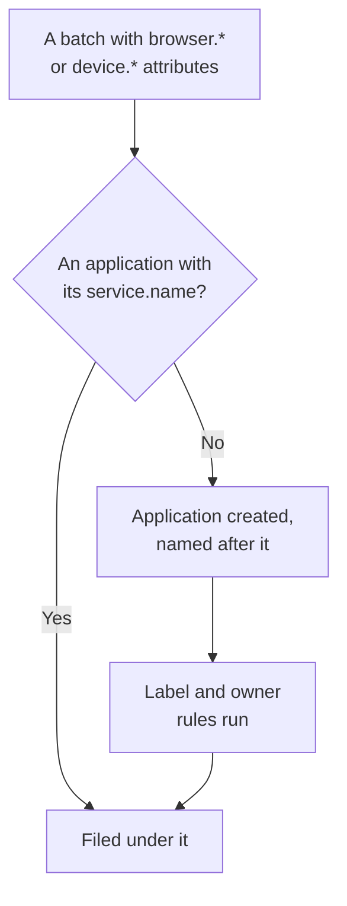

# Managing Applications

OneUptime creates a RUM application the first time your app's telemetry arrives. This page covers what you manage after that: the application's name, its labels and owners, how long its data is kept, archiving, who can see it, and alerts.

:::cards
- [How an application is created](#how-an-application-is-created): Matched by `service.name`, created on its first batch.
- [Labels](#labels): Group applications and decide who can reach them.
- [Retention](#retention): How long telemetry and recordings are kept.
- [Permissions](#permissions): Who can see applications, and who can watch recordings.
:::

## How an application is created

You do not have to create a RUM application. When a batch of telemetry with browser or device attributes and a `service.name` arrives, OneUptime files it under the application with that `service.name`, and creates the application when the project has none.



- The `service.name` is the application's identity, compared without regard to case: `Storefront-Web` and `storefront-web` are one application.
- A new `service.name` starts a new application. The old one keeps its history and turns **Disconnected**, the new one starts empty, and the two are never merged.
- Use one `service.name` per app, not one per environment. Tell environments apart with a label such as `oneuptime.label.env=production`, so they share one application and one history.

### Rename an application

The **Display Name** starts out as the `service.name`. To change it, open the application's **Settings** page and click **Edit Details** on the **Application Details** card, where you also edit its description and labels. Telemetry is matched by the **App Name (service.name)**, which the card shows and which never changes, so renaming is safe.

### Add an application yourself

Create an application yourself when you want its labels, owners or replay policy in place before the first visitor arrives.

:::steps
#### Open the application list

Go to **Products → Resources → Real User Monitoring** and click **Create RUM Application**.

#### Enter the app name

Fill in **App Name (service.name)** with the `service.name` your app will report, exactly as the app reports it.

#### Name it and save

The application is named after its app name, as a discovered one is. To show another name, open **More fields** and type a **Display Name**; the description and labels are there too. Then save the form.
:::

Its setup guide then opens on its own, with the app name as the snippet's `service.name`. Its last step, **Wait for it to connect**, says when the first data arrives.

If the project already has an application with that `service.name`, whether discovered, added before or archived, the form says so instead of creating a second one.

## Connection status

An application shows **Connected** while telemetry arrives and **Disconnected** after 15 minutes without any. OpenTelemetry telemetry and Session Replay traffic both count.

**Last Seen** is refreshed every few minutes rather than on every batch, so it can trail live traffic by up to about five minutes, and the 15 minutes leave room for that. Time when OneUptime itself was down or catching up on its ingest queue does not count towards them.

**Disconnected** is not an error on its own: an internal tool with no visitors overnight is genuinely disconnected. If people are using the app, see [RUM Troubleshooting](/docs/rum/troubleshooting).

## Labels

Labels group applications in lists and filters. They also decide what a member restricted to some labels can reach: such a member sees only the applications that carry one of those labels. An application gets its labels in three ways:

| How | Where |
| --- | --- |
| By hand | On the create form, under **More fields**, or later with **Edit Details** on the **Application Details** card of the application's **Settings** page. For several at once, select them in the list and choose **Add Labels** under **Bulk Actions**. |
| From telemetry | A resource attribute named `oneuptime.label.<name>` adds the label `<name>:<value>`, as shown below. |
| From a label rule | A rule adds labels to every new application it matches. See [Label rules and owner rules](#label-rules-and-owner-rules). |

Set the attributes on the same resource as `service.name`, for example in the `src/telemetry.ts` file from [Browser Setup](/docs/rum/browser-setup):

```ts
const resource = defaultResource().merge(
  resourceFromAttributes({
    [ATTR_SERVICE_NAME]: "storefront-web",
    "oneuptime.label.team": "payments",
    "oneuptime.label.env": "production",
  }),
);
```

This adds the labels `team:payments` and `env:production`, and creates them in the project when they do not exist. Writing the attribute's name into the label keeps `oneuptime.label.team=prod` and `oneuptime.label.env=prod` apart. A label longer than 100 characters is cut to 100, and an empty or non-string value adds nothing.

## Label rules and owner rules

A rule adds labels or owners to every new application it matches. Open **Real User Monitoring → Settings → Label Rules**, or **Owner Rules**, and create the rule in two steps:

1. On **Match**, **All RUM applications**, where a new rule starts, matches every application. To narrow it down, pick **Only RUM applications that match conditions** and add conditions on **Application Labels** (has any, all or none of the labels you pick), **Application Name** or **Application Description** (equals, contains, starts with, ends with, or matches a pattern).
2. On **Labels**, or **Owners** for an owner rule, pick what the rule adds. A new rule has to add at least one label or owner. The **Name** is filled in from your picks, such as _Add team:payments_ or _Add Payments as owners_, until you type a name of your own. The **Description**, and **Notify Owners** on an owner rule, wait under **More fields**.

Rules run when an application is created, discovered ones included. To apply a rule to the applications you already have, open the **⋯** menu on its row and select **Run Now**: see [Run Rules on Existing Resources](/docs/configuration/run-rules-now). A rule an edit left with nothing to add is marked **Adds nothing** in the list. [Label and Owner Rules](/docs/configuration/label-and-owner-rules) covers the forms in full.

### Owners

Owners are the people and teams responsible for an application. Owner rules add them to new applications. To add or remove them by hand, select applications in the list and choose **Add Owner** or **Remove Owner** under **Bulk Actions**; the API adds them through `/rum-application-owner-user` and `/rum-application-owner-team`. With **Notify Owners** on, which is the default, each owner a rule adds is told so. Turn it off before you run a rule over many applications, if nobody should be notified.

## Retention

An application's telemetry and its recordings are kept for different lengths of time:

| Data | Kept for | Set on |
| --- | --- | --- |
| Logs, metrics, traces and profiles | The project's retention, unless the application overrides it | The application's **Settings** page |
| Session Replay recordings | 7 days by default, or 1, 14, 30 or 90 days | **Replay Policy**, with **Edit Policy → Limits** |

### Telemetry retention

By default an application's telemetry is kept for the project's retention, which is set under **Project Settings → Telemetry & APM → Data Retention**. Two cards on the application's **Settings** page override it:

- **Telemetry Data Retention** holds **Retain Telemetry Data For (Days)**, one value for all of the application's telemetry. Leave it blank to use the project's retention.
- **Retention by Telemetry Type** holds a default for logs, traces, metrics and profiles each, and for logs by severity and traces by status. A value left blank falls back to the application's value, then to the project's.

Retention overrides are part of the [Enterprise Edition](/docs/self-hosted/enterprise), and of the Scale plan and above on OneUptime Cloud. Without them, the cards show what the plan adds, and the application keeps the project's retention.

On a lower Cloud plan, an override left by a trial keeps applying to new telemetry. The **Settings** page shows it on a **Retention Override** card with a **Remove Override** button, which works on every plan: from then on the application keeps the project's retention, and what is already stored keeps the retention it was stored with. Setting an override again needs the Scale plan.

### Session Replay retention

Recordings have a retention of their own, set on the application's **Replay Policy** page with **Edit Policy → Limits**: 7 days by default, or 1, 14, 30 or 90 days. It is short on purpose, because a recording is far more sensitive, and far larger, than a span. The **Session Replay Retention** card on the **Settings** page shows it (_Session replays are kept for 7 days._), and its **Edit on Replay Policy** button opens the policy.

A longer telemetry retention does not keep recordings longer. A session's counts, signals and device expire with its footage; only the session's logs, spans and exceptions follow the telemetry retention. See [Retention and deletion](/docs/telemetry/session-replay#retention-and-deletion).

> [!TIP]
> RUM is often the busiest telemetry in a project, because it grows with your users rather than with your servers. A shorter retention here, and a longer one on your backend services, is a common setup.

## Archiving and deleting

**Archive** hides an application from **All Applications** while it keeps collecting telemetry. Archive an app you no longer watch but whose history you want to keep.

- Click **Archive** on the application's **Settings** page, or select several applications in the list and archive them together.
- Archived applications are under **Real User Monitoring → Advanced → Archived**. **Advanced** starts folded in the side menu: click it to show **Archived**. **Unarchive** an application there, or several at once.

**Delete Application**, in the **Advanced** section of the application's side menu, removes the application for good. If the app still sends telemetry, its next batch creates the application again, with none of its settings, so stop the instrumentation first.

To erase one person's data rather than a whole application, file an erasure request: see [Erasing sessions](/docs/telemetry/session-replay#erasing-sessions).

## Permissions

Anyone with the project's Viewer role can see RUM applications and their telemetry. Session Replay is deliberately not part of that role: listing recordings, watching one and reading who watched are separate permissions. Project owners and admins hold them all. The permission pickers list each permission by its title, shown here in italics.

| Permission | Lets a member |
| --- | --- |
| `ReadRumApplication` (_Read RUM Application_) | See applications and their telemetry pages. |
| `CreateRumApplication`, `EditRumApplication`, `DeleteRumApplication` | Add, edit and delete applications. |
| `ReadRumSessionReplay` (_List Session Replays_) | List recorded sessions and their details, without playing them or learning who the user was. |
| `ReadRumSessionReplayPayload` (_Watch Session Replays_) | Play recordings back, and read the identified user's reference and traits. |
| `ReadRumSessionReplayAudit` (_Read Session Replay Audit_) | Read the **Replay Access Log**: who watched which recording. |
| `DeleteRumSessionReplay` (_Delete Session Replays_) | Delete recordings. |
| `CreateRumSessionErasureRequest`, `ReadRumSessionErasureRequest` | File erasure requests and follow them. |
| `ReadRumApplicationLabelRule`, `ReadRumApplicationOwnerRule` (and their Create, Edit and Delete) | Manage label rules and owner rules. |
| `ReadRumApplicationOwnerUser`, `ReadRumApplicationOwnerTeam` (and their Create, Edit and Delete) | Add and remove owners through the API. |

A useful split: give a support engineer `ReadRumApplication` and `ReadRumSessionReplay`. They can see which sessions hit errors without watching anyone's screen or learning who the user was. Give `ReadRumSessionReplayPayload` only to the people who need it; members with `ReadRumSessionReplayAudit` then see every playback on the application's **Replay Access Log** page. [Who can watch a recording](/docs/telemetry/session-replay#who-can-watch-a-recording) shows what each permission unlocks in the session list and the player.

## Alerting on RUM data

RUM telemetry is ordinary logs, metrics and traces, so there is no separate RUM monitor: the usual monitors work on it. The quickest start is the application's **Recommendations** page, which offers monitors already scoped to the application:

| Group | Recommendations |
| --- | --- |
| Core Web Vitals | Poor Largest Contentful Paint, Poor Interaction to Next Paint, Poor Cumulative Layout Shift, Slow First Contentful Paint and Slow Time to First Byte. See [Core Web Vitals](/docs/rum/web-vitals). |
| Errors | Failed User Operations, and Unhandled Browser Exceptions. |
| Session Replay | The four [storage budget alerts](/docs/telemetry/session-replay#storage-budget-alerts), which warn before the project's daily limit or the application's monthly budget runs out. They are offered once the application has recorded a replay, and the monthly pair once it also has a monthly budget. |

To build a monitor of your own, pick the one that reads the signal:

- [Metrics Monitor](/docs/monitor/metrics-monitor): a Core Web Vital, or any metric your app sends.
- [Traces Monitor](/docs/monitor/traces-monitor): the client-side error rate or latency.
- [Logs Monitor](/docs/monitor/logs-monitor): a pattern in browser logs.
- [Exceptions Monitor](/docs/monitor/exceptions-monitor): new or spiking client-side exceptions.

Scope a monitor you build to the application, so that a backend service with a similar signature does not trigger it.

## Next steps

:::cards
- [Session Replay](/docs/telemetry/session-replay): Record what users saw, with its own policy and retention.
- [Label and Owner Rules](/docs/configuration/label-and-owner-rules): Both rule forms, step by step.
- [Run Rules on Existing Resources](/docs/configuration/run-rules-now): Apply a new rule to the applications you already have.
- [RUM Troubleshooting](/docs/rum/troubleshooting): When an application is missing, empty or Disconnected.
:::
