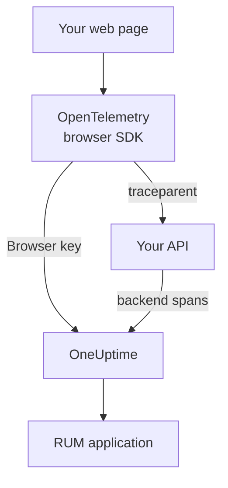

# Browser Setup

Instrument a web app with the OpenTelemetry browser SDK so it reports to OneUptime as a RUM application. Page loads and requests arrive as traces, and the same setup carries your errors, logs, metrics and Core Web Vitals.

:::cards
- [Set it up](#set-it-up): Six steps from a Browser key to your first page load.
- [Link to your backend](#linking-to-your-backend-traces): Join browser spans to the backend traces they start.
- [Report errors](#report-uncaught-errors): Send uncaught errors to the Exceptions view.
- [Troubleshooting](#troubleshooting): What to check when nothing arrives.
:::

## How it works

The SDK runs in your visitors' browsers. It records a span for each page load and request, and exports them straight to OneUptime with a **Browser** ingestion key, with no collector or proxy of your own in between.



## Before you begin

- A web app whose code you can change and redeploy, with its dependencies installed through npm.
- The origins your pages are served from, such as `https://app.example.com`. A Browser key accepts requests only from the origins you list on it.
- A role that can create ingestion keys: project owners and admins can, and so can anyone with the **Create Telemetry Ingestion Key** permission.

## Set it up

:::steps
### Create a Browser ingestion key

1. Go to **Products → Project Settings**.
2. In the side menu, open **Telemetry & APM** and select **Ingestion Keys**.
3. Click **Create Ingestion Key**, and pick **Browser** as the **Key Type**.
4. On the **Browser Settings** step, list your origins in **Allowed Origins** as a JSON array, such as `["https://app.example.com"]`, then create the key. On OneUptime Cloud's Free plan, a last **Billing** step shows the telemetry price first.


The new key opens on its own page. Copy its **Secret Key**: it is the token the SDK sends as `x-oneuptime-token`.


### Install the packages

```bash
npm install @opentelemetry/api \
  @opentelemetry/sdk-trace-web \
  @opentelemetry/resources \
  @opentelemetry/semantic-conventions \
  @opentelemetry/opentelemetry-browser-detector \
  @opentelemetry/exporter-trace-otlp-http \
  @opentelemetry/context-zone \
  @opentelemetry/instrumentation \
  @opentelemetry/instrumentation-document-load \
  @opentelemetry/instrumentation-fetch \
  @opentelemetry/instrumentation-xml-http-request
```

### Create the telemetry file

Create `src/telemetry.ts`. `browserDetector` adds the `browser.*` attributes that file the telemetry as RUM, and `service.name` names the application.

```ts title="src/telemetry.ts"
import {
  WebTracerProvider,
  BatchSpanProcessor,
} from "@opentelemetry/sdk-trace-web";
import { OTLPTraceExporter } from "@opentelemetry/exporter-trace-otlp-http";
import { ZoneContextManager } from "@opentelemetry/context-zone";
import { registerInstrumentations } from "@opentelemetry/instrumentation";
import { DocumentLoadInstrumentation } from "@opentelemetry/instrumentation-document-load";
import { FetchInstrumentation } from "@opentelemetry/instrumentation-fetch";
import { XMLHttpRequestInstrumentation } from "@opentelemetry/instrumentation-xml-http-request";
import {
  defaultResource,
  detectResources,
  resourceFromAttributes,
} from "@opentelemetry/resources";
import { browserDetector } from "@opentelemetry/opentelemetry-browser-detector";
import { ATTR_SERVICE_NAME } from "@opentelemetry/semantic-conventions";

const ONEUPTIME_URL = "https://oneuptime.com";
// Public: it ships in your page. It must be a Browser ingestion key.
const ONEUPTIME_TOKEN = "YOUR_TELEMETRY_INGESTION_TOKEN";

/*
 * browserDetector supplies the browser.* attributes. Without them this
 * telemetry is classified as a backend Service, not a RUM application.
 * The attributes set last win, so service.name here overrides the
 * "unknown_service" that defaultResource() provides.
 */
const resource = defaultResource()
  .merge(detectResources({ detectors: [browserDetector] }))
  .merge(
    resourceFromAttributes({
      [ATTR_SERVICE_NAME]: "storefront-web",
    }),
  );

const provider = new WebTracerProvider({
  resource: resource,
  spanProcessors: [
    new BatchSpanProcessor(
      new OTLPTraceExporter({
        url: `${ONEUPTIME_URL}/otlp/v1/traces`,
        headers: { "x-oneuptime-token": ONEUPTIME_TOKEN },
      }),
    ),
  ],
});

provider.register({
  contextManager: new ZoneContextManager(),
});

registerInstrumentations({
  instrumentations: [
    new DocumentLoadInstrumentation(),
    new FetchInstrumentation({
      // See "Linking to your backend traces" before widening this.
      propagateTraceHeaderCorsUrls: [/^https:\/\/api\.example\.com/],
    }),
    new XMLHttpRequestInstrumentation({
      propagateTraceHeaderCorsUrls: [/^https:\/\/api\.example\.com/],
    }),
  ],
});
```

### Import it first

Make it the first import of your app. The instrumentations patch `fetch` and `XMLHttpRequest`, and a request made before the patch is not traced.

```ts
// src/index.tsx (React), src/main.ts (Vue / Angular), etc.
import "./telemetry";
import React from "react";
// ... the rest of your app
```

### Check the key

Ask OneUptime whether it accepts the key before you look anywhere else:

```bash
curl -i https://oneuptime.com/otlp/v1/validate \
  -H "x-oneuptime-token: YOUR_TELEMETRY_INGESTION_TOKEN"
```

`200` with `"valid": true` means the key is accepted; for a Browser key the message adds that it works only from a browser, from one of its allowed origins. `401` means the key is unknown, revoked, switched off or expired.

### Load a page

Open your site. Within a minute the application appears under **Products → Resources → Real User Monitoring**, named after its `service.name`.
:::

## What a Browser key allows

Everything in the snippet ships to your visitors, so anyone can copy the token from your page. A Browser key limits what a copy can do:

| Setting | What it does |
| --- | --- |
| **Allowed Origins** | Requests are accepted only from these origins, each with its scheme and any port. A host may start with one `*.` wildcard: `https://*.example.com` covers every subdomain of `example.com`, but not `example.com` itself. |
| **Requests Per Minute Limit** | One ceiling for every visitor using the key: 6000 requests per minute unless you set your own. |
| **Pinned Service Name** | Forces `service.name` on everything the key writes, so a copy cannot pass its telemetry off as one of your backend services. |
| **Expires At** | The key stops being accepted after this date. |
| **Enabled** | Switch it off to stop a leaked key at once. |

A Browser key writes OTLP traces, logs and metrics, and session replays; every other ingest route refuses it. You change these settings on the key's own page. The key type cannot be changed after the key is created.

> [!WARNING]
> Never put a **Server** key in a page. A Server key writes every kind of telemetry from anywhere, with no origin check, so anyone who reads your page could write into your project.

## Setting `browser.*` without the detector

`browserDetector` reads the [UA Client Hints API](https://wicg.github.io/ua-client-hints/), which only Chromium browsers have. On Safari and Firefox it sets `browser.language` and `user_agent.original`, but not `browser.platform`, `browser.brands` or `browser.mobile`.

That is still enough to file the telemetry as RUM, because `browser.language` alone marks a batch as browser RUM. The **Clients** page lists platforms from `browser.platform`, though, so Safari and Firefox visits add no row there.

To skip the detector, or to give every browser a platform, set the attributes yourself:

```ts
const resource = defaultResource().merge(
  resourceFromAttributes({
    [ATTR_SERVICE_NAME]: "storefront-web",
    // Any one of these three marks the telemetry as browser RUM.
    "browser.language": navigator.language,
    "browser.platform":
      (navigator as any).userAgentData?.platform ?? "unknown",
    "browser.mobile": (navigator as any).userAgentData?.mobile ?? false,
    "user_agent.original": navigator.userAgent,
  }),
);
```

Keep `browser.platform` coarse. Every distinct value becomes a row on the **Clients** page, so a full user-agent string or a per-user value there makes an endless list, and is a privacy problem too.

## Trace route changes

`DocumentLoadInstrumentation` traces the first load only. In a single-page app, route changes stay invisible until you record them, which takes a few lines in your router:

```ts
import { trace } from "@opentelemetry/api";

const tracer = trace.getTracer("app-router");

function onRouteChange(to: string): void {
  const span = tracer.startSpan("route-change", {
    attributes: { "app.route": to },
  });
  // End it when the route's data has loaded and the view has painted.
  requestAnimationFrame(() => {
    return span.end();
  });
}
```

Add `@opentelemetry/instrumentation-user-interaction` to trace clicks and other DOM events too. For INP on each route, see [Single-page apps](/docs/rum/web-vitals#single-page-apps).

## Linking to your backend traces

`propagateTraceHeaderCorsUrls` decides which cross-origin requests carry a W3C `traceparent` header, which joins the browser span to the backend trace it started. Requests to your page's own origin carry it with no configuration.

> [!WARNING]
> Do not set it to `/.*/`. The header turns a simple cross-origin request into a preflighted one, so any third-party API that does not list `traceparent` in its `Access-Control-Allow-Headers` starts failing.

List only origins you control and have configured:

```ts
new FetchInstrumentation({
  propagateTraceHeaderCorsUrls: [
    /^https:\/\/api\.example\.com/,
    /^https:\/\/auth\.example\.com/,
  ],
});
```

With [Session Replay](/docs/telemetry/session-replay) installed, requests to your own origin also carry the replay's session id, which files your backend telemetry under the recording: see [Joining traces to session replay](#joining-traces-to-session-replay).

## Joining traces to session replay

If you also run [Session Replay](/docs/telemetry/session-replay), your **backend** telemetry joins the recording with no code here. While a session uploads, the recorder adds a `tracestate` member carrying the session id to the requests your page makes to its own origin, and leaves the `traceparent` to your `FetchInstrumentation` / `XMLHttpRequestInstrumentation`. Your backend's spans are stamped with the session id at ingest, in every service that continues W3C trace context, and its logs and exceptions join the recording by trace id. See [Correlating with your other telemetry](/docs/telemetry/session-replay#correlating-with-your-other-telemetry) for how it works, what it does not cover, and the switch that turns it off.

The recorder also reads back the `traceparent` your instrumentations set, whether the call passes a URL (with or without an init object) or a `Request` object, so each request row in the replay links to its backend trace. For an API on another origin, list it in `propagateTraceHeaderCorsUrls` above; its requests carry no session id and join the recording by trace id. **Trace propagation origins** in the application's replay policy does the same for pages *without* this SDK.

What the headers do not reach is this SDK's own browser spans: document loads, route changes and the errors you report. To file those under the recording as well, stamp `session.id` on each span as it starts. The recorder tells you the id through `onSessionChange`, which fires at once if a session already exists, and again whenever the id changes: when the visitor comes back after 30 minutes idle, at the 4-hour cap, when `identify()` names a different user, or when another tab of the same visitor changed it first.

```ts title="src/replaySession.ts"
import type { Context } from "@opentelemetry/api";
import type {
  ReadableSpan,
  Span,
  SpanProcessor,
} from "@opentelemetry/sdk-trace-web";

declare global {
  interface Window {
    OneUptimeReplayQueue?: Array<Array<unknown>>;
  }
}

let replaySessionId: string | null = null;

// The recorder script loads asynchronously. The queue is applied the
// moment it starts and stays live afterwards, so this works either way.
(window.OneUptimeReplayQueue = window.OneUptimeReplayQueue || []).push([
  "onSessionChange",
  (sessionId: string): void => {
    replaySessionId = sessionId;
  },
]);

export class ReplaySessionSpanProcessor implements SpanProcessor {
  public onStart(span: Span, _parentContext: Context): void {
    if (replaySessionId) {
      span.setAttribute("session.id", replaySessionId);
    }
  }

  public onEnd(_span: ReadableSpan): void {}

  public forceFlush(): Promise<void> {
    return Promise.resolve();
  }

  public shutdown(): Promise<void> {
    return Promise.resolve();
  }
}
```

Then put it first in the provider's span processors in `src/telemetry.ts`:

```ts
import { ReplaySessionSpanProcessor } from "./replaySession";

const provider = new WebTracerProvider({
  resource: resource,
  spanProcessors: [
    new ReplaySessionSpanProcessor(),
    new BatchSpanProcessor(
      new OTLPTraceExporter({
        url: `${ONEUPTIME_URL}/otlp/v1/traces`,
        headers: { "x-oneuptime-token": ONEUPTIME_TOKEN },
      }),
    ),
  ],
});
```

Spans started after that carry the id, the replay player's **Traces** tab lists them on the recording's clock, and each of them in the dashboard links back to the moment in the replay. A span processor stamps each span with the id that was current when it started; writing the id into `resource.attributes` instead would re-label spans still waiting in the export batch when the session rotated. The listener is told the id as soon as the recorder starts, before consent or a capture trigger, so if that matters, stamp only once your page has consent.

## Content Security Policy

If your site sends a Content Security Policy, the browser blocks the exporter's requests until you allow OneUptime in `connect-src`. Nothing fails where you can see it: the page simply reports nothing.

```text
connect-src 'self' https://oneuptime.com;
```

Merge it into your existing `connect-src` directive. If you host OneUptime yourself, use your own host.

## Report uncaught errors

The OpenTelemetry browser SDK does not capture uncaught errors. Report them yourself, and they appear under **Exceptions** next to your backend errors:

```ts
import { trace, SpanStatusCode } from "@opentelemetry/api";

const tracer = trace.getTracer("app-errors");

window.addEventListener("error", (event: ErrorEvent) => {
  const span = tracer.startSpan("window.onerror");
  span.recordException(event.error ?? new Error(event.message));
  span.setStatus({ code: SpanStatusCode.ERROR });
  span.end();
});

window.addEventListener("unhandledrejection", (event: PromiseRejectionEvent) => {
  const span = tracer.startSpan("unhandledrejection");
  span.recordException(
    event.reason instanceof Error ? event.reason : new Error(String(event.reason)),
  );
  span.setStatus({ code: SpanStatusCode.ERROR });
  span.end();
});
```

With [Session Replay](/docs/telemetry/session-replay), the recorder also captures uncaught errors and marks them on the replay's timeline. The exception's page then shows a **Watch what the user saw** card, which opens the replay ten seconds before the error. With the default policy every session is recorded, whether or not anything throws; the error only decides where the card opens.

## Add logs and metrics

Traces are enough to fill the overview. Add the log and metric pipelines when you want browser logs in OneUptime, or to send [Core Web Vitals](/docs/rum/web-vitals):

```bash
npm install @opentelemetry/api-logs @opentelemetry/sdk-logs \
  @opentelemetry/exporter-logs-otlp-http \
  @opentelemetry/sdk-metrics @opentelemetry/exporter-metrics-otlp-http
```

```ts
import { LoggerProvider, BatchLogRecordProcessor } from "@opentelemetry/sdk-logs";
import { OTLPLogExporter } from "@opentelemetry/exporter-logs-otlp-http";
import { MeterProvider, PeriodicExportingMetricReader } from "@opentelemetry/sdk-metrics";
import { OTLPMetricExporter } from "@opentelemetry/exporter-metrics-otlp-http";
import { logs } from "@opentelemetry/api-logs";
import { metrics } from "@opentelemetry/api";

const headers = { "x-oneuptime-token": ONEUPTIME_TOKEN };

logs.setGlobalLoggerProvider(
  new LoggerProvider({
    resource: resource,
    processors: [
      new BatchLogRecordProcessor({
        exporter: new OTLPLogExporter({
          url: `${ONEUPTIME_URL}/otlp/v1/logs`,
          headers,
        }),
      }),
    ],
  }),
);

metrics.setGlobalMeterProvider(
  new MeterProvider({
    resource: resource,
    readers: [
      new PeriodicExportingMetricReader({
        exporter: new OTLPMetricExporter({
          url: `${ONEUPTIME_URL}/otlp/v1/metrics`,
          headers,
        }),
        exportIntervalMillis: 30000,
      }),
    ],
  }),
);
```

Build them with the same `resource` object. A log or metric pipeline whose resource lacks `browser.*` is filed as a separate backend service.

## Endpoint reference

| Signal | Endpoint | Header |
| --- | --- | --- |
| Traces | `POST {host}/otlp/v1/traces` | `x-oneuptime-token: <token>` |
| Metrics | `POST {host}/otlp/v1/metrics` | `x-oneuptime-token: <token>` |
| Logs | `POST {host}/otlp/v1/logs` | `x-oneuptime-token: <token>` |

`{host}` is `https://oneuptime.com`, or your own host if you run OneUptime yourself; change it in the OTLP URLs and in the Content Security Policy entry. OneUptime accepts OTLP/JSON and OTLP/protobuf. The endpoints answer cross-origin requests from any origin and allow the `x-oneuptime-token` header, so a browser exports to them directly.

## Troubleshooting

:::details No request to OneUptime in the Network tab
Open your browser's developer tools, go to the Network tab and filter for `otlp`: you are looking for `POST /otlp/v1/traces`. No request at all means the SDK never started:

- `telemetry.ts` is not the first import, or your bundler dropped it.
- The batch processor has not exported yet. It waits a few seconds to fill a batch, so wait, or move to another page, before you decide nothing is sent.
- A build-time environment variable came out as `undefined`, so the exporter's URL is broken. Log the URL once at startup.
:::

:::details The browser blocks the request
- A Content Security Policy error in the console means `connect-src` does not allow OneUptime yet: see [Content Security Policy](#content-security-policy).
- A CORS error almost always means the request never reached OneUptime, whose endpoints allow any origin: look for a corporate proxy, an ad blocker or a typo in the host.
:::

:::details OneUptime refuses the request
- `422` with `Origin https://app.example.com is not allowed for this browser ingestion key.` means the page's exact origin (scheme, host and port) is missing from the key's **Allowed Origins**.
- `422` with `This telemetry ingestion key has been disabled.` means someone switched the key off. Turn it back on, or use another key.
- `401` means the key is unknown, revoked or expired. Run the key check in [Set it up](#set-it-up), then create a live Browser key.
- `404` means the URL is wrong. The trace exporter needs the full path, `/otlp/v1/traces`.
:::

:::details The app shows up under Services instead of Real User Monitoring
The resource has no `browser.*` attribute, so the telemetry was filed as a backend service. Add `browserDetector`, or set the attributes as in [Setting `browser.*` without the detector](#setting-browser-without-the-detector).

Check what you send in the Network tab, in the request's payload: `resourceSpans[0].resource.attributes` is the list that decides it. The service that was already created does not turn into a RUM application, so delete it under **Products → Services** once RUM telemetry arrives.
:::

:::details The Clients page is empty on Safari or Firefox
Client rows come from `browser.platform`, which `browserDetector` sets only on Chromium browsers. Set it yourself to list Safari and Firefox visits: see [Setting `browser.*` without the detector](#setting-browser-without-the-detector).
:::

## Next steps

:::cards
- [Core Web Vitals](/docs/rum/web-vitals): Send LCP, INP, CLS, FCP and TTFB from the same page.
- [Session Replay](/docs/telemetry/session-replay): Record what the user saw, next to these traces.
- [Managing Applications](/docs/rum/applications): Names, labels, owners and retention.
- [RUM Troubleshooting](/docs/rum/troubleshooting): Every check, in the order problems usually happen.
:::
