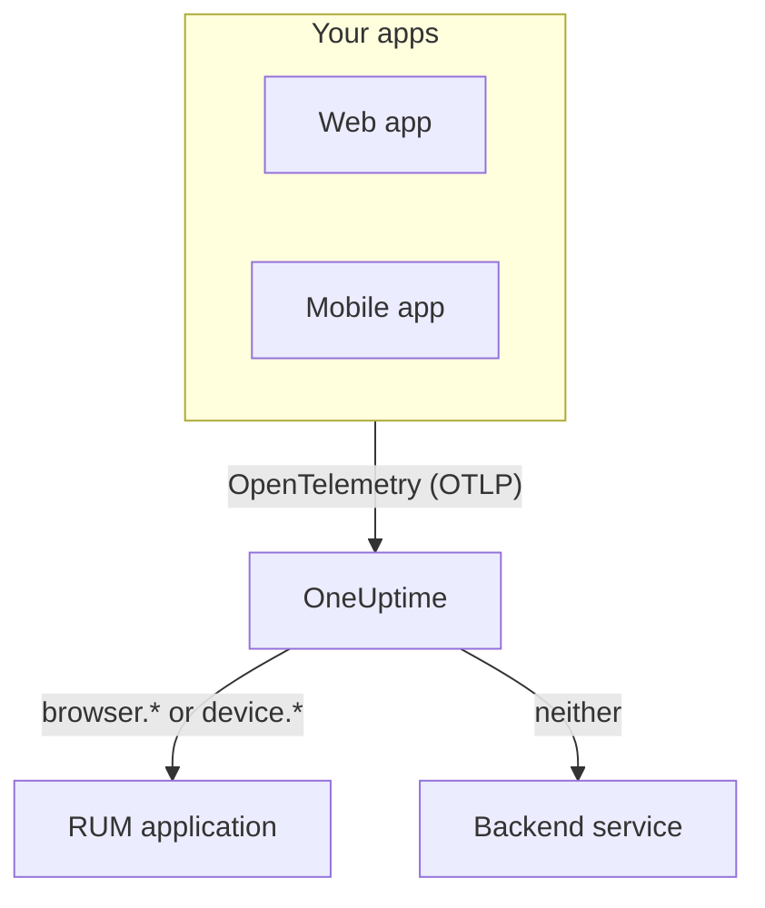

# RUM Overview

Real User Monitoring (RUM) shows what real users experience in your web and mobile apps: page loads, requests, errors and Core Web Vitals, reported by the app itself rather than by a probe. OneUptime files that telemetry under a RUM application you can chart, search and alert on.

:::cards
- [How it works](#how-it-works): One OpenTelemetry pipeline, filed as RUM when it arrives.
- [How OneUptime recognises RUM](#how-oneuptime-recognises-rum): The resource attributes that decide it.
- [What you get](#what-you-get): The overview, the vitals, the explorers and the replays.
- [Get started](#get-started): From an ingestion key to your first page load.
:::

## How it works

RUM uses the same OpenTelemetry pipeline as the rest of OneUptime. There is no RUM agent and no wire format of its own: you point an OpenTelemetry browser or mobile SDK at OneUptime, and the telemetry is filed as RUM when it arrives.

- **One application per app.** Its identity is the `service.name` your SDK reports, and OneUptime creates the application on its first batch of telemetry.
- **Never counted twice.** Client telemetry belongs to its RUM application only; it is not also listed as a backend service.
- **Session Replay is a separate, optional layer.** It has its own snippet and privacy controls: see [Session Replay](/docs/telemetry/session-replay).

## Where to find it

Open **Products → Resources → Real User Monitoring**. **All Applications** lists your applications with their **Client Type**, **Status** and **Last Seen**. Two more sections of the side menu start folded:

- **Settings**: **Owner Rules**, **Label Rules** and the project-wide **Session Replay** switch.
- **Advanced**: **Archived**, the applications you archived.

An application's own side menu groups its pages like this; **Settings**, **Developer** and **Advanced** start folded:

| Section | Pages |
| --- | --- |
| **Basic** | **Overview**, **Recommendations**, **Documentation** |
| **Observability** | **Metrics**, **Logs**, **Traces**, **Clients** |
| **Session Replay** | **Session Replay**, **User Flows**, **Replay Users**, **Health**, **Replay Policy**, **Replay Access Log**, **Documentation** |
| **Settings** | **Settings** |
| **Developer** | **Terraform**, **API**, **AI Assistants** |
| **Advanced** | **Delete Application** |

## How OneUptime recognises RUM

Most "my app does not show up" questions end here. OneUptime decides, for each batch of telemetry when it arrives, from the batch's **resource attributes**:

1. A batch whose resource has `browser.platform`, `browser.language` or a non-empty `browser.brands` is **browser** RUM.
2. Otherwise, a batch with `device.id` or `device.model.identifier` is **mobile** RUM.
3. Otherwise, a batch with `device.manufacturer` and no host identity (`host.name`, `host.id` or `k8s.node.name`) is **mobile** RUM too.
4. Anything else is a backend service.

Backend SDKs never set `browser.*`, `device.id` or `device.model.identifier`, so those are clean signals. `device.manufacturer` is the exception: a host's inventory reports the make of a machine with it too, so it counts only on a resource with no host identity. See [Inventory attributes](/docs/telemetry/host-otel-collector#inventory-attributes-ip-mac-serial-number-make-model-firmware).

| Attribute | Required | What it does |
| --- | --- | --- |
| `service.name` | **Yes** | The application's identity, such as `storefront-web`. Without it, no RUM application is created. |
| `browser.platform`, `browser.language`, `browser.brands` | One of them, on the web | Marks the batch as browser RUM. `browser.platform` also fills the **Clients** page. |
| `device.id`, `device.model.identifier` | One of them, on mobile | Marks the batch as mobile RUM. `device.model.identifier` also fills the **Clients** page. |
| `device.manufacturer` | No | Marks the batch as mobile RUM only when the resource carries no host identity. |
| `telemetry.sdk.language` | No | Shown on the overview, such as `webjs` or `swift`. |
| `telemetry.sdk.version` | No | Shown as the SDK version; `oneuptime.agent.version` is read when it is missing. |
| `oneuptime.label.<name>` | No | Adds the project label `<name>:<value>` to the application. |

OneUptime finds the application by `service.name`, ignoring case, and creates it when the project has none. A new `service.name` starts a new application, so keep it stable, and tell environments apart with a label rather than a new name. [Managing Applications](/docs/rum/applications) covers names, labels, owners and retention.

> [!IMPORTANT]
> The OpenTelemetry browser SDK adds no `browser.*` attributes unless you add the browser resource detector or set them yourself. With only `service.name`, the telemetry becomes a backend service, not a RUM application. [Browser Setup](/docs/rum/browser-setup) shows both ways.

## What you get

| Where | What it shows |
| --- | --- |
| **Overview** | Tiles for **Page loads**, **Page load time (p95)**, **Events**, **Error rate**, **Event duration (p95)**, **Exceptions**, **Clients** and **Sessions recorded**, and trend charts over the time range you pick. |
| **Core Web Vitals** | A card on the overview with LCP, INP, CLS, FCP and TTFB, each rated against Google's limits, and INP for each route of a single-page app. See [Core Web Vitals](/docs/rum/web-vitals) and [Single-page apps](/docs/rum/web-vitals#single-page-apps). |
| **Metrics**, **Logs**, **Traces** | The telemetry explorers, showing only this application. |
| **Clients** | The browser platforms and device models the application has been used on: a short list by platform, never one row per user. |
| **Session Replay** | Recordings of real sessions, next to their errors, traces and logs: see [Session Replay](/docs/telemetry/session-replay). |
| **Recommendations** | Ready-made monitors for the application: poor Core Web Vitals, failed requests, browser exceptions and, once it records, Session Replay budgets. |

The counts come from the spans your instrumentation sends. **Page loads** counts the `documentLoad` span that the page-load instrumentation records for each full load, so a route change inside a single-page app is not a page load.

An application shows **Connected** while telemetry arrives and **Disconnected** after 15 minutes without any. Time when OneUptime itself was down or catching up on its ingest queue does not count towards those 15 minutes.

## Get started

:::steps
### Create an ingestion key

Open **Project Settings → Telemetry & APM → Ingestion Keys** and click **Create Ingestion Key**. A web app needs a **Browser** key, which works only from the origins you list. A mobile app needs a **Server** key, because a mobile SDK sends no `Origin` header.

### Instrument your app

Follow [Browser Setup](/docs/rum/browser-setup) for a web app, or [Mobile Setup](/docs/rum/mobile-setup) for Android, iOS, React Native and other platforms.

### Open a page

Load a page of your site, or launch your app. The application appears under **Products → Resources → Real User Monitoring** on its first batch of telemetry, named after its `service.name`. You do not need to create it first.

### Add vitals and replays

When the basics arrive, send [Core Web Vitals](/docs/rum/web-vitals) and add [Session Replay](/docs/telemetry/session-replay). Both are optional.
:::

If nothing shows up, [RUM Troubleshooting](/docs/rum/troubleshooting) walks through the causes in the order they usually happen.

## Next steps

:::cards
- [Browser Setup](/docs/rum/browser-setup): Instrument a web app with the OpenTelemetry browser SDK.
- [Mobile Setup](/docs/rum/mobile-setup): Android, iOS, React Native and any other OpenTelemetry SDK.
- [Core Web Vitals](/docs/rum/web-vitals): Send LCP, INP, CLS, FCP and TTFB, and read INP route by route.
- [Session Replay](/docs/telemetry/session-replay): Watch what the user saw, next to their errors and traces.
:::
