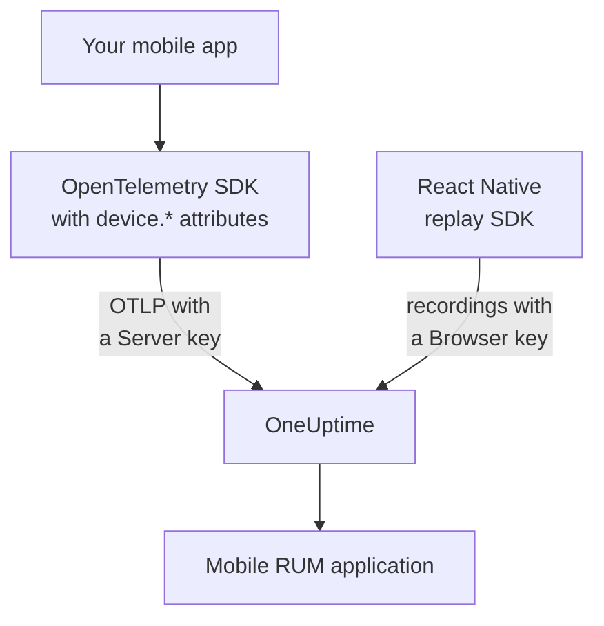

# Mobile Setup

Instrument an Android, iOS or React Native app with OpenTelemetry so it reports to OneUptime as a mobile RUM application. Any other platform with an OpenTelemetry SDK works the same way.

:::cards
- [What OneUptime needs](#what-oneuptime-needs): Two resource attributes, sent with a Server key.
- [Set up your platform](#set-up-your-platform): Android, iOS, React Native and the rest.
- [Check that it arrives](#check-that-it-arrives): Test the key, then find the app.
- [Session Replay on mobile](#session-replay-on-mobile): Recordings for React Native apps.
:::

## How it works

Your app exports OTLP straight to OneUptime with a **Server** ingestion key. The `device.*` attributes on its resource are what file it as mobile RUM rather than as a backend service.



## What OneUptime needs

Two resource attributes, on every batch your app exports:

| Attribute | What it is |
| --- | --- |
| `service.name` | The application's identity, such as `storefront-android`. |
| `device.id` or `device.model.identifier` | Marks the telemetry as mobile RUM. `device.model.identifier` also fills the **Clients** page. |

Without a device attribute, the telemetry still arrives and you can query it, but it is filed as a backend service instead of a RUM application.

`device.manufacturer` marks a batch as mobile too, but only on a resource with no host identity, because a host's inventory reports the make of a machine with it. Set `device.id` or `device.model.identifier` as well, as every recipe below does, and this never matters.

Make `device.id` an install-scoped identifier, never an advertising ID or anything else that identifies a person. OneUptime reads it only to recognise mobile telemetry.

## Before you begin

- An app with an OpenTelemetry SDK: the OpenTelemetry Java SDK or OpenTelemetry Android, opentelemetry-swift, or the OpenTelemetry JavaScript SDK for React Native.
- A **Server** ingestion key, created under **Project Settings → Telemetry & APM → Ingestion Keys** with **Create Ingestion Key**. A **Browser** key is refused from a mobile app: it is checked against the `Origin` header, which mobile SDKs do not send.
- These OTLP settings. If you host OneUptime yourself, replace `https://oneuptime.com` with your own host.

| Setting | Value |
| --- | --- |
| OTLP endpoint | `https://oneuptime.com/otlp` |
| Header | `x-oneuptime-token: YOUR_TELEMETRY_INGESTION_TOKEN` |
| Traces | `POST https://oneuptime.com/otlp/v1/traces` |
| Metrics | `POST https://oneuptime.com/otlp/v1/metrics` |
| Logs | `POST https://oneuptime.com/otlp/v1/logs` |

> [!WARNING]
> The key ships inside your app, and an app can be unpacked, so assume someone will copy it. On the key's page, set a **Pinned Service Name** so a copy cannot write under your backend services' names, add a **Requests Per Minute Limit** and an **Expires At** date, and rotate the key with your releases.

## Set up your platform

The snippets show the shape of the setup. The mobile OpenTelemetry SDKs change their APIs between releases, so check the method names against the version you pin. What OneUptime needs never changes: the endpoint, the header, `service.name` and one `device.*` attribute.

:::tabs
@tab Android
Use the OpenTelemetry Java SDK and its OTLP exporter, which run on Android:

```kotlin title="app/build.gradle.kts"
dependencies {
    implementation(platform("io.opentelemetry:opentelemetry-bom:<latest>"))
    implementation("io.opentelemetry:opentelemetry-sdk")
    implementation("io.opentelemetry:opentelemetry-exporter-otlp")
}
```

```kotlin title="StorefrontApplication.kt"
import android.app.Application
import android.os.Build
import io.opentelemetry.exporter.otlp.http.trace.OtlpHttpSpanExporter
import io.opentelemetry.sdk.OpenTelemetrySdk
import io.opentelemetry.sdk.resources.Resource
import io.opentelemetry.sdk.trace.SdkTracerProvider
import io.opentelemetry.sdk.trace.export.BatchSpanProcessor

class StorefrontApplication : Application() {
    override fun onCreate() {
        super.onCreate()

        val resource = Resource.getDefault().toBuilder()
            .put("service.name", "storefront-android")
            .put("device.manufacturer", Build.MANUFACTURER)
            .put("device.model.identifier", Build.MODEL)
            .build()

        val exporter = OtlpHttpSpanExporter.builder()
            .setEndpoint("https://oneuptime.com/otlp/v1/traces")
            .addHeader("x-oneuptime-token", BuildConfig.ONEUPTIME_TOKEN)
            .build()

        OpenTelemetrySdk.builder()
            .setTracerProvider(
                SdkTracerProvider.builder()
                    .setResource(resource)
                    .addSpanProcessor(BatchSpanProcessor.builder(exporter).build())
                    .build()
            )
            .buildAndRegisterGlobal()
    }
}
```

The [OpenTelemetry Android](https://github.com/open-telemetry/opentelemetry-android) agent adds automatic instrumentation on top, and sets device attributes on its own resource. If you use it, point its exporter at the same endpoint and header, and check that `device.model.identifier` reaches the resource on your version.
@tab iOS
Use [opentelemetry-swift](https://github.com/open-telemetry/opentelemetry-swift), and set the device attributes yourself: the resource each version adds on its own has changed between releases.

```swift
let resource = Resource(attributes: [
    "service.name": .string("storefront-ios"),
    "device.model.identifier": .string(UIDevice.current.model),
    "device.manufacturer": .string("Apple"),
    "telemetry.sdk.language": .string("swift"),
])

let exporter = OtlpHttpTraceExporter(
    endpoint: URL(string: "https://oneuptime.com/otlp/v1/traces")!,
    config: OtlpConfiguration(
        headers: [("x-oneuptime-token", oneUptimeToken)]
    )
)

OpenTelemetry.registerTracerProvider(
    tracerProvider: TracerProviderBuilder()
        .with(resource: resource)
        .add(spanProcessor: BatchSpanProcessor(spanExporter: exporter))
        .build()
)
```

`UIDevice.current.model` gives a short name such as `iPhone`, which keeps the **Clients** page to one row per kind of device.
@tab React Native
React Native runs the OpenTelemetry JavaScript SDK, so build the provider, the OTLP exporter and the batch processor as in [Browser Setup](/docs/rum/browser-setup), with three changes: send with a **Server** key, leave out `browserDetector` and `DocumentLoadInstrumentation`, and set the device attributes yourself.

```ts
import { Platform } from "react-native";
import * as Device from "expo-device"; // or react-native-device-info
import {
  defaultResource,
  resourceFromAttributes,
} from "@opentelemetry/resources";

const resource = defaultResource().merge(
  resourceFromAttributes({
    "service.name": "storefront-mobile",
    "device.manufacturer": Device.manufacturer ?? Platform.OS,
    "device.model.identifier":
      Device.modelId ?? Device.modelName ?? "unknown",
    "telemetry.sdk.language": "webjs",
  }),
);
```

`Device.modelId` is set on iOS only, so Android falls back to `Device.modelName`.
@tab Other platforms
Flutter, Unity, .NET MAUI, an embedded client or an OTLP writer of your own all work, as long as the resource carries `service.name` and one `device.*` attribute. An SDK that reads the standard OpenTelemetry environment variables takes these as they are:

```bash
OTEL_EXPORTER_OTLP_ENDPOINT="https://oneuptime.com/otlp"
OTEL_EXPORTER_OTLP_HEADERS="x-oneuptime-token=YOUR_TELEMETRY_INGESTION_TOKEN"
OTEL_RESOURCE_ATTRIBUTES="service.name=storefront-mobile,device.manufacturer=Acme,device.model.identifier=AC-100"
```

The SDK adds `/v1/traces`, `/v1/metrics` and `/v1/logs` to the endpoint itself.
:::

## Check that it arrives

:::steps
### Test the key

Before you look through the SDK's settings, ask OneUptime whether it accepts the key:

```bash
curl -i https://oneuptime.com/otlp/v1/validate \
  -H "x-oneuptime-token: YOUR_TELEMETRY_INGESTION_TOKEN"
```

`200` with `"valid": true` means the key is accepted. A Browser key answers `200` too, but its message says it works only from a browser: a mobile app needs a Server key. `401` means the key is unknown, revoked, switched off or expired, and no SDK setting will fix that.

### Launch the app

Run the app and use it for a moment. It appears under **Products → Resources → Real User Monitoring** on its first batch of telemetry, named after its `service.name`.

### Open the Clients page

Open the application's **Clients** page: each device model from `device.model.identifier` has a row. If the page stays empty while **Traces** fills up, the device attributes are not reaching the resource.
:::

## Session Replay on mobile

React Native apps can record sessions with `@oneuptime/react-native-replay`. It records the native view tree as a wireframe, never screenshots or the text on screen, and its recordings open in the same player as web ones. It sends with a **Browser** key whose **Allowed Origins** list your app as `app://` followed by its Android application ID or iOS bundle ID: a separate key from the Server key your OpenTelemetry SDK uses. [Install in React Native](/docs/telemetry/session-replay#install-in-react-native) walks through it.

Native Android and iOS apps, and the other platforms, have no session recorder: their **Session Replay** page stays empty, while traces, logs, metrics, exceptions and the **Clients** page work as usual.

## Troubleshooting

:::details The key check returns 401, or the key is refused
A `401` means the key is unknown, revoked, switched off or expired: create a Server key and rebuild the app with it.

A Browser key passes the check, but every export from a mobile app is refused with a `422` that reads `This request did not send an Origin header, so it cannot be checked against the allowed origins of this browser ingestion key. Use a server ingestion key for requests that are not sent by a browser.` Use a **Server** key.
:::

:::details The app shows up under Services instead of Real User Monitoring
The resource has no `device.id` or `device.model.identifier`, so the telemetry was filed as a backend service. Set them as in [Set up your platform](#set-up-your-platform).

The service that was already created does not turn into a RUM application, so delete it under **Products → Services** once RUM telemetry arrives.
:::

:::details The Clients page is empty
Client rows come from `device.model.identifier` only. An SDK that sets only `device.id` or `device.manufacturer` files the app as mobile RUM, but lists no clients: set `device.model.identifier` as well.
:::

:::details The status says Disconnected while people use the app
The status turns **Disconnected** after 15 minutes without telemetry. If people are using the app:

- A sampler may drop everything: look for an always-off sampler, or a very low ratio.
- The app may send telemetry only for actions nobody took in that time.
- The key may have been revoked, or may have expired, since the release: test it as in [Check that it arrives](#check-that-it-arrives).
:::

## Next steps

:::cards
- [Session Replay](/docs/telemetry/session-replay): Record React Native sessions, next to their traces.
- [Managing Applications](/docs/rum/applications): Names, labels, owners and retention.
- [OpenTelemetry](/docs/telemetry/open-telemetry): The OTLP endpoints, limits and errors in full.
- [RUM Troubleshooting](/docs/rum/troubleshooting): Every check, in the order problems usually happen.
:::
