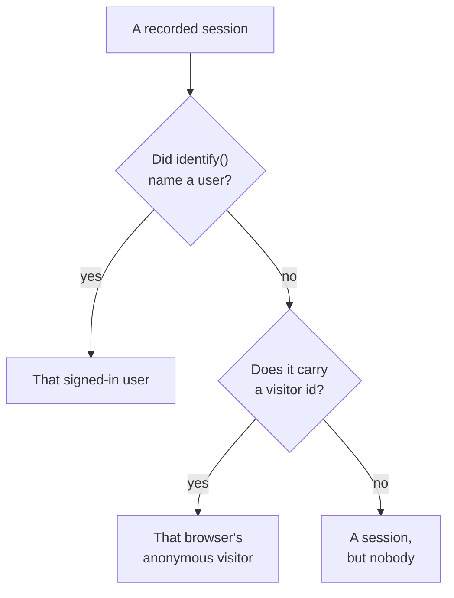

# Product Analytics

Product Analytics counts the people who use a RUM application and how their sessions go: active, new, returning, signed-in and dormant users, and sessions by device, browser, country and page. It counts the sessions [Session Replay](/docs/telemetry/session-replay) records, so it needs no snippet of its own, and it keeps its numbers for 13 months, long after the recordings have expired.

:::cards
- [How people are counted](#how-people-are-counted): A signed-in user once, an anonymous browser once.
- [Users](#users): Active, new, returning, signed-in, total and dormant users.
- [Sessions](#sessions): How many, how long, and by device, browser, country and page.
- [Privacy and retention](#privacy-and-retention): 13 months, no names stored, erased on request.
:::

## How people are counted

An application's side menu has a **Product Analytics** section with two pages, **Users** and **Sessions**. Both count the sessions Session Replay records, so they start when the application's recorder does, and a session the replay policy leaves unrecorded is not counted. Each session counts for one person, or for nobody:

- **A signed-in user counts once**, on every browser and device they use: they are known by the one-way hash of the reference your page gave `identify()` (see [Identify your users](/docs/telemetry/session-replay#identify-your-users)).
- **An anonymous browser counts once**, by its [anonymous visitor id](/docs/telemetry/session-replay#anonymous-visitors). Two browsers are two visitors, and the sessions a browser had before someone signed in on it stay its visitor's.
- **A session from an older recorder**, one that sent no visitor id, counts as a session but not as a person.

Days are counted in your own time zone.

## Users

**Users** counts the people of the range you pick:

| Tile | What it counts |
| --- | --- |
| **Active users** | Everyone who came in the range: each signed-in user once, and each anonymous browser once. |
| **New users** | Active users whose first visit was in the range. |
| **Returning users** | Active users who had come before the range began. |
| **Signed-in users** | Active users your app signed in with `identify()`, and their share of all active users. |
| **Total users** | Everyone the application has seen in the last 13 months. |
| **Dormant users** | People who came before but not in the last 30 days, or the 7, 14, 60 or 90 days you choose. |

The first three also say how they changed on the period before the range. Under the tiles, **Active users** charts, for each day, the people who came that day, in the 7 days up to it and in the 30 days up to it, and **New and returning users** splits each day's people in two.

**People** lists everyone the tiles count, one row per person, most recently seen first, and its filter shows one tile's people, the anonymous visitors, or everyone. Open a person for their first and last visit and every session of theirs from the last 13 months, with **Watch** on each one whose recording is still kept.

## Sessions

**Sessions** counts the sessions that started in the range: **Sessions**, **Signed-in sessions**, **Median session length**, **Pages per session**, **Sessions with errors** and **Frustrated sessions**. Under the tiles:

- **Sessions by device** charts each day's sessions from desktops, phones and tablets. A mobile app's session on a screen whose shorter side is 600 points or more counts as a tablet's.
- **Session length** sorts the finished sessions by how long they lasted, from under 10 seconds to over 30 minutes. A session that is still recording has no length yet.
- **Breakdown** ranks users and sessions by device type, browser, operating system, country, app version, entry page or page, most users first.

## Privacy and retention

- **13 months.** A month's numbers are removed on the first day of the 13th month after it, so the last 12 full months are always there, whatever the recordings' own retention (7 days by default).
- **No names stored.** The numbers keep a signed-in user's one-way key and a browser's visitor id, never the reference, the traits or an IP address. A row names a signed-in user only while one of their recordings is still kept, and only to a role that may read identity; otherwise it reads **Signed-in user** or **Anonymous visitor** and the start of the id.
- **Erased on request.** An erasure request removes the matching numbers here too (see [Erasing sessions](/docs/telemetry/session-replay#erasing-sessions)).

## Who can see it

Reading the two pages takes what reading the session list takes: `ReadRumSessionReplay` (_List Session Replays_) or `ReadRumSessionReplayPayload` (_Watch Session Replays_), which project owners and admins hold. Seeing who a signed-in user is, and searching people by name, takes the identity permission described in [Who can watch a recording](/docs/telemetry/session-replay#who-can-watch-a-recording).

## Next steps

:::cards
- [Session Replay](/docs/telemetry/session-replay): Record the sessions these pages count, and watch them.
- [Managing Applications](/docs/rum/applications): Names, labels, owners and retention.
- [RUM Overview](/docs/rum/index): What else a RUM application shows.
:::
