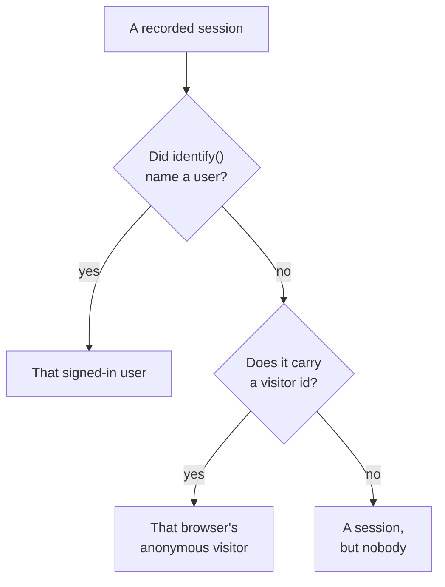

# Product Analytics

Product Analytics counts the people who use a RUM application, how their sessions go and what they do: active, new, returning, signed-in and dormant users, sessions by device, browser, country and page, and the events your app sends, as trends, funnels and retention. It counts the sessions [Session Replay](/docs/telemetry/session-replay) records and the events its recorder sends, so it needs no snippet of its own, and it keeps its numbers for 13 months, long after the recordings have expired.

:::cards
- [Users](#users): Active, new, returning, signed-in, total and dormant users.
- [Sessions](#sessions): How many, how long, and by device, browser, country and page.
- [Send events and metrics](#send-events-and-metrics): What people do, and the numbers your page measures.
- [Events](#events): How often something happened, who did it, and where.
- [Funnels](#funnels): Who went on, step by step, and how long it took.
- [User Retention](#user-retention): Who came back, cohort by cohort.
:::

## How people are counted

An application's side menu has a **Product Analytics** section: **Users**, **Sessions**, **Events**, **Funnels**, **User Retention**, **User Flows** and **Analytics Settings**. **Users** and **Sessions** count the sessions Session Replay records, so they start when the application's recorder does, and a session the replay policy leaves unrecorded is not counted. Each session counts for one person, or for nobody:



- **A signed-in user counts once**, on every browser and device they use: they are known by the one-way hash of the reference your page gave `identify()` (see [Identify your users](/docs/telemetry/session-replay#identify-your-users)).
- **An anonymous browser counts once**, by its [anonymous visitor id](/docs/telemetry/session-replay#anonymous-visitors). Two browsers are two visitors, and the sessions a browser had before someone signed in on it stay its visitor's.
- **A session from an older recorder**, one that sent no visitor id, counts as a session but not as a person.

**Events**, **Funnels** and **User Retention** count people the same way, from the events the recorder sends from every session, recorded or not (see [Send events and metrics](#send-events-and-metrics)).

Days are counted in your own time zone.

## Users

**Users** counts the people of the range you pick:

| Tile | What it counts |
| --- | --- |
| **Active users** | Everyone who came in the range: each signed-in user once, and each anonymous browser once. |
| **New users** | Active users whose first visit was in the range. |
| **Returning users** | Active users who had come before the range began. |
| **Signed-in users** | Active users your app signed in with `identify()`, and their share of all active users. |
| **Total users** | Everyone the application has seen in the last 13 months. |
| **Dormant users** | People who came before but not in the last 30 days, or the 7, 14, 60 or 90 days you choose. |

The first three also say how they changed on the period before the range. Under the tiles, **Active users** charts, for each day, the people who came that day, in the 7 days up to it and in the 30 days up to it, and **New and returning users** splits each day's people in two.

**People** lists everyone the tiles count, one row per person, most recently seen first, and its filter shows one tile's people, the anonymous visitors, or everyone. Open a person for their first and last visit and every session of theirs from the last 13 months, with **Watch** on each one whose recording is still kept.

## Sessions

**Sessions** counts the sessions that started in the range: **Sessions**, **Signed-in sessions**, **Median session length**, **Pages per session**, **Sessions with errors** and **Frustrated sessions**. Under the tiles:

- **Sessions by device** charts each day's sessions from desktops, phones and tablets. A mobile app's session on a screen whose shorter side is 600 points or more counts as a tablet's.
- **Session length** sorts the finished sessions by how long they lasted, from under 10 seconds to over 30 minutes. A session that is still recording has no length yet.
- **Breakdown** ranks users and sessions by device type, browser, operating system, country, app version, entry page or page, most users first.

## Send events and metrics

Events are sent while **Send product analytics events** is on, on the application's **Analytics Settings** page. It starts on for a new application, and off for an application created before it existed, so turn it on there. Session Replay must be on for the application too, as its recorder sends the events; the React Native recorder sends none yet.

Each session the browser recorder runs in sends its start and each page it views on its own, a single-page app's route changes included, whether or not the replay sample and policy record that session. Your own events and numbers come from your page's code:

```js
OneUptimeReplay.track("Signed up", { plan: "pro" });
OneUptimeReplay.metric("cart.value", 42.5, { currency: "EUR" });
```

| Call | What it sends |
| --- | --- |
| `track(name, properties?)` | An event that **Events**, **Funnels** and **User Retention** count, and a marker on the replay's timeline when the session is recorded. `name` ≤ 64 chars; ≤ 20 properties of string, number or boolean values, key ≤ 40 chars, value ≤ 200 chars. |
| `metric(name, value, attributes?)` | A number your page measured, as a point of a metric of the application's (see [Dashboards and alerts](#dashboards-and-alerts)). `name` ≤ 100 chars of letters, digits, `_`, `.`, `-` and `/`, starting with a letter and not with `oneuptime.`; `value` a finite number; `attributes` as `track()` properties. |

Before the recorder has loaded, push the same calls onto `window.OneUptimeReplayQueue` as `["track", name, properties]` and `["metric", name, value, attributes]` (see [JavaScript API](/docs/telemetry/session-replay#javascript-api)).

- **Every session, recorded or not.** The replay sample and the upload policy decide which sessions are recorded, not which are counted. Nothing is sent under Do Not Track or Global Privacy Control, and nothing is kept from an origin the application does not allow. When the policy requires consent, events wait for `grantConsent()`, at most 500 of them, and `revokeConsent()` drops them.
- **Masked as the recording is.** Under _Mask all text_, property and attribute values are masked before they leave the page. A page is sent as its path, without its query or fragment.
- **In small batches**, every 5 seconds and when the tab is hidden. An event that reaches OneUptime more than 3 days after it happened is dropped, and a project may send 60,000 events and metric points a minute, all its applications together; past that, the recorder waits and sends them again.

`metric()` sends nothing while the events are off, and `getDiagnostics().productAnalytics` says whether they are on (see [`getDiagnostics()`](/docs/telemetry/session-replay#getdiagnostics)).

### User properties

To break events down and segment them by who did them, list `identify()` trait keys under **User Properties for Analytics** on **Analytics Settings**, such as `["plan", "role"]`, at most 20, matched as written. Each event then carries those traits of the signed-in user, as your page passed them to `identify()`. The other traits never leave the page, and none do while **Capture end-user identity** is off. Do not list traits that hold personal data, such as an email address.

## Events

**Events** shows one event at a time: your app's most frequent event until you pick another, or the most viewed page while it sends none. The picker also lists **Session started** and each page viewed, and **All events**, below, lists every event of the range with how many times it happened and how many people did it; pick one to see it above.

- The tiles count the event's **Events**, with how many each person did on average, its **Users** and its **Sessions**.
- **Events and users** charts each day's count of the event, and of the people who did it that day.
- **Breakdown** ranks the event by device type, browser, operating system, country, app version, page, event property or user property, with each value's events, users and share. Pick a value to show only it.

**Segment** narrows the page to the events whose fields hold the values you choose: **Add filter**, then a field and a value, matched exactly. A segment holds at most 5 filters, and an event must match them all. The page's address keeps the event, the range, the segment and the breakdown, so a link opens the same view.

## Funnels

**Funnels** follows people through 2 to 6 steps in order, each one an event as **Events** lists them. Of the people who did the first step in the range, it counts how many did the second after it, then the third, all within the time you pick from their first step: **Within 1 hour**, **Within 1 day**, **Within 7 days**, **Within 14 days** or **Within 30 days**. **Add step** adds one.

Under **Conversion** are the share of people who did every step, and for each step how many people reached it, what share of the first step's people that is, how many dropped off since the step before, and the median time they took from it. Someone who tried more than once counts once, by the try that got furthest.

The segment of a funnel, and of a retention table, takes the fields every event carries and user properties, not an event's own properties, since its steps are different events.

## User Retention

**User Retention** groups people by the day, week or month of the range in which they first did one event, **People who did**, and shows what share of each group did another, **And came back to do**, in that period and each one after it. Both are **Session started** until you pick others.

**Cohorts** sets the period: **By day**, **By week** or **By month**. When the range holds more periods than one table shows, 32 days, 26 weeks or 13 months, the page makes the cohorts longer and says so.

Each row is a cohort and how many people it holds, and each cell the share of them who came back in that period, darker the more did. A period that has not begun yet is left empty.

## Dashboards and alerts

Each event is also counted, minute by minute, as a metric of the application's, and each `metric()` call is a point of a metric of its own, under the name it gives. Chart them on the application's **Metrics** page, add them to a dashboard, or alert on them with a Metrics monitor; **Open Metrics**, under **All events**, opens the page.

| Metric | What it counts | By |
| --- | --- | --- |
| `oneuptime.rum.product.events` | Your `track()` events, each minute | `event.name` |
| `oneuptime.rum.product.sessions` | Sessions that started, each minute | `device.type` |
| `oneuptime.rum.product.page.views` | Pages viewed, each minute | `device.type` |

These three are not billed, and `metric()` refuses a name that starts with `oneuptime.`, so nothing your page sends passes for them. Your `metric()` points are kept and billed as the application's other metrics are.

## Privacy and retention

- **13 months.** A month's numbers are removed on the first day of the 13th month after it, so the last 12 full months are always there, whatever the recordings' own retention (7 days by default). Events are kept the same way.
- **No names stored.** The numbers keep a signed-in user's one-way key and a browser's visitor id, never the reference or an IP address, and of the traits only the user properties you list. A row names a signed-in user only while one of their recordings is still kept, and only to a role that may read identity; otherwise it reads **Signed-in user** or **Anonymous visitor** and the start of the id.
- **Erased on request.** An erasure request removes the matching numbers and events here too (see [Erasing sessions](/docs/telemetry/session-replay#erasing-sessions)).

## Who can see it

Reading these pages takes what reading the session list takes: `ReadRumSessionReplay` (_List Session Replays_) or `ReadRumSessionReplayPayload` (_Watch Session Replays_), which project owners and admins hold. Seeing who a signed-in user is, and searching people by name, takes the identity permission described in [Who can watch a recording](/docs/telemetry/session-replay#who-can-watch-a-recording).

Turning the events on or off takes `EditRumApplication` (_Edit RUM Application_) or a project owner's, admin's or member's role. Listing user properties takes `EditRumApplication` or an owner's or admin's role, since it decides what is kept about signed-in people.

## Next steps

:::cards
- [Session Replay](/docs/telemetry/session-replay): Record the sessions these pages count, and watch them.
- [Managing Applications](/docs/rum/applications): Names, labels, owners and retention.
- [RUM Overview](/docs/rum/index): What else a RUM application shows.
:::
