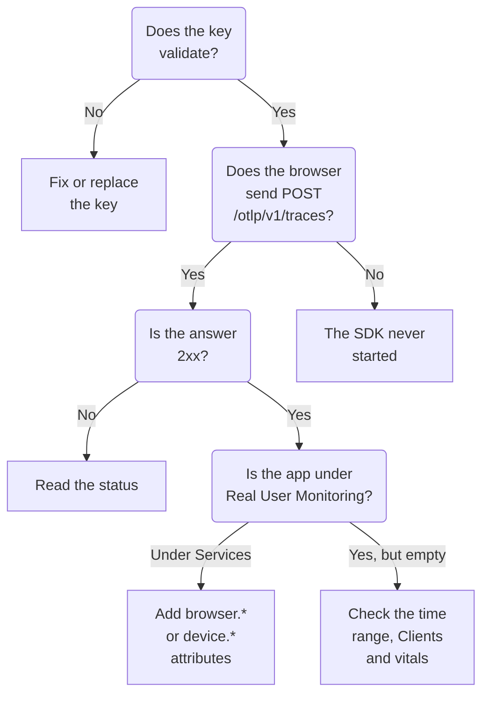

# RUM Troubleshooting

When a RUM application is missing, empty or **Disconnected**, work down this page in order. Each check rules out one part of the path from your app to OneUptime, in the order these problems usually happen.

:::cards
- [Check the key](#check-the-key): The quickest check, and everything after it depends on it.
- [Check what leaves the browser](#check-what-leaves-the-browser): The export request in your browser's developer tools.
- [Check where the telemetry lands](#check-where-the-telemetry-lands): A RUM application, or a backend service.
- [Session Replay problems](#session-replay-problems): A separate pipeline, with a page of its own.
:::

## Where RUM telemetry stops

Telemetry passes three checks on its way to a RUM application. Find the first one that fails:



## Check the key

Check the key first. It is the quickest check, and nothing after it works without a key OneUptime accepts:

```bash
curl -i https://oneuptime.com/otlp/v1/validate \
  -H "x-oneuptime-token: YOUR_TELEMETRY_INGESTION_TOKEN"
```

| Answer | What it means |
| --- | --- |
| `200` with `"valid": true` | OneUptime accepts the key. The answer also gives its `keyType` and its `projectId`. Move on to the next check. |
| `401` with `"valid": false` | The key is missing, unknown, revoked, switched off or expired, and the `message` says which. Create a live key under **Project Settings → Telemetry & APM → Ingestion Keys**. |

A web app needs a **Browser** key, and a mobile app a **Server** key: see [Browser Setup](/docs/rum/browser-setup) and [Mobile Setup](/docs/rum/mobile-setup). The export endpoints refuse a bad key with `401` too, as the OTLP specification asks, so a well-behaved SDK logs the refusal instead of retrying. That line is easy to miss in a browser console, and this check answers directly.

## Check what leaves the browser

Open your browser's developer tools on the app's page, select the Network tab and filter for `otlp`. You are looking for `POST /otlp/v1/traces` answered with a `2xx` status.

### No request at all

The SDK never started. It is nearly always one of these:

- `telemetry.ts` is not the first import of your app, or your bundler dropped it. The instrumentations patch `fetch` and `XMLHttpRequest`, so a request made before the patch is not traced, and a file the bundler removed runs nothing at all.
- The batch processor has not exported yet. `BatchSpanProcessor` waits a few seconds to fill a batch, so wait, or move to another page, before you decide nothing is sent.
- A build-time environment variable came out as `undefined`, so the exporter's URL is broken. Log the URL once at startup.

### The browser blocks the request

- **A Content Security Policy error in the console.** Your page's policy does not allow OneUptime yet. Add it to your existing `connect-src` directive, or use your own host if you run OneUptime yourself:

  ```text
  connect-src 'self' https://oneuptime.com;
  ```

- **A CORS error.** The OTLP endpoints accept requests from any origin and allow the `x-oneuptime-token` header, so a real CORS failure almost always means the request never reached OneUptime: look for a corporate proxy, an ad blocker or a typo in the host. Check the request's URL in the Network tab.

### The request gets an error status

**`401`.** The key is unknown, revoked or expired. Run the [key check](#check-the-key), then use a live key.

**`404`.** The URL is wrong. The trace exporter needs the full path, `/otlp/v1/traces`. A common mistake is to give the base address (`https://oneuptime.com/otlp`) to an exporter that expects the full URL, or the full URL to one that adds the path itself and ends up at `/otlp/v1/traces/v1/traces`.

**`413`.** The batch was larger than a proxy allows. OneUptime's own ingress accepts up to 4 MB on `/otlp`, but a proxy you run in front of OneUptime can be stricter — ingress-nginx, for example, defaults `proxy-body-size` to 1 MB — so if you have one, raise its limit for `/otlp` as well. Either way, a smaller `maxExportBatchSize` on the `BatchSpanProcessor` makes each export smaller:

```ts
new BatchSpanProcessor(exporter, { maxExportBatchSize: 100 });
```

A browser rarely sends batches that large unless spans carry big attributes, such as a whole stack trace or a response body. Trimming those is the better fix.

**`422`.** OneUptime refused the key here, and the message says why. `Origin https://app.example.com is not allowed for this browser ingestion key.` means the page's exact origin, with its scheme and any port, is missing from the key's **Allowed Origins**. `This telemetry ingestion key has been disabled.` means someone switched the key off.

**`429`.** The key's **Requests Per Minute Limit** is used up: `Too many telemetry requests for this ingestion key. Please retry later.` A Browser key allows 6000 requests a minute for all your visitors together unless you set your own limit on the key.

**`403` with an HTML page, or an empty body.** OneUptime answers every refusal in JSON, so this one came from something in front of it, usually a web application firewall on your own domain, if you proxy OneUptime through it. The firewall parses OTLP/JSON and checks every span attribute against its injection rules, so a URL with a query string on a span is enough to be blocked, and the firewall's log names the rule. Exclude the OTLP payload from inspection on the OTLP paths only: [Your OpenTelemetry requests are blocked too](/docs/rum/session-replay-troubleshooting#your-opentelemetry-requests-are-blocked-too) shows how, and covers the replay recorder behind the same firewall.

## Check where the telemetry lands

The request succeeds, but the app shows up under **Products → Services** instead of **Products → Resources → Real User Monitoring**. This is the most common report, and the cause is nearly always a resource without client attributes. OneUptime files a batch as RUM only when its resource carries one of these:

| Kind | Attributes |
| --- | --- |
| Browser | `browser.platform`, `browser.language`, or a non-empty `browser.brands` |
| Mobile | `device.id` or `device.model.identifier`, or `device.manufacturer` on a resource with no host identity (`host.name`, `host.id` or `k8s.node.name`) |

A `service.name` alone makes a backend service. The OpenTelemetry browser SDK adds no `browser.*` attributes unless you add the browser resource detector or set them yourself: see [Browser Setup](/docs/rum/browser-setup).

To see what you actually send, open the OTLP request in the Network tab and look at its payload: `resourceSpans[0].resource.attributes` is the list that decides it. If no `browser.*` attribute is there, the SDK is not adding it, whatever its documentation says.

Add the attributes, and the next batch creates the RUM application. The service that was created first does not turn into a RUM application, because the two are separate records, so delete it under **Products → Services** once RUM telemetry arrives.

> [!NOTE]
> A resource whose only client attribute is `device.manufacturer`, and which also has a host identity, is read as a machine rather than a phone, because a host's inventory reports its make with the same attribute. Add `device.id` or `device.model.identifier`, and the batch is filed as mobile RUM whatever else it carries.

## The application is empty

The application exists, but its pages show nothing.

- **Check the time range.** The overview shows the past hour by default, so a test batch from this morning is outside it.
- **Wait a few minutes.** Ingest is queued, and **Last Seen** is refreshed every few minutes rather than on every batch.
- **Check the project.** A key writes into its own project, so telemetry sent with another project's key is there, not here.

## The Clients page is empty

The **Clients** page lists `browser.platform` on the web and `device.model.identifier` on mobile. Two reasons it stays empty while everything else works:

- **Safari and Firefox.** `browserDetector` reads the UA Client Hints API, which only Chromium browsers have. Elsewhere it sets `browser.language`, which is enough to file the telemetry as RUM, but not `browser.platform`. Set `browser.platform` yourself to list those clients.
- **A mobile SDK that sets only `device.manufacturer`.** That files the telemetry as mobile RUM, but the **Clients** page needs `device.model.identifier`.

## Core Web Vitals show "No web vitals reported yet"

The card fills only from metrics your app sends, so traces alone never fill it. Check that you export metrics at all, that the metric names are ones OneUptime reads, and that they are on the application's **Metrics** page. [The card says "No web vitals reported yet"](/docs/rum/web-vitals#troubleshooting) goes through each check, including values lost when a visitor closes the tab before the next export.

## The status says Disconnected while people use the app

An application turns **Disconnected** after 15 minutes with no telemetry. If people are using the app:

- **A sampler may drop everything.** Check that you did not set an always-off sampler, or a very low ratio.
- **The app may send telemetry only on some interactions**, and nobody used them in that time.
- **The key may have been revoked or switched off** after you deployed: run the [key check](#check-the-key) again.

An internal or low-traffic app with no visitors overnight is genuinely disconnected. That is not a fault.

## Session Replay problems

Session Replay is a separate pipeline with problems of its own: the recorder script, the origin allowlists, consent, the Content Security Policy and masking. [Session Replay Troubleshooting](/docs/rum/session-replay-troubleshooting) covers them. Start there, and start by turning on the recorder's diagnostics, because most of its failures are silent on purpose:

```js
localStorage.setItem("oneuptime.sessionReplay.debug", "true");
// then reload the page
```

The application's **Health** page, in its **Session Replay** section, and the **Test your installation** panel on **Replay Policy** check the key, the allowlists and the policy from the server's side, and say why nothing arrives. The browser's console tells you the half the server cannot see.

Under the default policy, a recorder posts a chunk about every 15 seconds while the user is interacting with the page. An idle tab has nothing to send, so click or move the mouse first; after that, no chunk requests at all means something is wrong. If the application uploads only _On error or frustration_, silence is expected until something goes wrong. Call `OneUptimeReplay.captureSession()` to force an upload and prove the path either way.

The two pipelines are independent. A working RUM application is not needed for the recorder to load, and a working recorder does not mean RUM telemetry arrives: each can fail alone.

## Still stuck

Collect these before you ask for help. They save a round trip:

- The `resource.attributes` list from a real OTLP request's payload.
- The HTTP status of that request.
- The exact `service.name` you send, and whether the project has an application or a service with that name.
- Whether `/otlp/v1/validate` answers `200` for the key in the deployed build.

Then contact support@oneuptime.com, or open an issue on [GitHub](https://github.com/OneUptime/oneuptime).

## Next steps

:::cards
- [Browser Setup](/docs/rum/browser-setup): The setup these checks assume, step by step.
- [Mobile Setup](/docs/rum/mobile-setup): The key and attributes a mobile app needs.
- [Managing Applications](/docs/rum/applications): Names, labels, retention and status.
- [Session Replay Troubleshooting](/docs/rum/session-replay-troubleshooting): Every recorder code, and what to do about it.
:::
