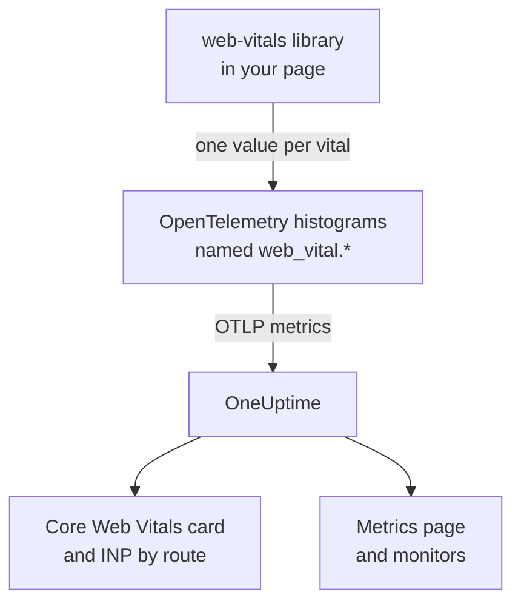
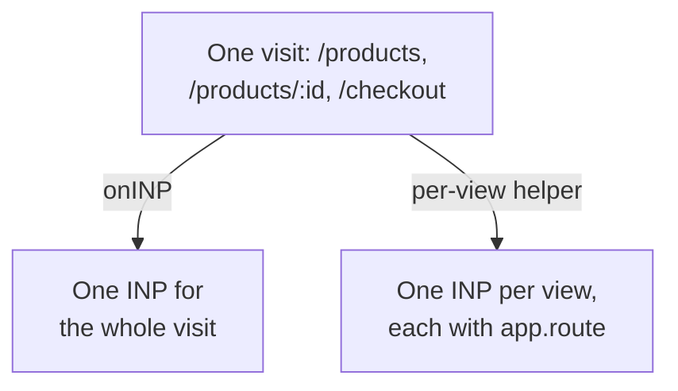

# Core Web Vitals

The **Core Web Vitals** card on a RUM application's overview shows LCP, INP, CLS, FCP and TTFB, each rated against Google's limits. OneUptime measures none of them itself: the card fills only from metrics your browser instrumentation reports, and this page shows how to send them.

:::cards
- [Send them](#send-them-from-your-app): Forward the web-vitals library's values as OpenTelemetry metrics.
- [Names OneUptime reads](#metric-names-oneuptime-recognises): The metric names each vital can arrive under.
- [Single-page apps](#single-page-apps): INP for each view, not one value per page load.
- [Alert on a vital](#alert-on-a-vital): Ready-made monitors for poor vitals.
:::

## How it works

The [`web-vitals`](https://github.com/GoogleChrome/web-vitals) library measures each vital in the page, the same library Chrome's own tools use. Your code records each value on an OpenTelemetry histogram, and the browser's metrics pipeline exports it to OneUptime.



OpenTelemetry has no final naming convention for web vitals yet, so OneUptime looks for each vital under several names and uses the first one with data. Use the `web_vital.*` names for new instrumentation.

## Before you begin

- A web app set up as in [Browser Setup](/docs/rum/browser-setup), with its metrics pipeline: the `MeterProvider` from [Add logs and metrics](/docs/rum/browser-setup#add-logs-and-metrics) is what exports these values.

## Send them from your app

:::steps
### Install the library

```bash
npm install web-vitals
```

### Record each vital on a histogram

Create `src/web-vitals.ts`. Each vital is a histogram, so the **Metrics** page can work out percentiles later, with bucket edges on Google's good and poor limits.

```ts title="src/web-vitals.ts"
// Import after ./telemetry
import { metrics } from "@opentelemetry/api";
import { onCLS, onFCP, onINP, onLCP, onTTFB, type Metric } from "web-vitals";

const meter = metrics.getMeter("web-vitals");

// Histograms, so the Metrics tab can compute percentiles later. The bucket
// edges sit on each vital's good / poor limits: a percentile is read from
// the buckets, and the defaults are far too coarse for these ranges.
const buckets = (...edges: number[]) => ({ advice: { explicitBucketBoundaries: edges } });

const lcp = meter.createHistogram("web_vital.lcp", { unit: "ms", ...buckets(0, 1000, 1500, 2000, 2500, 3000, 3500, 4000, 5000, 7500, 10000) });
const inp = meter.createHistogram("web_vital.inp", { unit: "ms", ...buckets(0, 50, 100, 150, 200, 250, 300, 400, 500, 750, 1000, 2000) });
const fcp = meter.createHistogram("web_vital.fcp", { unit: "ms", ...buckets(0, 600, 1200, 1800, 2400, 3000, 4000, 6000, 10000) });
const ttfb = meter.createHistogram("web_vital.ttfb", { unit: "ms", ...buckets(0, 200, 400, 600, 800, 1200, 1800, 2500, 4000) });
const cls = meter.createHistogram("web_vital.cls", { unit: "1", ...buckets(0, 0.025, 0.05, 0.1, 0.15, 0.2, 0.25, 0.4, 0.6, 1) });

function record(
  histogram: { record: (v: number, a?: Record<string, string>) => void },
) {
  return (metric: Metric): void => {
    histogram.record(metric.value, {
      // Keep attributes low-cardinality. Never put a full URL or a user id here.
      "web_vital.rating": metric.rating,
    });
  };
}

onLCP(record(lcp));
onINP(record(inp));
onCLS(record(cls));
onFCP(record(fcp));
onTTFB(record(ttfb));
```

### Import it after your telemetry setup

```ts
import "./telemetry";
import "./web-vitals";
```

### Check the Metrics page

Load a few pages, then search for `web_vital.lcp` on the application's **Metrics** page. Once the metrics are there, the **Core Web Vitals** card fills in for the range you pick.
:::

## Send the last values before the page closes

`onINP` and `onCLS` report when the page is hidden, not during the visit. With the 30-second export interval from [Browser Setup](/docs/rum/browser-setup), a visitor who closes the tab right after the last value may leave before it is exported. If completeness matters, shorten `exportIntervalMillis`, or keep the `MeterProvider` you built in `telemetry.ts` and flush it when the page is hidden:

```ts
// In telemetry.ts, export the provider you created:
export const meterProvider = new MeterProvider({ /* ... */ });

// Anywhere after setup:
import { meterProvider } from "./telemetry";

document.addEventListener("visibilitychange", () => {
  if (document.visibilityState === "hidden") {
    void meterProvider.forceFlush();
  }
});
```

## Metric names OneUptime recognises

OneUptime tries the names in this order, and the first one with data in the selected range wins.

| Vital | Metric names, any one | Unit |
| --- | --- | --- |
| LCP: Largest Contentful Paint | `web_vital.lcp`, `browser.largest_contentful_paint`, `largest_contentful_paint`, `web.vitals.lcp` | ms |
| INP: Interaction to Next Paint | `web_vital.inp`, `browser.interaction_to_next_paint`, `interaction_to_next_paint`, `web.vitals.inp` | ms |
| CLS: Cumulative Layout Shift | `web_vital.cls`, `browser.cumulative_layout_shift`, `cumulative_layout_shift`, `web.vitals.cls` | score |
| FCP: First Contentful Paint | `web_vital.fcp`, `browser.first_contentful_paint`, `first_contentful_paint`, `web.vitals.fcp` | ms |
| TTFB: Time to First Byte | `web_vital.ttfb`, `browser.time_to_first_byte`, `time_to_first_byte`, `web.vitals.ttfb` | ms |

The other names exist so an app that already sends a community convention shows up without changes.

## Rating thresholds

The card rates each value with Google's published Core Web Vitals limits:

| Vital | **Good** | **Needs work** | **Poor** |
| --- | --- | --- | --- |
| LCP | below 2500 ms | 2500 to 4000 ms | 4000 ms or more |
| INP | below 200 ms | 200 to 500 ms | 500 ms or more |
| CLS | below 0.1 | 0.1 to 0.25 | 0.25 or more |
| FCP | below 1800 ms | 1800 to 3000 ms | 3000 ms or more |
| TTFB | below 800 ms | 800 to 1800 ms | 1800 ms or more |

The card shows the **mean** over the selected range, not the 75th percentile that Google's field tools report. That is on purpose: OneUptime reads a histogram's percentiles from its buckets, so a percentile is only as precise as the buckets are, while the mean comes from the histogram's exact sum and count. With OpenTelemetry's default buckets (`0, 5, 10, 25, 50, …`) every CLS value lands in the first bucket, and a 75th percentile would read 2.5 for a page that barely moves.

> [!TIP]
> Read the card as a trend. For the 75th percentile, record with the bucket edges above, then chart the metric on the **Metrics** page with the **P75** aggregation. A Metrics monitor offers the same choice.

## Single-page apps

`onINP` measures INP the way the browser defines it: **one value per page load**. A single-page app loads once and then changes route with `history.pushState`, so a visit to `/products`, `/products/42` and `/checkout` produces one INP for the whole visit. Every view's interactions compete for that single number, and a route attribute on it names whichever page was showing when it was reported, not the page that was slow.



To see INP per view, measure it per view: every route change ends the current view and starts a new one, and each view reports its own INP. The helper below does that with the browser's Event Timing API, the same data `onINP` uses, and handles the part that is easy to get wrong: the click that **caused** a navigation is delivered after the route has already changed, but it belongs to the page it was clicked on.

```ts title="src/inp-per-route.ts"
// INP for each view of a single-page app.
type Report = (inpMs: number, route: string) => void;

interface View {
  route: string;
  path: string; // the URL path it was opened for
  start: number; // performance.now() when the view began
  latencies: Map<number, number>; // interactionId -> its slowest entry
}

// Long enough for the click that navigated to be delivered: its entry
// arrives after the next paint, i.e. after the route has changed.
const SETTLE_MS = 1000;

let views: Array<View> = [];
let report: Report = () => {};

// The path, plus the hash when a hash router keeps the route there.
const currentPath = (): string =>
  location.pathname + (location.hash.startsWith("#/") ? location.hash : "");

function close(view: View): void {
  if (!views.includes(view)) return; // already reported
  views = views.filter((v) => v !== view);

  const sorted = [...view.latencies.values()].sort((a, b) => b - a);
  if (sorted.length === 0) return; // nobody interacted: no INP, not 0

  // web-vitals' p98: skip one outlier for every 50 interactions.
  report(sorted[Math.min(sorted.length - 1, Math.floor(sorted.length / 50))]!, view.route);
}

function record(entries: PerformanceEntryList): void {
  for (const entry of entries as Array<PerformanceEventTiming & { interactionId?: number }>) {
    if (!entry.interactionId) continue; // hovers, scrolls: not interactions

    // The view the interaction STARTED in, so the click that navigated
    // counts towards the page it was clicked on.
    const view = [...views].reverse().find((v) => entry.startTime >= v.start);
    if (!view) continue;

    const slowest = view.latencies.get(entry.interactionId) ?? 0;
    view.latencies.set(entry.interactionId, Math.max(slowest, entry.duration));
  }
}

export function observeInpPerRoute(route: string, onReport: Report): void {
  if (typeof PerformanceObserver === "undefined" || !PerformanceObserver.supportedEntryTypes?.includes("event")) return;

  report = onReport;
  views = [{ route, path: currentPath(), start: 0, latencies: new Map() }];

  const observer = new PerformanceObserver((list) => record(list.getEntries()));
  observer.observe({ type: "event", durationThreshold: 40, buffered: true } as PerformanceObserverInit);

  // The tab may never come back: report every view now, then keep
  // measuring the current route as a fresh view.
  document.addEventListener("visibilitychange", () => {
    if (document.visibilityState !== "hidden") return;
    record(observer.takeRecords());
    const current = views[views.length - 1]?.route ?? route;
    [...views].forEach(close);
    views = [{ route: current, path: currentPath(), start: performance.now(), latencies: new Map() }];
  });
}

// Call after every navigation, with the route PATTERN ("/products/:id").
// Safe to call when nothing changed (a router's initial navigation, a
// query-string update): the view only ends when the path does.
export function startView(route: string): void {
  const closing = views[views.length - 1];
  if (!closing || closing.path === currentPath()) return;

  views.push({ route, path: currentPath(), start: performance.now(), latencies: new Map() });
  setTimeout(() => close(closing), SETTLE_MS);
}
```

Both functions take the route **pattern**, never the URL: `/products/42` and `/products/7` must be one route, or every product becomes a series of its own. Use your router's pattern where it has one; otherwise collapse the ids yourself:

```ts
// "/products/42" -> "/products/:id", also for UUIDs.
export const toRoutePattern = (path: string): string =>
  path.replace(/\/(\d+|[0-9a-f]{8}-[0-9a-f-]{27})(?=\/|$)/gi, "/:id");
```

Record what the helper reports on the same `web_vital.inp` histogram, with the route as `app.route`, and **drop `onINP`** from the snippet above: keeping both would count every interaction twice.

```ts
// src/web-vitals.ts, in place of onINP(record(inp))
import { observeInpPerRoute } from "./inp-per-route";

observeInpPerRoute(toRoutePattern(location.pathname), (inpMs, route) => {
  inp.record(inpMs, {
    "app.route": route,
    "web_vital.rating": inpMs <= 200 ? "good" : inpMs <= 500 ? "needs-improvement" : "poor",
  });
});
```

Then call `startView` wherever your router announces a finished navigation. It ignores a call when the URL path has not changed, so a router that also reports the first load, or a query-string update, does not split the view:

:::tabs
@tab Vue Router
```ts
router.afterEach((to) => startView(to.matched[to.matched.length - 1]?.path ?? toRoutePattern(to.path)));
```
@tab React Router
```tsx
// In a component that stays mounted inside the router
const { pathname } = useLocation();
useEffect(() => startView(toRoutePattern(pathname)), [pathname]);
```
:::

What you get:

- **INP by route** on the overview, slowest first, from `app.route`; OneUptime also reads OpenTelemetry's `url.template`.
- A route filter for alerting: filter a Metrics monitor on `web_vital.inp` by `app.route` to watch one flow, such as `/checkout`, on its own.
- The app-wide INP on the **Core Web Vitals** card keeps working: it is the same metric, now with one value per view instead of one per page load.

Chromium browsers report the interaction ids this needs. Safari reports none, which is also why `onINP` reports nothing there. Chrome's experimental Soft Navigations API aims to do this natively, but it is not generally available; this helper works today.

> [!NOTE]
> The [Session Replay](/docs/telemetry/session-replay) recorder already measures INP per view, with no code: each recording shows an INP row for every route the user interacted on, with the slow element and how its time split into input delay, processing and presentation.

## Keeping cardinality under control

Metric attributes multiply. `web_vital.rating` has three possible values, which is fine, and a route or page-type attribute is usually worth it:

```ts
histogram.record(metric.value, {
  "web_vital.rating": metric.rating,
  "app.route": routePattern, // "/product/:id" — the PATTERN, not "/product/8842"
});
```

Recording the concrete URL instead of the route pattern creates one time series per product page, which makes the **Metrics** page slow and the storage bill large. The same goes for user ids, session ids and screen sizes.

## Alert on a vital

The application's **Recommendations** page offers a ready-made monitor for each vital. Each one reads the five-minute average of its metric and fires when it reaches Google's poor limit:

| Recommendation | Metric | Fires at | Severity |
| --- | --- | --- | --- |
| **Poor Largest Contentful Paint** | `web_vital.lcp` | 4000 ms | **Critical** |
| **Poor Interaction to Next Paint** | `web_vital.inp` | 500 ms | **Critical** |
| **Poor Cumulative Layout Shift** | `web_vital.cls` | 0.25 | **Critical** |
| **Slow First Contentful Paint** | `web_vital.fcp` | 3000 ms | **Warning** |
| **Slow Time to First Byte** | `web_vital.ttfb` | 1800 ms | **Warning** |

These monitors read the `web_vital.*` names only. If your app sends a vital under another name, edit the created monitor's metric. To alert on one route, add an `app.route` filter to the monitor. You can also build your own monitor on any of these metrics: see [Metrics Monitor](/docs/monitor/metrics-monitor).

## Troubleshooting

:::details The card says "No web vitals reported yet"
The card fills only from metrics your app sends. Check, in order:

1. You have a metrics pipeline at all: traces alone never fill this card.
2. The metric names are ones OneUptime reads: see [Metric names OneUptime recognises](#metric-names-oneuptime-recognises).
3. The metrics are on the application's **Metrics** page. If they are, the export works, and the problem is the name or the time range.
4. INP and CLS are reported when the page is hidden, so a short visit can end before the next export: see [Send the last values before the page closes](#send-the-last-values-before-the-page-closes).

If none of these helps, [RUM Troubleshooting](/docs/rum/troubleshooting) checks the whole pipeline.
:::

:::details INP is reported, but not per route
The **INP by route** card needs the `app.route` attribute, or `url.template`, on `web_vital.inp`. Record the route pattern with each value as in [Single-page apps](#single-page-apps).
:::

:::details The values differ from Google's report
The card shows the mean over the range you picked, and Google reports the 75th percentile of its own visitors. Chart the **P75** on the **Metrics** page to compare like with like.
:::

## Next steps

:::cards
- [Browser Setup](/docs/rum/browser-setup): The traces, logs and metrics pipeline these vitals ride on.
- [Metrics Monitor](/docs/monitor/metrics-monitor): Alert on any vital, for the whole app or one route.
- [Session Replay](/docs/telemetry/session-replay): See INP per view in recordings, with no code.
- [RUM Troubleshooting](/docs/rum/troubleshooting): Every check, in the order problems usually happen.
:::
