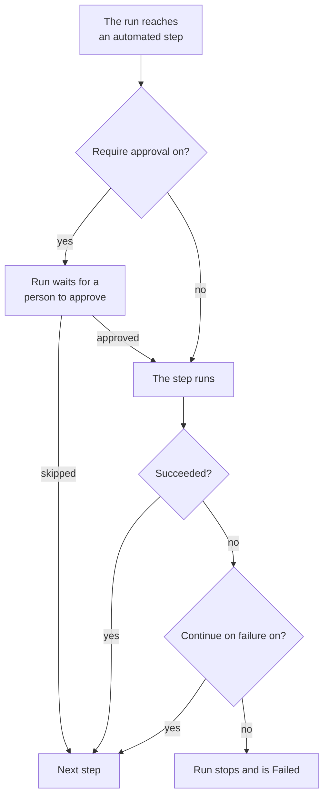

# Authoring a Runbook

You write a runbook as an ordered list of steps on its **Steps** page. This page shows how to create a runbook, how to set up each of the seven step types, and how failures and approvals change the course of a run.

:::cards
- [Create a runbook](#create-a-runbook): From an empty runbook to saved steps.
- [Step types](#step-types): Manual, JavaScript, HTTP request, Bash, SSH, kubectl and AI.
- [Failure handling and approvals](#failure-handling-and-approvals): What happens when a step fails, or waits for approval.
- [A worked example](#a-worked-example): A five-step database failover.
:::

## Before you begin

- **A role that writes runbooks.** Project Owner, Project Admin and Runbook Admin create runbooks and save their steps. With granular permissions, you need **Create Runbook** and **Edit Runbook**. See [Permissions](/docs/runbooks/configuration#permissions).
- **A Runner, for Bash, SSH and kubectl steps.** These steps run on a [Runner](/docs/runbooks/agents) inside your own infrastructure, never on the OneUptime Worker. Install one first. A step that picks no Runner runs on the project's [default Runner](/docs/runbooks/agents#the-projects-default-runner), if you set one; a JavaScript step otherwise runs on a [global Runner](/docs/runbooks/agents#global-runners).
- **A secret variable, for SSH and kubectl steps.** The key, password or kubeconfig a step signs in with is a secret [runbook variable](/docs/runbooks/variables). Project Owner and Project Admin create variables, and Runbook Admin picks them in the steps it writes. A kubectl step can use the Runner's own access instead.
- **An LLM provider, for AI steps.** See [LLM Providers](/docs/ai/llm-provider).

## Create a runbook

:::steps
### Open Runbooks

Open **Products → Runbooks**. Runbooks is in the **Dashboards & Automation** group.

### Create the runbook

Click **Create Runbook**, enter a **Name** and, optionally, a **Description** of what the runbook is for. Under **More fields** are the **Enabled** switch, on by default, and **Labels**. The new runbook opens on its **Steps** page.

### Add steps

Under **Start your runbook**, pick the type of the first step; below the last step, **Add another step** offers the same seven types. Each step opens with its **Title** and what its type needs; the rest, such as its **Description** and timeouts, is folded under **More fields**. Once the runbook has a step, **Add Step**, at the top of the card, adds a Manual step.

### Put the steps in order

Steps run **in order**. To change the order, drag a step by the grip at the left of its header; from the keyboard, focus the grip, press Space, move the step with the arrow keys and press Space again.

### Save the steps

Click **Save Steps**. Until you do, the editor says **Unsaved changes**. Once saved, you see **Saved**, and the runbook is ready to [run](/docs/runbooks/running).
:::

## Anatomy of a step

Every step has these fields. An automated step shows its **Title** and its type's settings, and folds the rest under **More fields**, which says what of it is set:

| Field | Purpose |
| --- | --- |
| **Title** | A short label, shown in the step list and on every run. |
| **Description** | Optional context for the responder, in Markdown, under **More fields**. On a Manual step it is the **Instructions** the responder reads and follows, shown below the title. |
| **Continue on failure** | Automated steps only. If on, a failing step does not stop the run: the next step still runs. |
| **Require approval** | Automated steps only. If on, the run stops before this step until someone approves it, and only then runs it. The switch reads **Require approval before running this step**, and the step's header says **Needs approval**. |
| Type-specific settings | The script, URL, Runner, secret variable or prompt. See [Step types](#step-types). |

## Step types

| Type | Runs on | Needs |
| --- | --- | --- |
| [Manual](#manual) | A person | Nothing |
| [JavaScript](#javascript) | A Runner | A Runner |
| [HTTP request](#http-request) | The OneUptime Worker | Nothing |
| [Bash](#bash) | A Runner | A Runner |
| [SSH](#ssh) | A Runner | A Runner and a secret variable to sign in with |
| [kubectl](#kubectl) | A Runner | A Runner, and a kubeconfig variable or the Runner's own access |
| [AI](#ai) | The OneUptime Worker | An LLM provider |

In every automated step below, the step's **More fields** holds its **Runner** first, for a step that runs on one, then **Require approval** and **Continue on failure**, then the step's own extra settings - an HTTP request's headers, an SSH step's port, key passphrase and host key, an AI step's provider and context switches - and last the **Description** and the timeouts. Folded, it names the step's Runner, so you see where a step runs without opening it.

### Manual

A checklist item for a person: its **Instructions** say what to do or check. The run pauses when it reaches a Manual step and stays in `WaitingForManualStep` (**Waiting for you**) until someone clicks **Mark complete** or **Skip**. A run that waits for a person never times out. A Manual step has no approval switch: it stops the run for a person already.

Use it for what only a human can check or do: "Confirm traffic has moved to the secondary region in the load balancer dashboard."

### JavaScript

A snippet of JavaScript, run in an `isolated-vm` sandbox on a [Runbook Agent](/docs/runbooks/agents), not on the OneUptime Worker: on one of yours, or on a [global Runner](/docs/runbooks/agents#global-runners) when the step picks none.

| Field | What it does | Default |
| --- | --- | --- |
| **Runner** | Under **More fields**. The Runner that runs the step: **Global Runner**, or one of yours. Only the Runner you pick may claim the job; any global Runner may claim a step on **Global Runner**. | The project's [default Runner](/docs/runbooks/agents#the-projects-default-runner), if you set one; otherwise **Global Runner**, when there is one |
| **Script** | The JavaScript to run. `return` a value to capture it; each `console.log` line is captured too. Throwing an error fails the step. | — |
| **Execution timeout** | How long the Runner lets the snippet run before tearing the sandbox down. A global Runner runs it for 5 minutes at most. | 30 seconds |
| **Claim timeout** | How long the Worker waits for the Runner to pick the job up. | 2 minutes |

```javascript
const start = Date.now();
// ... your logic ...
console.log("replica lag checked");
return { durationMs: Date.now() - start };
```

The sandbox has 128 MB of memory and no filesystem or process access. It can make HTTP requests with `axios`, but only to public addresses: a request to a private network, to the Runner's own host or to a cloud metadata endpoint is refused. To reach a service inside your network, use a [Bash](#bash) step with `curl`.

### HTTP request

An outbound HTTP call, made by the OneUptime Worker. No Runner is needed.

| Field | What it does | Default |
| --- | --- | --- |
| **Method** | `GET`, `POST`, `PUT`, `PATCH`, `DELETE` or `HEAD`. | `GET` |
| **URL** | The endpoint to call. | Empty |
| **Headers (JSON)** | Under **More fields**. A JSON object, such as `{ "Authorization": "Bearer ..." }`. Headers that are not valid JSON fail the step. | None |
| **Body** | Shown for `POST`, `PUT`, `PATCH` and `DELETE`. Sent as JSON when it parses as JSON, and as text otherwise. | None |
| **Request timeout** | How long to wait for the endpoint to respond before failing the step. | 30 seconds |

The step succeeds on a `2xx` or `3xx` response and fails on anything else, with `HTTP <status>` as its error. Redirects are not followed. The response's status, headers and body are captured, up to 50 KB.

> [!NOTE]
> The Worker never calls loopback or link-local addresses, such as a cloud metadata endpoint. On OneUptime Cloud it calls public addresses only. A self-hosted OneUptime also reaches private networks, unless `DATA_SOURCE_BLOCK_PRIVATE_ADDRESSES` is `true`. To call a service inside your network from OneUptime Cloud, use a [Bash](#bash) step with `curl`.

Useful for: opening a PagerDuty incident, posting to a Slack webhook, calling your cloud provider's or your own public API.

> [!TIP]
> Keep tokens out of the step. Store them as secret [runbook variables](/docs/runbooks/variables) and write `{{global.variables.NAME}}` where the value goes, in the URL, the headers or the body. OneUptime sends the request itself, so it fills in secrets too, and the response the step records shows `[REDACTED]` in their place. In JSON headers or a JSON body, a value goes inside its string, so a quote or a line break in it does not break the JSON.

### Bash

A bash script, run with `bash -c <script>` on a [Runbook Agent](/docs/runbooks/agents) in your own infrastructure. Bash never runs on the OneUptime Worker.

| Field | What it does | Default |
| --- | --- | --- |
| **Runner** | Under **More fields**. The Runner that runs the step. Only that Runner may claim the job. Global Runners run JavaScript steps only. | The project's default Runner, if you set one |
| **Bash script** | The script. Output (stdout and stderr) is captured up to 50 KB, and a non-zero exit code fails the step. | — |
| **Execution timeout** | How long the Runner lets the script run before killing it with `SIGKILL`. Raise it for steps that legitimately take minutes. | 30 seconds |
| **Claim timeout** | How long the Worker waits for the Runner to pick the job up. | 2 minutes |

The script runs inside the Runner's container, with the tools its image ships, such as `curl`, `wget` and the `ssh` client, and with the network access of the host it runs on. For example, to check a service that only your network can reach:

```bash
set -euo pipefail
HTTP_CODE=$(curl -s -o /tmp/resp.txt -w "%{http_code}" "http://payments.internal:8080/health")
echo "HTTP $HTTP_CODE"
cat /tmp/resp.txt
if [[ "$HTTP_CODE" != "200" ]]; then
  echo "Health check failed"
  exit 1
fi
```

If the selected Runner is offline when the run reaches this step, the step waits up to the **claim timeout** (default 2 minutes) and then fails as timed out. Add an agent under **Runbooks → Runners** before relying on a Bash step.

> [!TIP]
> Keep passwords and tokens out of the script. Store them as secret [runbook variables](/docs/runbooks/variables) and write `{{global.variables.NAME}}` where the value goes: the Runner receives the script with the value filled in, and the step's output shows `[REDACTED]` in its place.

### SSH

Sign in to a machine over SSH and run a bash script there. The Runner opens the connection, so the machine only has to be reachable from the Runner, and the key or password the step signs in with is a secret [runbook variable](/docs/runbooks/variables), never written into the step.

| Field | What it does |
| --- | --- |
| **Runner** | Under **More fields**. The Runner that opens the connection. It must be able to reach the machine on the network. A step that picks none runs on the project's default Runner. |
| **SSH to** | The user and the machine, as you would write them after `ssh`: `deploy@10.0.4.21`. |
| **Sign in with** | The secret variable that holds the private key or the password; the value says which it is. Only secret variables are offered, and the step says when its Runner may not use the one picked. |
| **Bash script** | Runs with `bash` on the machine, as the user it signs in as. Output is captured up to 50 KB, and a non-zero exit code fails the step. |
| **Port** | Under **More fields**. 22 when left empty. |
| **Key passphrase** | Under **More fields**. The secret variable that holds the passphrase of a key that has one. |
| **Host key** | Under **More fields**. The machine's SHA256 fingerprint, or its public key as `ssh-keyscan` prints it, one per line. The step signs in only when the machine presents one of them. Left empty, any key is accepted, and the step's output names the one the machine presented. |
| **Execution timeout** | Covers connecting, signing in and running the script together, so a script that hangs cannot hold the step open. Default 30 seconds. |
| **Claim timeout** | How long the Worker waits for the Runner to pick the job up. Default 2 minutes. |

For example, to restart a service and show that it came back:

```bash
sudo systemctl restart nginx
systemctl status nginx --no-pager
```

Name the machine's host key so that the step signs in to that machine and no other: `ssh-keyscan 10.0.4.21` prints its public keys, and `ssh-keygen -lf /etc/ssh/ssh_host_ed25519_key.pub` on the machine itself its fingerprint. A step that names one fails on a Runner too old to check it, saying to update the Runner.

### kubectl

Run kubectl commands against a cluster. The script runs with bash on the Runner, which ships `kubectl`, with `KUBECONFIG` pointing at the cluster: any kubectl command works, and so does any bash around it.

| Field | What it does |
| --- | --- |
| **Runner** | Under **More fields**. The Runner that runs kubectl. It must be able to reach the cluster's API server. A step that picks none runs on the project's default Runner. |
| **Kubeconfig** | The secret variable that holds the cluster's kubeconfig, or **The Runner's own access**: the Runner's own kubeconfig, or its service account when it runs in the cluster. The Runner writes a kubeconfig to a file only it can read, and removes it when the script ends. |
| **Script** | The kubectl commands. Output is captured up to 50 KB, and a non-zero exit code fails the step. |
| **Execution timeout** | How long the Runner lets the script run before stopping it with `SIGKILL`. Default 30 seconds. |
| **Claim timeout** | How long the Worker waits for the Runner to pick the job up. Default 2 minutes. |

For example, to restart a deployment and wait until its new pods are ready:

```bash
kubectl rollout restart deployment/checkout-api --namespace checkout
kubectl rollout status deployment/checkout-api --namespace checkout --timeout=120s
```

**Examples — click to insert**, under each script, fills in common scripts like these. Give the kubeconfig's user only what your scripts do: a Role in the namespaces they act in, with the verbs they use. If the API server refuses a command, kubectl's own message is in the step's output, so a permission failure tells you which role binding to widen.

### AI

Ask AI to analyze, summarize or decide something mid-run. The response becomes the step's output on the execution. AI steps run on the OneUptime Worker; no Runner is needed.

| Field | What it does |
| --- | --- |
| **Prompt** | What the AI should do. For example: "Review the output of the previous steps and say whether it is safe to proceed with remediation." |
| **LLM provider** | Optional. **Project default** uses the project's default provider. Pin a provider when the step needs a specific model, such as a self-hosted one for data that must not leave your network. See [LLM Providers](/docs/ai/llm-provider). |
| **Include previous step context** | If on, the AI sees everything about the steps that ran before this one: title, type, status, output and error messages. It gets up to 4,000 characters of each step's output. |
| **Include trigger context** | If on, the AI sees what started the run: the linked incident, alert or scheduled maintenance event (its description, severity, current state, affected monitors, root cause, state timeline and public notes), or who ran the runbook by hand. |

To keep a person in the loop, turn on **Require approval** on the step after an AI step: the AI analyzes, a responder reads its answer, and the remediation step runs only once they approve it.

**What the AI never sees.** An AI step's answer is stored as step output on the execution, and executions are readable by anyone with runbook-read permission, a wider audience than the incident's. So the trigger context leaves out **private internal notes** and **Slack and Microsoft Teams channel messages**. The output of earlier steps is scanned for secrets (tokens, keys, credentials), which are redacted before it is sent to the model. Embedded images and long encoded data, such as a screenshot pasted into an incident's description, are left out too, with a short note in their place.

AI steps are metered and billed like any other AI feature. The step fails, with a message that says why, when it has no prompt, when AI features are turned off for the project, when no LLM provider is available, or when the pinned provider is no longer available to the project. Turn on **Continue on failure** if the rest of the runbook should still run.

## Failure handling and approvals



By default, a failing step halts the run and marks the execution `Failed`, with the step's error as the reason. With **Continue on failure** on, the failure is recorded and the next step runs, which suits "try these three things, then notify" runbooks.

**Require approval** applies before a step runs, whatever happened before it: the run waits until someone clicks **Approve and run**, and the step runs, or **Skip**, and it never runs. Turn it on for the step that changes something - the restart, the failover, the scale-down - so a person looks at what the steps before it found first. The approval belongs to the step, so moving the step moves it too.

:::note
Through the API and Terraform, the switch is a step's `requireApprovalBeforeRunning`. A step's `requireApproval`, which runbooks wrote before approvals moved to the step they guard, still works and means what it meant: an approval after that step. OneUptime reads it as an approval before the next step, or, after the last step, as a Manual step at the end, **Approve the result**.
:::

## Saving and editing

Changes to the steps take effect when you click **Save Steps**. Each run works from the snapshot taken when it started, so executions already in flight keep the steps they started with, and editing never rewrites the history of past runs.

## A worked example

A runbook for "DB primary unreachable":

| # | Type | What it does |
| --- | --- | --- |
| 1 | JavaScript | Fetch the current primary host from your config service and log it. |
| 2 | Manual | "Confirm replication lag in the secondary is under 5 seconds." |
| 3 | HTTP request | `POST` to your failover orchestrator's API. |
| 4 | Manual | "Verify writes are now going to the new primary." |
| 5 | HTTP request | `POST` an all-clear message to a Slack webhook. |

The responder watches step 1 run, ticks off step 2, watches step 3 run, ticks off step 4, and the run ends with step 5. Every step's output is captured for the postmortem.

## Next steps

:::cards
- [Running a Runbook](/docs/runbooks/running): Start a run, and complete, approve or skip its steps.
- [Runbook Rules](/docs/runbooks/rules): Start this runbook automatically on matching incidents.
- [Runbook Agents](/docs/runbooks/agents): Install the Runner your script steps need.
- [Runbook Variables](/docs/runbooks/variables): Keep hosts, keys, passwords and kubeconfigs out of your steps.
:::
