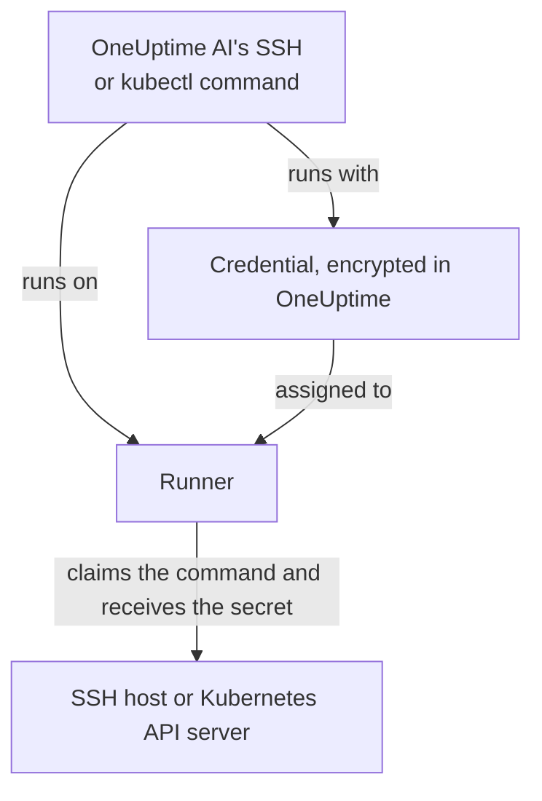

# AI Access

AI Access is how OneUptime AI's own commands reach something that is **not** a Runner's own host — a server over SSH, or the API server of a Kubernetes cluster that does not run the Kubernetes agent chart. Each one is a credential: that access as a managed object, encrypted at rest, assigned to specific Runners, and picked by OneUptime AI rather than written into a command. Runbook steps do not use these: an SSH or kubectl step signs in with a secret [runbook variable](/docs/runbooks/variables).

Manage them under **Runbooks → Runners → AI Access**.

:::cards
- [Create a credential](#create-a-credential): Its access, and the Runners that may use it.
- [Least privilege on the far side](#least-privilege-on-the-far-side): Limit what the key or token can do.
- [Runners that run OneUptime AI's commands](#runners-that-run-oneuptime-ais-commands): Who may give such a Runner an SSH credential.
:::

## How a credential is used

OneUptime AI runs an SSH command with one of the SSH credentials assigned to the Runner it runs on, and a kubectl command for a cluster that does not run the Kubernetes agent chart with the Kubernetes credential bound to that cluster, as [AI SRE](/docs/ai/ai-sre) shows. When the Runner claims the command, OneUptime checks that the credential is assigned to it, decrypts the secret and hands it over in the answer to that claim only. The secret is never stored on the job and never readable through the API.

## Before you begin

- **A role that manages credentials.** Project Owner and Project Admin, or anyone with the **Create Runbook Credential** permission. The Runbook Admin role does not include it. Assigning an SSH credential to a Runner that runs OneUptime AI's commands also takes **Read Runbook Credential**; see [Runners that run OneUptime AI's commands](#runners-that-run-oneuptime-ais-commands).
- **A plan that includes them.** On OneUptime Cloud, runbook credentials need the **Growth** plan or above.
- **A [Runner](/docs/runbooks/agents)** that can reach the host or the cluster's API server over the network.

## Create a credential

:::steps
### Open AI Access

Open **Runbooks → Runners → AI Access** and click **Create Credential**.

### Name it and pick its type

On the **Credential** step, enter a **Name**, such as `prod-cluster`, an optional **Description**, and the **Type**: **SSH** or **Kubernetes**. The type cannot be changed later; create a new credential instead.

### Enter the access

:::tabs
@tab SSH
On **SSH Host**, enter the **Hostname**, the **Port** (22 when left empty) and the **Username**. On **SSH Authentication**, pick how to **Sign in with**: a **Private key**, the better option where you have the choice, then paste the **Private Key (PEM)**, with its **Private Key Passphrase** if it has one; or a **Password**, for a host without key access, then enter the **Password**.
@tab Kubernetes
On **Kubernetes**, enter the **API Server URL**, such as `https://10.0.0.1:6443`, the **Service Account Token**, and the **CA Certificate (PEM)** so the Runner can verify the API server. Leave the CA empty only if the API server presents a certificate the Runner already trusts.
:::

### Assign it to Runners

On the **Runners** step, pick the Runners that may use the credential, then click **Create Credential**. A credential assigned to no Runner can be used by no command.

### Let OneUptime AI use it

OneUptime AI runs its SSH commands on the Runner an auto remediation rule picks for them, with one of the SSH credentials assigned to it. A Kubernetes credential is used once it is bound, with one of its Runners, to a cluster: see [AI SRE](/docs/ai/ai-sre).
:::

## What is stored

| Type | Fields |
| --- | --- |
| SSH | Hostname, port (defaults to 22), username, and either a PEM private key (with an optional passphrase) or a password. |
| Kubernetes | API server URL, a service account token, and the cluster CA certificate. |

## Secret values are write-only

Private keys, passphrases, passwords and service account tokens are encrypted at rest and the API **never returns them** — not to the dashboard, not to a workflow, not to an export. The table can show you what a credential *is* without ever showing what it holds.

That means there is no "view" for a secret value, only "replace": re-entering a value is how you rotate it. If you lose the original, issue a new key on the target system and update the credential.

## Assigning a credential to Runners

A credential is usable only by the Runners you assign it to. A command that names a credential its Runner is not assigned to **fails rather than running** — a Runner that silently does nothing looks exactly like one that worked.

The assignment is the access boundary, so keep it narrow: a Runner that only ever restarts one cluster does not need the SSH key for your database hosts.

### Runners that run OneUptime AI's commands

A Runner runs OneUptime AI's commands once it is picked for them: as an auto remediation rule's Runner, or for a Kubernetes cluster's AI access. On such a Runner, OneUptime AI picks from the SSH credentials assigned to the Runner for the commands it runs there. So an SSH credential reaches such a Runner only through someone who may read runbook credentials (**Read Runbook Credential**, or a Project Owner or Project Admin), whichever is saved first:

- **Assigning the credential.** Creating an SSH credential with such a Runner, or adding such a Runner to one, takes that permission. Without it, the save is refused and names the Runner: assign the credential to Runners that don't run AI remediation commands, or ask someone who has the permission to assign it.
- **Picking the Runner.** Picking a Runner that holds SSH credentials for OneUptime AI's commands - as a rule's Runner, or for a cluster - takes the same permission, the first time it is picked.

Removing Runners from a credential, saving a credential with the Runners it has, and Kubernetes credentials ask nothing more: OneUptime AI's kubectl commands run with the credential bound to their cluster. Creating a credential with Runners and picking a Runner by someone without that permission are saved one at a time in a project, so the two can't pass their checks together; a save that comes while another is being saved waits for it, and if that takes too long it is refused with *Try again in a moment*. Save it again. Saving a Runner, such as editing its description, never waits.

A workflow's steps act as a Project Admin, but are never lent a Project Admin's read of runbook credentials: a person who has it has to make these changes. See [What workflow steps can do](/docs/workflows/configuration#what-workflow-steps-can-do).

## Least privilege on the far side

OneUptime cannot restrict what your credential is allowed to do on the target system — that is the target system's job, and it is worth doing:

- **SSH** — prefer a key over a password, give the user only the commands it needs (a forced command or a restricted shell where practical), and do not reuse an administrator's personal key.
- **Kubernetes** — bind the service account to a Role that permits only what you let OneUptime AI do, in the namespaces it may act in. A service account that may only read lets OneUptime AI investigate, and refuses every fix.

## Who can see them

Creating, editing and deleting credentials needs the Runbook Credential permissions (or Project Owner/Admin). Reading a credential shows its non-secret fields only.

Note that a Runner's **agent key** is equivalent to the credentials assigned to that Runner: anything holding the key can claim work as that Runner and receive credential material. Agent keys are readable only by Project Owners, Project Admins and Runbook Admins for that reason — treat them the same way you would treat the credentials themselves.

## Next steps

:::cards
- [Runbook Variables](/docs/runbooks/variables): The secrets SSH and kubectl steps sign in with.
- [Runbook Agents](/docs/runbooks/agents): Install the Runner a credential is assigned to.
- [Runbook Configuration & Safety](/docs/runbooks/configuration): Permissions and hardening for the whole runbook stack.
:::
