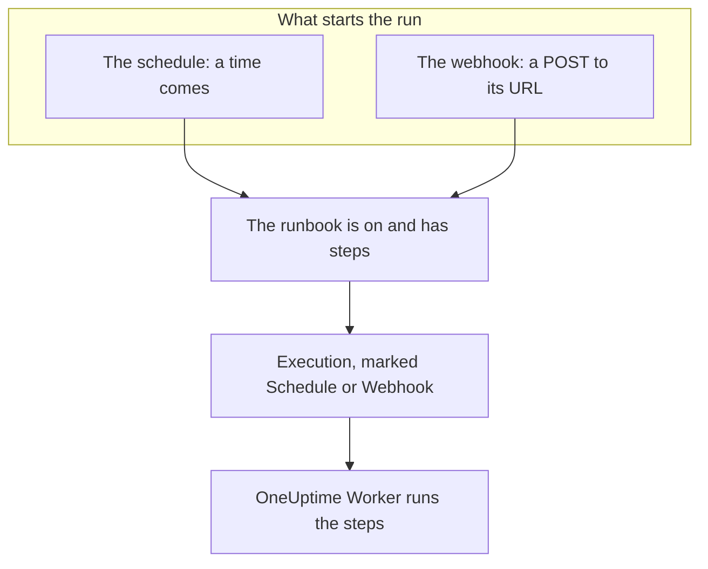

# Runbook Triggers

A runbook can start on its own: on a schedule, or when another tool calls its webhook URL. Use a schedule for routine work, such as a nightly cleanup or a weekly certificate check, and the webhook to start a runbook from an alerting system, a CI pipeline or a script. Both are set up on the runbook's **Triggers** page.

:::cards
- [Run on a schedule](#run-on-a-schedule): Every few minutes, every day, on days of the week, or a cron expression.
- [Call the webhook](#call-the-webhook): Start a run with a POST request to the runbook's URL.
- [Values a webhook call sends](#values-a-webhook-call-sends): How the steps read the JSON a caller sends.
- [Troubleshooting](#troubleshooting): A schedule that does not run, a call that is refused.
:::

## How a trigger starts a run



A trigger starts a run the way **Run Now** does: the run is an execution of the runbook's current steps, not attached to any incident, alert or scheduled maintenance event. Each run records what started it. The runbook's **Executions** and **Runbooks → Executions** show it under **Triggered by**, with when a scheduled run was due, or the address that called the webhook, and both lists can be filtered by it.

## Before you begin

- A runbook with at least one step, and its **Run this runbook** switch on, on its **Settings** page.
- Permission to edit the runbook and to run it. See [Who may set up triggers](#who-may-set-up-triggers).

## Run on a schedule

:::steps
### Open the runbook's Triggers page
Open the runbook from **Runbooks**, and click **Triggers** in its menu.

### Set up the schedule
Click **Set Up Schedule**. Under **When it runs**, pick a **Repeat** and what it needs. The dialog says the schedule in a sentence, such as "Runs every weekday at 09:00", and lists its next runs, as you change it.

### Check the time zone
**Time zone** starts at your own. The schedule's times are read on this zone's clock.

### Save it
Click **Save Schedule**. The schedule is turned on, and the card shows it in a sentence with its **Next runs**.
:::

| **Repeat** | What you pick | For example |
| --- | --- | --- |
| **Every few minutes** | **Every**: 1, 2, 3, 4, 5, 6, 10, 12, 15, 20 or 30 minutes | Every 15 minutes |
| **Every few hours** | **Every**: 1, 2, 3, 4, 6, 8 or 12 hours, and **Minutes past the hour** | Every 2 hours at :30 |
| **Every day** | **Time of day** | Every day at 09:00 |
| **On days of the week** | **On these days**, with **Weekdays** and **Every day** as shortcuts, and **Time of day** | Every weekday at 09:00 |
| **Custom (cron expression)** | **Cron expression** | `0 2 1 * *`: 02:00 on the 1st of each month |

A cron expression has five fields: minute, hour, day of month, month and day of week. Runbooks run at most once a minute, so there is no seconds field. The dialog explains an expression it cannot read, or one that never runs, such as `0 0 31 2 *`, and saves nothing until it can run.

The card then shows the schedule, its next three runs on the zone's clock, what it does when a run is still going or a time was missed, and the **Last scheduled run** with **View run**. **Edit Schedule** opens the same dialog, and the **Run on this schedule** switch pauses the schedule without losing it.

### If a run is still going

A run is still going while it is queued, running, or waiting for someone to complete or approve a step, however it started. The schedule's **If a run is still going** setting, folded under **More fields** in the dialog, decides what a time that comes then does:

| Setting | What happens |
| --- | --- |
| **Skip that time** (default) | Nothing starts. The schedule waits for its next time. |
| **Run after it ends** | One run waits, and starts when the run in progress ends. More times that come meanwhile start nothing. |

### If OneUptime missed a time

If OneUptime was down or being upgraded at a scheduled time, the time is missed once it is more than 5 minutes late. **If OneUptime missed a time** decides what happens when OneUptime is back:

| Setting | What happens |
| --- | --- |
| **Run once when OneUptime is back** (default) | One run starts, however many times were missed, marked "Catch-up for times OneUptime missed". |
| **Skip the missed times** | Nothing starts until the next time. |

Times that pass while the schedule or the runbook is turned off are not missed: turning either back on starts from the next time.

### Time zones and daylight saving time

Times are read on the zone's clock all year. A schedule for 09:00 in Europe/London runs at 09:00 London time in winter and in summer. On the night the clocks go forward, a time that does not exist that night runs an hour later on the clock. When the clocks go back and an hour comes twice, a schedule that runs every hour runs in both, and any other schedule runs once, at the first.

## Call the webhook

:::steps
### Turn the webhook on
On the runbook's **Triggers** page, turn on **Run when this URL is called**. The runbook gets its own URL.

### Copy the URL
The **Webhook URL** is masked: click **Show** to see it, or **Copy URL** to copy all of it. **Try it** has a `curl` command to start from.

### Call it from your tool
Send a `POST` request to the URL, with a JSON object as the body, or no body:

```bash
curl -X POST "https://oneuptime.com/runbook/webhook/RUNBOOK_ID/SECRET_KEY" \
  -H "Content-Type: application/json" \
  -d '{"host": "web-1", "reason": "Disk almost full"}'
```

### Check the run
The answer names the run it started: `{"runbookExecutionId": "...", "status": "Scheduled"}`. The run is on the runbook's **Executions**, where **Triggered by** says **Webhook**, and its page shows what the call sent under **Inputs**.
:::

**Send Test Request** sends a `POST` with a body you write to the URL, as another tool would, and links the run it started. It is a real run of the runbook.

### What a call is answered with

| Answer | When |
| --- | --- |
| `200` | The run was started. The body names it. |
| `400` | The body is not a JSON object, is nested more than 32 levels deep, or holds a NUL character, or the runbook has no steps. |
| `403` | The webhook or the runbook is turned off. |
| `404` | No runbook webhook answers at this URL: the runbook ID or the key is wrong, or the URL was reset. |
| `405` | The request is a `GET`. A `GET` never starts a run, so a link preview in a chat app cannot run it by accident. |
| `413` | The body is larger than 64 KB. |
| `429` | The webhook started 30 runs in the last minute, 10 of its runs are still going, or one address made more than 120 calls to runbook webhooks in a minute. The `Retry-After` header says when to try again, where it can. |
| `503` | OneUptime cannot count calls right now. Try again in a minute. |

A refused call starts nothing, and its body says why in a sentence, such as "This runbook is turned off, so it was not started. Turn it on with Run this runbook, under the runbook's Settings."

### Keep the URL private

The URL holds the runbook's secret key: anyone who has it can start the runbook. The key is 43 random characters, compared in constant time, and a wrong key is answered as if there were no such runbook.

If the URL leaks, click **Reset URL**. The runbook gets a new URL, and the old one stops working at once, so give the new one to every tool that calls it. Turning the webhook off and on again keeps the same URL.

## Values a webhook call sends

The body's top-level values become the run's inputs. They reach the steps as data, never as text pasted into a script or a command:

| Step type | How it reads the inputs |
| --- | --- |
| Bash | Environment variables: one `ONEUPTIME_INPUT_<NAME>` for each top-level value, `ONEUPTIME_INPUTS` with the whole object as JSON, and `ONEUPTIME_TRIGGER` with what started the run, such as `Webhook` or `Schedule`. |
| JavaScript | `args.inputs`, the object as sent, and `args.trigger`. |
| AI | In its prompt, marked as data from outside OneUptime, when **Include trigger context** is on. |
| HTTP request, SSH and Kubernetes | Not at all. Their URL, command and target are what the runbook says, and nothing a caller sends changes them. |

A variable's name is the value's name in capitals, with every character other than a letter or a digit written as `_`: `host-name` becomes `ONEUPTIME_INPUT_HOST_NAME`. Text is passed as it is, numbers and `true` or `false` as written, and objects and lists as JSON. A step gets at most 100 of these variables, and a name longer than 100 characters becomes none; every value is still in `ONEUPTIME_INPUTS`. Every name starts with `ONEUPTIME_`, so a caller cannot set `PATH` or any other variable the Runner reads.

A caller decides these values, so check them before you act on them:

```bash
set -euo pipefail
case "$ONEUPTIME_INPUT_HOST" in
  web-1|web-2|web-3) ;;
  *) echo "Unknown host: $ONEUPTIME_INPUT_HOST"; exit 1 ;;
esac
curl -fsS -X POST "http://$ONEUPTIME_INPUT_HOST.internal:8080/restart"
```

```javascript
const host = args.inputs.host;
if (!["web-1", "web-2", "web-3"].includes(host)) {
  throw new Error(`Unknown host: ${host}`);
}
console.log(`Started by ${args.trigger} for ${host}`);
return { host };
```

## Who may set up triggers

A schedule or a webhook starts runs with nobody there, so setting one up takes permission to edit the runbook and to run it: Project Owner, Project Admin or Runbook Admin, or **Edit Runbook** together with Project Member, Runbook Member or **Create Runbook Execution**. The labels a role is limited to count, as they do for **Run Now**. Seeing or resetting the webhook URL takes the same.

Turning a schedule or a webhook off starts nothing, so it takes only permission to edit the runbook. Someone who may edit the runbook but not run it sees the **Triggers** page with **Set Up Schedule** locked, and is told who can see the webhook URL.

## Troubleshooting

:::details Nothing runs on the schedule
The runbook is turned off, or has no steps: the card says which. Turn on **Run this runbook** on the runbook's **Settings** page, or add steps on its **Steps** page. If the card says the schedule is paused, turn on **Run on this schedule**.
:::

:::details A scheduled time started nothing
A run was still going and the schedule skips such times, or OneUptime missed the time and the schedule skips missed times. See [If a run is still going](#if-a-run-is-still-going) and [If OneUptime missed a time](#if-oneuptime-missed-a-time).
:::

:::details Saving a schedule fails with "You do not have permission to set up this runbook's schedule or webhook."
Setting up a trigger takes permission to run the runbook as well as to edit it. Ask for Runbook Admin, or for Runbook Member or **Create Runbook Execution** as well as **Edit Runbook**.
:::

:::details A call is answered "No runbook webhook answers at this URL."
The URL was reset, or was copied wrong. Copy it again from the runbook's **Triggers** page.
:::

:::details A call is answered "This runbook's webhook is turned off, so the runbook was not started."
Turn on **Run when this URL is called** on the runbook's **Triggers** page. The URL is the same as before.
:::

## Next steps

:::cards
- [Running a Runbook](/docs/runbooks/running): What a run shows, and how to move it along.
- [Authoring a Runbook](/docs/runbooks/authoring): Write the steps a trigger runs.
- [Runbook Configuration & Safety](/docs/runbooks/configuration): Limits, permissions and hardening.
:::
