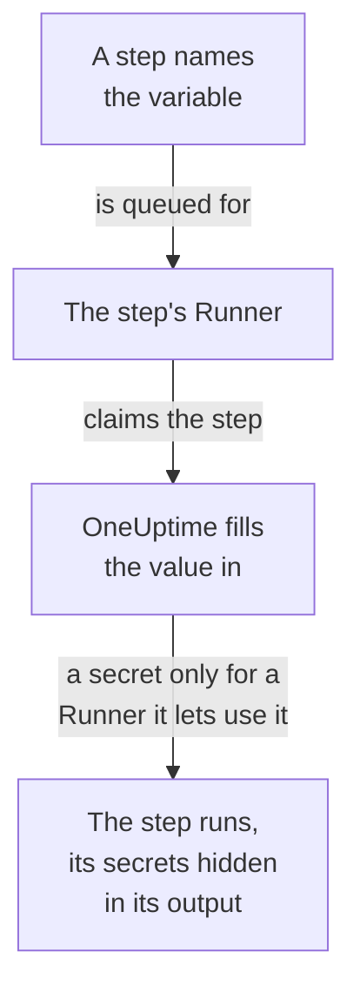

# Runbook Variables

A runbook variable is a value your steps use by name instead of holding it themselves: a host, a namespace or a URL, or a secret such as an SSH key, a password, a kubeconfig or an API token. Change the value once, and every step that names it uses the new one the next time it runs. A secret is encrypted, never shown again, and hidden in what steps print.

:::cards
- [Create a variable](#create-a-variable): A plain value, or a secret and the Runners that may use it.
- [Use a variable in a step](#use-a-variable-in-a-step): In a script or an HTTP request, or as an SSH step's sign-in and a kubectl step's kubeconfig.
- [Who receives a secret](#who-receives-a-secret): Your Runners, global Runners when you let them, and OneUptime for an HTTP request step.
:::

## How a variable reaches a step



A step holds the variable's name, never its value. When the step's Runner claims it, OneUptime fills the value in - in the script, an SSH step's machine and sign-in, or a kubectl step's kubeconfig - and hands it to that Runner only. A step that names a variable it may not have fails with the reason, rather than running with the name where the value should be.

Bash, JavaScript, SSH, kubectl and HTTP request steps use variables. AI steps do not fill them in. OneUptime sends an HTTP request step itself, without a Runner, so the step gets every variable it names, secrets too, and hides them in the response it records.

## Global and runbook variables

| | Global variables | A runbook's own variables |
| --- | --- | --- |
| Managed under | **Runbooks → Settings → Global Variables** | The runbook's **Settings → Variables** |
| Used by | Every runbook in the project | That runbook's steps only |
| Written in a step as | `{{global.variables.NAME}}` | `{{local.variables.NAME}}` |

A name is used once, whatever its case, among the project's global variables, and once among a runbook's own. A runbook's variable may share a name with a global one: each is written its own way.

## Before you begin

- **A role that manages variables.** Project Owner and Project Admin, or the **Create Runbook Variable** permission. Runbook Admin reads variables, to pick them in the steps it writes, but does not change them.
- **A plan that includes them.** On OneUptime Cloud, runbook variables need the **Growth** plan or above.

## Create a variable

:::steps
### Open the variables

Open **Runbooks → Settings → Global Variables**, or a runbook's **Settings → Variables**, and click **Create Variable**.

### Name it and enter its value

On the **Variable** step, enter a **Name**: letters, numbers, hyphens and underscores, up to 100 characters, such as `PROD_DB_SSH_KEY`. **Secret** starts on: paste the key, password, token or kubeconfig into **Secret Value** and click **Next**. For a value anyone may read, such as a host, turn **Secret** off, enter it in **Value** and click **Create Variable**. An optional **Description** waits under **More fields**.

### Choose who may use a secret

On the **Who can use it** step, pick your Runners under **Your Runners that can use it**. On a server with [global Runners](/docs/runbooks/agents#global-runners), **Global Runners can use it** also lets this project's steps that run on a global Runner use the secret: it starts on while the project uses global Runners. A secret needs one or the other. Click **Create Variable**.
:::

Whether a variable is a secret cannot be changed later. Delete it and create it again with the same name instead: steps name variables by name, so they keep working. A cluster's in-cluster Runner, the one the Kubernetes agent chart installs, is never given a secret.

## Secret values are write-only

A secret's value is encrypted at rest and the API **never returns it**: not to the dashboard, a workflow or an export. The list says **Secret** where a plain variable shows its value, and its **Runners** column says which Runners get each secret. To change it, click **Replace Value** on its row: the new value is encrypted, the old one is gone for good, and steps get the new one the next time they run.

When a step prints a secret it was handed, the Runner replaces it with `[REDACTED]` before the output leaves its host, and OneUptime does again before it stores the output. A line of a private key, or the token in a kubeconfig, is hidden too. A secret shorter than 4 characters is not looked for.

## Use a variable in a step

:::tabs
@tab In a script
Write the reference where the value goes, in a Bash, JavaScript, SSH or kubectl script:

```bash
curl -s -X POST \
  -H "Authorization: Bearer {{global.variables.CDN_API_TOKEN}}" \
  "https://api.cdn.example.com/v1/purge"
```
@tab In an HTTP request
Write the reference in an [HTTP request step](/docs/runbooks/authoring#http-request)'s URL, headers or body:

```json
{ "Authorization": "Bearer {{global.variables.API_TOKEN}}" }
```
@tab SSH sign-in
An [SSH step](/docs/runbooks/authoring#ssh) picks the secret variable that holds its private key or password under **Sign in with**, and its key's passphrase under **More fields → Key passphrase**. The value says whether it is a key or a password.
@tab Kubeconfig
A [kubectl step](/docs/runbooks/authoring#kubectl) picks the secret variable that holds the cluster's kubeconfig under **Kubeconfig**, or **The Runner's own access** to use the Runner's.
:::

On a runbook's **Steps** page, each script and each HTTP request lists the variables its step can use under **Variables — click to copy**, and the editor says when a step names a variable that is not there, or a secret its Runner may not use.

## Who receives a secret

| Who runs the step | A plain variable | A secret |
| --- | --- | --- |
| One of your Runners | Always | When the secret lists it under **Your Runners that can use it** |
| A global Runner | Always | When **Global Runners can use it** is on, for a step of the secret's own project |
| OneUptime itself, for an HTTP request step | Always | Always |

A step that names a secret its Runner may not use fails, naming the secret and what to change, and nothing is handed over.

## Runbook secrets and credentials became variables

Runbook variables took the place of runbook secrets, and of the credentials SSH and Kubernetes steps named. When OneUptime was upgraded, what each project had was moved once, so every runbook runs as it did:

- every runbook secret became a secret global variable of the same name, with the same value, Runners and switch for global Runners;
- `{{runbookSecrets.NAME}}` in a script was rewritten to `{{global.variables.NAME}}`, and the old spelling still reads the global variable `NAME`;
- every credential a step named became secret global variables with the same Runners, named after it: `<name>-ssh-key` (and `<name>-ssh-key-passphrase`, for a key that had one), `<name>-ssh-password` or `<name>-kubeconfig`;
- every SSH step that named a credential signs in to its machine with them and runs its command as its script, and every Kubernetes step became a kubectl step that runs the `kubectl patch` its action made, which needs no more access than the step had.

A Runner older than this release (14.0.79) cannot run a kubectl script: it fails a kubectl step and says to update the Runner. Every Kubernetes step moved this way first kept its credential and action beside its script, for such a Runner; they went with runbook credentials, so every kubectl step needs a Runner of 14.0.79 or later.

Runbook credentials were removed since, and a step that still named one was moved the same way first. A step that names a credential no longer runs, and its Steps page offers **Turn into a script step**; a save through the API or Terraform that gives a step one is refused. See [Runbook credentials are removed](/docs/installation/upgrading#runbook-credentials-are-removed).

## Next steps

:::cards
- [Authoring a Runbook](/docs/runbooks/authoring): Write the SSH and kubectl steps that use a variable.
- [Runbook Agents](/docs/runbooks/agents): Install the Runner a secret is handed to.
- [Runbook Configuration & Safety](/docs/runbooks/configuration): Permissions and hardening for the whole runbook stack.
:::
