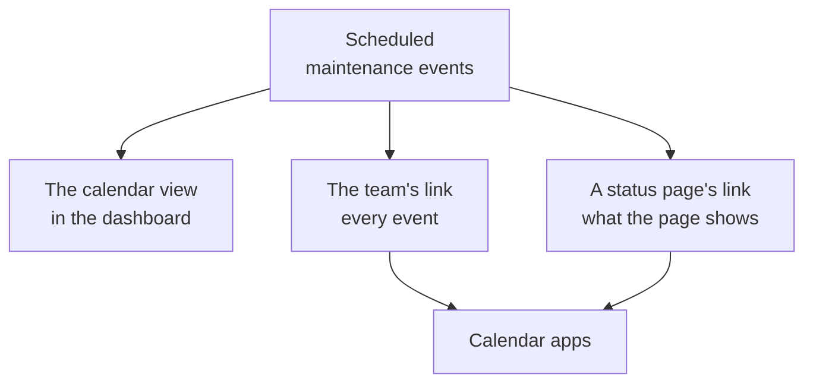

# Maintenance Calendar

The maintenance calendar shows your scheduled maintenance by date: as a calendar in the dashboard, in your team's own calendar apps through a secret link, and in the calendars of the people who follow your status pages. This page explains the calendar view, the team's calendar link, a status page's calendar, and what each calendar event holds.

:::cards
- [The calendar view](#the-calendar-view): Every event on a month, a week or a day, in its state's colour.
- [The team's calendar link](#the-teams-calendar-link): Every event of the project in Google Calendar, Outlook or Apple Calendar.
- [A status page's calendar](#a-status-pages-calendar): What a status page shows, in its visitors' calendars.
- [What a calendar event holds](#what-a-calendar-event-holds): The title, the window, the state and a link back.
:::



## The calendar view

Open **Scheduled Maintenance → All Events**. At the right end of the filter bar, **List** and **Calendar** switch between the table of events and a calendar of them. Your browser remembers the choice, so the page opens on the calendar the next time.

- The calendar opens on this month, with today marked. **Month**, **Week** and **Day** change how much it shows, and **Back**, **Next** and **Today** move through it. Times are in your own time zone.
- Each event is a block in the colour of its state, and the states' colours are named under the calendar. Click an event to open it.
- The filters above the calendar work as they do on the list: pick a state, a label or an owner to see only those events.
- A day that is still to come shows a **+** when you point at its week. It opens **Create Scheduled Maintenance Event** with **Starts At** on that day, at the hour the form would pick today. You see it only if you can create events.
- One view shows up to 500 events. A busier month says so: narrow it with the filters, or look at a week.

## The team's calendar link

**Subscribe to calendar**, under the calendar or in the list's **⋯** menu, opens the project's calendar link: one secret iCalendar (`.ics`) link that puts every scheduled maintenance event of the project in Google Calendar, Outlook, Apple Calendar or any app that subscribes to a calendar by URL.

:::steps
### Publish the link

Click **Publish link**. A project has one link, for the whole team, so this is needed only once.

### Add it to your calendar app

**Google Calendar** opens Google Calendar, which asks whether to add the calendar. **Apple Calendar / Outlook** opens the link in the calendar app of your computer or phone. **Copy link** copies it for any other app.

### Check that it works

The **Status** panel says when a calendar app last read the link, and which one. A new link says **Waiting for first sync** until an app reads it.
:::

The link looks like this:

```text
https://<your host>/api/scheduled-maintenance-calendar/project/<token>/maintenance.ics
```

> [!WARNING]
> Anyone with the link sees every scheduled maintenance event of the project, without signing in. Treat it like a password, and regenerate it if it is shared by mistake.

### Who can see the link

The link shows every event of the project, so the dialog shows it only to people who can read every event. Someone whose role limits them to some events, by label or to the events they own, is told why instead.

| Action | Who can do it |
| --- | --- |
| Copy the link | Anyone who can read every scheduled maintenance event of the project |
| **Publish link** | Anyone who can also create scheduled maintenance events |
| **Regenerate link**, **Turn off link** | Anyone who can also edit scheduled maintenance events |

### Manage the link

**Regenerate link** and **Turn off link** are in the dialog's **Manage link** menu.

| Action | What happens |
| --- | --- |
| **Regenerate link** | Makes a new link. For 30 days the old one serves an empty calendar, so the apps that hold it clear their copy; after that it is not found. Subscribe again with the new link. |
| **Turn off link** | Keeps the link, but it serves an empty calendar until **Turn on link**. |

The calendar holds every event from 90 days back to a year ahead, up to 1,000 events.

## A status page's calendar

The people who follow a status page can put its scheduled maintenance in their own calendar. On the status page's scheduled events page, **Subscribe to calendar** offers Google Calendar, the calendar app of their device, or the link to copy. The link is the page's address followed by `/maintenance.ics`, such as `https://status.example.com/maintenance.ics`.

- **What it holds.** Exactly what the page shows: the events of the page's history window, every event still to come and every one in progress, while **Visible on Status Page** is on. What each event affects is named as the page names its resources, never by your monitors' own names.
- **A private page.** A calendar app cannot sign in, so a private page offers no **Subscribe to calendar**, and its link serves an empty calendar that says the page is private.
- **One event.** **Add to calendar** on an event's page adds that event alone: Google Calendar opens with it filled in, or it downloads as a file the device's calendar app opens. It works on a private page too, for a visitor who has signed in, and is not offered once the event is over.

## What a calendar event holds

Every calendar, the team's and a status page's, writes an event the same way.

| Part | What it holds |
| --- | --- |
| Title | The event's title |
| Start and end | Its planned window, in UTC; the calendar app shows it in your own time zone |
| Description | Its description as plain text, its state, what it affects, and a link to the event; the team's link also names its status pages |
| Status | Cancelled when the event was called off: completed without ever being in progress |
| Free or busy | Free, so a maintenance window never blocks your availability |
| Categories | Its labels; a status page's calendar shows them only when the page shows labels |

An event edited in OneUptime is updated in place in every calendar that holds it, and one that is deleted, or taken off a status page, leaves the calendar at its next refresh.

## How often calendars refresh

Calendar apps read a subscribed link on their own schedule. Google Calendar does so every few hours, sometimes only once a day; Apple Calendar and Outlook usually every hour. OneUptime keeps a calendar for at most five minutes, so the wait you see is the calendar app's. The steps for each app are on [Calendar Feeds](/docs/on-call/calendar-feeds#subscribe-in-your-calendar-app), which work the same way for on-call shifts.

## Troubleshooting

:::details The calendar app stopped showing new events
The link was regenerated or turned off: open **Subscribe to calendar** to see its status. A regenerated link needs subscribing again with the new link; a link that is turned off comes back with **Turn on link**.
:::

:::details Google Calendar cannot add the link
Google Calendar reads the link from Google's servers, so the OneUptime server must be reachable from the internet. See [Calendar Feeds](/docs/on-call/calendar-feeds#troubleshooting) for a self-hosted server.
:::

:::details An event is missing from a status page's calendar
The page's calendar holds what the page shows. Check that the event names the page, that **Visible on Status Page** is on in its **Settings**, and that it started within the page's history window.
:::

## Next steps

:::cards
- [Creating Maintenance Events](/docs/scheduled-maintenance/creating-events): The form, field by field, and what happens next.
- [Subscribers & Announcements](/docs/status-pages/subscribers#scheduled-maintenance-events): What a status page's subscribers are told about maintenance.
- [Calendar Feeds](/docs/on-call/calendar-feeds): The same kind of link, for on-call shifts.
:::
