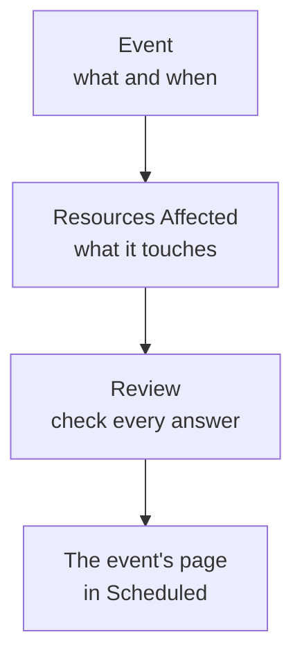

# Creating Maintenance Events

Schedule maintenance in two short steps: say what is happening and when, then what it affects and who should hear about it. Only the title has to be typed; everything else starts with a sensible default. This page walks through the form, what happens the moment you create an event, how to change it later, and how to create events from code.

:::cards
- [Create an event](#create-an-event): Two steps and a review.
- [What happens when you create it](#what-happens-when-you-create-it): Its number, rules, owners and the first messages.
- [Change an event later](#change-an-event-later): Its window, resources, status pages and notes.
- [Create events from code](#create-events-from-code): The API, Terraform, workflows and chat.
:::

## How it works

The form asks two questions, one per step, then shows everything on a review before it creates the event. The event starts in your scheduled state, and its page opens.



## Before you begin

- **Your role.** Creating an event takes **Project Owner**, **Project Admin**, **Project Member**, **Scheduled Maintenance Admin** or **Scheduled Maintenance Member**, or a custom role with **Create Scheduled Maintenance**.
- **Your status pages.** To tell customers, you need a status page that shows scheduled maintenance events. See [Status Pages Overview](/docs/status-pages/index).

## Create an event

:::steps
### Open the form

Go to **Scheduled Maintenance → All Events** and click **Create Scheduled Maintenance Event**. The form opens on its first step, **Event**.

### Say what is happening and when

Type a **Title**, and add a **Description** if it helps: it is Markdown, and it is shown on your status pages. **Starts At** is already the next full hour on your clock, and **Ends At** an hour later; change them only when they are wrong. Moving **Starts At** moves **Ends At** with it, so the window keeps its length. **Owners** and **Labels** wait under **More fields**, folded.

### Pick what it affects

Click **Next** to reach **Resources Affected**. Pick the **Monitors** the work touches. Once you pick one, **Change Monitor Status to** appears under them: the status the monitors change to when the event starts. Then pick any **Other Affected Resources**, such as hosts, clusters, databases, network sites or services.

### Choose who hears about it

Pick the status pages under **Show event on these status pages**. **Subscriber Notifications**, folded, says in one line who is told and when; open it to change **When the event is scheduled**, **When the event starts**, **When the event ends** or **Reminders before the event**.

### Create it

Click **Next** to see the review, check it, then click **Create Scheduled Maintenance Event**. The event's own page opens.
:::

Nothing is sent until you pick a status page: an event shown on no status page tells no subscriber.

## The form's fields

| Field                                | Step               | Starts as                       | What it does                                                                     |
| ------------------------------------ | ------------------ | ------------------------------- | -------------------------------------------------------------------------------- |
| **Title**                            | **Event**          | Empty, and required             | Names the event everywhere, on your status pages too.                            |
| **Description**                      | **Event**          | Empty                           | Explains the work to your customers, in Markdown.                                |
| **Starts At**                        | **Event**          | The next full hour              | When the event starts, on its own.                                               |
| **Ends At**                          | **Event**          | An hour after **Starts At**     | When the event ends, on its own. It has to come after **Starts At**.             |
| **Owners**                           | **Event**          | Nobody                          | People and teams who own the event and are told about it.                        |
| **Labels**                           | **Event**          | None                            | Labels that rules and filters can match on.                                      |
| **Monitors**                         | **Resources Affected** | None                        | The monitors that are not checked while the event is in progress.               |
| **Change Monitor Status to**         | **Resources Affected** | No change                   | The status those monitors show during the event. Asked once a monitor is picked. |
| **Other Affected Resources**         | **Resources Affected** | None                        | Hosts, clusters, databases, network sites, services and more.                    |
| **Show event on these status pages** | **Resources Affected** | None                        | The status pages that show the event and tell their subscribers.                 |
| **Subscriber Notifications**         | **Resources Affected** | All three moments on, no reminders | When the subscribers of those pages are told.                           |

Two things fill the form in for you as you go:

- **Linked resources.** When you pick a monitor, the hosts, clusters, services and other resources it is linked to are added under **Other Affected Resources**, and a line under the field names them. Remove any you do not want. Cloud resources are not added: a maintenance event does not hold them.
- **Suggested status pages.** Under **Show event on these status pages**, the pages that show your monitors are suggested: click a page's name to add it, or **Add all**. Nothing is picked for you. See [Scheduled maintenance events](/docs/status-pages/subscribers#scheduled-maintenance-events).

## Start from a resource or a template

On the **Scheduled Maintenance** tab of a host, a Kubernetes, Proxmox, Ceph or Docker Swarm cluster, a Docker or Podman host, a vCenter, a storage array, an IoT fleet, a database, a service or a network site, **Create Scheduled Maintenance Event** opens the same form with that resource already picked under **Other Affected Resources**, and the tab lists the events that affect it. An inventory item's tab picks the host, service or Kubernetes cluster the item points at.

**Create from Template**, beside the create button, asks you to **Select Scheduled Maintenance Template**, then opens the form filled in from the template. See [Templates & Recurring Events](/docs/scheduled-maintenance/templates).

## What happens when you create it

The moment you click **Create Scheduled Maintenance Event**, OneUptime works through these steps, in this order:

1. **It gets a number and a state.** The number comes from a per-project counter, shown with your prefix (`SM-42`). The event starts in your scheduled state, whatever state a request names.
2. **Your chat tools hear of it.** The Slack and Microsoft Teams rules under **Workspace** post it to their channels, and a rule can create a channel for the event. Its feed records that it was created.
3. **Its state timeline starts.** The first row of its **State Timeline** is your scheduled state.
4. **Owners and labels are added**: the ones you picked, then those of matching owner and label rules.
5. **Runbook rules start** the runbooks that match the event.
6. **Reminders are scheduled**, when a reminder rule matches, for its owners.

Within a minute, the subscribers of its status pages are told that it is scheduled, unless you turned **When the event is scheduled** off. The **On Create Scheduled Maintenance Event** workflow trigger starts any workflow built on it, and its owners hear of it if they turned that notification on: see [Notification Settings](/docs/notifications/notification-settings).

## Change an event later

Everything on the form can be changed on the event's own pages, except the three subscriber moments, which are set once, when the event is created.

| To change                                   | Go to                                                                          |
| ------------------------------------------- | ------------------------------------------------------------------------------ |
| The title, the window or the labels         | **Edit** on the **Maintenance Details** card of its **Overview**, step **Event** |
| The status pages or the reminders           | The same **Edit**, step **Status Pages**                                        |
| The monitors, their status or other resources | **Edit** on the **Affected Resources** card                                   |
| The description                             | **Description** in its side menu                                               |
| The owners                                  | **Owners** in its side menu                                                    |

**Change Monitor Status to** can be changed until the event starts. After that the card shows it read-only, because the monitors are already in that status. An edit adds an entry to the **Scheduled Maintenance Feed** that names what it changed; saving with nothing changed adds none.

## Post notes as the work goes on

- **Public Notes** are updates for your customers: they are shown on the event's status pages, and each one can notify their subscribers with **Notify status page subscribers**.
- **Private Notes** are for your team only.

Write one on the event's **Public Notes** or **Private Notes** page, or from the **Actions** menu of the **Scheduled Maintenance Feed** with **Add Public Note** or **Add Private Note**. The same menu runs a runbook with **Execute Runbook**. A note template fills in text your team writes often: see [Maintenance Rules & Settings](/docs/scheduled-maintenance/settings#note-templates).

## Create events from code

The event model has a standard API, so `POST /api/scheduled-maintenance` creates an event. Authenticate with an API key from **Project Settings → Advanced → API Keys**, sent in the `apikey` header; the key names the project.

```bash
curl -X POST https://oneuptime.com/api/scheduled-maintenance \
  -H "apikey: $ONEUPTIME_API_KEY" \
  -H "Content-Type: application/json" \
  -d '{
    "data": {
      "title": "Database upgrade",
      "description": "Writes pause for a few minutes while the primary restarts.",
      "startsAt": "2030-06-01T02:00:00Z",
      "endsAt": "2030-06-01T04:00:00Z"
    }
  }'
```

| Field                                                 | Notes                                                                                     |
| ----------------------------------------------------- | ----------------------------------------------------------------------------------------- |
| `title`, `startsAt`, `endsAt`                          | Required, as on the form.                                                                 |
| `monitors`, `statusPages`, `labels`                   | The event's monitors, status pages and labels, all from the API key's project.           |
| `changeMonitorStatusToId`                             | The monitor status its monitors change to when it starts.                                  |
| `currentScheduledMaintenanceStateId`                  | Ignored: every event starts in your scheduled state.                                      |
| `shouldStatusPageSubscribersBeNotifiedOnEventCreated` | The **When the event is scheduled** switch. The other two moments have their own fields. |

The same event as code is the `oneuptime_scheduled_maintenance_event` Terraform resource: see [Examples](/docs/terraform/examples#scheduled-maintenance). A workflow creates one with its **Create One Scheduled Maintenance Event** step, and `/oneuptime maintenance` opens the form in Slack: see [Slack](/docs/workspace-connections/slack#creating-incidents-and-maintenance-from-slack).

## Troubleshooting

:::details Ends At says it must be after Starts At
The window has to be in order: the event ends after it starts. Move **Starts At** first, since **Ends At** follows it, then set **Ends At**.
:::

:::details Change Monitor Status to is missing from the form
It is asked only once the event has a monitor. Pick one under **Monitors**, and it appears right under them.
:::

:::details Change Monitor Status to cannot be changed any more
The event has started, and its monitors are already in that status. The status applies from the moment the event starts until it ends.
:::

## Next steps

:::cards
- [Maintenance States](/docs/scheduled-maintenance/states): What starts and ends an event, and how to move it by hand.
- [Templates & Recurring Events](/docs/scheduled-maintenance/templates): Save the form's answers for next time.
- [Subscribers & Announcements](/docs/status-pages/subscribers#scheduled-maintenance-events): Exactly who is told, and when.
- [Maintenance Rules & Settings](/docs/scheduled-maintenance/settings): Add owners, labels and reminders automatically.
:::
