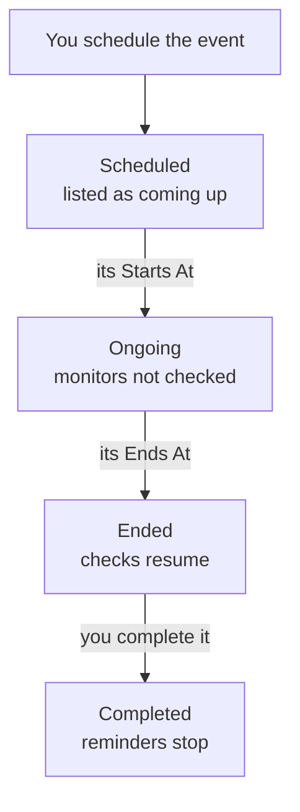

# Scheduled Maintenance Overview

A scheduled maintenance event tells everyone about planned work before it happens: a database upgrade, a network change, a move to new servers. OneUptime starts and ends the event on time, stops checking the monitors it affects while the work runs, and shows it on your status pages, so planned downtime never looks like an outage. This page explains how an event runs, where everything is in the dashboard, and what an event changes in the rest of OneUptime.

:::cards
- [How an event runs](#how-an-event-runs): From scheduled to completed, mostly on its own.
- [Where events come from](#where-events-come-from): The form, templates, a schedule, forms, chat and code.
- [What an event affects](#what-an-event-affects): Monitors, status pages, subscribers and alerts.
- [An event's own pages](#an-events-own-pages): Its overview, timeline, notes and settings.
:::

## How an event runs

Every event has a planned window, its **Starts At** and **Ends At**, and walks down your list of maintenance states. A job that runs every minute moves it on at both ends of the window, so you schedule the work once and OneUptime does the rest.

A new event starts in **Scheduled**. At its **Starts At** it moves to **Ongoing**: OneUptime stops checking its monitors and, if you picked a status for them, shows them in it. At its **Ends At** it moves to **Ended**: checks resume, and each monitor goes back to operational. **Completed** is the last step, and nothing takes it on its own: a person, a chat button or the API marks the work as signed off, which also stops the owners' reminders.

You can start or end an event early, or add states of your own between these four. See [Maintenance States](/docs/scheduled-maintenance/states).

## Maintenance and announcements

Both tell the visitors of your status pages about something. Use a maintenance event for work with a start and an end, and an announcement for anything else they should read.

|                              | Scheduled maintenance                                                   | Announcement                                   |
| ---------------------------- | ----------------------------------------------------------------------- | ---------------------------------------------- |
| **What it is**               | Planned work, with a window                                             | A message for your status page visitors        |
| **Its monitors**             | Not checked while it runs, and shown in the status you pick             | Not changed                                    |
| **How it moves on**          | Through your maintenance states, on time                                | It shows from its start time until its end time, if it has one |
| **When subscribers are told** | When it is scheduled, starts and ends, and before it starts if you ask | Once, when it starts showing                   |
| **Numbers in a new project** | `SM-42`                                                                 | None                                           |

Announcements are covered on [Subscribers & Announcements](/docs/status-pages/subscribers#announcements).

## Where events come from

- **The form.** Click **Create Scheduled Maintenance Event** on the list of events, or on the **Scheduled Maintenance** tab of a host, a cluster, a service, a network site or another resource, which picks that resource for you. See [Creating Maintenance Events](/docs/scheduled-maintenance/creating-events).
- **A template.** **Create from Template** fills the form in from a template you saved for work you do often. See [Templates & Recurring Events](/docs/scheduled-maintenance/templates).
- **A schedule.** A recurring template creates a new event on a schedule, such as every week or every month, without anyone opening the form.
- **A form.** A form whose submissions create maintenance events turns a change request into an event. See [What a Submission Creates](/docs/forms/on-submit#how-a-submission-becomes-a-scheduled-maintenance-event).
- **Chat.** `/oneuptime maintenance` in Slack, or `maintenance` typed to the OneUptime bot in Microsoft Teams, opens the form in your chat tool. See [Slack](/docs/workspace-connections/slack#creating-incidents-and-maintenance-from-slack).
- **Code.** The API at `/api/scheduled-maintenance`, the `oneuptime_scheduled_maintenance_event` Terraform resource, and the **Create One Scheduled Maintenance Event** step of a workflow.

## Where maintenance lives in the dashboard

Open **Scheduled Maintenance** from the **Products** menu in the top bar. The list of events is at `/dashboard/{projectId}/scheduled-maintenance-events`, and its side menu holds everything about maintenance:

| Section       | What you do there                                                                                                                    |
| ------------- | ------------------------------------------------------------------------------------------------------------------------------------ |
| **Overview**  | **All Events** and **Ongoing Events**, whose badge counts the events in progress right now.                                          |
| **Calendar**  | **Maintenance Calendar**: every event on a month, a week or a day, beside the calendars from outside the project you add.            |
| **Workspace** | **Slack** and **Microsoft Teams**, whichever the project has connected, or **Connect Slack or Teams** when it has neither.           |
| **Rules**     | **Owner Rules**, **Runbook Rules**, **Label Rules**, **Reminder Rules**.                                                             |
| **Settings**  | **Event State**, **Event Templates**, **Note Templates**, **Custom Fields**, **Measurements**, **Calendar Settings**, **Numbering**. |

**Overview** and **Calendar** are open; **Workspace**, **Rules**, **Settings** and **Developer** start folded, and a section opens by itself when you are on one of its pages. **Developer** holds **Terraform**, **API** and **AI Assistants**, for managing maintenance from code. Everything about maintenance lives here, not in **Project Settings**.

The list shows **Scheduled Maintenance Number**, **Title**, **Current State**, **Affected Resources**, **Shown on Status Page**, **Starts At**, **Duration**, **Ends At**, **Labels** and **Owners**. Select events to act on several at once: **Mark as {{state}}**, **Change State**, **Assign to Me**, **Add Owner**, **Remove Owner**, **Add Labels**, **Remove Labels** or **Delete**. Each event's **⋯** menu, at the end of its row, does the same for that event alone: the **Mark as {{state}}** moves while the event can make them, **Change State**, **Assign to Me** until you own it, and **Add Owner**.

**Maintenance Calendar**, in the **Calendar** section, shows the same events on a month, a week or a day, and can show calendars from outside the project beside them. See [Maintenance Calendar](/docs/scheduled-maintenance/calendar).

## What an event affects

While an event is in progress, OneUptime treats the outage it plans as expected:

- **Its monitors are not checked.** Every monitor under **Monitors** stops being checked, and each one's pages say **This monitor is disabled**. If you picked a **Change Monitor Status to**, the monitors show that status, on your status pages too. When the event ends, or is deleted, checks resume and each monitor goes back to operational, unless another event in progress still holds it.
- **Its other resources stay quiet.** A telemetry monitor that watches many hosts, clusters, databases or services, one series each, raises no incident or alert for a series whose resource the event covers, while the other series keep alerting.
- **Network sites and SLOs hold back.** A network site the event covers stops counting its planned outage against the sites above it, and an SLO's burn rate rules raise nothing while any of its monitors is in maintenance. See [Network Sites](/docs/monitor/network-sites#scheduled-maintenance-for-network-sites) and [Burn Rate Alerts and Incidents](/docs/slo/burn-rate-alerts#scheduled-maintenance).
- **Your status pages show it.** The event appears on the status pages you picked, as coming up, then in progress, then over, while **Visible on Status Page** is on in its **Settings**, and from its **Publish At** when you picked one. Once it has started, on those pages the uptime history of every resource its monitors are on lists it on each day its window touches, and those resources say "Under maintenance" while it runs; the monitor's uptime history in the dashboard shows it the same way. See [Uptime percentages and history charts](/docs/status-pages/resources-and-groups#uptime-percentages-and-history-charts).
- **Subscribers hear about it.** By default, the subscribers of those pages are told when it is scheduled, when it starts and when it ends, and reminded before it starts if you set reminders. See [Scheduled maintenance events](/docs/status-pages/subscribers#scheduled-maintenance-events).
- **Your team hears about it.** Its owners are told as their [notification settings](/docs/notifications/notification-settings) say, and the Slack and Microsoft Teams rules under **Workspace** post it to your channels.

## An event's own pages

Open an event from the list to see its pages. Its side menu holds:

| Side menu section | Pages                                                                                         |
| ----------------- | --------------------------------------------------------------------------------------------- |
| **Overview** | **Overview**, **State Timeline**, **Description**, **Runbooks** |
| **Team** | **Owners** |
| **Notifications**          | **Notification Logs** and **AI Logs**: every message sent about the event, and what AI did for it |
| **Notes**         | **Private Notes** and **Public Notes**                                                         |
| **Developer**     | **Terraform**, **API** and **AI Assistants**: the event managed from code                     |
| **Advanced**      | **Custom Fields**, **Settings**, **Audit Logs**, **Delete Event**                             |

**Overview**, **Team** and **Notes** are open; the other sections start folded until you click them.

- **Overview** — the header shows the event's number, title and state, how long until it starts or how long it has run, who owns it, the status pages it shows on and who created it, and the buttons that move it on. Under it, **Starts**, **Ends** and **Duration** show the planned window in your time zone. The **Scheduled Maintenance Feed** records everything that happened to the event, beside the **Maintenance Details** and **Affected Resources** cards, and the **Measurements** and **Custom Fields** cards when your project has any.
- **State Timeline** — every state the event has been in, when, and for how long. See [Maintenance States](/docs/scheduled-maintenance/states#the-state-timeline).
- **Public Notes** — updates for your status pages and their subscribers. **Private Notes** are for your team only.
- **Settings** — **Visible on Status Page**, which shows or hides the event on its status pages, and **Send reminders**, which reminds its owners until it is completed. Each switch saves the moment you flip it.

## Troubleshooting

:::details An event did not start at its Starts At
The job that starts events runs every minute, so allow a minute. If the header says **Start overdue**, the event missed its start by more than two minutes: start it with the header's button, which does everything the job does, and open its **State Timeline** to see where it was.
:::

:::details A monitor was still checked during maintenance
Only the monitors the event names under **Monitors** stop being checked, and only while the event is in progress. A monitor of a host or a service that the event names under **Other Affected Resources** is still checked. Edit the event's **Affected Resources** card to add the monitor.
:::

:::details The event is not on my status page
Check that the event names the page under **Show event on these status pages**, and that **Visible on Status Page** is on in the event's **Settings**. If its header says **Not on status pages yet**, it shows from its **Publish At**: see [Publish it later](/docs/scheduled-maintenance/creating-events#publish-it-later). Then check the status page itself: it must show scheduled maintenance events, and an event that started longer ago than the page's history window, 14 days unless you changed it, is no longer listed.
:::

## Next steps

:::cards
- [Creating Maintenance Events](/docs/scheduled-maintenance/creating-events): The form, field by field, and what happens next.
- [Maintenance States](/docs/scheduled-maintenance/states): What starts and ends an event, and states of your own.
- [Templates & Recurring Events](/docs/scheduled-maintenance/templates): Reuse an event, or schedule it every week.
- [Maintenance Rules & Settings](/docs/scheduled-maintenance/settings): Owners, labels, runbooks and reminders, automatically.
:::
