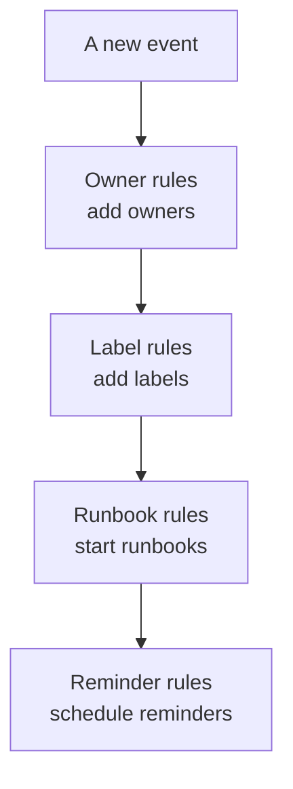

# Maintenance Rules & Settings

Maintenance configuration lives inside **Scheduled Maintenance**, not in **Project Settings**: the rules that act on every new event, and the settings that shape every event in the project. This page is the reference for each of them, and for who may change them.

:::cards
- [The rules a new event passes through](#the-rules-a-new-event-passes-through): In order, and what each one does.
- [Reminder rules](#reminder-rules): Remind owners until an event is completed.
- [Settings](#settings): Note templates, custom fields, measurements and numbering.
- [Who can change these](#who-can-change-these): The maintenance roles, and the plans.
:::

## Where maintenance settings live

Open **Scheduled Maintenance** from the **Products** menu in the top bar. The **Rules** and **Settings** sections of its side menu start folded, so expand them first. Every page here is project-wide, at an address beginning `/dashboard/{projectId}/scheduled-maintenance-events/settings/`.

| Rules page         | What it does                                                        |
| ------------------ | ------------------------------------------------------------------- |
| **Owner Rules**    | Adds owners to matching events.                                     |
| **Runbook Rules**  | Starts runbooks for matching events.                                |
| **Label Rules**    | Adds labels to matching events.                                     |
| **Reminder Rules** | Reminds owners at an interval until an event is completed.          |

The **Settings** section holds **Event State**, covered on [Maintenance States](/docs/scheduled-maintenance/states), **Event Templates**, covered on [Templates & Recurring Events](/docs/scheduled-maintenance/templates), then **Note Templates**, **Custom Fields**, **Measurements**, **Calendar Settings** and **Numbering**. **Calendar Settings** is covered on [Maintenance Calendar](/docs/scheduled-maintenance/calendar#external-calendars), the rest below.

The **Workspace** section holds the Slack and Microsoft Teams rules that post events to channels. See [Slack](/docs/workspace-connections/slack#notification-rules) and [Microsoft Teams](/docs/workspace-connections/microsoft-teams#notification-rules).

## The rules a new event passes through

The rules differ in how several matches resolve:

- **Owner Rules**, **Label Rules** and **Runbook Rules** all act when they match. Owners and labels that several rules add are added once.
- **Reminder Rules** are checked from the top of their list down, and the first match wins. Drag a rule to change its place; a new rule goes to the end.

A new rule starts enabled; switch **Enabled** off on its edit form to pause it, and the list shows a green **Enabled** or red **Disabled** for each rule. Owner, label and runbook rules act on events created after you save them. To apply an owner or label rule to the events you already have, use **Run Now**: see [Run Rules on Existing Resources](/docs/configuration/run-rules-now).

## Owner and label rules

**Owner Rules** add owner users and teams to new events that match, and **Label Rules** add labels. Creating one takes two steps: **Match**, the conditions, then **Owners** or **Labels**, what the rule adds.

| Condition                                                       | Matches                                                                    |
| --------------------------------------------------------------- | -------------------------------------------------------------------------- |
| **Monitors**, **Event Labels**, **Monitor Labels**              | Events with any of the monitors or labels you pick.                        |
| **Event Title**, **Event Description**, **Monitor Name**, **Monitor Description** | A pattern, as a regular expression, ignoring case.        |

A rule matches only when every condition you fill in holds; a condition left empty is skipped.

- **A rule can inherit.** Folded under **Inherit Owners** or **Inherit Labels**, six switches hand on the owners or labels of the event's monitors, hosts, Kubernetes clusters, Docker hosts, Podman hosts and services.
- **A new rule has to add something**: pick at least one owner or label, or turn on a switch.
- **Notify Owners**, under **More fields** on an owner rule, decides whether the people added are told.

[Label and Owner Rules](/docs/configuration/label-and-owner-rules) covers the form step by step, for every kind of resource.

## Runbook rules

**Runbook Rules** start a runbook when a new event matches, such as a pre-flight checklist for every database upgrade. They match on the same things as owner and label rules; events have no severity, so maintenance runbook rules do not offer one. The run is attached to the event, on its **Runbooks** page. See [Runbook Rules](/docs/runbooks/rules).

## Reminder rules

**Scheduled Maintenance → Rules → Reminder Rules** reminds an event's owners until the work is signed off. Each event gets the first rule that matches it, from the top of the list down.

:::steps
### Choose which events to remind about

Click **Create Scheduled Maintenance Reminder Rule**. On **Match**, leave **All scheduled maintenance events** picked to remind about every event, or pick **Only scheduled maintenance events that match conditions** and choose the **Labels** it applies to.

### Set the interval

On **Reminders**, set **Reminder Interval (minutes)**, how often owners are reminded, and pick when to remind them under **Remind Owners**. Its **Name** follows both, such as "Remind every 30 minutes while it is in progress", until you type your own, and a **Description** waits under **More fields**. Then create the rule.
:::

| Answer | When owners are reminded |
| --- | --- |
| **While it is in progress** | From when the event starts until it ends. A new rule starts with this one. |
| **Before it starts** | From when the event is scheduled until it starts. |
| **Before it starts and while it is in progress** | From when the event is scheduled until it ends. |

The API and Terraform refuse a rule that would wait for the event to start and stop when it starts: it would never send a reminder. An older rule saved that way is marked **Never reminds** in the list, and its form asks you to pick when to remind.

Owners get each reminder as **Maintenance reminder**, which is on by email for every new member. Saving, changing or deleting a reminder rule matches every event that is not completed again. To stop the reminders for one event, turn **Send reminders** off on its **Settings** page; it saves the moment you flip it.

These reminders are for your team. The reminders your status page subscribers get before an event starts are set on the event itself, under **Reminders before the event**.

## Settings

### Note templates

**Scheduled Maintenance → Settings → Note Templates** holds ready-made text for maintenance updates. The **Public or Private Note Templates for Scheduled Maintenance Events** card lists them; **Create Scheduled Maintenance Note Template** asks for a **Template Name**, a **Template Description** and the **Note**. A template is offered when someone writes a public or private note on an event, and when they change its state, and its text can be edited before it is posted. Unlike incident note templates, maintenance note templates fill in no variables.

### Custom fields

**Scheduled Maintenance → Settings → Custom Fields** adds your own fields to every event, such as a change ticket or a customer tier. Fill them in on an event's **Custom Fields** page, or through the API as `customFields`. A field can copy its value from a monitor custom field instead of being typed in: see [Fields copied from a monitor](/docs/incidents/settings#fields-copied-from-a-monitor), which works the same way for events.

### Measurements

**Scheduled Maintenance → Settings → Measurements** times how long things take on every event. Pick **Start delay**, from the planned start until the event starts, **Overrun**, from the planned end until it ends, or **Maintenance duration**, from when it starts until it ends; or two moments of your own with **Something else**. Each measurement is shown on the event's page and charted as `oneuptime.scheduled-maintenance.measurement.<key>`. See [Measurements](/docs/incidents/settings#measurements), which works the same way for events.

### Numbering

**Scheduled Maintenance → Settings → Numbering** sets the text in front of event numbers: `SM-` in a new project, or `#` with none. **Update** asks for the **Scheduled Maintenance Number Prefix**, and previews the number as you type. Only events created afterwards get the new prefix; existing ones keep their numbers. The rules for a prefix are on [Number prefixes](/docs/incidents/settings#number-prefixes).

The **Next Number** card under it sets the number the next event gets, to carry on from another tool's numbers: **Update** opens **Next Scheduled Maintenance Number**, which must be higher than the highest used so far. See [Next numbers](/docs/incidents/settings#next-numbers).

> [!NOTE]
> On OneUptime Cloud, custom fields take the **Growth** plan or above, and so do adding and changing maintenance states and templates.

## Workflows

Every maintenance model has workflow triggers and actions, named after it: **On Create Scheduled Maintenance Event**, **On Update Scheduled Maintenance Event**, **On Create or Update Scheduled Maintenance Event** and **On Delete Scheduled Maintenance Event**, the same for **Scheduled Maintenance State Timeline** and the others, and actions such as **Create One Scheduled Maintenance Event** and **Update One Scheduled Maintenance Event**. Custom field definitions and measurement values are the exceptions: they have no workflow steps. See [Workflows Overview](/docs/workflows/index).

## Who can change these

| Role                              | What it can do                                                                                       |
| --------------------------------- | ---------------------------------------------------------------------------------------------------- |
| **Scheduled Maintenance Viewer**  | Reads events, and changes nothing.                                                                   |
| **Scheduled Maintenance Member**  | Creates, changes and deletes events with their notes, state timelines and owners, and both kinds of templates. |
| **Scheduled Maintenance Admin**   | Everything a member does, and also creates, changes and deletes maintenance states.                  |

Rules, custom fields and measurements take **Project Owner** or **Project Admin**, or a custom role with that page's own permission, such as **Create Scheduled Maintenance Owner Rule**. Runbook rules also take **Runbook Admin**. **Project Member** works with events and templates, like **Scheduled Maintenance Member**. See [Users, Teams & Permissions](/docs/permissions/index).

## Troubleshooting

:::details An owner rule did not add anyone to a new event
Open the rule and check its conditions: every condition you filled in must hold. A title pattern is a regular expression, so `db upgrade` does not match "DB-Upgrade"; write `db.upgrade`. A rule also acts only on events created after it was saved: use **Run Now** for the ones you already have.
:::

:::details Owners got no reminder
Check that a reminder rule matches the event's labels, that the event's **Send reminders** is on, and that **Maintenance reminder** is on in the owners' notification settings. A rule that reminds **While it is in progress** sends nothing before the event starts.
:::

## Next steps

:::cards
- [Maintenance States](/docs/scheduled-maintenance/states): The Event State page, and what each state does.
- [Templates & Recurring Events](/docs/scheduled-maintenance/templates): The Event Templates page, in depth.
- [Label and Owner Rules](/docs/configuration/label-and-owner-rules): The rule form, step by step.
- [Notification Settings](/docs/notifications/notification-settings): How each owner chooses what reaches them.
:::
