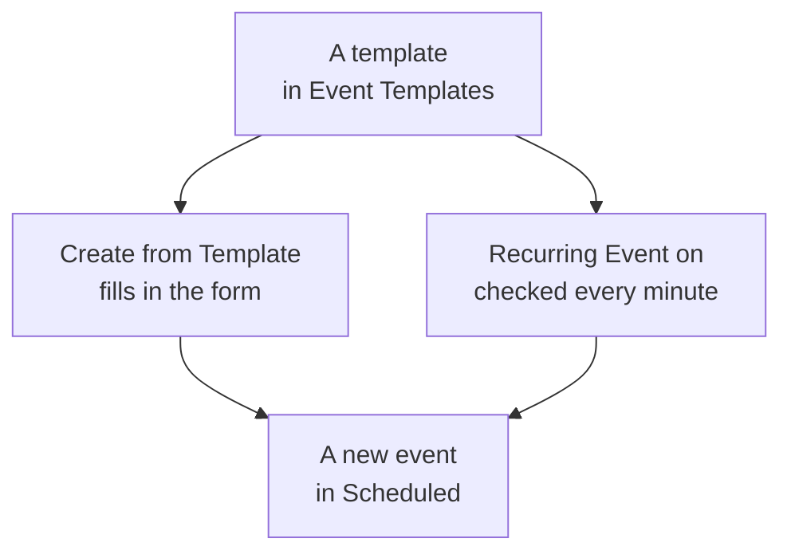

# Templates & Recurring Events

A scheduled maintenance template saves an event you plan often: its title and description, the monitors it pauses, the status pages it shows on and who is told. Use one to fill in the form with one click, or make it recurring, so OneUptime schedules the event for you every week, every month or at any interval you choose.

:::cards
- [Create a template](#create-a-template): The form's steps, with a name in front and a schedule at the end.
- [Use a template](#use-a-template): Fill in a new event from it.
- [Recurring events](#recurring-events): Let OneUptime schedule the event on its own.
- [Change or stop a template](#change-or-stop-a-template): Edit it, pause its schedule, or delete it.
:::

## How it works

A template is a starting point. An event created from it is a copy with its own values: changing the template later changes only the events created after that.

## Before you begin

- **Your plan.** On OneUptime Cloud, templates take the **Growth** plan or above.
- **Your role.** Creating a template takes **Project Owner**, **Project Admin**, **Project Member**, **Scheduled Maintenance Admin** or **Scheduled Maintenance Member**, or a custom role that may create scheduled maintenance templates.

## Create a template

:::steps
### Open the templates

Go to **Scheduled Maintenance → Settings → Event Templates**. **Settings** starts folded in the side menu: expand it first. Click **Create Scheduled Maintenance Template**.

### Name the template

On **Template Info**, give it a **Template Name** and a **Template Description**, so your team knows when to use it. Both are required.

### Describe the event

On **Event**, fill in the **Title** and the **Description** every event from it starts with. **Owners** and **Labels** wait under **More fields**.

### Pick what it affects

On **Resources Affected**, pick the **Monitors**, the **Change Monitor Status to** for them, any **Other Affected Resources**, the status pages under **Show event on these status pages**, and the **Subscriber Notifications**.

### Decide whether it recurs

On **Recurring**, leave **Recurring Event** off for a template you use by hand, or turn it on and fill in its schedule. Click **Next** to check the review, then create the template.
:::

A template asks for **Change Monitor Status to** even when it names no monitors: the status also applies to the monitors you add when you schedule an event from it. Under **Other Affected Resources**, a template takes hosts, Kubernetes clusters, Docker hosts, Podman hosts and services.

## What a template fills in

| Part of the event                                 | Create from Template                 | A recurring event               |
| ------------------------------------------------- | ------------------------------------ | ------------------------------- |
| **Title** and **Description**                     | Filled in, and you can change them   | Copied                          |
| **Monitors** and **Change Monitor Status to**     | Filled in                            | Copied                          |
| **Other Affected Resources**                      | Filled in                            | Copied                          |
| The status pages and **Subscriber Notifications** | Filled in                            | Copied                          |
| **Owners** and **Labels**                         | Filled in                            | Copied                          |
| **Starts At** and **Ends At**                     | The next full hour, for an hour      | Worked out from the schedule    |

## Use a template

:::steps
### Pick the template

On **Scheduled Maintenance → All Events**, click **Create from Template**, and choose a template under **Select Scheduled Maintenance Template**.

### Check the form

Click **Create from Template**. The create form opens with the template's answers filled in. Set the window, and change anything this event needs.

### Create the event

Walk the steps with **Next**, then click **Create Scheduled Maintenance Event** on the review.
:::

When the project has no template yet, **Create from Template** says so, and links to **Event Templates**.

## Recurring events

A recurring template creates the event on a schedule. You set when the first event is created, when it starts and when it ends; every later event keeps the same distances, one interval later.

| Field                                    | What it means                                                                                       |
| ---------------------------------------- | --------------------------------------------------------------------------------------------------- |
| **Recurring Event**                      | Turns the schedule on.                                                                              |
| **First Event Scheduled At**             | When OneUptime creates the first event, which is when its subscribers are told it is scheduled.     |
| **First Event Starts At**                | When the first event starts.                                                                        |
| **First Event Ends At**                  | When the first event ends.                                                                          |
| **How often should this event recur?**   | A number and a unit: hours, days, weeks, months or years.                                           |

For example, a weekly window with the first event created on a Monday for the Saturday after it:

| Event        | Created            | Starts             | Ends               |
| ------------ | ------------------ | ------------------ | ------------------ |
| The first    | `2030-06-03 09:00` | `2030-06-08 02:00` | `2030-06-08 04:00` |
| The second   | `2030-06-10 09:00` | `2030-06-15 02:00` | `2030-06-15 04:00` |

Set **First Event Scheduled At** as far ahead of the start as you want your customers to hear about the work. All three times must be in the future when you create the template, the event has to be created before it starts and ends, and it has to start before it ends; the form says which rule a time breaks.

A job checks the recurring templates every minute. When a template's next time comes, it moves that time on by one interval and creates the event. The templates list shows that time in its **Recurring Event** column. An event created from the schedule is like any other: its rules run, its owners are added, and its subscribers are told it is scheduled.

## Change or stop a template

Open a template from the list to see its page:

- **Scheduled Maintenance Template Details** shows what new events start with. Its **Edit** walks **Template Info**, **Event**, **Status Pages** and **Recurring**.
- **Affected Resources** holds its **Monitors**, their **Change Monitor Status to** and its **Other Affected Resources**, with an **Edit** of its own.
- **Owners** lists the people and teams who own every event scheduled from it.

Changes apply to the events created after you save them; events already created keep their own values. To stop a schedule, turn **Recurring Event** off in **Edit**, or delete the template. Deleting a template leaves the events it created.

## Troubleshooting

:::details Creating a recurring template says a time should be in the future
All three first times have to be ahead of now when you create it. Move them forward: the schedule then continues from the first event.
:::

:::details A recurring template created no event
Check that **Recurring Event** is still on, and look at the time in the list's **Recurring Event** column: the event is created then, not at its start. The job runs every minute, so allow a minute.
:::

:::details An event from a template is missing a resource I picked
A template takes hosts, Kubernetes clusters, Docker hosts, Podman hosts and services under **Other Affected Resources**. Add other kinds of resources to the event itself, with **Edit** on its **Affected Resources** card.
:::

## Next steps

:::cards
- [Creating Maintenance Events](/docs/scheduled-maintenance/creating-events): The form a template fills in.
- [Maintenance States](/docs/scheduled-maintenance/states): How each event moves on once it is created.
- [Maintenance Rules & Settings](/docs/scheduled-maintenance/settings): Add owners and labels to every new event automatically.
- [Scheduled Maintenance Overview](/docs/scheduled-maintenance/index): Where templates fit in the rest of maintenance.
:::
