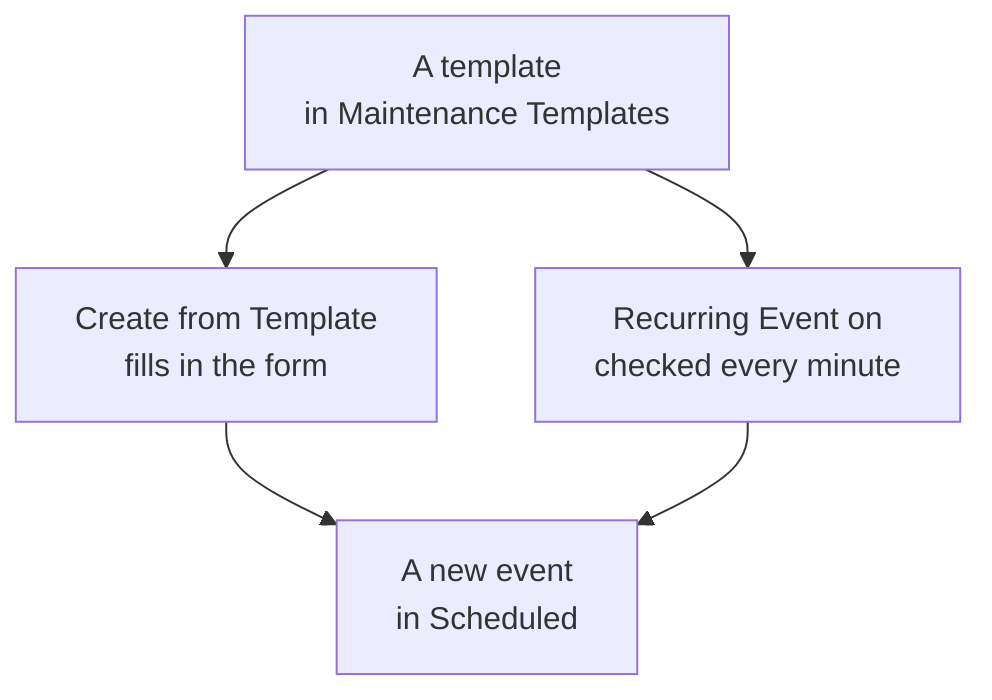

# Templates & Recurring Events

A scheduled maintenance template saves an event you plan often: its title and description, the monitors it pauses, the status pages it shows on and who is told. Use one to fill in the form with one click, or make it recurring, so OneUptime schedules the event for you every week, every month or at any interval you choose.

:::cards
- [Create a template](#create-a-template): The form's steps, with a name in front and a schedule at the end.
- [Use a template](#use-a-template): Fill in a new event from it.
- [Recurring events](#recurring-events): Let OneUptime schedule the event on its own.
- [Change or stop a template](#change-or-stop-a-template): Edit it, pause its schedule, or delete it.
:::

## How it works

A template is a starting point. An event created from it is a copy with its own values: changing the template later changes only the events created after that.

## Before you begin

- **Your plan.** On OneUptime Cloud, templates take the **Growth** plan or above.
- **Your role.** Creating a template takes **Project Owner**, **Project Admin**, **Project Member**, **Scheduled Maintenance Admin** or **Scheduled Maintenance Member**, or a custom role that may create scheduled maintenance templates.

## Create a template

:::steps
### Open the templates

Go to **Scheduled Maintenance → Settings → Maintenance Templates**. **Settings** starts folded in the side menu: expand it first. Click **Create Scheduled Maintenance Template**.

### Name the template

On **Template Info**, give it a **Template Name** and a **Template Description**, so your team knows when to use it. Both are required.

### Describe the event

On **Maintenance Details**, fill in the **Title** and the **Description** every event from it starts with. **Owners** and **Labels** wait under **More fields**.

### Pick what it affects

On **Resources Affected**, pick the **Monitors**, the **Change Monitor Status to** for them, any **Other Affected Resources**, the status pages under **Show event on these status pages**, and the **Subscriber Notifications**.

### Decide whether it recurs

On **Recurring**, leave **Recurring Event** off for a template you use by hand, or turn it on, pick how often it recurs and its **Timezone**, and set the first event's times on **First Event**. Click **Next** to check the review, then create the template.
:::

A template asks for **Change Monitor Status to** even when it names no monitors: the status also applies to the monitors you add when you schedule an event from it. Under **Other Affected Resources**, a template takes hosts, Kubernetes clusters, Docker hosts, Podman hosts and services.

## What a template fills in

| Part of the event                                 | Create from Template                 | A recurring event               |
| ------------------------------------------------- | ------------------------------------ | ------------------------------- |
| **Title** and **Description**                     | Filled in, and you can change them   | Copied                          |
| **Monitors** and **Change Monitor Status to**     | Filled in                            | Copied                          |
| **Other Affected Resources**                      | Filled in                            | Copied                          |
| The status pages and **Subscriber Notifications** | Filled in                            | Copied                          |
| **Owners** and **Labels**                         | Filled in                            | Copied                          |
| **Starts At** and **Ends At**                     | The next full hour, for an hour      | Worked out from the schedule    |

## Use a template

:::steps
### Pick the template

On **Scheduled Maintenance → All Maintenance Events**, click **Create from Template**, and choose a template under **Select Scheduled Maintenance Template**.

### Check the form

Click **Create from Template**. The create form opens with the template's answers filled in. Set the window, and change anything this event needs.

### Create the event

Walk the steps with **Next**, then click **Create Maintenance Event** on the review.
:::

When the project has no template yet, **Create from Template** says so, and links to **Maintenance Templates**.

## Recurring events

A recurring template creates the event on a schedule. You set how often it recurs, the time zone it keeps, and when the first event is created, when it starts and when it ends; every later event is the first one moved on whole intervals of that time zone's calendar, at the same times of day.

| Field                                    | What it means                                                                                       |
| ---------------------------------------- | --------------------------------------------------------------------------------------------------- |
| **Recurring Event**                      | Turns the schedule on.                                                                              |
| **How often should this event recur?**   | A number and a unit: hours, days, weeks, months or years.                                           |
| **Timezone**                             | The time zone the events keep their time of day in. A new template starts on yours.                 |
| **First Event Scheduled At**             | When OneUptime creates the first event, which is when its subscribers are told it is scheduled.     |
| **First Event Starts At**                | When the first event starts.                                                                        |
| **First Event Ends At**                  | When the first event ends.                                                                          |

The first three are on the **Recurring** step. The first event's times are on the **First Event** step, which appears once **Recurring Event** is on.

For example, a weekly window with the first event created on a Monday for the Saturday after it:

| Event        | Created            | Starts             | Ends               |
| ------------ | ------------------ | ------------------ | ------------------ |
| The first    | `2030-06-03 09:00` | `2030-06-08 02:00` | `2030-06-08 04:00` |
| The second   | `2030-06-10 09:00` | `2030-06-15 02:00` | `2030-06-15 04:00` |

Every event keeps the first event's times of day in the template's time zone, also when the clocks change for daylight saving time: a window from 02:00 to 04:00 in Berlin is from 02:00 to 04:00 there in summer and in winter. A few days work out as follows:

- **A day the month does not have.** A monthly event on the 29th, 30th or 31st is on the last day of a shorter month, such as 30 April or 28 February, and back on its own day in the months that have it. A yearly event on 29 February is on 28 February in other years.
- **The night the clocks go forward.** A time that does not exist that night, such as 02:30 when 02:00 jumps to 03:00, moves on by the jump, to 03:30. An event whose start that moves past its end keeps the first event's length.
- **The night the clocks go back.** A time that happens twice that night, such as 01:30 in New York, is the first of the two.
- **Every few hours.** Hours are counted as they pass, so a template that recurs every few hours moves an hour on the clock when it changes.
- **A time zone without daylight saving time.** A time zone that no longer changes its clocks, such as British Columbia's (America/Vancouver) since November 2026, keeps the same offset, so nothing moves.

A template created before templates had a time zone shows **UTC**, the time zone its events were worked out in until then. Pick the time zone its times were meant in, and from its next event on, every event keeps the first event's time of day there.

Set **First Event Scheduled At** as far ahead of the start as you want your customers to hear about the work. All three times must be in the future when you create the template, the event has to be created before it starts and ends, and it has to start before it ends; the form says which rule a time breaks.

A job checks the recurring templates every minute. When a template's next time comes, it creates the event and moves that time on to the next event of the schedule. The templates list shows that time in its **Recurring Event** column, and **No** for a template that does not recur. An event created from the schedule is like any other: its rules run, its owners are added, and its subscribers are told it is scheduled.

## Change or stop a template

Open a template from the list to see its page:

- **Scheduled Maintenance Template Details** shows what new events start with. Its **Edit** walks **Template Info**, **Maintenance Details**, **Status Pages** and **Recurring**, then **First Event** for a template that recurs.
- **Affected Resources** holds its **Monitors**, their **Change Monitor Status to** and its **Other Affected Resources**, with an **Edit** of its own.
- **Owners** lists the people and teams who own every event scheduled from it.

Changes apply to the events created after you save them; events already created keep their own values. To stop a schedule, turn **Recurring Event** off in **Edit**, or delete the template. A template turned off keeps its schedule: turn it back on, and it picks up at the schedule's next time, skipping the times it was off. Deleting a template leaves the events it created.

## Troubleshooting

:::details Creating a recurring template says a time should be in the future
All three first times have to be ahead of now when you create it. Move them forward: the schedule then continues from the first event.
:::

:::details A recurring template created no event
Check that **Recurring Event** is still on, and look at the time in the list's **Recurring Event** column: the event is created then, not at its start. The job runs every minute, so allow a minute.
:::

:::details Events from a recurring template are an hour early or late after the clocks changed
Open the template and check its **Timezone**: its events keep the first event's time of day in that time zone. A template created before templates had a time zone shows **UTC**: pick the time zone its times were meant in. Events already created keep their times.
:::

:::details An event from a template is missing a resource I picked
A template takes hosts, Kubernetes clusters, Docker hosts, Podman hosts and services under **Other Affected Resources**. Add other kinds of resources to the event itself, with **Edit** on its **Affected Resources** card.
:::

## Next steps

:::cards
- [Creating Maintenance Events](/docs/scheduled-maintenance/creating-events): The form a template fills in.
- [Maintenance States](/docs/scheduled-maintenance/states): How each event moves on once it is created.
- [Maintenance Rules & Settings](/docs/scheduled-maintenance/settings): Add owners and labels to every new event automatically.
- [Scheduled Maintenance Overview](/docs/scheduled-maintenance/index): Where templates fit in the rest of maintenance.
:::
