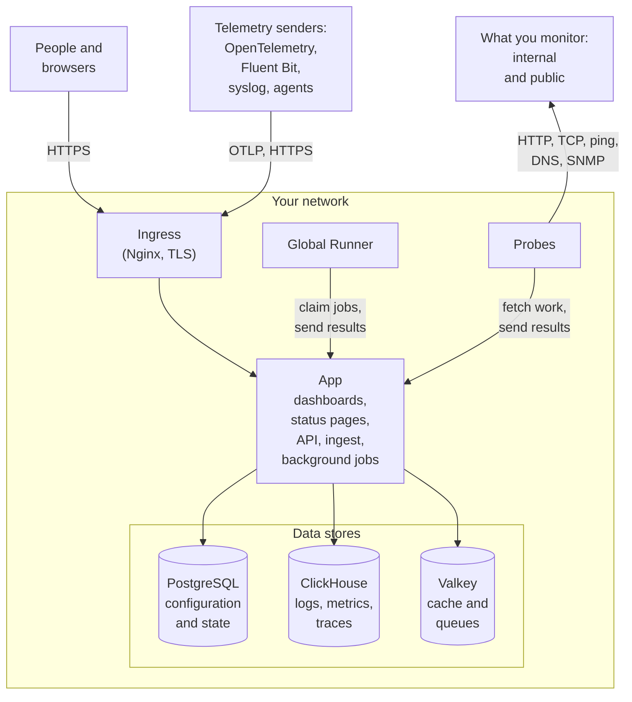

# Architecture

A self-hosted OneUptime install is a handful of containers: one ingress that every request enters through, one app image that does the work, probes that run your monitors' checks, and three data stores. This page shows how they fit together, what each one does, and which connections cross your network.

## What this shows

- People reach OneUptime through the **ingress**, which terminates TLS and routes each request to the app: the Dashboard, status pages, the API, and every ingest endpoint telemetry is sent to.
- The **app** reads and writes its state in PostgreSQL, keeps telemetry in ClickHouse, and uses Valkey (the BSD-licensed fork of Redis 7.2) for caching and for the queues its background jobs work through.
- **Probes** can run inside your cluster (recommended) and/or elsewhere on your network. They can monitor:
  - Internal/private services behind your firewall.
  - External/public resources on the internet.
- Probe results are sent to the app, queued in Valkey, and processed by the background jobs into your data stores. A probe elsewhere on your network reaches the app through the ingress, at your OneUptime URL.
- Telemetry (metrics, traces, logs and more) is ingested by the same app and stored in ClickHouse.

> [!NOTE]
> If you use external PostgreSQL, Valkey (or Redis), or ClickHouse instead of the built-in ones, the app connects to your external endpoints instead. The logical flow remains the same.

## The components

| Component | Docker Compose service | Helm chart | What it does |
| --- | --- | --- | --- |
| Ingress | `ingress` | `nginx` | Terminates TLS, serves your hostname and status page domains, and routes every request to the app. |
| App | `app` | `app` | The Dashboard, status pages, API and ingest endpoints, and, unless you split them off, the background jobs. |
| Worker | Part of `app` | `worker` (off by default) | The background jobs, in pods of their own, so heavy queue processing never competes with API requests. |
| Telemetry writer | Part of `app` | `telemetryWriter` (off by default) | A fixed-size tier that makes every ClickHouse insert, so inserts stay bounded however far the workers scale. |
| Probe | `probe-1` | `probes` | Runs monitor checks and sends the results back. Every bundled probe is a global probe all projects can use. |
| Global Runner | `global-runner` | `globalRunner` | A [global Runner](/docs/runbooks/agents#global-runners): it runs the JavaScript steps of every project that picks no Runner of its own, each in a sandbox that reaches the internet only, and OneUptime AI's code fixes in every code repository that picks none. It holds its own key and nothing else of the server's. Bash, SSH and kubectl steps run on [Runners](/docs/runbooks/agents) you install where they should run. |
| PostgreSQL | `postgres` | `postgresql`, or `postgresOperator.cnpg` | Projects, monitors, incidents, users and every other setting and state. |
| ClickHouse | `clickhouse` | `clickhouse`, or `clickhouseOperator.altinity` | Logs, metrics, traces, exceptions, profiles and monitor logs. |
| Valkey | `valkey` | `valkey` | The cache, the job queues and short-lived state such as pending push receipts. |

All of the app's roles are the same image: Docker Compose runs them in one `app` container, and the Helm chart can run the worker and the telemetry writer as deployments of their own. To size each tier, see [Sizing & Capacity Planning](/docs/installation/sizing).

## Connections out of your network

Four connections are made unless you change a setting:

- Once a day, the app asks GitHub's API (`api.github.com`) whether a newer release is out. It also reads the security advisories OneUptime published, so your master admins are told when one affects the version you run ([Update and Security Checks](/docs/self-hosted/update-checks)). To turn this off, set `updateCheck.disabled: true` in the Helm chart, or `DISABLE_UPDATE_CHECK=true` in `config.env` on Docker Compose.
- Once a day, the app tells `oneuptime.com` your install's address and the version it runs, so OneUptime knows which installs still run a release with a security issue. Nothing about your users, projects or monitoring data is sent. To turn this off, set `instanceCheckIn.disabled: true` in the Helm chart, or `DISABLE_INSTANCE_CHECK_IN=true` in `config.env` on Docker Compose.
- Signing up with “Notify me about security patches and new releases” ticked, as it is at first, sends the person's name and email, any company and phone number they gave, and your install's address and version to `oneuptime.com`. Untick it on a network without internet access.
- On Kubernetes, probes fall back to the public resolvers `8.8.8.8` and `1.1.1.1` after your cluster's own DNS. Set `dnsConfig.nameservers` to `[]` to keep every lookup on your own DNS.

Everything else reaches out only when you turn it on, and each has a page that names the exact addresses to allow:

| Outbound connection | Used for | Where to read more |
| --- | --- | --- |
| Email (SMTP, or SendGrid's API) | Notifications and invitations | [SMTP](/docs/emails/smtp) |
| Twilio | SMS and phone calls | [Twilio Integration](/docs/self-hosted/twilio-integration) |
| OneUptime's push relay, or Expo | Mobile push notifications | [Push Notifications](/docs/self-hosted/push-notifications) |
| Slack and Microsoft Teams | Workspace notifications and actions | [Slack Integration](/docs/self-hosted/slack-integration) |
| An LLM provider, such as OpenAI, Anthropic, Microsoft Foundry, or a model you run yourself | OneUptime AI | [LLM Providers](/docs/ai/llm-provider) |
| `oneuptime.com` | Activating an Enterprise license online | [Enterprise Edition](/docs/self-hosted/enterprise) |

Connections the other way - SendGrid delivering inbound email, Slack and Microsoft Teams calling back - need the ingress to be reachable from the internet. Which private addresses the app and the probes may reach is up to you: see [Private Network Access](/docs/self-hosted/private-network-access).

OneUptime's logo travels inside every email it sends, so it shows even on a network without internet access, and opening an email asks no other host for it. Images you upload yourself, such as your own logo or a status page's, are shown from your OneUptime URL, which the people who read those emails need to be able to reach.

## Next steps

:::cards
- [Docker Compose](/docs/installation/docker-compose): Install every component on one machine.
- [Sizing & Capacity Planning](/docs/installation/sizing): How much CPU, memory and disk each tier needs.
- [Custom Probes](/docs/probe/custom-probe): Run a probe inside another network.
- [Enterprise Edition](/docs/self-hosted/enterprise): What the Enterprise images add, and how licensing works.
:::
