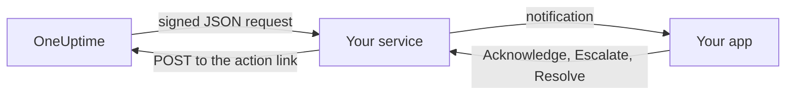

# Custom Notification Channels

A custom channel sends on-call pages to a service you run: your company's own app, a pager system, or a gateway that checks what leaves your network. You add it once, for the whole server, and everyone can be paged through it with nothing to set up. In the Admin Dashboard they are called **Custom Channels**.

:::cards
- [Add a channel](#add-a-channel): A name, a URL and a signing secret.
- [What your service receives](#what-your-service-receives): One signed JSON request per person per page.
- [Act on a page](#act-on-a-page): Acknowledge, escalate or resolve from your own app.
- [Delivery and retries](#delivery-and-retries): What happens when your service is down.
- [Other notifications](#other-notifications): Owner notifications, notes and shifts, for people who want them.
:::

## How It Works



When an on-call policy pages someone and their on-call rule uses the channel, OneUptime sends a request to the channel's URL. It says who the page is for (their name and email), what it is about, and carries links your service calls when the person acknowledges, escalates or resolves it in your app.

## Add a Channel

1. In the Admin Dashboard, open **Settings**, then **Custom Channels** under **Notifications**, and select **Add**.
2. Fill in:
   - **Name**: what people see in their notification methods and on-call rules, for example `CorpoApp`.
   - **Webhook URL**: where OneUptime sends each page. It can be on your private network.
   - **Signing Secret**: OneUptime makes one for you. Copy it into your service, which checks every request with it. You can see it again by editing the channel.
3. Save, then select **Send test** to send your service a [test request](#test-requests).

Under **More fields**, **Page everyone through this channel** is on. OneUptime then adds the channel to everyone's on-call rules in every project, and to the rules of everyone who joins a project later, and uses it to reach a responder who has no rule for what fired. Turn it off to let people add the channel to their rules themselves.

People see the channel under **User Settings**, then **Notification Methods**, then **Custom Channels**, with a **Send test** button, and pick it in their on-call rules as `Custom Channel: CorpoApp`. They set nothing up: your service is told who each page is for.

To stop sending without changing anyone's rules, edit the channel and turn off **On**. Pages that would have gone to it are recorded in the on-call log as not sent. Deleting a channel deletes every on-call rule that uses it.

## What Your Service Receives

Every page is a `POST` request with a JSON body:

| Header | What it holds |
| --- | --- |
| `Content-Type` | `application/json` |
| `X-OneUptime-Event` | The event, such as `on-call.incident.created` |
| `X-OneUptime-Signature` | `sha256=` and the hex HMAC-SHA256 of the raw body, made with the channel's signing secret |

```json title="An incident page"
{
  "version": 1,
  "event": "on-call.incident.created",
  "notificationId": "5f2c8a1e-6b1d-4c3a-9e7f-2a4b6c8d0e1f",
  "sentAt": "2026-10-27T03:14:15.000Z",
  "channel": { "id": "0b7e…", "name": "CorpoApp" },
  "title": "New Incident INC-42: API latency high",
  "message": "A new incident has been created: INC-42 (API latency high) in Agency A. Click to view details.",
  "project": { "id": "8d1f…", "name": "Agency A" },
  "team": { "id": "2c9a…", "name": "SRE" },
  "user": { "id": "4e6b…", "name": "Jane Tan", "email": "jane@example.com" },
  "recordType": "incident",
  "record": {
    "id": "9a3c…",
    "number": "INC-42",
    "title": "API latency high",
    "description": "p95 latency above 2 seconds for 5 minutes.",
    "severity": "Critical",
    "state": "Created",
    "url": "https://oneuptime.example.com/dashboard/8d1f…/incidents/9a3c…"
  },
  "onCallPolicy": { "id": "1d4e…", "name": "Primary" },
  "escalationRule": { "id": "7b2f…", "name": "Level 1" },
  "isPageAgain": false,
  "actions": {
    "acknowledge": "https://oneuptime.example.com/api/custom-notification-channel/page/5f2c…/acknowledge?token=…",
    "escalate": "https://oneuptime.example.com/api/custom-notification-channel/page/5f2c…/escalate?token=…",
    "resolve": "https://oneuptime.example.com/api/custom-notification-channel/page/5f2c…/resolve?token=…"
  }
}
```

| Field | What it is |
| --- | --- |
| `version` | `1`. Fields are only ever added to this version. |
| `event` | `on-call.incident.created`, `on-call.alert.created`, `on-call.incidentEpisode.created`, `on-call.alertEpisode.created`, `notification` for [other notifications](#other-notifications), or `test` |
| `notificationId` | One per person per page. Use it to drop a request you already handled. |
| `title`, `message` | Ready to show, as a push notification would show them |
| `user` | Who the page is for. Find their account in your app by `email` or `id`. |
| `team` | The team they were paged through, or `null` when they were paged directly |
| `recordType`, `record` | What the page is about: an `incident`, `alert`, `incidentEpisode` or `alertEpisode` |
| `onCallPolicy`, `escalationRule` | The policy and level that paged them |
| `isPageAgain` | `true` when the record was acknowledged a while ago and is still not resolved |
| `actions` | The links your service calls to [act on the page](#act-on-a-page) |

A page to several people is one request per person, each with that person's own links, so OneUptime knows who answered. The title, message and description together are held to 16,384 characters; a longer description is cut and ends with "… (truncated — see OneUptime for the full text)".

### Check the Signature

Compute the HMAC of the raw request body, before parsing it, and compare it with the header:

```javascript title="Node.js"
const crypto = require("crypto");

function isFromOneUptime(rawBody, signatureHeader, secret) {
  const expected =
    "sha256=" + crypto.createHmac("sha256", secret).update(rawBody).digest("hex");
  const received = String(signatureHeader || "");

  return (
    received.length === expected.length &&
    crypto.timingSafeEqual(Buffer.from(received), Buffer.from(expected))
  );
}
```

## Act on a Page

When the person presses a button in your app, your service sends a `POST` request to the matching link in `actions`. It needs no API key: each link carries a token for that one page, valid for 7 days, and the action is recorded as done by the person who was paged.

| Action | What it does |
| --- | --- |
| `acknowledge` | Acknowledges their page, and with it the incident, alert or episode |
| `escalate` | They cannot take it: pages the next level of the on-call policy now and stops paging them |
| `resolve` | Resolves the incident, alert or episode, if their own permissions allow it |

```bash title="Acknowledge a page"
curl -X POST "https://oneuptime.example.com/api/custom-notification-channel/page/5f2c…/acknowledge?token=…"
```

The answer says what happened, in words your app can show as they are:

```json title="The answer"
{
  "action": "acknowledge",
  "result": "acknowledged",
  "message": "Acknowledged."
}
```

`result` is one of `acknowledged`, `alreadyAcknowledged`, `escalated`, `notEscalated`, `resolved` and `alreadyResolved`. An expired or wrong link is refused with a 4xx status and a message.

## Other Notifications

Pages are not the only notifications people get: OneUptime also tells them when an incident they own changes state, when a note is posted, when their on-call shift starts, and more. Each person chooses where each of these goes in **User Settings > Notification Settings**, which has a **Custom Channels** column while a channel is on. It is off for everyone until they turn it on.

A notification goes to every channel that is on, as one request per channel, with `event` set to `notification`:

```json title="A notification"
{
  "version": 1,
  "event": "notification",
  "notificationId": null,
  "sentAt": "2026-10-27T03:20:00.000Z",
  "channel": { "id": "0b7e…", "name": "CorpoApp" },
  "title": "Incident INC-42 acknowledged",
  "message": "Incident INC-42 (API latency high) was acknowledged in Agency A.",
  "project": { "id": "8d1f…", "name": "Agency A" },
  "team": null,
  "user": { "id": "4e6b…", "name": "Jane Tan", "email": "jane@example.com" },
  "recordType": null,
  "record": null,
  "onCallPolicy": null,
  "escalationRule": null,
  "isPageAgain": false,
  "actions": null,
  "notificationType": "Send incident state changed notification when I am the owner of the incident",
  "url": "https://oneuptime.example.com/dashboard/8d1f…/incidents/9a3c…"
}
```

`title` and `message` are what the person's push notification would say. `notificationType` names the setting it was sent for, and `url` links to what it is about, or is `null`. There is nothing to act on, so `actions` is `null`.

## Delivery and Retries

A request counts as delivered when your service answers with a 2xx status within 10 seconds. A request it did not answer, or answered with 408, 429 or a 5xx status, is sent again after 1 second and after 4 seconds more: three attempts in all. Any other 4xx status is not sent again.

Each attempt's outcome is in the person's on-call log, with the channel's name and the status your service answered, never the URL. A page that is not delivered does not stop the on-call policy: if nobody acknowledges, it escalates as usual. Keep an email or SMS rule later in your rules if your service is the only way people are reached.

## Test Requests

**Send test**, on the Admin Dashboard's page or a person's Notification Methods, sends a request with `event` set to `test`, the person who pressed it as `user`, and `notificationId`, `record` and `actions` set to `null`. Use it to try your service before a real page arrives.
