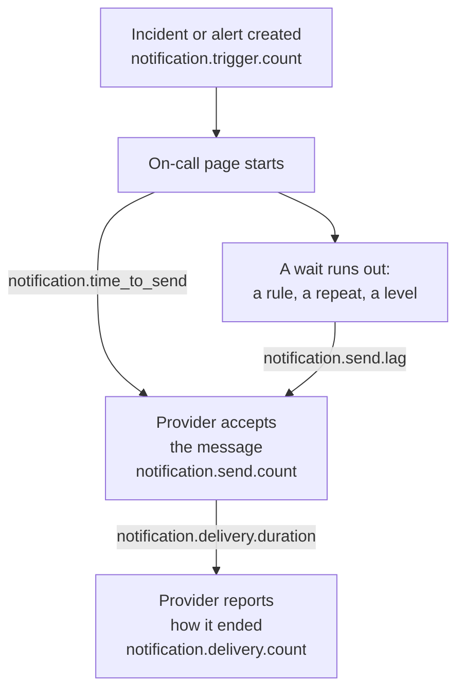

# Notification Delivery Metrics

OneUptime records how the notifications it sends go: how many incidents and alerts call for them, whether each message reached its provider, how long a page took to go out, and whether it reached the phone. Send OneUptime's own telemetry to a OneUptime project, or to any OpenTelemetry backend, to set delivery objectives for the people your installation serves and to check that you keep them.

:::cards
- [Turn them on](#turn-them-on): Two settings, and nothing is recorded without them.
- [The metrics](#the-metrics): Seven metrics, from the trigger to the phone.
- [How a page is timed](#how-a-page-is-timed): What time to send and send lag start from.
- [SLOs to start from](#slos-to-start-from): Four objectives, query by query.
:::

## How it works



Every message counts in `notification.send.count`, on every channel, not only on-call pages. The two times, `notification.time_to_send` and `notification.send.lag`, cover on-call pages only.

## Turn them on

Nothing is recorded until OneUptime has an OpenTelemetry exporter: without one, the metrics cost nothing and are kept nowhere. Point it at a OneUptime project, with a Server [ingestion key](/docs/telemetry/ingestion-keys) of that project, or at any backend that takes OTLP over HTTP.

:::tabs
@tab Kubernetes
```yaml
openTelemetryExporter:
  endpoint: https://oneuptime.example.com/otlp
  headers: x-oneuptime-token=YOUR_INGESTION_KEY
```
The `app` and `worker` deployments send them: keep `app.disableTelemetryCollection` and `worker.disableTelemetryCollection` at `false`, their default.
@tab Docker Compose
```bash
OPENTELEMETRY_EXPORTER_OTLP_ENDPOINT=https://oneuptime.example.com/otlp
OPENTELEMETRY_EXPORTER_OTLP_HEADERS=x-oneuptime-token=YOUR_INGESTION_KEY
DISABLE_TELEMETRY_FOR_APP=false
```
Set them in `config.env`, then run `npm start`. `DISABLE_TELEMETRY_FOR_APP` is `true` by default, and then nothing is sent.
:::

OneUptime needs both the endpoint and the headers: it sends nothing without a header. Write each header as `name=value`, and separate several with `;`. A value may hold `=`. OneUptime adds `/v1/metrics` to the endpoint itself, and the same settings send its own traces and logs too. Each metric appears once OneUptime first records it: `notification.send.count` with the first message sent.

### Send deltas to a OneUptime project

OneUptime sends counters and histograms the way OpenTelemetry does by default: each point holds the running total since that server process started. The metrics explorer adds up the points in each step of a chart, so it reads the counts and percentiles of a time range exactly only from deltas, points that hold what happened since the previous one. When the metrics go to a OneUptime project, send deltas:

:::tabs
@tab Kubernetes
```yaml
extraEnv:
  - name: OTEL_EXPORTER_OTLP_METRICS_TEMPORALITY_PREFERENCE
    value: delta
```
A service's own list replaces the chart-wide one: if you set `app.extraEnv` or `worker.extraEnv`, add it there too.
@tab Docker Compose
```yaml title="docker-compose.override.yml"
services:
  app:
    environment:
      OTEL_EXPORTER_OTLP_METRICS_TEMPORALITY_PREFERENCE: delta
```
Create it next to `docker-compose.yml`, or add this to the one you have, then run `npm start`.
:::

This applies to every metric OneUptime sends about itself. A backend that reads running totals itself, such as Prometheus, needs no change.

## The metrics

| Metric | Type | Unit | What it answers |
| --- | --- | --- | --- |
| `notification.trigger.count` | Counter | `1` | How many records called for notifications |
| `notification.send.count` | Counter | `1` | How each message handed to a provider went |
| `notification.send.duration` | Histogram | `ms` | How long the provider took to take it |
| `notification.time_to_send` | Histogram | `ms` | How long after its trigger a page reached its provider |
| `notification.send.lag` | Histogram | `ms` | How long after it was due a notification sent later reached its provider |
| `notification.delivery.count` | Counter | `1` | How the messages the providers accepted ended |
| `notification.delivery.duration` | Histogram | `ms` | How long after its provider accepted it a message ended |

Every attribute holds one of a few fixed values, never a project, a person, a phone number or a record. The one exception is a custom channel's ID and name: an installation has a handful, and telling them apart is the point.

### Records that notify people

`notification.trigger.count` counts each incident, alert, incident episode and alert episode as it is created.

| Attribute | Values |
| --- | --- |
| `notification.trigger.type` | `incident`, `alert`, `incident_episode`, `alert_episode` |
| `notification.trigger.source` | `automatic` when OneUptime created it, from a monitor or a rule; `manual` when a person or the API did |
| `monitor.type` | The type of the monitor that created an incident or an alert, such as `Incoming Request`, `Logs` or `Metrics`; left out when no monitor did |

### Messages handed to a provider

`notification.send.count` counts every message handed to a provider, and `notification.send.duration` times the provider's call. Both carry these attributes:

| Attribute | Values |
| --- | --- |
| `notification.channel` | `email`, `sms`, `call`, `whatsapp`, `telegram`, `push`, `webhook`, `slack`, `microsoft_teams`, `mattermost`, `custom_channel` |
| `notification.provider` | `twilio`, `sms_and_call_gateway`, `smtp`, `sendgrid`, `amazon_ses`, `mailgun`, `postmark`, `resend`, `microsoft_graph`, `expo`, `push_relay`, `web_push`, `meta_whatsapp`, `telegram_bot_api`, `slack`, `microsoft_teams`, `mattermost`, `webhook`, `custom_channel`, or `none` when nothing was handed to one |
| `notification.provider.config` | `global` for the installation's own account and settings; `project` for a project's own Twilio account, SMTP server, webhook or workspace connection, whose failures are the project's to fix |
| `notification.on_call_page` | `true` for a notification of an on-call page, otherwise `false` |
| `outcome` | `success`, `failure` or `not_sent`, as below |
| `notification.destination` | Slack, Microsoft Teams and Mattermost: `direct_message` to one person, `channel` for a post into a channel or a Teams group chat, `incoming_webhook` for an incoming webhook, such as a status page subscriber's. Webhooks: `status_page_subscriber` for a status page subscriber's own webhook. Left out on a person's webhook and on every other channel |
| `notification.custom_channel.id`, `notification.custom_channel.name` | Custom channels only: the channel's ID, and its name cut to 100 characters |

- `success`: the provider accepted the message.
- `failure`: the provider refused it or could not be reached, or sending it failed. A chat channel that could not be found is a failure with no duration.
- `not_sent`: deliberately not sent. The project turned the channel off, has too little balance or is blocked, push is turned off on this server, or a custom channel is turned off, deleted or not covered by the license. A success rate leaves these out: they are settings at work, not the platform failing.

A message to a status page subscriber's own webhook counts once, however many times it was tried: `success` when the endpoint answered with a 2xx status, and `failure` when it answered with another status, could not be reached, or its address is not allowed.

### What reached the phone

`notification.delivery.count` counts how each message a provider accepted ended, as the provider reports it later, once per message. `notification.delivery.duration` times how long after the provider accepted it. Both carry `notification.channel`, `notification.provider`, `notification.provider.config`, `notification.on_call_page` and `outcome`, the final status:

| Channel | Provider | `outcome` | Duration |
| --- | --- | --- | --- |
| `sms` | `twilio` | `delivered`, `undelivered`, `failed` | Until Twilio reports the status |
| `call` | `twilio` | `answered`, `not_answered`, `failed` | Until the call was picked up, or else ended |
| `push` | `expo`, `push_relay` | `delivered`, `undelivered`, `failed` | Not timed: a receipt says whether Apple or Google took the push, not when |
| `whatsapp` | `meta_whatsapp` | `delivered`, `failed` | Until Meta reports the status |

A call that rang out, was busy or was declined is `not_answered`. A push to an app that is gone is `undelivered`, and a WhatsApp message read counts as delivered. `notification.provider.config` is `project` only for SMS and calls on a project's own Twilio account.

Statuses arrive only where the provider can report them:

- SMS and calls: through Twilio, when Twilio can reach your server at its `HOST` (see [Twilio Integration](/docs/self-hosted/twilio-integration#3-configure-network-access)). The SMS and call gateway reports none.
- WhatsApp: when Meta's webhook is set up for your installation.
- Push: from Expo's receipts, which OneUptime reads about 15 minutes after the push, through the push relay too. The installation that sent the push counts it.
- Email, Telegram, webhooks, chat and custom channels report no final status.

## How a page is timed

### Time to send

`notification.time_to_send` runs from a page's trigger to its provider accepting the notification. It times only the notifications due as the page starts: the people of the first escalation rule, by the steps of their How to Reach Me that wait for nothing, and any level the page moves on to at once because it reached nobody. Waits the on-call configuration asks for are not the platform's delay, so they are left out: they are in [send lag](#send-lag). Only notifications their provider accepted are timed; a failure shows in `notification.send.count`.

| Attribute | Values |
| --- | --- |
| `notification.channel` | As on `notification.send.count` |
| `notification.page.start` | What the time runs from, as below |
| `notification.trigger.type` | The record the page is for: `incident`, `alert`, `incident_episode`, `alert_episode` |
| `notification.custom_channel.id`, `notification.custom_channel.name` | Custom channels only |

| `notification.page.start` | The time runs from |
| --- | --- |
| `monitor_data_received` | When OneUptime received the data that tripped the monitor: an incoming request, a server agent's report, an incoming email, a probe's check, an SNMP trap or a network device poll. It includes the time the data waited in the queue to be evaluated. |
| `record_created` | When the incident, alert or episode was created: by a telemetry monitor, a rule or a person, and for a check of absence, such as a heartbeat that stopped. |
| `page_started` | When a page started later: a person, a workflow or a rule that now matches started it, or it is a direct page. For a page held by its on-call rule or by OneUptime AI, when its hold ran out, or when it started if that was sooner. For a page again, when its acknowledgement timeout ran out. So a worker that got to either late shows in the time. |

For an incoming request, the time runs from the latest request the endpoint received, so it can read a little short.

### Send lag

`notification.send.lag` runs from the moment a notification sent later was due to its provider accepting it. Two workers send these, once a minute each, so a worker on time shows up to about a minute, and one that fell behind shows by how much.

| `notification.schedule` | Due when |
| --- | --- |
| `rule_wait` | A person's on-call rule that waits, such as "call me after 10 minutes": that long after the person was paged. Never before the worker last went through their rules, so a rule added or changed later is due from then. |
| `repeat` | A push repeated until somebody acknowledges: each time its interval runs out. |
| `escalation` | A later escalation level: when the level before it finished its wait, or at once when a person passes the page on. |
| `policy_repeat` | The policy starting again from its first level: when its last level's wait ran out. |

It also carries `notification.channel`, `notification.trigger.type` and, for custom channels, `notification.custom_channel.id` and `notification.custom_channel.name`. A notification due as its page starts is never in it, even when a worker started the page late, after a hold or as a page again: it is in time to send.

### Histogram buckets

Each histogram has bucket edges of its own, in milliseconds, set so that an objective can be read at an edge:

| Histogram | Bucket edges, in milliseconds |
| --- | --- |
| `notification.send.duration` | `5, 10, 25, 50, 100, 250, 500, 1000, 2500, 5000, 10000, 30000, 60000, 120000` |
| `notification.time_to_send` | `250, 500, 1000, 2000, 5000, 10000, 15000, 30000, 60000, 120000, 300000, 600000, 1800000, 3600000` |
| `notification.send.lag` | `1000, 5000, 10000, 15000, 30000, 45000, 60000, 75000, 90000, 120000, 180000, 300000, 600000, 1800000, 3600000` |
| `notification.delivery.duration` | `500, 1000, 2000, 5000, 10000, 15000, 30000, 60000, 120000, 300000, 600000, 1800000, 3600000, 14400000, 86400000` |

A percentile is worked out from the buckets, and drawn as the middle of the bucket it falls in. So compare it with a bucket's edge: a P95 of `notification.time_to_send` at or below 30000 means that 95% of pages took 30 seconds or less.

## SLOs to start from

Four objectives most installations can promise, each built from one or two queries in the metrics explorer of the project that receives the metrics. They read a time range exactly once the metrics arrive as deltas: see [Send deltas to a OneUptime project](#send-deltas-to-a-oneuptime-project).

### Build one in the metrics explorer

:::steps
1. Open the project's [Metrics Explorer](/docs/telemetry/metrics-explorer), and click the objective's first metric. Its query is `a`.
2. Pick its aggregation under **Aggregate by**. Then open **Filters & grouping**, and add each of its conditions under **Filter by attributes**.
3. For a second query, click **Add Metric**, and set up `b` the same way.
4. For a formula, click **Add Formula**, and write it in **Formula**.
5. To be told when the objective is missed, click **Actions → Create monitor from this view**, and alert when the value passes the objective: see [Metrics Monitor](/docs/monitor/metrics-monitor).
:::

To follow an objective over 30 days with an error budget, attach that monitor to an [SLO](/docs/slo/introduction): it counts the time the objective was missed.

### On-call SMS reach Twilio

At most 1% of the on-call SMS sent through the installation's own Twilio account fail, so 99% are accepted.

| Query | Metric | Aggregation | Conditions |
| --- | --- | --- | --- |
| `a` | `notification.send.count` | **Sum** | `notification.channel = sms`, `notification.on_call_page = true`, `notification.provider.config = global`, `outcome != not_sent` |
| `b` | `notification.send.count` | **Sum** | The same, with `outcome = failure` |

The formula `$b / $a * 100` is the share that failed, and the objective holds while it stays at or below 1. A step with no failure draws no point, as `b` has none. `outcome != not_sent` leaves out what the projects' own settings held back, and `global` the projects' own Twilio accounts. On an installation that sends SMS through its SMS and call gateway, the same queries measure the gateway. For another channel, change `sms`: `call`, `push` or `email`.

### Pages go out within 30 seconds

95% of on-call pages reach their provider within 30 seconds of their trigger.

| Query | Metric | Aggregation | Conditions |
| --- | --- | --- | --- |
| `a` | `notification.time_to_send` | **P95** | `notification.page.start != page_started` |

The objective holds while `a` stays at or below 30000. Pages started later are timed from when they started or were due, not from a trigger, so they are left out. Group by `notification.page.start` to see the monitors' queue (`monitor_data_received`) apart from the rest, or by `notification.channel` to find a slow channel.

### Notifications sent later go out within 90 seconds

99% of the notifications sent after a wait reach their provider within 90 seconds of being due.

| Query | Metric | Aggregation | Conditions |
| --- | --- | --- | --- |
| `a` | `notification.send.lag` | **P99** | — |

The objective holds while `a` stays at or below 90000. Group by `notification.schedule` to see which worker fell behind: `rule_wait` and `repeat` are one worker's, `escalation` and `policy_repeat` the other's.

### On-call SMS reach the phone

At most 5% of the on-call SMS that Twilio accepted for the installation's own account go undelivered.

| Query | Metric | Aggregation | Conditions |
| --- | --- | --- | --- |
| `a` | `notification.delivery.count` | **Sum** | `notification.channel = sms`, `notification.on_call_page = true`, `notification.provider.config = global` |
| `b` | `notification.delivery.count` | **Sum** | The same, with `outcome != delivered` |

The formula `$b / $a * 100` is the share not delivered. Carriers and phones that are switched off decide part of it, so set the objective from what you see over a few weeks. For calls, use `call` and `outcome != answered`. Twilio must be able to reach your server: see [What reached the phone](#what-reached-the-phone).

## Troubleshooting

:::details No notification metrics arrive
Check that `OPENTELEMETRY_EXPORTER_OTLP_ENDPOINT` and `OPENTELEMETRY_EXPORTER_OTLP_HEADERS` are both set, and in Docker Compose that `DISABLE_TELEMETRY_FOR_APP` is `false`, then restart OneUptime. As it starts, OneUptime logs a warning when it cannot read a header, or when it sends nothing. A metric appears only once something is recorded, so send a notification first.
:::

:::details A count only ever grows, or a percentile barely moves
The metrics arrive as running totals. Send deltas: see [Send deltas to a OneUptime project](#send-deltas-to-a-oneuptime-project).
:::

:::details No final statuses arrive
Final statuses come from the providers, later, and only where they can report them: see [What reached the phone](#what-reached-the-phone). On an installation Twilio cannot reach, SMS and calls are counted as sent, but never as delivered.
:::

## Next steps

:::cards
- [Metrics Explorer](/docs/telemetry/metrics-explorer): Chart, combine and compare any metric.
- [Metrics Monitor](/docs/monitor/metrics-monitor): Alert when an objective is missed.
- [Twilio Integration](/docs/self-hosted/twilio-integration): Let Twilio report what reached the phone.
- [Escalation Rules](/docs/on-call/escalation-rules): The waits that send lag starts from.
:::
